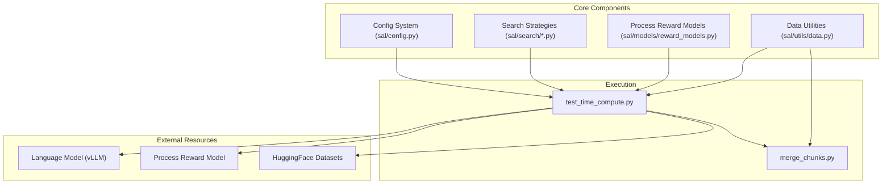
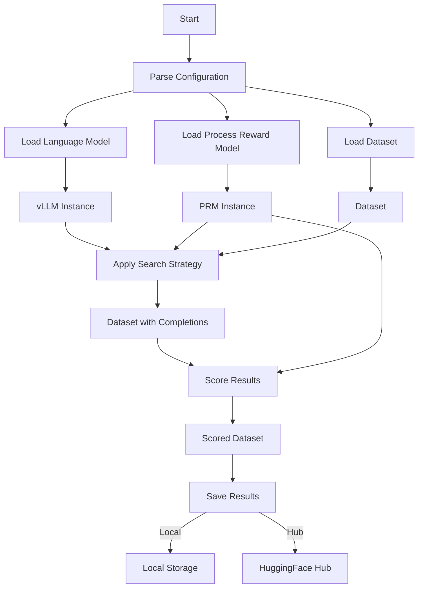
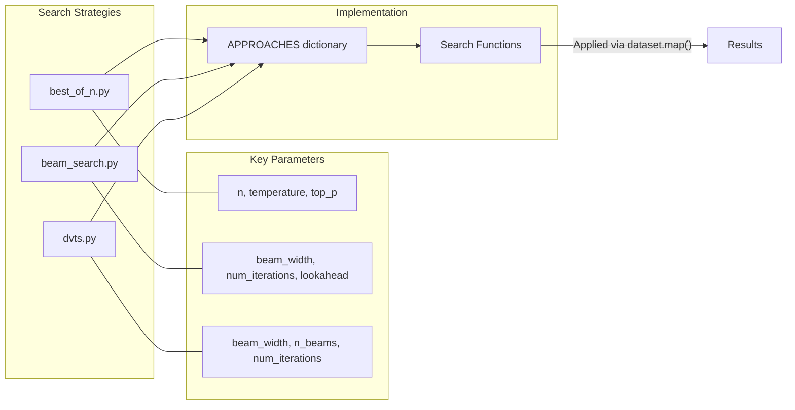
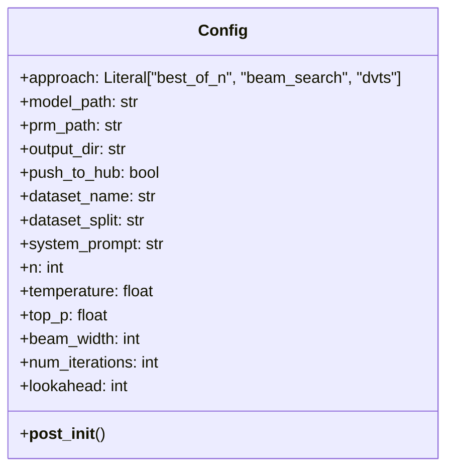
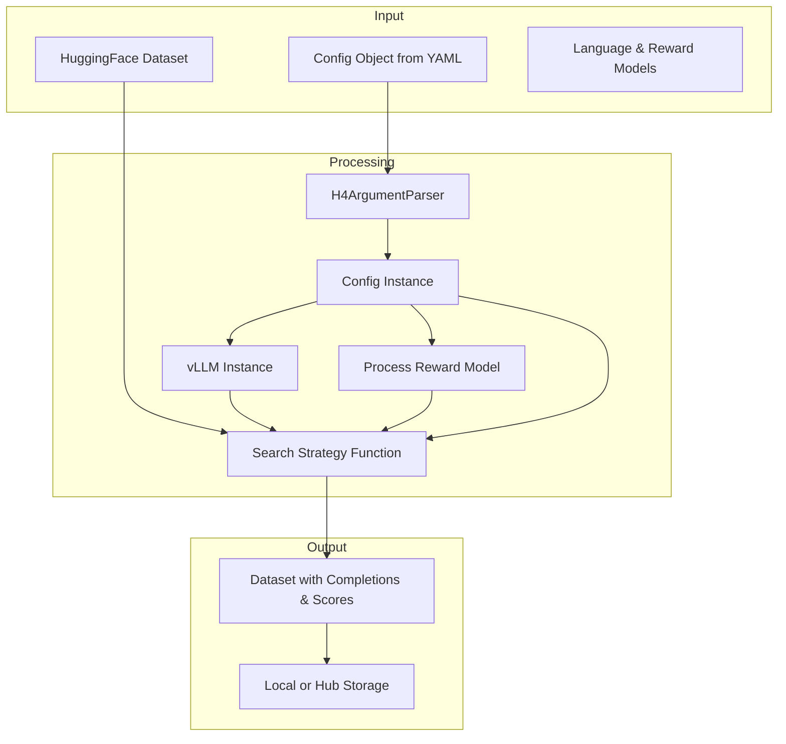
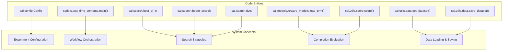
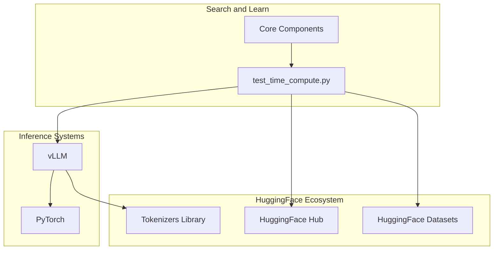

<!-- source: DeepWiki mcp.deepwiki.com · repo huggingface/search-and-learn · page 2 System Architecture · fetched 2026-10-26 -->

# System Architecture

Relevant source files

The following files were used as context for generating this wiki page:

- [README.md](README.md)
- [scripts/test_time_compute.py](scripts/test_time_compute.py)
- [src/sal/config.py](src/sal/config.py)

This document provides an overview of the Search and Learn system architecture, detailing how its components work together to enable test-time compute scaling for language models. The architecture is designed to allow language models to "think longer" on harder problems through dynamic inference strategies.

For information about specific configuration options, see [Configuration System](#2.1). For details on search algorithms, see [Search Strategies](#2.2).

## Overall System Structure

The following diagram illustrates the main components of the Search and Learn system and their relationships:

Sources: [scripts/test_time_compute.py:41-70](), [src/sal/config.py:24-106]()

## Execution Flow

The main execution flow of the system is managed by the `test_time_compute.py` script, which processes inputs through the following steps:

Sources: [scripts/test_time_compute.py:41-70]()

## Search Strategy Architecture

The system implements three search strategies, each with different approaches to exploring the solution space:

Sources: [scripts/test_time_compute.py:34-38](), [src/sal/config.py:52-76]()

## Configuration System

The configuration system is built around the `Config` dataclass, which defines all parameters for a test-time compute experiment:

Sources: [src/sal/config.py:24-106]()

## Data and Model Flow

This diagram illustrates how data and models flow through the system during execution:

Sources: [scripts/test_time_compute.py:41-70]()

## Component Roles and Interactions

The following table summarizes the main components and their roles:

| Component | File Path | Role |
|-----------|-----------|------|
| Config | src/sal/config.py | Defines parameters for test-time compute experiments |
| Search Strategies | src/sal/search/*.py | Implements different search algorithms |
| Process Reward Models | src/sal/models/reward_models.py | Loads and manages reward models used to score completions |
| Data Utilities | src/sal/utils/data.py | Handles dataset loading, processing, and saving |
| test_time_compute.py | scripts/test_time_compute.py | Main execution script that orchestrates the process |
| merge_chunks.py | scripts/merge_chunks.py | Merges results from parallelized runs |

Sources: [README.md:26-36](), [scripts/test_time_compute.py:34-38]()

## Search Strategy Implementation Details

The system supports three main search strategies with different strengths and use cases:

```mermaid
graph TD
    subgraph "Best-of-N Implementation"
        BoN_Start["Generate n completions"]
        BoN_Score["Score with PRM"]
        BoN_Select["Select highest score"]
        
        BoN_Start --> BoN_Score
        BoN_Score --> BoN_Select
    end
    
    subgraph "Beam Search Implementation"
        BS_Init["Initialize beam with prefix"]
        BS_Loop["beam_search_loop()"]
        BS_Expand["Expand candidates"]
        BS_Score["Score candidates"]
        BS_Prune["Keep top beam_width"]
        BS_Check["Check completion"]
        BS_Result["Return best beam"]
        
        BS_Init --> BS_Loop
        BS_Loop --> BS_Expand
        BS_Expand --> BS_Score
        BS_Score --> BS_Prune
        BS_Prune --> BS_Check
        BS_Check -->|"Not complete"| BS_Loop
        BS_Check -->|"Complete"| BS_Result
    end
    
    subgraph "DVTS Implementation"
        DVTS_Init["Initialize n_beams beams"]
        DVTS_Loop["dvts_loop()"]
        DVTS_Expand["Expand candidates"]
        DVTS_Score["Score candidates"]
        DVTS_Diversity["Apply diversity across beams"]
        DVTS_Prune["Prune each beam"]
        DVTS_Check["Check completion"]
        DVTS_Result["Return best overall"]
        
        DVTS_Init --> DVTS_Loop
        DVTS_Loop --> DVTS_Expand
        DVTS_Expand --> DVTS_Score
        DVTS_Score --> DVTS_Diversity
        DVTS_Diversity --> DVTS_Prune
        DVTS_Prune --> DVTS_Check
        DVTS_Check -->|"Not complete"| DVTS_Loop
        DVTS_Check -->|"Complete"| DVTS_Result
    end
```

Sources: [scripts/test_time_compute.py:34-38](), [src/sal/config.py:52-76]()

Each strategy has specific configuration parameters:

| Strategy | Description | Key Parameters |
|----------|-------------|----------------|
| Best-of-N | Generate multiple samples, select best | n, temperature, top_p |
| Beam Search | Maintain beam of candidates, expand and prune | beam_width, num_iterations, lookahead |
| DVTS | Multiple diverse beams with optimization | beam_width, n_beams, num_iterations, lookahead |

Sources: [src/sal/config.py:52-76]()

## Code to Concept Mapping

This diagram maps key code entities to system concepts:

Sources: [scripts/test_time_compute.py:41-70](), [src/sal/config.py:24-106]()

## Integration with External Systems

The Search and Learn system integrates with several external systems:

Sources: [scripts/test_time_compute.py:48-54](), [README.md:45-63]()

## Summary

The Search and Learn system architecture is composed of modular components that work together to enable test-time compute scaling for language models. The system's main strengths are:

1. **Flexibility**: Multiple search strategies can be selected and configured via recipes
2. **Modularity**: Clear separation between configuration, search, evaluation, and data management
3. **Integration**: Seamless integration with the HuggingFace ecosystem and vLLM
4. **Scalability**: Support for parallelization via chunking and merging

The architecture allows for easy experimentation with different search strategies and model combinations, making it a powerful tool for research in test-time compute scaling.

Sources: [README.md:16-25](), [src/sal/config.py:24-106](), [scripts/test_time_compute.py:41-70]()

---

