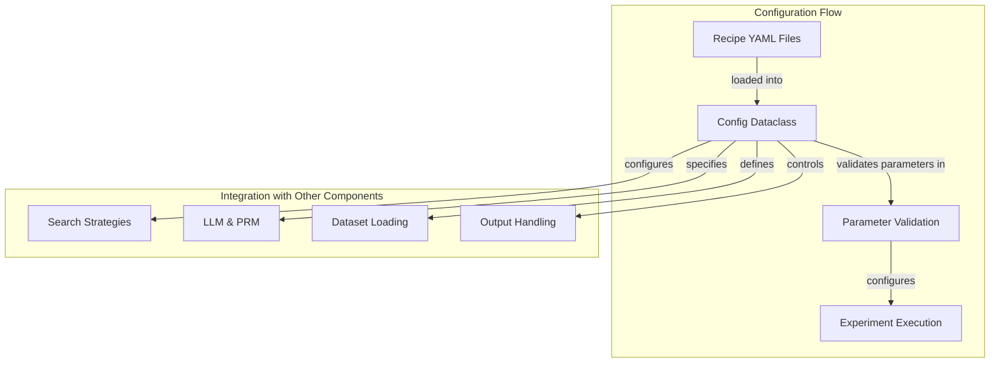
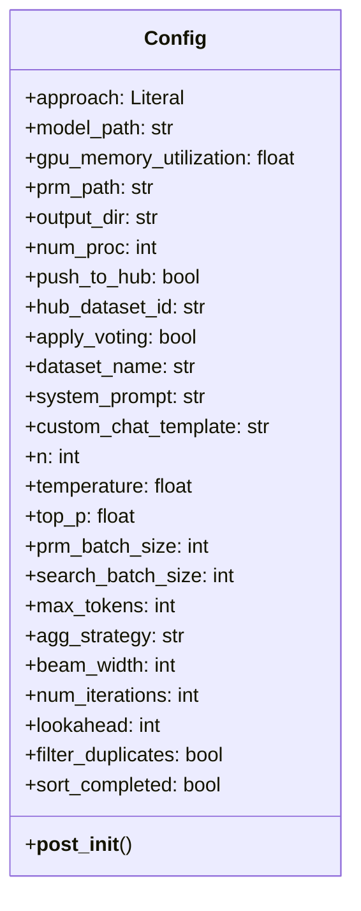
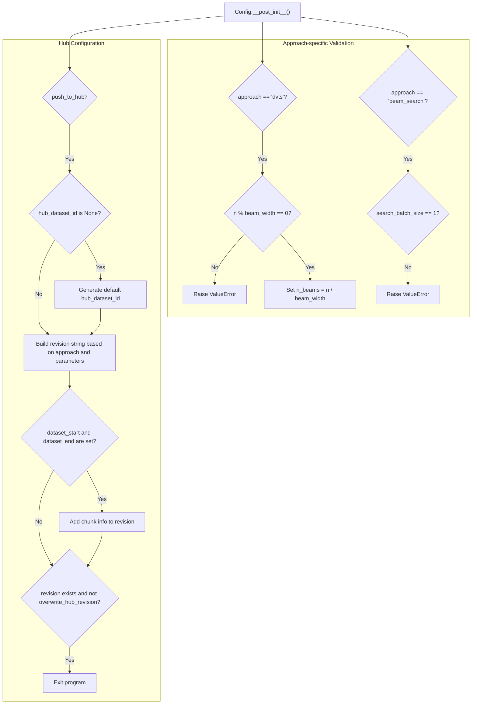

<!-- source: DeepWiki mcp.deepwiki.com · repo huggingface/search-and-learn · page 2.1 Configuration System · fetched 2026-10-26 -->

# Configuration System

Relevant source files

The following files were used as context for generating this wiki page:

- [src/sal/config.py](src/sal/config.py)

This document describes the configuration system used in the Search and Learn framework. The configuration system provides a centralized way to define and manage parameters for test-time compute scaling experiments. For information about specific search strategies that use these configurations, see [Search Strategies](#2.2).

## Overview

The Search and Learn configuration system uses a dataclass-based approach combined with YAML recipe files to provide a flexible, type-safe way to configure experiments. This design allows for easy parameter management and validation while ensuring reproducibility of experiments.

*Diagram: Configuration System Flow and Integration*

Sources: [src/sal/config.py:24-106]()

## Config Dataclass Structure

The core of the configuration system is the `Config` dataclass defined in `src/sal/config.py`. This class encapsulates all parameters needed for running experiments with the Search and Learn framework.

*Diagram: Config Dataclass Structure*

Sources: [src/sal/config.py:24-60]()

## Configuration Parameters

The `Config` dataclass groups parameters by their purpose:

### Core Parameters

| Parameter | Type | Default | Description |
|-----------|------|---------|-------------|
| `approach` | Literal | "best_of_n" | Search strategy to use (options: "best_of_n", "beam_search", "dvts") |
| `model_path` | str | "meta-llama/Llama-3.2-1B-Instruct" | Path or HF model ID of the language model |
| `gpu_memory_utilization` | float | 0.5 | Fraction of GPU memory allocated to vLLM (rest used for PRM) |
| `prm_path` | str | "RLHFlow/Llama3.1-8B-PRM-Deepseek-Data" | Path or HF model ID of the Process Reward Model |

Sources: [src/sal/config.py:26-31]()

### Output Configuration

| Parameter | Type | Default | Description |
|-----------|------|---------|-------------|
| `output_dir` | str | None | Directory to save output files |
| `num_proc` | int | None | Number of processes for parallel execution |
| `push_to_hub` | bool | False | Whether to push results to HuggingFace Hub |
| `hub_dataset_id` | str | None | ID for the Hub dataset (auto-generated if None) |
| `hub_dataset_private` | bool | False | Whether the Hub dataset should be private |
| `overwrite_hub_revision` | bool | False | Whether to overwrite existing Hub revisions |
| `apply_voting` | bool | True | Whether to apply voting for final result selection |

Sources: [src/sal/config.py:33-39]()

### Dataset Configuration

| Parameter | Type | Default | Description |
|-----------|------|---------|-------------|
| `dataset_name` | str | "HuggingFaceH4/MATH-500" | Name of the dataset to use |
| `dataset_config` | str | None | Dataset configuration name |
| `dataset_split` | str | "test" | Dataset split to use |
| `dataset_start` | int | None | Start index for dataset slicing |
| `dataset_end` | int | None | End index for dataset slicing |
| `num_samples` | int | None | Number of samples to process |

Sources: [src/sal/config.py:42-47]()

### Chat Template Configuration

| Parameter | Type | Default | Description |
|-----------|------|---------|-------------|
| `system_prompt` | str | *Math problem solving prompt* | System prompt for chat-based models |
| `custom_chat_template` | str | *Custom template* | Custom chat template for formatting messages |

Sources: [src/sal/config.py:50-51]()

### Search Parameters

| Parameter | Type | Default | Description |
|-----------|------|---------|-------------|
| `n` | int | 4 | Number of samples to generate |
| `temperature` | float | 0.8 | Sampling temperature |
| `top_p` | float | 1.0 | Top-p sampling parameter |
| `prm_batch_size` | int | 4 | Batch size for PRM scoring |
| `search_batch_size` | int | 25 | Batch size for search operations |
| `seed` | int | 42 | Random seed for reproducibility |
| `max_tokens` | int | 2048 | Maximum number of tokens to generate |
| `agg_strategy` | str | "last" | Strategy for aggregating scores (options: "last", "min", "prod") |

Sources: [src/sal/config.py:53-60]()

### Strategy-Specific Parameters

| Parameter | Type | Default | Description |
|-----------|------|---------|-------------|
| `beam_width` | int | 4 | Beam width for beam search and DVTS (m in paper) |
| `num_iterations` | int | 40 | Number of iterations for iterative search methods |
| `lookahead` | int | 1 | Lookahead parameter for search strategies |
| `filter_duplicates` | bool | False | Whether to filter duplicate candidates in beam search |
| `sort_completed` | bool | False | Whether to sort completed candidates in beam search |

Sources: [src/sal/config.py:63-69]()

## Parameter Validation and Post-Processing

The `Config` class includes a `__post_init__` method that performs validation and post-processing of configuration parameters:

1. For DVTS approach:
   - Validates that `n` is a multiple of `beam_width`
   - Calculates `n_beams` as `n / beam_width`

2. For beam search approach:
   - Enforces that `search_batch_size` is set to 1 (current limitation)

3. For Hub dataset configuration:
   - Generates a default `hub_dataset_id` if not provided
   - Constructs a revision string based on approach and parameters
   - Adds chunk information to revision if dataset slicing is used
   - Checks for existing revisions to avoid duplicate work

*Diagram: Configuration Validation and Post-Processing Flow*

Sources: [src/sal/config.py:71-106]()

## Integration with the Overall System

The configuration system serves as the central control point for experiment execution in the Search and Learn framework. Configuration parameters flow from the `Config` dataclass to various components:

1. **Search Strategies**: Parameters like `approach`, `n`, `temperature`, and strategy-specific parameters configure the search behavior.

2. **Model Loading**: The `model_path` and `prm_path` parameters specify which language model and process reward model to load.

3. **Dataset Processing**: Dataset parameters control which data to process and how to slice it.

4. **Output Handling**: Output parameters determine where and how to save results, including Hub integration.

Sources: [src/sal/config.py:24-106]()

## Usage Example

While the actual loading of configuration from YAML files is handled elsewhere in the codebase, the configuration structure is designed to be populated from recipe YAML files that match the parameter structure of the `Config` dataclass.

When fully configured, the `Config` instance contains all necessary information to run a complete Search and Learn experiment, ensuring reproducibility and ease of configuration management.

Sources: [src/sal/config.py:24-106]()

---

