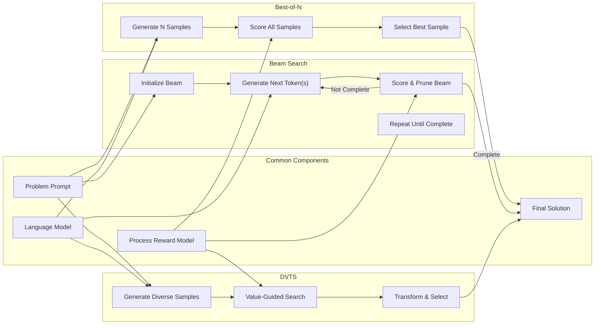
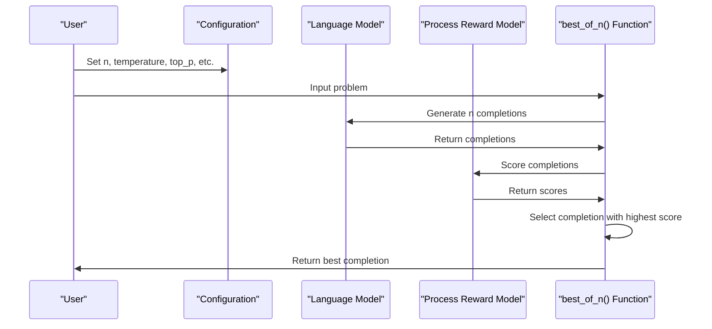
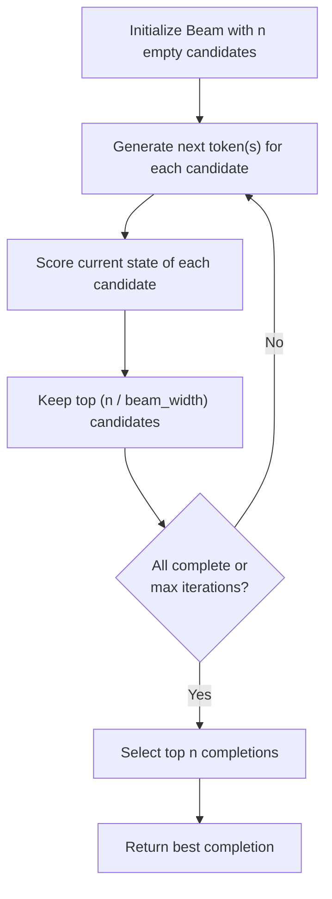
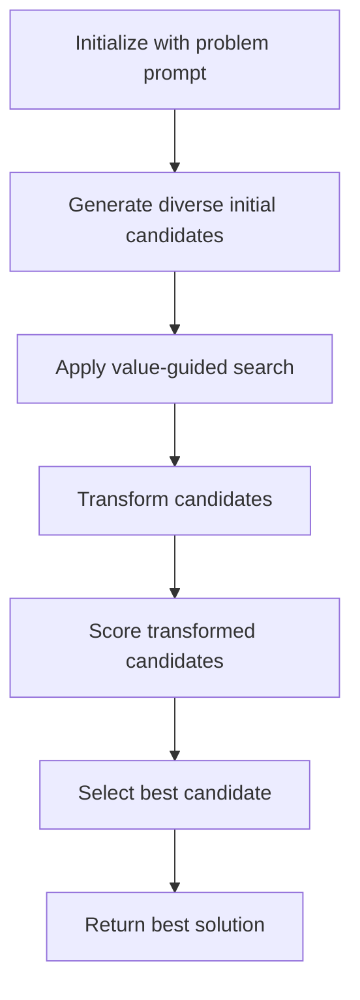
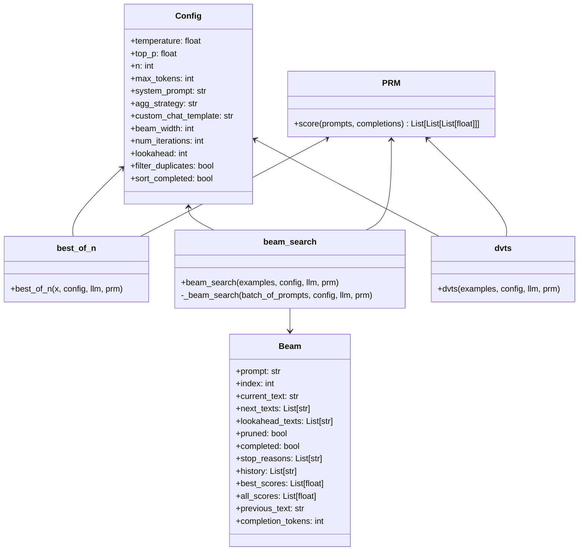

<!-- source: DeepWiki mcp.deepwiki.com · repo huggingface/search-and-learn · page 2.2 Search Strategies · fetched 2026-10-26 -->

# Search Strategies

<details>
<summary>Relevant source files</summary>

The following files were used as context for generating this wiki page:

- [recipes/README.md](recipes/README.md)
- [src/sal/search/beam_search.py](src/sal/search/beam_search.py)
- [src/sal/search/best_of_n.py](src/sal/search/best_of_n.py)

</details>


This page documents the search strategies implemented in the Search and Learn system. Search strategies are algorithms that explore the space of possible completions from a language model to find high-quality solutions to complex problems. These strategies act as the core computational methods that enable test-time compute scaling for language models.

For information about how Process Reward Models evaluate these completions, see [Process Reward Models](#2.3). For details on configuring search strategies, see [Configuration System](#2.1).

## Overview of Search Strategies

The Search and Learn repository implements three main search strategies, each with different approaches to exploring the solution space:

1. **Best-of-N**: A simple strategy that generates multiple independent completions and selects the best one based on a reward model score
2. **Beam Search**: An iterative strategy that maintains a beam of promising candidates, expanding and pruning them based on reward model scores
3. **DVTS (Diverse Value Transformation Search)**: A strategy that emphasizes diversity of candidates while using value-guided search to explore the solution space

### Search Strategy Comparison



Sources: [recipes/README.md:3-15]()

## Best-of-N Strategy

The Best-of-N strategy is the simplest of the three approaches. It generates N independent completions for each prompt and selects the one with the highest score according to a Process Reward Model (PRM).

### Algorithm



### Implementation Details

The Best-of-N strategy is implemented in `best_of_n.py`. The main function, `best_of_n()`, takes a batch of prompts, a configuration object, a language model, and a process reward model as inputs, and returns the best completion for each prompt.

Key steps in the implementation:

1. Convert user prompts to chat format using the model's chat template
2. Duplicate each prompt n times to generate n completions
3. Generate completions using vLLM with specified sampling parameters
4. Score all completions using the process reward model
5. Aggregate scores based on the configured strategy (e.g., last token, average)
6. Select the completion with the highest score for each prompt

Key parameters that affect Best-of-N performance:

- `n`: Number of completions to generate per prompt
- `temperature`: Controls randomness in generation
- `top_p`: Probability threshold for nucleus sampling
- `max_tokens`: Maximum length of each completion
- `agg_strategy`: How to aggregate scores (e.g., last, mean)

Sources: [src/sal/search/best_of_n.py:24-97]()

## Beam Search Strategy

Beam Search is a more sophisticated strategy that maintains a beam of promising candidate solutions and iteratively expands them. At each step, all candidates are scored and only the top-k are kept for the next iteration.

### Algorithm



### Implementation Details

The Beam Search strategy is implemented in `beam_search.py`. It uses a helper class `Beam` to track the state of each candidate solution.

Key steps in the implementation:

1. Initialize n beams with empty completions
2. For each iteration:
   - Generate the next token(s) for each active beam
   - Score the current state of each beam
   - Prune the beams to keep only the most promising ones
   - Mark completed beams and add them to the completed list
3. Select the top n completions from the completed beams based on their scores

Key parameters that affect Beam Search performance:

- `n`: Total number of beams to maintain
- `beam_width`: Controls how many beams are kept after each pruning step
- `num_iterations`: Maximum number of iterations
- `lookahead`: Number of tokens to generate in each step
- `filter_duplicates`: Whether to filter out duplicate beams
- `sort_completed`: Whether to sort completed beams by score

Sources: [src/sal/search/beam_search.py:32-223]()

## DVTS (Diverse Value Transformation Search) Strategy

DVTS combines diversity-aware exploration with value-guided search. It generates a diverse set of candidates and uses a value function (PRM) to guide the search toward promising regions of the solution space.

### Algorithm



### Implementation Characteristics

While the specific implementation details of DVTS are not fully visible in the provided files, from the context we understand:

1. DVTS emphasizes generating a diverse set of initial candidates
2. It uses the Process Reward Model as a value function to guide the search
3. It applies transformations to explore the solution space efficiently
4. Like other strategies, it ultimately selects the candidate with the highest score

Sources: [recipes/README.md:3-15]()

## Code Structure



Sources: [src/sal/search/best_of_n.py:24-97](), [src/sal/search/beam_search.py:32-223]()

## Usage Example

To use these search strategies, you can run the `test_time_compute.py` script with a configuration file that specifies the search strategy and its parameters:

```bash
# For Best-of-N
python scripts/test_time_compute.py recipes/Llama-3.2-1B-Instruct/best_of_n.yaml

# For Beam Search
python scripts/test_time_compute.py recipes/Llama-3.2-1B-Instruct/beam_search.yaml

# For DVTS
python scripts/test_time_compute.py recipes/Llama-3.2-1B-Instruct/dvts.yaml
```

Each recipe file contains configuration parameters specific to the search strategy. For example, the Best-of-N recipe might specify:
- `n`: 16 (number of completions to generate)
- `temperature`: 0.8 (sampling temperature)
- `top_p`: 1.0 (nucleus sampling parameter)
- `agg_strategy`: "last" (use the score of the last token)

Sources: [recipes/README.md:17-23]()

## Performance Considerations

When choosing a search strategy, consider the following trade-offs:

| Strategy | Compute Efficiency | Solution Quality | Parallelizability | Memory Usage |
|----------|-------------------|------------------|-------------------|--------------|
| Best-of-N | Medium | Good | High | Low |
| Beam Search | Low | Very Good | Medium | Medium |
| DVTS | Medium | Very Good | Medium | Medium |

- **Best-of-N** is the most straightforward and highly parallelizable, making it efficient for large-scale experiments. However, it may not explore the solution space as effectively as the other strategies.
- **Beam Search** can find better solutions by iteratively refining candidates, but it requires more sequential computation steps and has higher memory requirements.
- **DVTS** offers a balance between exploration and exploitation, with special emphasis on diversity, which can help find novel solutions.

Sources: [recipes/README.md:106-157]()

## Scaling Experiments

For running large-scale experiments with any of these search strategies, the repository provides SLURM scripts for parallelization. This allows running the search strategies on a large number of problems in parallel:

```bash
# Example for Best-of-N with parallelization
sbatch recipes/launch_array.slurm recipes/Llama-3.2-1B-Instruct/best_of_n.yaml \
    --n=256 \
    --seed=0 \
    --hub_dataset_id=<YOUR_ORG>/Llama-3.2-1B-Instruct-best_of_n-completions
```

After running parallel jobs, the results can be merged using the `merge_chunks.py` script.

Sources: [recipes/README.md:160-192]()

---

