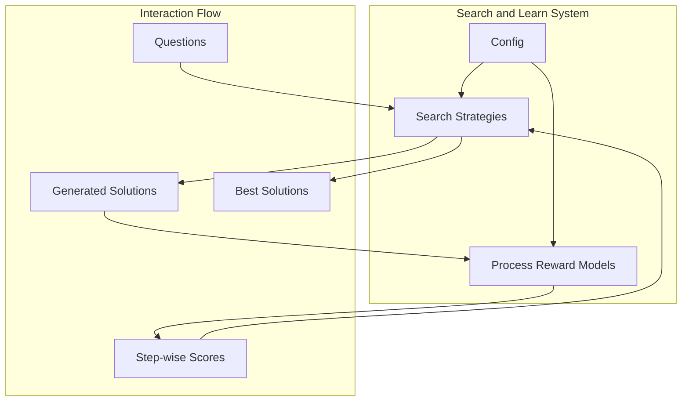
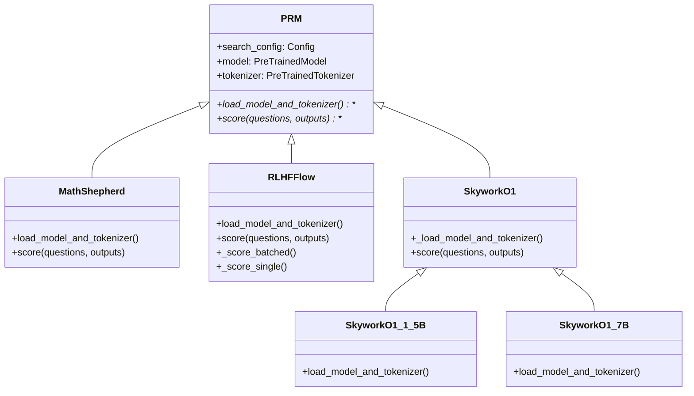
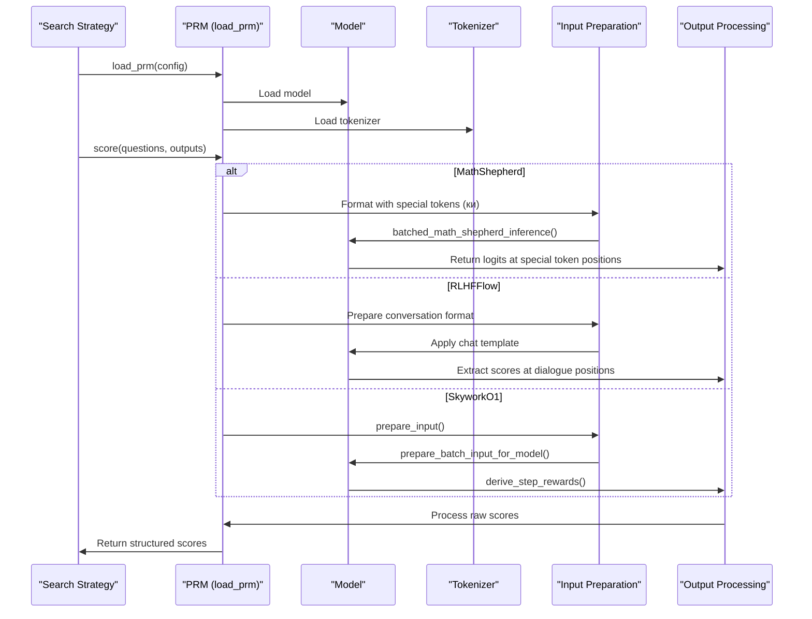
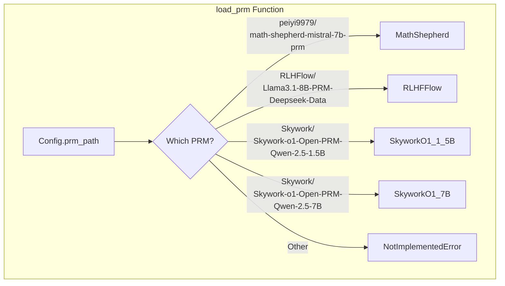
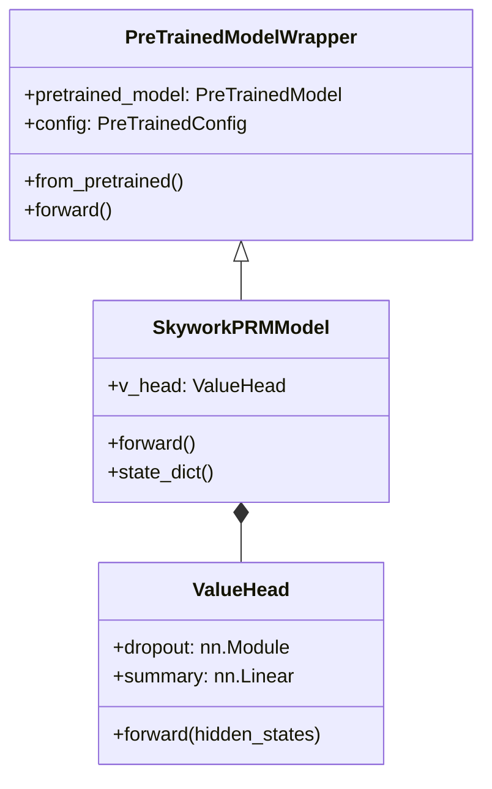
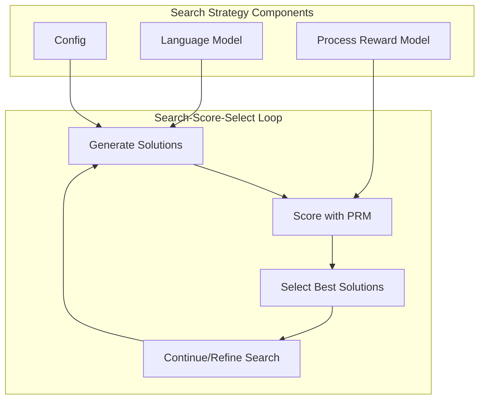

<!-- source: DeepWiki mcp.deepwiki.com · repo huggingface/search-and-learn · page 2.3 Process Reward Models · fetched 2026-10-26 -->

# Process Reward Models

Relevant source files

The following files were used as context for generating this wiki page:

- [src/sal/models/reward_models.py](src/sal/models/reward_models.py)
- [src/sal/models/skywork_o1_prm/io_utils.py](src/sal/models/skywork_o1_prm/io_utils.py)
- [src/sal/models/skywork_o1_prm/modeling_base.py](src/sal/models/skywork_o1_prm/modeling_base.py)
- [src/sal/models/skywork_o1_prm/prm_model.py](src/sal/models/skywork_o1_prm/prm_model.py)

Process Reward Models (PRMs) are specialized models that evaluate the quality of stepwise solutions in the Search and Learn system. They provide the crucial scoring mechanism that guides search strategies toward better solutions by analyzing intermediate steps rather than just final answers. This document explains how PRMs are implemented, their role in the system, and how they interact with other components.

For information about search strategies that use these models, see [Search Strategies](#2.2). For details on how to train custom PRMs, see [Training Process Reward Models](#4).

## 1. Overview

Process Reward Models evaluate solution quality by examining the reasoning process rather than just the final answer. They assign scores to each step in a solution, allowing search algorithms to select solutions with better reasoning paths. This approach aligns with the core idea of test-time compute scaling: enabling models to explore multiple reasoning paths and select the most promising one.

Sources: [src/sal/models/reward_models.py:38-137](), [src/sal/models/reward_models.py:343-356]()

## 2. PRM Class Hierarchy

The system implements a base `PRM` class with several concrete implementations. Each implementation is responsible for loading a specific model and tokenizer, and implementing the scoring logic for that model.

The base `PRM` class defines the interface that all implementations must follow:

1. `load_model_and_tokenizer()`: Loads the model and tokenizer for the specific PRM implementation
2. `score(questions, outputs)`: Scores a batch of outputs for a batch of questions

Sources: [src/sal/models/reward_models.py:72-86](), [src/sal/models/reward_models.py:88-136](), [src/sal/models/reward_models.py:139-277](), [src/sal/models/reward_models.py:280-322](), [src/sal/models/reward_models.py:327-340]()

## 3. PRM Implementations

### 3.1 MathShepherd

MathShepherd is a PRM specifically designed for mathematical problem-solving. It uses the model `peiyi9979/math-shepherd-mistral-7b-prm` and is designed to score solutions to math problems.

Key features:
- Uses special tokens (`ки`) to identify steps in the solution
- Batched inference for efficiency
- Scores each step in the solution

Sources: [src/sal/models/reward_models.py:88-136]()

### 3.2 RLHFFlow

RLHFFlow is a PRM based on Llama 3.1 trained with RLHF (Reinforcement Learning from Human Feedback). It uses the model `RLHFlow/Llama3.1-8B-PRM-Deepseek-Data`.

Key features:
- Uses the plus/minus tokens to represent positive/negative feedback
- Supports both batched and single-example scoring
- Handles multiple steps in each solution

Sources: [src/sal/models/reward_models.py:139-277]()

### 3.3 SkyworkO1

SkyworkO1 is a family of PRMs provided by Skywork AI, available in two sizes: 1.5B and 7B. These models use a specialized `SkyworkPRMModel` architecture.

Key features:
- Specialized ValueHead architecture for scoring
- Handles step-by-step rewards explicitly
- Available in multiple sizes for different compute requirements

Sources: [src/sal/models/reward_models.py:280-340](), [src/sal/models/skywork_o1_prm/prm_model.py:64-98](), [src/sal/models/skywork_o1_prm/io_utils.py:6-56]()

## 4. PRM Scoring Process

The scoring process is a key part of how PRMs evaluate solutions. While each PRM implementation has its own approach, the general flow is similar:

For all PRMs, the output of the scoring process is a nested list structure:
- The outer list corresponds to each question
- The middle list corresponds to each candidate solution for that question
- The inner list contains scores for each step in the solution

Sources: [src/sal/models/reward_models.py:38-70](), [src/sal/models/reward_models.py:102-136](), [src/sal/models/reward_models.py:162-277](), [src/sal/models/reward_models.py:297-323]()

## 5. Loading and Using PRMs

PRMs are loaded using the `load_prm` function, which takes a configuration object and returns the appropriate PRM instance:

The process to use a PRM in a search strategy involves:

1. Loading the PRM using `load_prm`
2. Generating candidate solutions using a language model
3. Scoring the solutions using PRM's `score` method
4. Using the scores to guide the search strategy

Sources: [src/sal/models/reward_models.py:343-356]()

## 6. SkyworkO1 Architecture Details

The SkyworkO1 PRM uses a specialized model architecture defined in the SkyworkPRMModel class. This model extends a base language model with a value head that produces rewards for each token.

The key components in the SkyworkO1 architecture:

1. **ValueHead**: A neural network head that converts hidden states to scalar rewards
2. **SkyworkPRMModel**: Wraps a pretrained language model and adds the value head
3. **IO Utilities**: Functions for preparing inputs and processing outputs

The SkyworkO1 model processes inputs by:
1. Tokenizing the problem and response
2. Identifying step boundaries using a special token
3. Computing rewards at each step boundary
4. Aggregating the rewards into a step-wise structure

Sources: [src/sal/models/skywork_o1_prm/prm_model.py:22-61](), [src/sal/models/skywork_o1_prm/prm_model.py:64-198](), [src/sal/models/skywork_o1_prm/io_utils.py:6-56]()

## 7. Integration with Search Strategies

PRMs are a critical component in search strategies, providing the evaluation mechanism that guides the search. The search-score-select loop forms the core of test-time compute scaling:

The search strategy determines how solutions are generated and refined, while the PRM determines how solutions are evaluated. Different PRMs can be used with different search strategies, allowing for experimentation with different combinations.

Sources: [src/sal/models/reward_models.py:72-86](), [src/sal/models/reward_models.py:343-356]()

## 8. Performance Considerations

When using PRMs, several performance considerations should be kept in mind:

1. **Batch Size**: All PRM implementations support batched inference, which can significantly improve throughput
2. **Model Size**: Larger models (e.g., SkyworkO1_7B vs SkyworkO1_1_5B) provide better quality but require more compute
3. **Memory Management**: PRMs explicitly manage GPU memory with operations like `torch.cuda.empty_cache()`
4. **Precision**: Models use mixed precision (float16 or bfloat16) to reduce memory usage and improve performance

Sources: [src/sal/models/reward_models.py:38-70](), [src/sal/models/reward_models.py:94-100](), [src/sal/models/reward_models.py:146-151](), [src/sal/models/reward_models.py:288-293]()

## 9. Conclusion

Process Reward Models are a fundamental component of the Search and Learn system, providing the ability to evaluate solutions based on their reasoning process rather than just their final answer. The system implements several PRM variants, each with its own strengths and characteristics, and provides a unified interface for using them in search strategies.

By scoring each step in a solution, PRMs enable search strategies to find solutions with better reasoning processes, ultimately leading to more reliable and explainable results.

---

