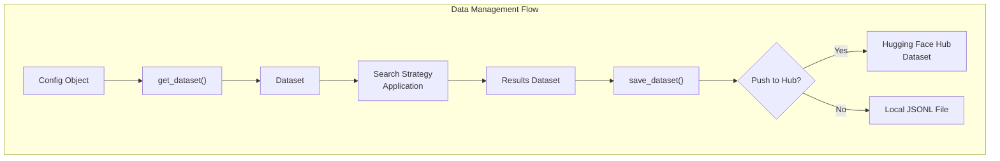
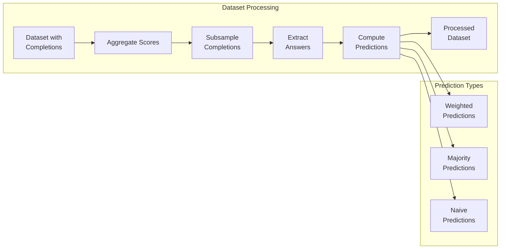
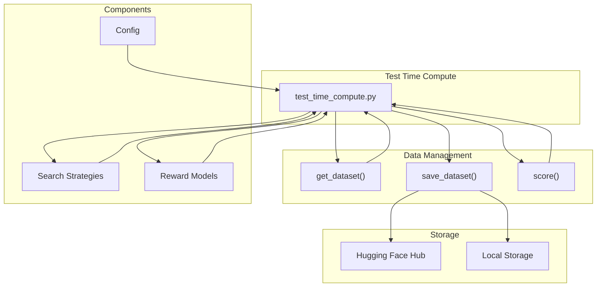

<!-- source: DeepWiki mcp.deepwiki.com · repo huggingface/search-and-learn · page 2.4 Data Management · fetched 2026-10-26 -->

# Data Management

<details>
<summary>Relevant source files</summary>

The following files were used as context for generating this wiki page:

- [src/sal/utils/data.py](src/sal/utils/data.py)
- [src/sal/utils/score.py](src/sal/utils/score.py)

</details>


This page documents the data handling mechanisms in the Search and Learn system, covering how data is loaded, processed, and saved during test-time compute experiments. For information about search strategies, refer to [Search Strategies](#2.2), and for details on process reward models, see [Process Reward Models](#2.3).

## Overview

The Data Management component provides utilities for loading datasets from Hugging Face Hub, processing them through search strategies, and saving results either locally or back to the Hub. These utilities are primarily defined in the `sal/utils/data.py` module and are used extensively by the test-time compute scripts.



Sources: [src/sal/utils/data.py:29-79]()

## Dataset Loading

The system provides a straightforward mechanism for loading datasets from Hugging Face Hub through the `get_dataset()` function. This function handles dataset selection based on configuration parameters.

```mermaid
classDiagram
    class Config {
        dataset_name: str
        dataset_split: str
        dataset_start: int
        dataset_end: int
        num_samples: int
    }
    
    class get_dataset {
        <<function>>
        param: Config
        return: Dataset
    }
    
    Config --> get_dataset: provides parameters
    get_dataset --> "HF Dataset": returns
```

The `get_dataset()` function accepts a `Config` object containing dataset parameters and returns a Hugging Face `Dataset` object. It supports:

- Loading a dataset by name and split (`dataset_name`, `dataset_split`)
- Selecting a specific range of examples (`dataset_start`, `dataset_end`)
- Limiting the number of examples (`num_samples`)

Example usage through configuration:
```python
config = Config(
    dataset_name="gsm8k",
    dataset_split="test",
    dataset_start=0,
    dataset_end=100,
    num_samples=None
)
dataset = get_dataset(config)
```

Sources: [src/sal/utils/data.py:29-37]()

## Dataset Saving

After processing, datasets can be saved either to Hugging Face Hub or locally as JSONL files using the `save_dataset()` function:

```mermaid
classDiagram
    class Config {
        push_to_hub: bool
        hub_dataset_id: str
        revision: str
        hub_dataset_private: bool
        output_dir: str
        model_path: str
        approach: str
    }
    
    class save_dataset {
        <<function>>
        param: Dataset
        param: Config
    }
    
    class Dataset {
        push_to_hub()
        to_json()
    }
    
    Config --> save_dataset: provides parameters
    Dataset --> save_dataset: provides data
    save_dataset --> "Hub or Local Storage": saves data
```

The save mechanism is controlled by configuration parameters:

- When `push_to_hub` is `True`:
  - Creates or updates a dataset on Hugging Face Hub using the specified `hub_dataset_id`
  - Uses the specified `revision` as the branch name
  - Sets privacy with `hub_dataset_private`
  - Includes retry logic to handle concurrent push rejections

- When `push_to_hub` is `False`:
  - Saves to a local JSONL file
  - Uses `output_dir` if specified, otherwise defaults to `data/{model_path}`
  - Filename format: `{approach}_completions.jsonl`

Sources: [src/sal/utils/data.py:40-79]()

## Dataset Processing

While not directly part of the data loading or saving, the system includes utilities for processing datasets after they've been loaded and passed through search strategies. The `score.py` module provides functions for scoring and aggregating results:



The `score()` function applies a series of transformations to a dataset:

1. Aggregates scores for each completion using strategies like "min", "prod", or "last"
2. For different subset sizes, it:
   - Subsamples completions
   - Extracts answers from completions
   - Computes weighted predictions (based on scores)
   - Computes majority predictions (most common answer)
   - Computes naive predictions (first completion)

This creates a processed dataset with multiple prediction methods at different sample sizes for evaluation.

Sources: [src/sal/utils/score.py:46-86]()

## Integration with System Architecture

The Data Management component integrates with the broader Search and Learn system as shown below:



The Data Management utilities provide the input and output mechanisms for the test-time compute process, working alongside the configuration system, search strategies, and reward models to enable the complete Search and Learn workflow.

Sources: [src/sal/utils/data.py:29-79](), [src/sal/utils/score.py:46-86]()

## Summary

The Data Management component in the Search and Learn system provides:

1. **Dataset Loading**: Functions to load datasets from Hugging Face Hub with configurable selection parameters
2. **Dataset Saving**: Mechanisms to save results either to Hugging Face Hub (with branch management) or locally
3. **Dataset Processing**: Utilities to process and score generated completions

These components work together to form a complete data pipeline for test-time compute experiments, allowing researchers to easily load test data, process it with various search strategies, and save the results for analysis.

---

