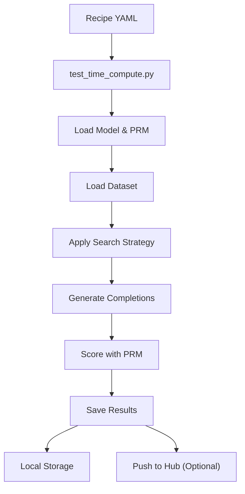
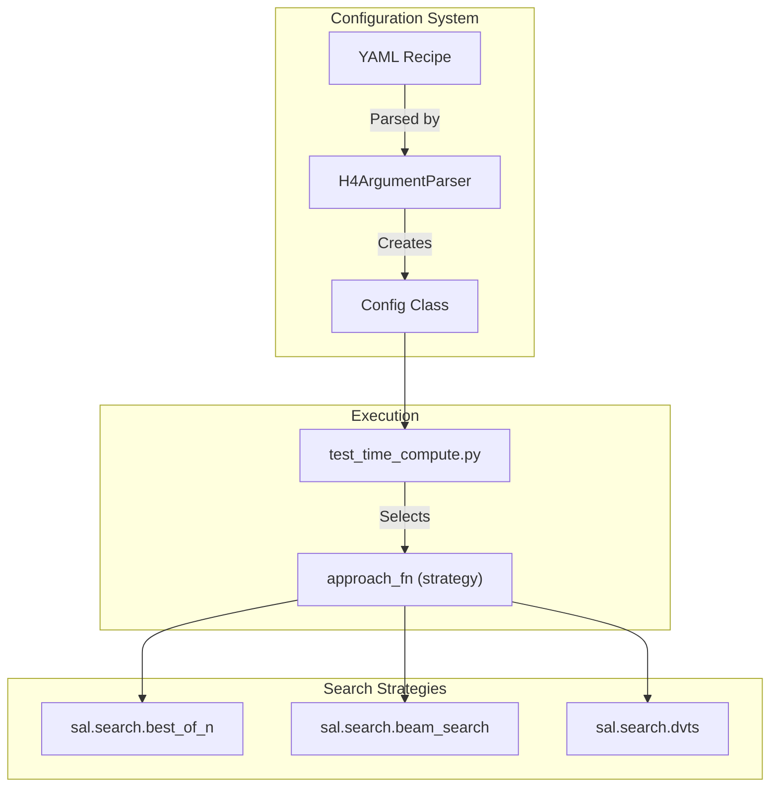
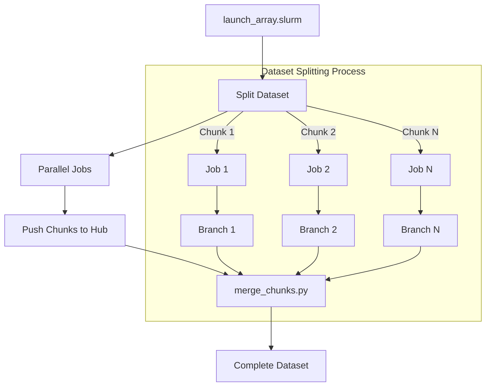

<!-- source: DeepWiki mcp.deepwiki.com · repo huggingface/search-and-learn · page 3 Usage Guide · fetched 2026-10-26 -->

# Usage Guide

<details>
<summary>Relevant source files</summary>

The following files were used as context for generating this wiki page:

- [recipes/README.md](recipes/README.md)
- [scripts/test_time_compute.py](scripts/test_time_compute.py)

</details>


This guide covers how to use the Search and Learn system for enhancing Language Model capabilities through test-time compute scaling. It provides instructions for running experiments with different search strategies, configuring models and datasets, and processing results. 

For information about the system architecture, see [System Architecture](#2), and for details on how Process Reward Models work, see [Process Reward Models](#2.3).

## Basic Execution Flow

The Search and Learn system uses a configuration-driven workflow to apply different search strategies to language models and evaluate their outputs.



Sources: [scripts/test_time_compute.py:1-74](), [recipes/README.md:17-34]()

## Running Basic Experiments

To run a basic experiment, use the `test_time_compute.py` script with a recipe file:

```shell
python scripts/test_time_compute.py recipes/Llama-3.2-1B-Instruct/best_of_n.yaml
```

This command will:
1. Load the configuration from the specified YAML file
2. Initialize the specified model and Process Reward Model (PRM)
3. Run the Best-of-N search strategy to generate completions
4. Score the completions and save the results

By default, this will generate 4 completions for the first 10 problems of the MATH-500 dataset and save the results locally to `data/{MODEL_PATH}/{APPROACH}.jsonl`.

Sources: [recipes/README.md:17-26](), [scripts/test_time_compute.py:41-70]()

## Available Recipes

The repository provides ready-to-use YAML configurations for various models and search strategies:

| Model | Method |
| :--- | :--- |
| Llama-3.2-1B-Instruct | [Best-of-N](recipes/Llama-3.2-1B-Instruct/best_of_n.yaml) |
| | [Beam search](recipes/Llama-3.2-1B-Instruct/beam_search.yaml) |
| | [DVTS](recipes/Llama-3.2-1B-Instruct/dvts.yaml) |
| Llama-3.2-3B-Instruct | [Best-of-N](recipes/Llama-3.2-3B-Instruct/best_of_n.yaml) |
| | [Beam search](recipes/Llama-3.2-3B-Instruct/beam_search.yaml) |
| | [DVTS](recipes/Llama-3.2-3B-Instruct/dvts.yaml) |
| Qwen2.5-1.5B-Instruct | [Best-of-N](recipes/Qwen2.5-1.5B-Instruct/best_of_n.yaml) |
| | [Beam search](recipes/Qwen2.5-1.5B-Instruct/beam_search.yaml) |
| | [DVTS](recipes/Qwen2.5-1.5B-Instruct/dvts.yaml) |



Sources: [recipes/README.md:3-15](), [scripts/test_time_compute.py:34-38]()

## Customizing Experiment Parameters

You can override configuration parameters using command-line arguments:

### Changing the Model

```shell
# Define variables
export CONFIG=recipes/Llama-3.2-1B-Instruct/best_of_n.yaml
export MODEL=meta-llama/Llama-3.2-8B-Instruct

# Run test-time compute
python scripts/test_time_compute.py $CONFIG --model_path=$MODEL
```

### Changing the Dataset

```shell
# Define variables
export CONFIG=recipes/Llama-3.2-1B-Instruct/best_of_n.yaml
export DATASET=AI-MO/aimo-validation-aime

# Run test-time compute
python scripts/test_time_compute.py $CONFIG \
    --dataset_name=$DATASET \
    --dataset_split=train
```

### Changing the Process Reward Model

```shell
# Define variables
export CONFIG=recipes/Qwen2.5-1.5B-Instruct/best_of_n.yaml
export PRM=Skywork/Skywork-o1-Open-PRM-Qwen-2.5-1.5B

# Run test-time compute
python scripts/test_time_compute.py $CONFIG --prm_path=$PRM
```

Currently supported PRMs include:
- `RLHFlow/Llama3.1-8B-PRM-Deepseek-Data` (default)
- `peiyi9979/math-shepherd-mistral-7b-prm`
- `Skywork/Skywork-o1-Open-PRM-Qwen-2.5-1.5B`
- `Skywork/Skywork-o1-Open-PRM-Qwen-2.5-7B`

Sources: [recipes/README.md:49-91]()

### Pushing Results to Hugging Face Hub

To save results to the Hugging Face Hub instead of locally:

```shell
python scripts/test_time_compute.py $CONFIG --push_to_hub=true
```

This will push the completions as a branch on a dataset repository. You can then convert the branch into a dataset config for easier exploration:

```python
from datasets import load_dataset

DATASET_ID="lewtun/Llama-3.2-1B-Instruct-best_of_n-prm-completions"
REVISION="HuggingFaceH4_MATH-500--T-0.8--top_p-1.0--n-4--seed-0--agg_strategy-last"

ds = load_dataset(DATASET_ID, revision=REVISION)
# Push to Hub as a config for exploration
ds.push_to_hub(DATASET_ID, config_name=REVISION)
```

Sources: [recipes/README.md:28-47]()

## Scaling with SLURM

For large-scale experiments, you can use SLURM to parallelize the execution:



### Running Array Jobs

To parallelize experiments using SLURM:

```shell
sbatch recipes/launch_array.slurm recipes/Llama-3.2-1B-Instruct/best_of_n.yaml \
    --n=256 \
    --seed=0 \
    --hub_dataset_id=YOUR_ORG/Llama-3.2-1B-Instruct-best_of_n-completions
```

This command will:
1. Split the dataset into 20 chunks (default setting)
2. Launch an array job to process each chunk in parallel 
3. Push results for each chunk to separate branches in the specified Hub repository

### Merging Results

After all array jobs complete, merge the results:

```shell
python scripts/merge_chunks.py \
    --dataset_name=YOUR_ORG/Llama-3.2-1B-Instruct-best_of_n-completions \
    --filter_strings seed-0 # Adjust for each seed
```

Sources: [recipes/README.md:160-192]()

## Replicating Blog Post Results

To replicate the results from the [Search and Learn blog post](https://huggingface.co/spaces/HuggingFaceH4/blogpost-scaling-test-time-compute), you need to:

1. Generate completions for each search method and various compute budgets (`n`)
2. Compute the accuracy of each method for a given compute budget

Each search strategy requires a slightly different approach:

### Best-of-N

```shell
export CONFIG=recipes/Llama-3.2-1B-Instruct/best_of_n.yaml
# Repeat for seeds 0-4
export SEED=0 

python scripts/test_time_compute.py $CONFIG \
    --n=256 \
    --num_samples=500 \
    --seed=$SEED
```

### Beam Search

```shell
export CONFIG=recipes/Llama-3.2-1B-Instruct/beam_search.yaml
# Repeat for seeds 0-4
export SEED=0 

for n in 4 16 64 256; do
    python scripts/test_time_compute.py $CONFIG \
        --n=$n \
        --num_samples=500 \
        --seed=$SEED
done
```

### DVTS

```shell
export CONFIG=recipes/Llama-3.2-1B-Instruct/dvts.yaml
# Repeat for seeds 0-4
export SEED=0 

python scripts/test_time_compute.py $CONFIG \
    --n=256 \
    --num_samples=500 \
    --seed=$SEED
```

For evaluating the results, the system uses a fork of the Qwen2.5-Math evaluation repository. See [Training Process Reward Models](#4) for more information on evaluation methods.

Sources: [recipes/README.md:93-199]()

## Hardware Considerations

The experiments in the blog post were run on H100s with 80GB of VRAM. If you're using different hardware, you may need to adjust the `--prm_batch_size` and `--search_batch_size` arguments to fit the models on your available GPU memory.

Sources: [recipes/README.md:102-102]()

---

