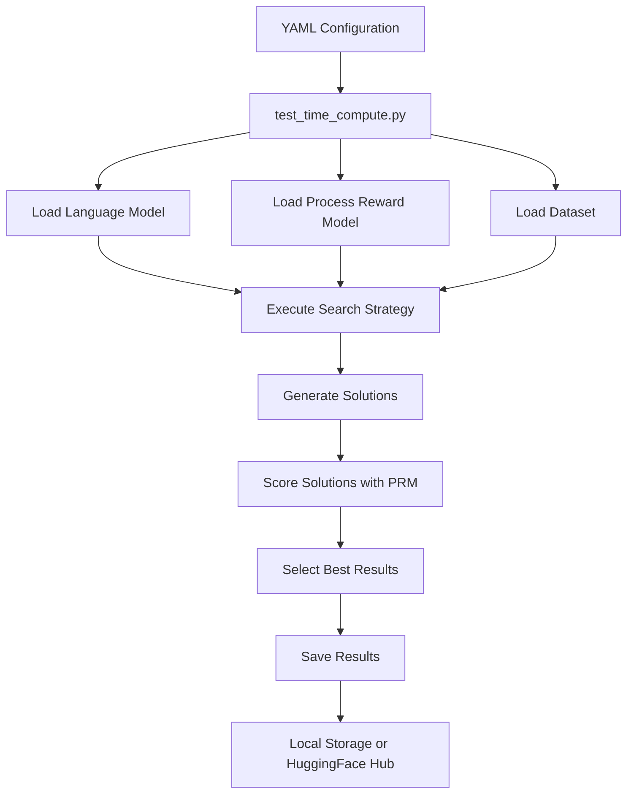
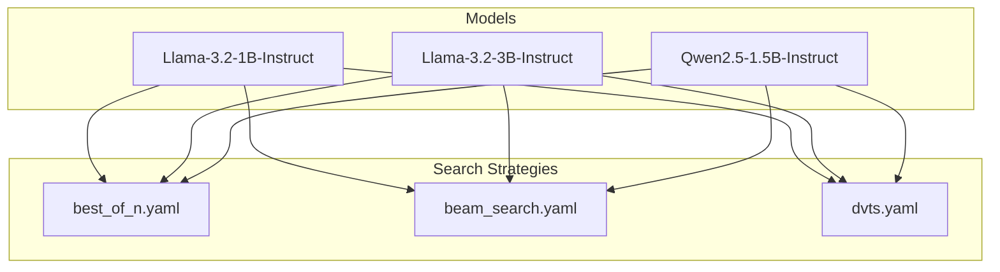
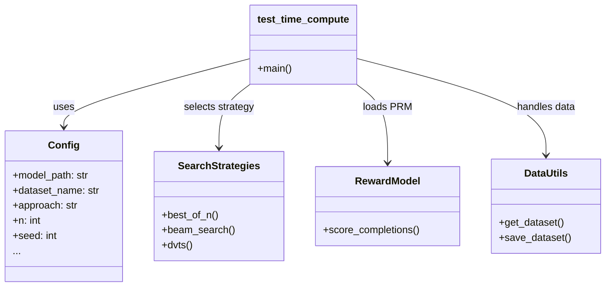
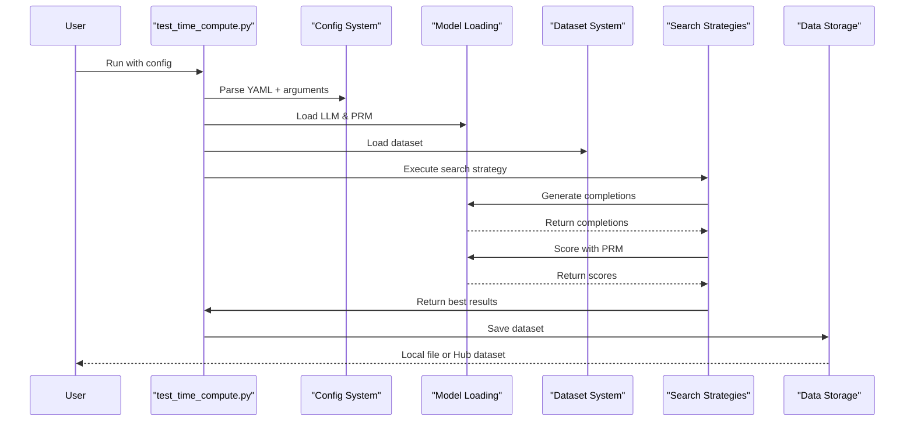

<!-- source: DeepWiki mcp.deepwiki.com · repo huggingface/search-and-learn · page 3.1 Running Basic Experiments · fetched 2026-10-26 -->

# Running Basic Experiments

<details>
<summary>Relevant source files</summary>

The following files were used as context for generating this wiki page:

- [recipes/README.md](recipes/README.md)
- [scripts/test_time_compute.py](scripts/test_time_compute.py)

</details>


This page guides you through the process of running basic test-time compute experiments using the Search and Learn framework. You'll learn how to use the `test_time_compute.py` script with pre-configured recipes to run different search strategies and evaluate their performance. For more advanced usage including parallelization with SLURM, see [Scaling with SLURM](#3.3).

## Experiment Workflow

The diagram below illustrates the basic workflow for running experiments:



Sources: [scripts/test_time_compute.py](), [recipes/README.md]()

## Quick Start

To run a basic experiment using a pre-configured recipe:

```bash
# Choose a recipe
export CONFIG=recipes/Llama-3.2-1B-Instruct/best_of_n.yaml

# Run the experiment
python scripts/test_time_compute.py $CONFIG
```

This will run the Best-of-N search strategy using the Llama-3.2-1B-Instruct model on the default MATH-500 dataset.

Sources: [recipes/README.md:17-23]()

## Available Recipes

The repository provides pre-configured YAML recipes for three different search strategies applied to various language models:



Sources: [recipes/README.md:1-15]()

## Understanding the Code Structure

The `test_time_compute.py` script serves as the entry point for running experiments:



Sources: [scripts/test_time_compute.py:1-74]()

## Configuration Options

The behavior of `test_time_compute.py` is controlled through YAML configuration files (recipes) and command-line arguments. Here's a breakdown of the key parameters:

| Parameter | Description | Default | Example |
|-----------|-------------|---------|---------|
| `model_path` | Path to language model | Depends on recipe | `meta-llama/Llama-3.2-1B-Instruct` |
| `prm_path` | Path to Process Reward Model | `RLHFlow/Llama3.1-8B-PRM-Deepseek-Data` | `Skywork/Skywork-o1-Open-PRM-Qwen-2.5-1.5B` |
| `approach` | Search strategy | Depends on recipe | `best_of_n`, `beam_search`, or `dvts` |
| `n` | Number of completions or beam width | 4 | 4, 16, 64, 256 |
| `dataset_name` | Dataset to evaluate on | `HuggingFaceH4/MATH-500` | `AI-MO/aimo-validation-aime` |
| `num_samples` | Number of problems to use | 10 | 500 |
| `seed` | Random seed | 0 | 0-4 |
| `push_to_hub` | Whether to push results to Hub | `false` | `true` |

Sources: [scripts/test_time_compute.py:33-43](), [recipes/README.md:25-85]()

## Running Your First Experiment

To run a basic experiment:

1. **Select a recipe**: Choose a YAML configuration file from the `recipes` directory.
2. **Run the experiment**:

```bash
# Define the configuration
export CONFIG=recipes/Llama-3.2-1B-Instruct/best_of_n.yaml

# Run the experiment
python scripts/test_time_compute.py $CONFIG
```

By default, this will:
- Run the Best-of-N search strategy
- Use Llama-3.2-1B-Instruct as the language model
- Generate 4 completions for each problem
- Process the first 10 problems from MATH-500
- Save results locally to `data/{MODEL_PATH}/{APPROACH}.jsonl`

Sources: [recipes/README.md:17-26]()

## Customizing Your Experiment

You can override various settings through command-line arguments:

### Changing the Model

```bash
export CONFIG=recipes/Llama-3.2-1B-Instruct/best_of_n.yaml
export MODEL=meta-llama/Llama-3.2-8B-Instruct

python scripts/test_time_compute.py $CONFIG --model_path=$MODEL
```

Sources: [recipes/README.md:49-58]()

### Changing the Dataset

```bash
export CONFIG=recipes/Llama-3.2-1B-Instruct/best_of_n.yaml
export DATASET=AI-MO/aimo-validation-aime

python scripts/test_time_compute.py $CONFIG \
    --dataset_name=$DATASET \
    --dataset_split=train
```

Sources: [recipes/README.md:64-74]()

### Changing the Process Reward Model

```bash
export CONFIG=recipes/Qwen2.5-1.5B-Instruct/best_of_n.yaml
export PRM=Skywork/Skywork-o1-Open-PRM-Qwen-2.5-1.5B

python scripts/test_time_compute.py $CONFIG --prm_path=$PRM
```

Sources: [recipes/README.md:76-85]()

### Adjusting Search Parameters

You can also adjust the number of completions or beam width by modifying the `n` parameter:

```bash
export CONFIG=recipes/Llama-3.2-1B-Instruct/best_of_n.yaml

python scripts/test_time_compute.py $CONFIG --n=64
```

Sources: [recipes/README.md:106-123]()

## Saving and Sharing Results

By default, results are saved locally. To push them to the Hugging Face Hub:

```bash
export CONFIG=recipes/Llama-3.2-1B-Instruct/best_of_n.yaml

python scripts/test_time_compute.py $CONFIG --push_to_hub=true
```

This will publish your results as a dataset branch, which can then be converted into a dataset config:

```python
from datasets import load_dataset

DATASET_ID="your-username/Llama-3.2-1B-Instruct-best_of_n-prm-completions"
REVISION="HuggingFaceH4_MATH-500--T-0.8--top_p-1.0--n-4--seed-0--agg_strategy-last"

ds = load_dataset(DATASET_ID, revision=REVISION)
# Push to Hub as a config for exploration
ds.push_to_hub(DATASET_ID, config_name=REVISION)
```

Sources: [recipes/README.md:28-47]()

## Execution Flow

The internal flow of `test_time_compute.py` follows this sequence:



Sources: [scripts/test_time_compute.py:41-70]()

## Tips for Efficient Experimentation

1. **Start small**: Begin with a small number of problems (default is 10) to make sure your setup works correctly.

2. **GPU requirements**: The experiments require significant GPU memory, especially for larger models or when using larger values of `n`.

3. **Chat templates**: By default, recipes use a custom chat template for Llama 3 models. For other models, use `--custom_chat_template=none`.

4. **Supported PRMs**: The system supports several Process Reward Models:
   - `RLHFlow/Llama3.1-8B-PRM-Deepseek-Data` (default)
   - `peiyi9979/math-shepherd-mistral-7b-prm`
   - `Skywork/Skywork-o1-Open-PRM-Qwen-2.5-1.5B`
   - `Skywork/Skywork-o1-Open-PRM-Qwen-2.5-7B`

5. **Batch sizes**: Adjust `--prm_batch_size` and `--search_batch_size` to fit your hardware capabilities.

Sources: [recipes/README.md:60-91](), [recipes/README.md:102-103]()

## Next Steps

After running basic experiments, you might want to:

1. Run experiments on the full MATH-500 dataset (500 problems)
2. Try different search strategies and compare their performance
3. Scale up your experiments using SLURM parallelization (see [Scaling with SLURM](#3.3))
4. Explore the available recipes (see [Available Recipes](#3.2))
5. Train your own Process Reward Models (see [Training Process Reward Models](#4))

Sources: [recipes/README.md:93-199]()

---

