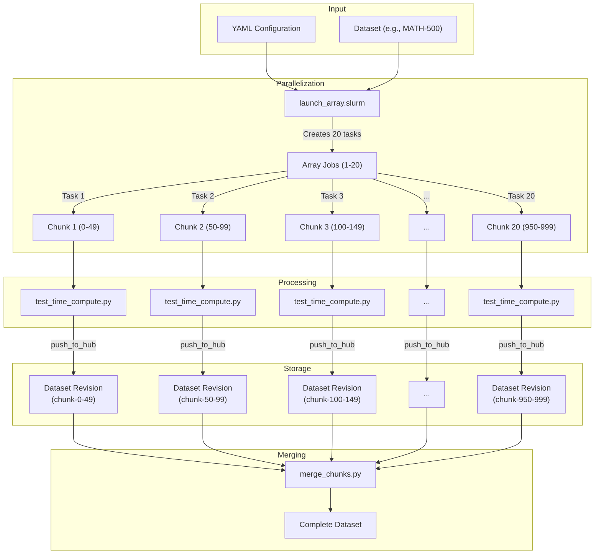
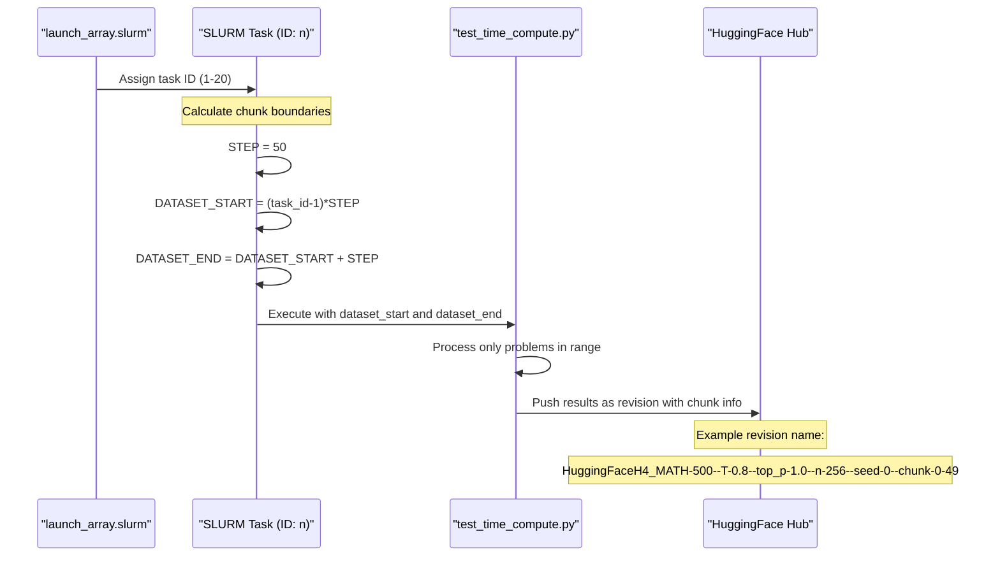
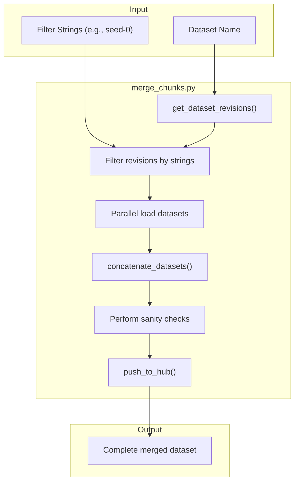

<!-- source: DeepWiki mcp.deepwiki.com · repo huggingface/search-and-learn · page 3.3 Scaling with SLURM · fetched 2026-10-26 -->

# Scaling with SLURM

<details>
<summary>Relevant source files</summary>

The following files were used as context for generating this wiki page:

- [recipes/README.md](recipes/README.md)
- [recipes/launch_array.slurm](recipes/launch_array.slurm)
- [scripts/merge_chunks.py](scripts/merge_chunks.py)

</details>


This page explains how to parallelize large-scale test-time compute experiments using SLURM and how to merge the resulting chunks into a complete dataset. When running experiments with large computation budgets (e.g., `n=256` completions per problem), sequential execution on a single GPU becomes prohibitively slow. For example, with 500 problems, Best-of-N can take ~3 hours while Beam Search and DVTS can take 60+ hours on a single GPU.

For basic experiment execution without parallelization, see [Running Basic Experiments](#3.1).

## Parallelization Architecture

The Search and Learn codebase provides a SLURM-based parallelization system that:
1. Divides the dataset into smaller chunks
2. Processes each chunk in parallel across multiple GPUs
3. Pushes results to the Hugging Face Hub as separate revisions
4. Merges the chunks back into a complete dataset



Sources: [recipes/launch_array.slurm:1-35](), [scripts/merge_chunks.py:1-116](), [recipes/README.md:157-193]()

## Using the SLURM Array Script

The repository provides a SLURM array script that divides your dataset into 20 chunks of approximately 25 problems each (for the MATH-500 dataset).

### Script Parameters

The SLURM script has the following key parameters:

```
#SBATCH --array=1-20%8         # Creates 20 tasks, maximum 8 running concurrently
#SBATCH --gres=gpu:1           # Each task uses 1 GPU
#SBATCH --time=4:00:00         # Time limit of 4 hours per task
```

### Launching Parallel Jobs

To launch a parallelized experiment, use the `launch_array.slurm` script with the appropriate YAML configuration:

```bash
sbatch recipes/launch_array.slurm recipes/Llama-3.2-1B-Instruct/best_of_n.yaml \
    --n=256 \
    --seed=0 \
    --hub_dataset_id=<YOUR_ORG>/Llama-3.2-1B-Instruct-best_of_n-completions
```

This command:
1. Launches 20 SLURM jobs (tasks 1-20)
2. Each job processes a 50-problem chunk of the dataset
3. Results are pushed to the Hugging Face Hub under the specified dataset ID, with different revisions for each chunk

### Examples for Different Search Strategies

Here are examples for running parallelized experiments for each search strategy:

**Best-of-N**:
```bash
sbatch recipes/launch_array.slurm recipes/Llama-3.2-1B-Instruct/best_of_n.yaml \
    --n=256 \
    --seed=0 \
    --hub_dataset_id=<YOUR_ORG>/Llama-3.2-1B-Instruct-best_of_n-completions
```

**Beam Search**:
```bash
# Must be run separately for each value of n
for n in 4 16 64 256; do
    sbatch recipes/launch_array.slurm recipes/Llama-3.2-1B-Instruct/beam_search.yaml \
        --n=$n \
        --seed=0 \
        --hub_dataset_id=<YOUR_ORG>/Llama-3.2-1B-Instruct-beam_search-completions
done
```

**DVTS**:
```bash
sbatch recipes/launch_array.slurm recipes/Llama-3.2-1B-Instruct/dvts.yaml \
    --n=256 \
    --seed=0 \
    --hub_dataset_id=<YOUR_ORG>/Llama-3.2-1B-Instruct-dvts-completions
```

Sources: [recipes/README.md:162-192](), [recipes/launch_array.slurm:10-14]()

## How Chunking Works

The SLURM array script creates 20 tasks, each processing a different portion of the dataset. Here's how the chunking mechanism works:



The key lines in the SLURM script that handle chunking are:

```bash
STEP=50
ENDPOINT=$((SLURM_ARRAY_TASK_COUNT * STEP - STEP))
STARTS=($(seq 0 $STEP $ENDPOINT))
DATASET_START=${STARTS[$SLURM_ARRAY_TASK_ID-1]}
DATASET_END=$((${STARTS[$SLURM_ARRAY_TASK_ID-1]}+$STEP))
```

These calculations determine which portion of the dataset each task should process, and the script passes these values to `test_time_compute.py` with the `--dataset_start` and `--dataset_end` parameters.

Sources: [recipes/launch_array.slurm:20-33]()

## Merging Results

After all SLURM jobs complete, you'll have 20 separate revisions of your dataset on the Hugging Face Hub. The `merge_chunks.py` script combines these chunks into a single complete dataset.

### Merge Process



### Using the Merge Script

To merge dataset chunks, run:

```bash
python scripts/merge_chunks.py \
    --dataset_name=<YOUR_ORG>/Llama-3.2-1B-Instruct-best_of_n-completions \
    --filter_strings seed-0  # Filter to include only specific revisions
```

You can filter which revisions to merge using the `--filter_strings` parameter. For example, to merge only results for seed 0, use `--filter_strings seed-0`.

### Sanity Checks

The merge script performs important validations:
1. Checks for duplicate problems
2. Verifies the expected number of samples (500 for MATH-500 dataset)

If these checks fail, the script will raise an error.

Sources: [scripts/merge_chunks.py:25-39](), [scripts/merge_chunks.py:94-102](), [recipes/README.md:186-193]()

## Workflow Diagram of the Complete Process

Here's a complete workflow diagram showing how the SLURM parallelization and merging process work together:

```mermaid
flowchart TD
    subgraph "Configuration"
        Config["YAML Recipe"]
        Params["Command-line Parameters\n(n, seed, etc.)"]
    end
    
    subgraph "SLURM Parallelization"
        Array["launch_array.slurm\nCreates 20 tasks"]
        Jobs["SLURM Array Jobs"]
    end
    
    subgraph "Execution"
        Chunk1["Chunk 1 (test_time_compute.py)"]
        Chunk2["Chunk 2 (test_time_compute.py)"]
        ChunkN["..."]
        Chunk20["Chunk 20 (test_time_compute.py)"]
    end
    
    subgraph "Hub Storage"
        Rev1["Dataset Revision 1"]
        Rev2["Dataset Revision 2"]
        RevN["..."]
        Rev20["Dataset Revision 20"]
    end
    
    subgraph "Merging"
        Merge["merge_chunks.py"]
        Final["Final Merged Dataset"]
    end
    
    Config --> Array
    Params --> Array
    Array --> Jobs
    
    Jobs --> Chunk1
    Jobs --> Chunk2
    Jobs --> ChunkN
    Jobs --> Chunk20
    
    Chunk1 --> Rev1
    Chunk2 --> Rev2
    ChunkN --> RevN
    Chunk20 --> Rev20
    
    Rev1 --> Merge
    Rev2 --> Merge
    RevN --> Merge
    Rev20 --> Merge
    
    Merge --> Final
```



Sources: [recipes/launch_array.slurm:1-35](), [scripts/merge_chunks.py:1-116](), [recipes/README.md:157-193]()

## Best Practices and Tips

### Resource Considerations

1. **Memory Requirements**: For large models, you may need to adjust the `--prm_batch_size` and `--search_batch_size` parameters to fit within your GPU's VRAM.

2. **Time Allocation**: The default 4-hour time limit per job should be sufficient for processing 50 problems with Best-of-N. For more intensive methods like Beam Search and DVTS, consider increasing the time limit.

3. **Concurrency Limit**: The script limits concurrent tasks to 8 (`--array=1-20%8`). Adjust this based on your available resources.

### Runtime Differences

Different search methods have vastly different computational requirements:
- **Best-of-N**: Fastest, approximately 9 minutes per problem with n=256
- **Beam Search**: Much slower, can take hours per problem with larger beam widths
- **DVTS**: Also slow, comparable to Beam Search

### Error Handling

When a SLURM job fails, it will typically create error logs in the `logs/` directory. Check these logs for debugging information.

If the merge process encounters problems such as missing chunks, verify that all SLURM jobs completed successfully before attempting to merge.

Sources: [recipes/README.md:101-104](), [recipes/launch_array.slurm:3-6]()

---

