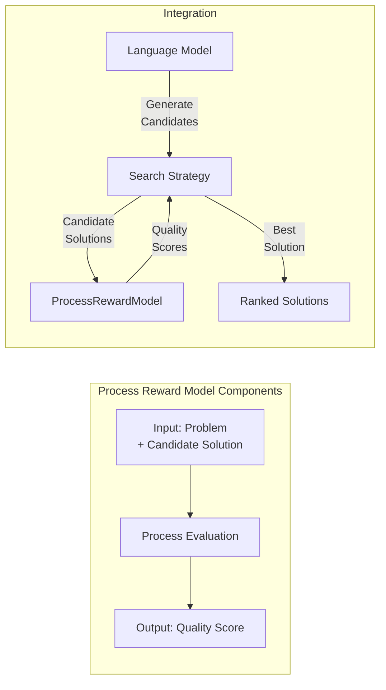
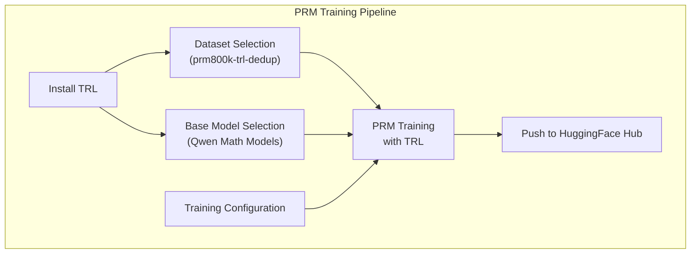
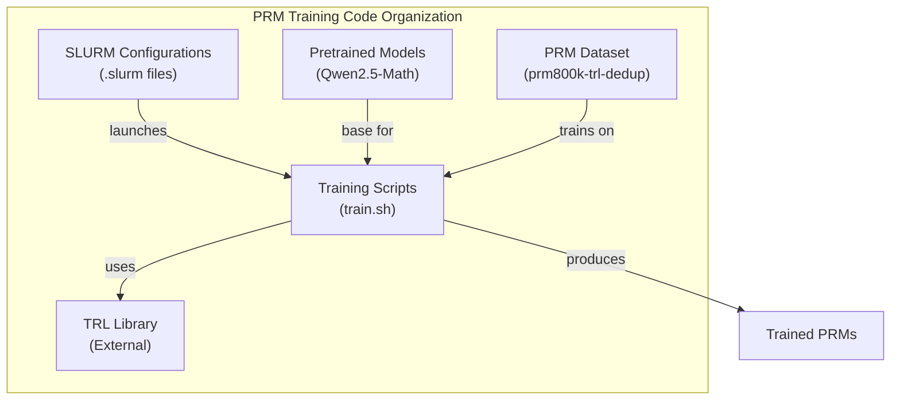
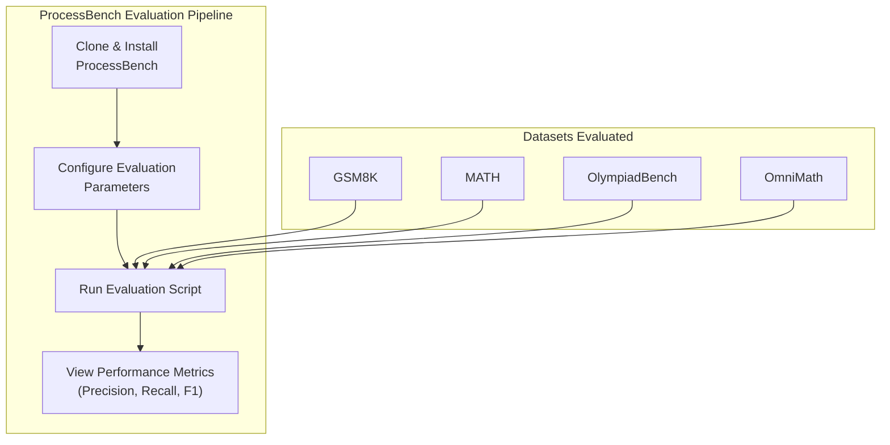
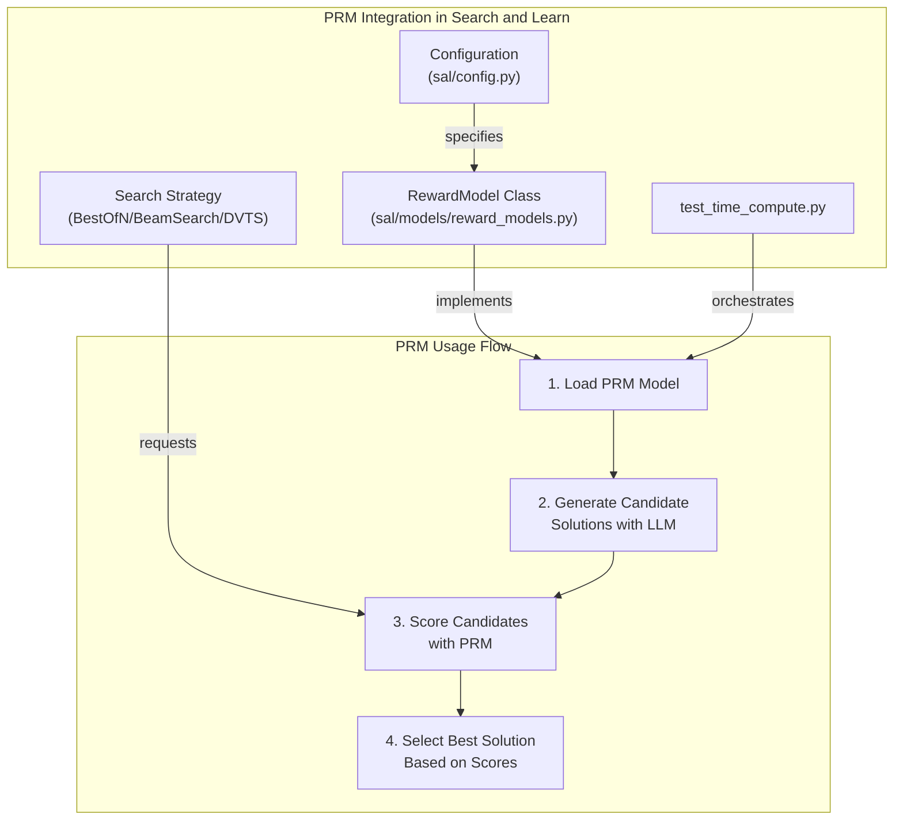

<!-- source: DeepWiki mcp.deepwiki.com · repo huggingface/search-and-learn · page 4 Training Process Reward Models · fetched 2026-10-26 -->

# Training Process Reward Models

<details>
<summary>Relevant source files</summary>

The following files were used as context for generating this wiki page:

- [recipes/training/Qwen2.5-Math-1.5B-Instruct-PRM/train.sh](recipes/training/Qwen2.5-Math-1.5B-Instruct-PRM/train.sh)
- [recipes/training/Qwen2.5-Math-7B-Instruct-PRM/train.sh](recipes/training/Qwen2.5-Math-7B-Instruct-PRM/train.sh)
- [recipes/training/README.md](recipes/training/README.md)

</details>


This page provides a comprehensive guide on how to train Process Reward Models (PRMs) for the Search and Learn system. PRMs are essential components that evaluate the quality of reasoning processes or solutions generated by language models, particularly in domains requiring step-by-step reasoning like mathematics. For information about how PRMs are used within search strategies, see [Search Strategies](#2.2).

## What are Process Reward Models?

Process Reward Models are specialized language models fine-tuned to assess the quality of reasoning processes. Unlike traditional evaluative models that only consider the final answer, PRMs evaluate the entire reasoning path, allowing for more accurate assessments of multi-step problem-solving.

In the Search and Learn framework, PRMs serve as the evaluation mechanism that guides search strategies toward optimal solutions by scoring candidate responses based on their reasoning quality.



Sources: [recipes/training/README.md:1-3]()

## Training Infrastructure

The Search and Learn repository leverages TRL (Transformer Reinforcement Learning) library for training PRMs. Specifically, it uses the PRM trainer introduced in TRL v0.13.0, which simplifies the process of fine-tuning models to evaluate reasoning processes.



Sources: [recipes/training/README.md:5-11](), [recipes/training/Qwen2.5-Math-1.5B-Instruct-PRM/train.sh:4-26]()

### Installation Requirements

To train your own PRMs, you need to install TRL and its dependencies:

```bash
pip install -e '.[trl]'
```

This installs the Search and Learn package with TRL-specific dependencies.

Sources: [recipes/training/README.md:7-11]()

## Training Scripts and Models

The repository provides training scripts for two model variations:

| Model | Size | Training Script | SLURM Configuration |
|-------|------|----------------|---------------------|
| Qwen2.5-Math-Instruct | 1.5B | [Qwen2.5-Math-1.5B-Instruct-PRM/train.sh]() | [Qwen2.5-Math-1.5B-Instruct-PRM/prm_qwen_math_1p5b_instruct.slurm]() |
| Qwen2.5-Math-Instruct | 7B | [Qwen2.5-Math-7B-Instruct-PRM/train.sh]() | [Qwen2.5-Math-7B-Instruct-PRM/prm_qwen_math_7b_instruct.slurm]() |

The training scripts use accelerate with DeepSpeed for distributed training, primarily designed for environments with multiple GPUs (like 8xH100 clusters), but can be adapted to available resources.



Sources: [recipes/training/README.md:12-19](), [recipes/training/Qwen2.5-Math-1.5B-Instruct-PRM/train.sh:1-26](), [recipes/training/Qwen2.5-Math-7B-Instruct-PRM/train.sh:1-27]()

### Key Training Parameters

The training scripts include important configuration parameters:

- **Base model**: Qwen2.5-Math-1.5B-Instruct or Qwen2.5-Math-7B-Instruct
- **Dataset**: plaguss/prm800k-trl-dedup
- **Learning rate**: 1.0e-06
- **Batch sizes**: Adjusted based on model size (smaller for larger models)
- **Training epochs**: 1 full epoch
- **Step separator**: "\n\n" (crucial for parsing the reasoning steps)
- **Mixed precision**: BF16

These parameters are optimized for producing effective PRMs while being computationally efficient.

Sources: [recipes/training/Qwen2.5-Math-1.5B-Instruct-PRM/train.sh:4-26](), [recipes/training/Qwen2.5-Math-7B-Instruct-PRM/train.sh:4-26]()

## Trained Models

The Search and Learn project provides two pre-trained PRM models:

1. [HuggingFaceH4/Qwen2.5-Math-7B-Instruct-PRM-0.2](https://huggingface.co/HuggingFaceH4/Qwen2.5-Math-7B-Instruct-PRM-0.2)
2. [HuggingFaceH4/Qwen2.5-Math-1.5B-Instruct-PRM-0.2](https://huggingface.co/HuggingFaceH4/Qwen2.5-Math-1.5B-Instruct-PRM-0.2)

These models can be used directly for evaluating mathematical reasoning processes in your own applications or as part of the Search and Learn system.

Sources: [recipes/training/README.md:30-36]()

## Evaluating PRMs with ProcessBench

The repository integrates with [ProcessBench](https://github.com/huggingface/ProcessBench), a benchmark specifically designed for evaluating PRMs. This allows you to assess your trained models across multiple mathematical reasoning datasets.



Sources: [recipes/training/README.md:37-63]()

### Installation

To evaluate your trained PRMs with ProcessBench:

1. Clone the ProcessBench repository
2. Set up a Python environment (3.12 recommended)
3. Install the requirements

```bash
git clone https://github.com/huggingface/ProcessBench.git
uv venv .venv --python 3.12  # or use conda
source .venv/bin/activate
uv pip install -r requirements-trl.txt
```

Sources: [recipes/training/README.md:39-62]()

### Running Evaluations

Navigate to the ProcessBench code directory and run the evaluation script:

```bash
cd code/
python run_eval_prm_trl.py \
    --model_name "YOUR_MODEL_NAME" \
    --output_dir "./outputs" \
    --batch_size 256 \  # Adjust based on your GPU memory
    --sep "\n\n"  # Must match the separator used during training
```

The script evaluates your model on multiple mathematical reasoning datasets and provides detailed metrics including precision, recall, and F1 scores.

Sources: [recipes/training/README.md:64-76]()

### Performance Benchmarks

The provided PRM models achieve the following benchmarks:

**Qwen2.5-Math-1.5B-Instruct-PRM-0.2**:
- GSM8K: F1 Score: 36.56
- MATH: F1 Score: 49.61
- OlympiadBench: F1 Score: 36.07
- OmniMath: F1 Score: 37.00
- Weighted Average: F1 Score: 40.38

**Qwen2.5-Math-7B-Instruct-PRM-0.2**:
- GSM8K: F1 Score: 70.77
- MATH: F1 Score: 62.63
- OlympiadBench: F1 Score: 47.13
- OmniMath: F1 Score: 48.02
- Weighted Average: F1 Score: 54.73

The 7B model significantly outperforms the 1.5B model, demonstrating the value of scale for PRM performance.

Sources: [recipes/training/README.md:78-132]()

## Integration with Search and Learn

Once trained, PRMs are integrated into the Search and Learn system as evaluation components for search strategies. The system loads the PRMs and uses them to score candidate solutions generated during the search process.



This integration allows the Search and Learn system to leverage PRMs to improve the quality of solutions generated by language models, particularly for complex reasoning tasks.

Sources: System overview diagram, Component relationships diagram

## Conclusion

Process Reward Models are a critical component of the Search and Learn system, providing the evaluation mechanism that guides search strategies toward optimal solutions. The repository provides comprehensive tools for training and evaluating your own PRMs, as well as pre-trained models that can be used directly.

The combination of TRL for training and ProcessBench for evaluation provides a complete infrastructure for developing and testing PRMs for various reasoning tasks.

For more information on how PRMs are used within search strategies, see [Search Strategies](#2.2), and for details on the overall system architecture, see [System Architecture](#2).

---

