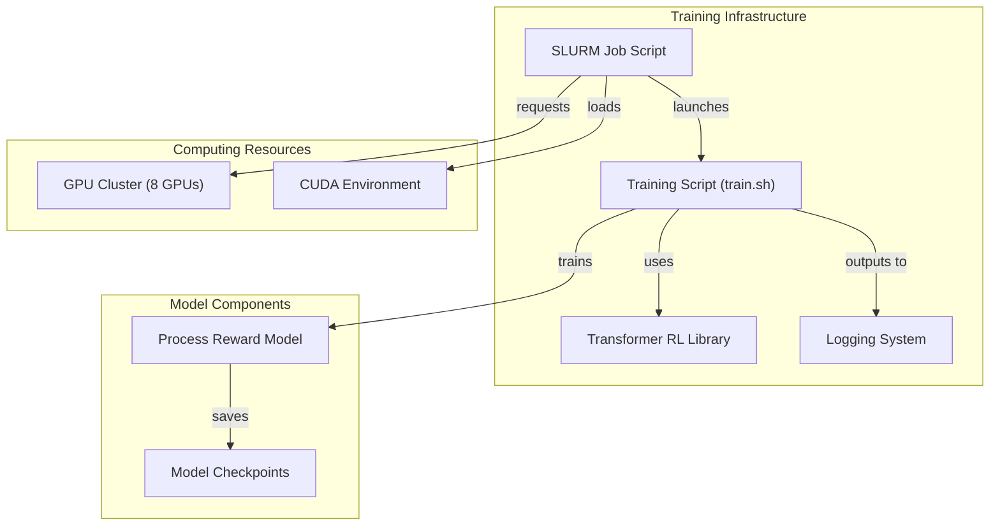
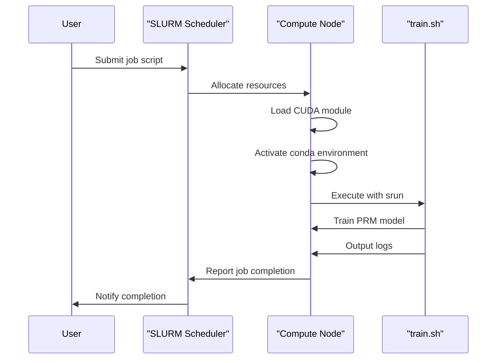
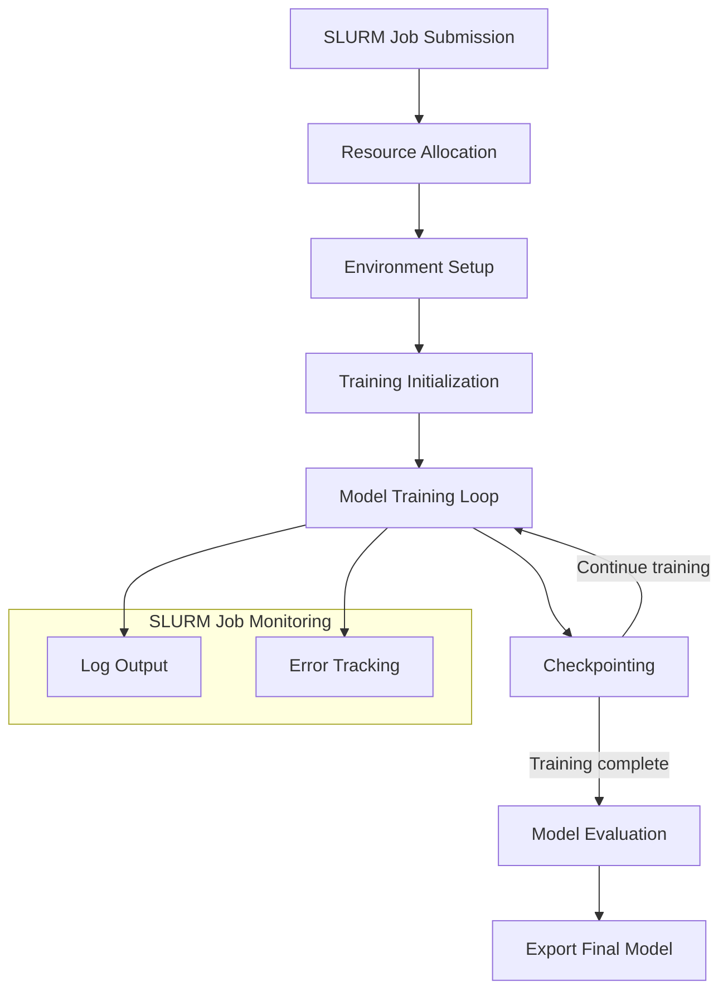
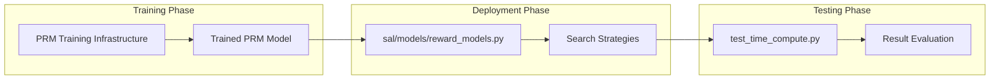

<!-- source: DeepWiki mcp.deepwiki.com · repo huggingface/search-and-learn · page 4.1 Training Infrastructure · fetched 2026-10-26 -->

# Training Infrastructure

<details>
<summary>Relevant source files</summary>

The following files were used as context for generating this wiki page:

- [recipes/training/Qwen2.5-Math-1.5B-Instruct-PRM/prm_qwen_math_1p5b_instruct.slurm](recipes/training/Qwen2.5-Math-1.5B-Instruct-PRM/prm_qwen_math_1p5b_instruct.slurm)
- [recipes/training/Qwen2.5-Math-7B-Instruct-PRM/prm_qwen_math_7b_instruct.slurm](recipes/training/Qwen2.5-Math-7B-Instruct-PRM/prm_qwen_math_7b_instruct.slurm)

</details>


## Purpose and Overview

This document describes the SLURM-based infrastructure used for training Process Reward Models (PRMs) in the Search and Learn system. The training infrastructure provides a standardized way to train PRMs across different model sizes and architectures, utilizing high-performance computing resources efficiently.

For information about evaluating the trained PRMs, see [Evaluating with ProcessBench](#4.2).

## Infrastructure Architecture

The PRM training infrastructure is built around SLURM (Simple Linux Utility for Resource Management), a workload manager designed for high-performance computing environments. The system uses recipe-specific SLURM job scripts to train different model configurations.



Sources: [recipes/training/Qwen2.5-Math-1.5B-Instruct-PRM/prm_qwen_math_1p5b_instruct.slurm](), [recipes/training/Qwen2.5-Math-7B-Instruct-PRM/prm_qwen_math_7b_instruct.slurm]()

## SLURM Job Configuration

The training infrastructure uses standardized SLURM job scripts for different model sizes. Each SLURM job script specifies the computing resources required for training and sets up the environment.

### Common SLURM Parameters

| Parameter | Value | Description |
|-----------|-------|-------------|
| `partition` | hopper-prod | The cluster partition to use |
| `qos` | normal | Quality of service level |
| `nodes` | 1 | Number of compute nodes |
| `ntasks-per-node` | 1 | Number of tasks per node |
| `gpus-per-node` | 8 | Number of GPUs allocated per node |
| `time` | 02-00:00:00 | Maximum job duration (2 days) |

Sources: [recipes/training/Qwen2.5-Math-1.5B-Instruct-PRM/prm_qwen_math_1p5b_instruct.slurm:2-10](), [recipes/training/Qwen2.5-Math-7B-Instruct-PRM/prm_qwen_math_7b_instruct.slurm:2-10]()

### Environment Setup

The SLURM scripts perform the following environment setup steps:

1. Load CUDA modules for GPU support
2. Activate the Search and Learn conda environment
3. Set environment variables for logging and debugging
4. Launch the actual training script with appropriate resource allocation



Sources: [recipes/training/Qwen2.5-Math-1.5B-Instruct-PRM/prm_qwen_math_1p5b_instruct.slurm:12-19](), [recipes/training/Qwen2.5-Math-7B-Instruct-PRM/prm_qwen_math_7b_instruct.slurm:12-19]()

## Model-Specific Configurations

The training infrastructure supports various model sizes and architectures through model-specific SLURM scripts. Current examples include:

1. **Qwen2.5-Math-1.5B-Instruct-PRM**: A 1.5B parameter model optimized for mathematical reasoning
2. **Qwen2.5-Math-7B-Instruct-PRM**: A larger 7B parameter model with enhanced capabilities

The job names and output paths are configured specifically for each model while maintaining consistent resource allocations and training procedures.

Sources: [recipes/training/Qwen2.5-Math-1.5B-Instruct-PRM/prm_qwen_math_1p5b_instruct.slurm:2](), [recipes/training/Qwen2.5-Math-7B-Instruct-PRM/prm_qwen_math_7b_instruct.slurm:2]()

## Training Execution Flow

The SLURM infrastructure executes PRM training through a series of orchestrated steps:



Sources: [recipes/training/Qwen2.5-Math-1.5B-Instruct-PRM/prm_qwen_math_1p5b_instruct.slurm](), [recipes/training/Qwen2.5-Math-7B-Instruct-PRM/prm_qwen_math_7b_instruct.slurm]()

## Logging System

Training logs are managed through SLURM's output and error file configuration:

- Standard output logs: `./logs/%x-%j.out`
- Error logs: `./logs/%x-%j.err`

Where:
- `%x` represents the job name (e.g., "PRM-qwen-1.5" or "PRM-qwen-7b")
- `%j` represents the SLURM job ID

Additional logging information is controlled through environment variables like `ACCELERATE_LOG_LEVEL=info`.

Sources: [recipes/training/Qwen2.5-Math-1.5B-Instruct-PRM/prm_qwen_math_1p5b_instruct.slurm:8-9](), [recipes/training/Qwen2.5-Math-7B-Instruct-PRM/prm_qwen_math_7b_instruct.slurm:8-9]()

## Usage Instructions

To use the training infrastructure to train a Process Reward Model:

1. Navigate to the appropriate recipe directory
2. Ensure environment and dependencies are properly set up
3. Submit the SLURM job using the command:
   ```bash
   sbatch prm_qwen_math_[model_size]_instruct.slurm
   ```
4. Monitor job progress through SLURM commands:
   ```bash
   squeue -u [username]
   ```
5. After completion, check logs in the `./logs` directory

The trained model outputs and checkpoint files will be saved according to the configurations in the `train.sh` script.

Sources: [recipes/training/Qwen2.5-Math-1.5B-Instruct-PRM/prm_qwen_math_1p5b_instruct.slurm](), [recipes/training/Qwen2.5-Math-7B-Instruct-PRM/prm_qwen_math_7b_instruct.slurm]()

## Integration with Search and Learn System

The trained Process Reward Models are integrated into the main Search and Learn system for use with various search strategies:



Sources: [recipes/training/Qwen2.5-Math-1.5B-Instruct-PRM/prm_qwen_math_1p5b_instruct.slurm](), [recipes/training/Qwen2.5-Math-7B-Instruct-PRM/prm_qwen_math_7b_instruct.slurm]()

---

