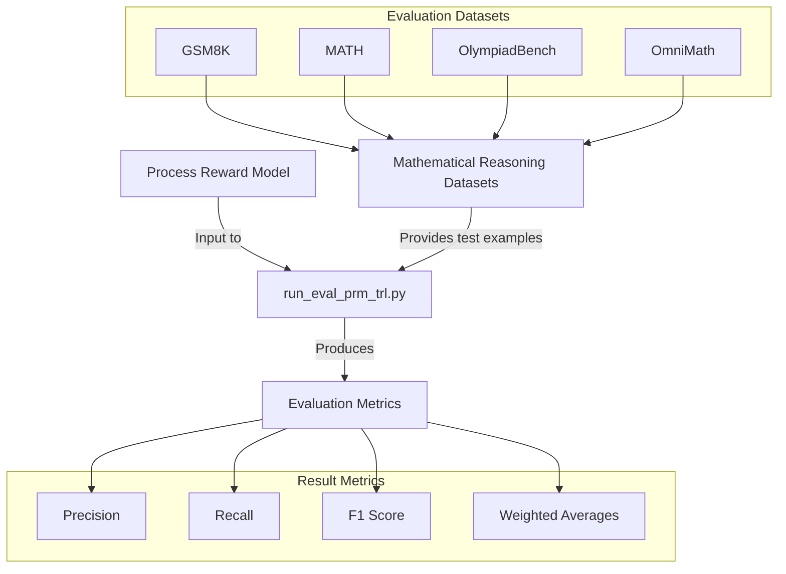
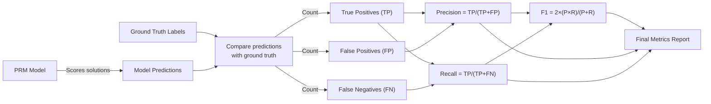
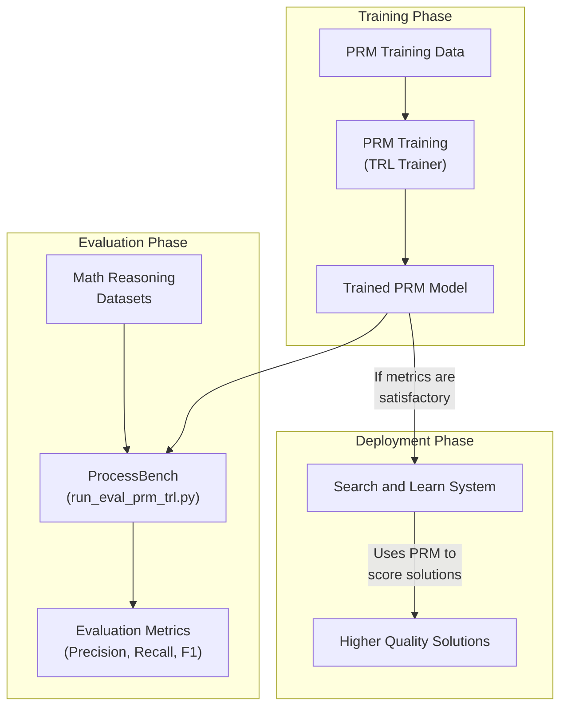

<!-- source: DeepWiki mcp.deepwiki.com · repo huggingface/search-and-learn · page 4.2 Evaluating with ProcessBench · fetched 2026-10-26 -->

# Evaluating with ProcessBench

<details>
<summary>Relevant source files</summary>

The following files were used as context for generating this wiki page:

- [recipes/training/README.md](recipes/training/README.md)
- [recipes/training/assets/wandb.png](recipes/training/assets/wandb.png)

</details>


This page describes how to evaluate Process Reward Models (PRMs) using the ProcessBench framework. PRMs are a critical component of the Search and Learn system, as they guide the search process by scoring the quality of generated solutions. ProcessBench provides standardized evaluation metrics to assess PRM performance on mathematical reasoning tasks. For information about training PRMs, see [Training Process Reward Models](#4) and [Training Infrastructure](#4.1).

## Installation and Setup

To evaluate PRMs with ProcessBench, you first need to clone the repository and set up the environment:

```bash
git clone https://github.com/huggingface/ProcessBench.git
```

Then install the required dependencies using either UV:

```bash
uv venv .venv --python 3.12
source .venv/bin/activate
uv pip install -r requirements-trl.txt
```

Or using Conda:

```bash
conda create -n processbench python=3.12 && conda activate processbench
pip install -r requirements-trl.txt
```

Sources: [recipes/training/README.md:39-62]()

## Evaluation Process

The diagram below illustrates the overall evaluation workflow:

### ProcessBench Evaluation Workflow



To run an evaluation, navigate to the `/code` directory in the ProcessBench repository and execute the `run_eval_prm_trl.py` script:

```bash
cd code/
python run_eval_prm_trl.py \
    --model_name "YOUR_MODEL_NAME" \
    --output_dir "./outputs" \
    --batch_size 256 \
    --sep "\n\n"
```

Key parameters:
- `--model_name`: Name or HuggingFace path of the PRM to evaluate
- `--output_dir`: Directory where evaluation results will be saved
- `--batch_size`: Number of examples to process at once (adjust based on GPU memory)
- `--sep`: Separator token used during PRM training (must match the training separator)

Sources: [recipes/training/README.md:64-74]()

## Evaluation Mechanics

The following diagram illustrates how ProcessBench calculates the evaluation metrics:

### ProcessBench Metrics Calculation



ProcessBench evaluates a PRM's ability to correctly classify solutions as either correct or incorrect. The evaluation process:

1. Loads the PRM model and test examples from multiple mathematics datasets
2. For each example, has the PRM score the solution
3. Calculates evaluation metrics based on the ground truth labels
4. Reports results for each dataset and weighted averages

Sources: [recipes/training/README.md:78-132]()

## Example Results

Below are example evaluation results for two different PRMs:

### Qwen2.5-Math-1.5B-Instruct-PRM-0.2

```
Individual Results:
----------------------------------------------------------------------
gsm8k         -> Precision: 22.71  Recall: 93.78  F1 Score: 36.56
math          -> Precision: 38.22  Recall: 70.69  F1 Score: 49.61
olympiadbench -> Precision: 27.08  Recall: 53.98  F1 Score: 36.07
omnimath      -> Precision: 27.93  Recall: 54.77  F1 Score: 37.00
Weighted Averages:
----------------------------------------------------------------------
Weighted      -> Precision: 30.09  Recall: 63.81  F1 Score: 40.38
```

### Qwen2.5-Math-7B-Instruct-PRM-0.2

```
Individual Results:
----------------------------------------------------------------------
gsm8k         -> Precision: 62.32  Recall: 81.87  F1 Score: 70.77
math          -> Precision: 58.42  Recall: 67.49  F1 Score: 62.63
olympiadbench -> Precision: 47.35  Recall: 46.90  F1 Score: 47.13
omnimath      -> Precision: 46.38  Recall: 49.79  F1 Score: 48.02
Weighted Averages:
----------------------------------------------------------------------
Weighted      -> Precision: 52.08  Recall: 57.92  F1 Score: 54.73
```

Sources: [recipes/training/README.md:93-102](), [recipes/training/README.md:122-131]()

## Understanding Evaluation Metrics

The metrics reported by ProcessBench are defined as follows:

| Metric | Description |
|--------|-------------|
| Precision | Proportion of solutions identified as correct by the PRM that are actually correct |
| Recall | Proportion of actually correct solutions that are identified as correct by the PRM |
| F1 Score | Harmonic mean of precision and recall: 2 × (Precision × Recall) / (Precision + Recall) |
| Weighted Average | Average metrics weighted by the number of examples in each dataset |

Higher values indicate better performance, with the F1 score providing a balanced measure of precision and recall. Note the significant performance improvement of the 7B model over the 1.5B model.

### Integration with Search and Learn

The following diagram shows how ProcessBench evaluation fits into the larger Search and Learn system:



In the overall Search and Learn system, PRMs with higher ProcessBench scores typically lead to more effective search results when used in search algorithms like Best-of-N, Beam Search, or DVTS.

Sources: [recipes/training/README.md:1-36]()

## Performance Considerations

When running ProcessBench evaluations, consider:

- Batch size should be adjusted based on available GPU memory
- For Qwen2.5-Math-1.5B-Instruct, a batch size of 256 takes approximately 0.5 hours on an H100
- For Qwen2.5-Math-7B-Instruct, a batch size of 128 takes approximately 2 hours on an H100

Sources: [recipes/training/README.md:64-67]()

## Available PRM Models

The repository includes example PRMs that have been evaluated with ProcessBench:

- [HuggingFaceH4/Qwen2.5-Math-7B-Instruct-PRM-0.2](https://huggingface.co/HuggingFaceH4/Qwen2.5-Math-7B-Instruct-PRM-0.2)
- [HuggingFaceH4/Qwen2.5-Math-1.5B-Instruct-PRM-0.2](https://huggingface.co/HuggingFaceH4/Qwen2.5-Math-1.5B-Instruct-PRM-0.2)

These models can be used directly in the Search and Learn system or as references for evaluating your own PRMs.

Sources: [recipes/training/README.md:29-36]()

---

