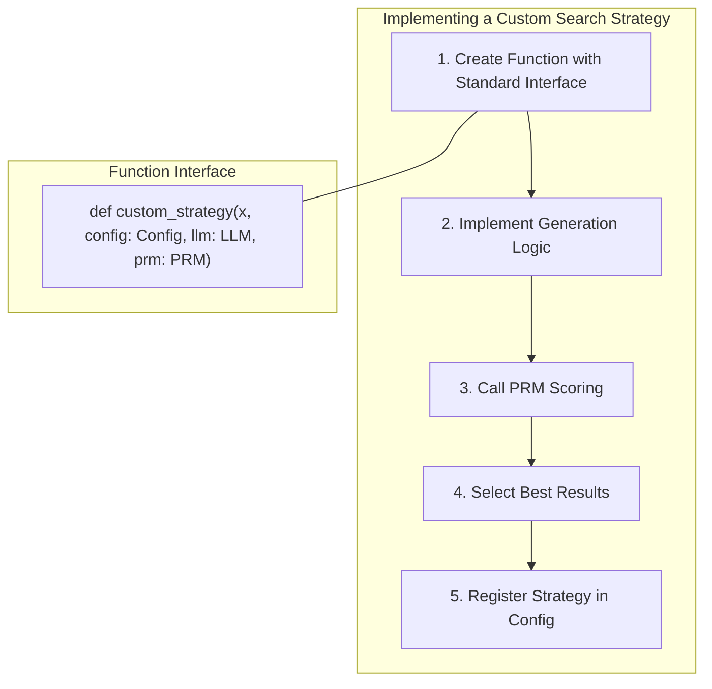
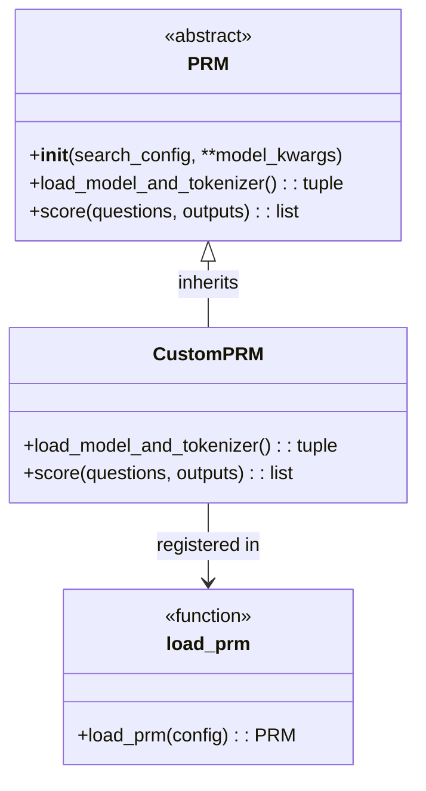
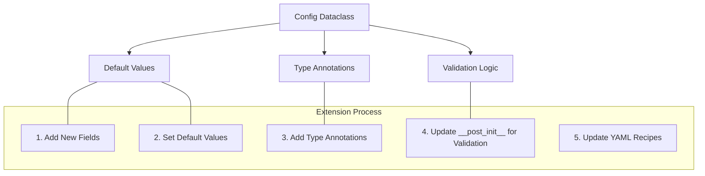
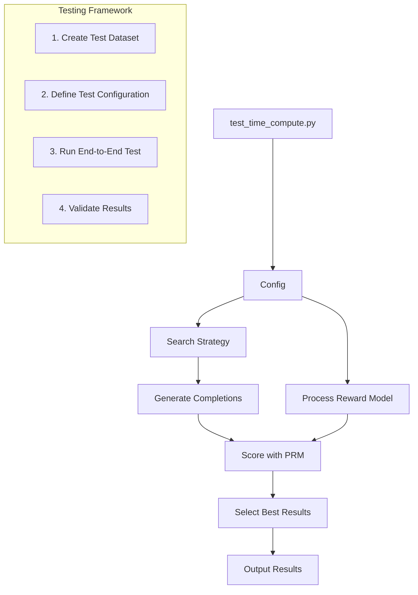

<!-- source: DeepWiki mcp.deepwiki.com · repo huggingface/search-and-learn · page 5 Extending the System · fetched 2026-10-26 -->

# Extending the System

<details>
<summary>Relevant source files</summary>

The following files were used as context for generating this wiki page:

- [src/sal/config.py](src/sal/config.py)
- [src/sal/models/reward_models.py](src/sal/models/reward_models.py)
- [src/sal/search/best_of_n.py](src/sal/search/best_of_n.py)

</details>


This document provides guidance for developers who want to extend the Search and Learn system with custom components. The system is designed to be modular and extensible, allowing you to add new search strategies, implement custom Process Reward Models (PRMs), and extend the configuration system to accommodate new features.

For information about running existing search strategies, see [Usage Guide](#3). For training new PRMs, see [Training Process Reward Models](#4).

## System Extension Architecture

The Search and Learn system is built with extensibility in mind, featuring several key extension points. The following diagram illustrates the major extensible components and their relationships:

```mermaid
classDiagram
    class "Configuration System" {
        Config
        YAML Recipes
    }
    
    class "Search Strategies" {
        best_of_n()
        beam_search()
        dvts()
        custom_strategy()
    }
    
    class "Process Reward Models" {
        PRM (Abstract Base Class)
        MathShepherd
        RLHFFlow
        SkyworkO1
        CustomPRM
    }
    
    class "Integration Points" {
        load_prm()
        test_time_compute.py
    }
    
    "Configuration System" --> "Search Strategies" : configures
    "Configuration System" --> "Process Reward Models" : configures
    "Search Strategies" --> "Process Reward Models" : uses
    "Process Reward Models" --> "Integration Points" : registered via
    "Search Strategies" --> "Integration Points" : registered via
    "Configuration System" --> "Integration Points" : loaded by
```

**Diagram: Extension Points in the Search and Learn System**

Sources: [src/sal/config.py](), [src/sal/models/reward_models.py](), [src/sal/search/best_of_n.py]()

The system can be extended in the following key areas:

1. **Custom Search Strategies**: Implement new algorithms for generating and selecting text completions.
2. **Custom Process Reward Models**: Create new models for evaluating the quality of generated solutions.
3. **Configuration Extensions**: Add new parameters to the configuration system to support new features.

## Creating Custom Search Strategies

Search strategies are responsible for generating completions and selecting the best ones based on PRM scores. The system currently includes Best-of-N, Beam Search, and DVTS strategies.



**Diagram: Custom Search Strategy Implementation Process**

Sources: [src/sal/search/best_of_n.py:24-97](), [src/sal/config.py:26]()

### Implementation Steps

1. **Create a new Python file** in the `src/sal/search/` directory.

2. **Implement your search strategy function** with the following signature:
   ```python
   def custom_strategy(x, config: Config, llm: LLM, prm: PRM):
       # Implementation here
       return x
   ```

3. **Add your strategy to the Config class** by updating the `approach` field's type annotation in [src/sal/config.py]():

   ```python
   approach: Literal["best_of_n", "beam_search", "dvts", "custom_strategy"] = "best_of_n"
   ```

4. **Implement custom validation logic** if needed in the `__post_init__` method of the `Config` class.

### Implementation Guidelines

Your search strategy function should:

1. **Generate completions** using the provided language model (`llm`).
2. **Score completions** using the provided process reward model (`prm`).
3. **Select the best completion(s)** based on scores.
4. **Update the input dictionary `x`** with:
   - `completions`: All generated completions
   - `scores`: Scores for all completions
   - `pred`: The selected best completion
   - `completion_tokens`: Token counts for the completions

### Example: Best-of-N Implementation

The [src/sal/search/best_of_n.py:24-97]() provides a good reference implementation for developing your own search strategy:

1. It formats conversations and applies the chat template
2. Duplicates prompts to generate multiple completions
3. Calls the LLM to generate completions
4. Uses the PRM to score the completions
5. Selects the completion with the highest score
6. Updates the input dictionary with the results

Sources: [src/sal/search/best_of_n.py:24-97](), [src/sal/config.py:26-66]()

## Implementing New Reward Models

Process Reward Models (PRMs) evaluate the quality of generated text. The system uses an abstract base class `PRM` that custom implementations should inherit from.



**Diagram: Custom PRM Implementation**

Sources: [src/sal/models/reward_models.py:72-86](), [src/sal/models/reward_models.py:343-356]()

### Implementation Steps

1. **Create a new class** that inherits from the `PRM` base class.

2. **Implement required methods**:
   - `load_model_and_tokenizer`: Load and return the model and tokenizer.
   - `score`: Score the outputs for the given questions.

3. **Register your PRM** in the `load_prm` function in [src/sal/models/reward_models.py]().

### Example Implementation

```python
class CustomPRM(PRM):
    def load_model_and_tokenizer(self, **model_kwargs) -> tuple[PreTrainedModel, PreTrainedTokenizer]:
        # Load and return your model and tokenizer
        tokenizer = AutoTokenizer.from_pretrained("your-model-path")
        model = AutoModelForCausalLM.from_pretrained(
            "your-model-path",
            device_map="auto",
            torch_dtype=torch.float16,
            **model_kwargs
        ).eval()
        return model, tokenizer

    def score(self, questions: list[str], outputs: list[list[str]]) -> list[list[float]]:
        # Implement your scoring logic
        # Return a list of scores for each question's outputs
```

### Registering a Custom PRM

To register your custom PRM, add a conditional branch to the `load_prm` function:

```python
def load_prm(config: Config) -> PRM:
    # Existing conditions...
    
    if config.prm_path == "your/custom/prm/path":
        return CustomPRM(config)
        
    # Fallback
    raise NotImplementedError(f"PRM {config.prm_path} not implemented")
```

Sources: [src/sal/models/reward_models.py:72-86](), [src/sal/models/reward_models.py:343-356]()

## Extending the Configuration System

The configuration system is based on a Python dataclass defined in [src/sal/config.py](). You can extend it to support new parameters for your custom components.



**Diagram: Configuration System Extension Process**

Sources: [src/sal/config.py:24-106]()

### Adding New Parameters

1. **Add new fields** to the `Config` dataclass with appropriate type annotations and default values.

2. **Update the `__post_init__` method** if your new parameters require validation or affect other parameters.

3. **Create or update YAML recipes** in the `recipes/` directory to include your new parameters.

### Example: Adding a Parameter for a Custom Search Strategy

```python
@dataclass
class Config:
    # Existing fields...
    
    # New fields for custom search strategy
    custom_strategy_param1: int = 10
    custom_strategy_param2: float = 0.5
    
    def __post_init__(self):
        # Existing validation...
        
        # Validation for new parameters
        if self.approach == "custom_strategy":
            if self.custom_strategy_param1 < 1:
                raise ValueError("custom_strategy_param1 must be at least 1")
```

Sources: [src/sal/config.py:24-106]()

## Testing and Validation

When extending the system, it's important to test your custom components thoroughly.

### Testing Search Strategies

1. Create a small dataset with representative problems.
2. Run your custom search strategy on the dataset.
3. Compare results with baseline strategies (e.g., Best-of-N).
4. Check that your strategy correctly populates all expected fields in the output.

### Testing Process Reward Models

1. Create a dataset with problems and known good/bad solutions.
2. Run your PRM on the dataset to ensure it correctly scores the solutions.
3. Compare scores with other PRMs to ensure consistency.
4. Test edge cases, such as very short or very long outputs.

### Strategy-PRM Compatibility

Ensure your custom strategy works correctly with different PRMs, and your custom PRM works with different strategies.



**Diagram: Testing Framework for Custom Components**

Sources: [src/sal/search/best_of_n.py:24-97](), [src/sal/models/reward_models.py:72-86]()

## Conclusion

The Search and Learn system is designed to be modular and extensible, allowing you to add custom search strategies and process reward models. By following the guidelines in this document, you can extend the system to meet your specific needs while maintaining compatibility with the existing components.

Remember to thoroughly test your custom components and update the configuration system appropriately to support any new parameters they require.

---

