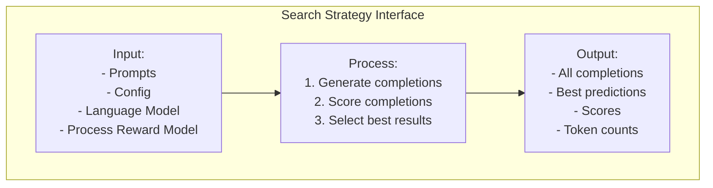
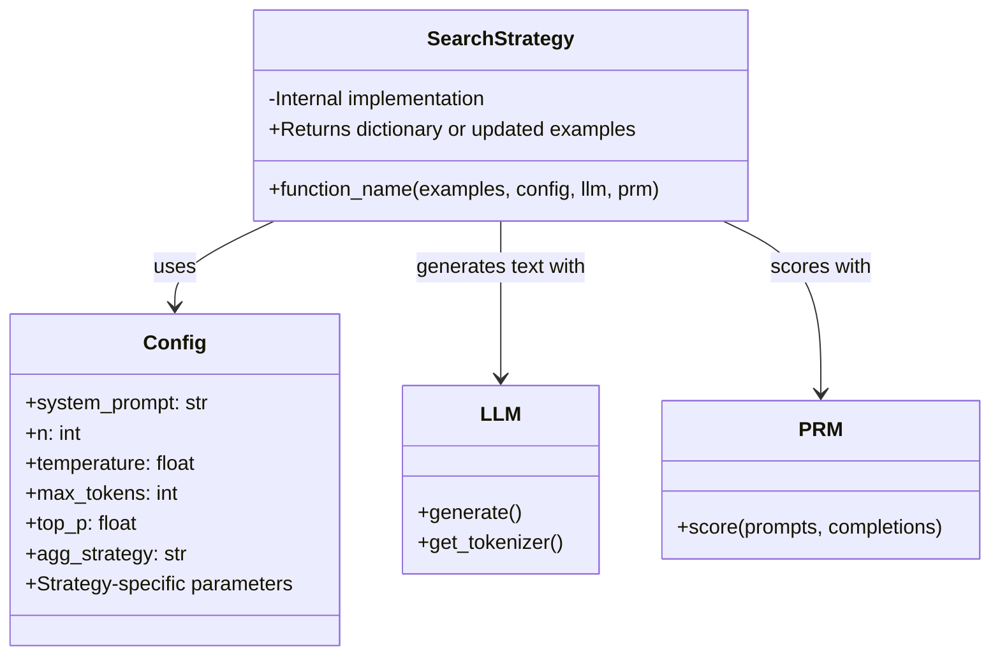
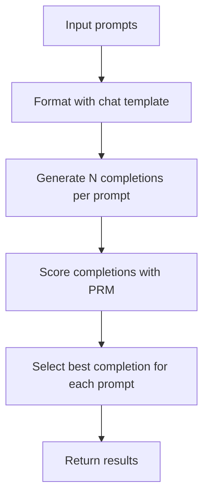
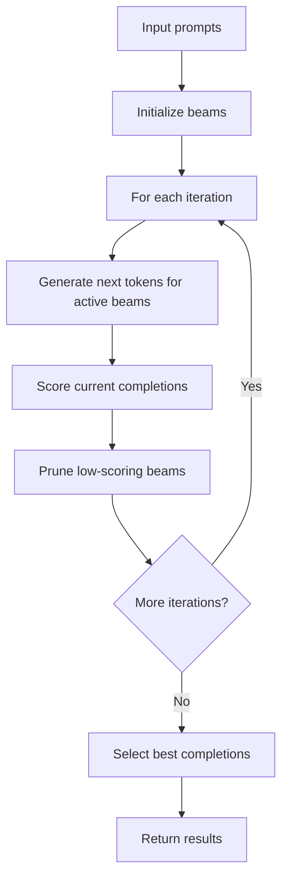
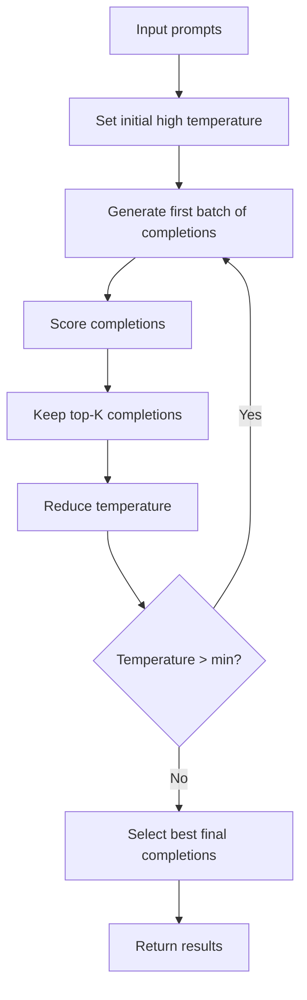

<!-- source: DeepWiki mcp.deepwiki.com · repo huggingface/search-and-learn · page 5.1 Creating Custom Search Strategies · fetched 2026-10-26 -->

# Creating Custom Search Strategies

<details>
<summary>Relevant source files</summary>

The following files were used as context for generating this wiki page:

- [src/sal/search/beam_search.py](src/sal/search/beam_search.py)
- [src/sal/search/best_of_n.py](src/sal/search/best_of_n.py)

</details>


This page explains how to implement custom search strategies for the Search and Learn system. Search strategies are core components that determine how to explore the space of possible completions from a language model to find high-quality solutions according to a Process Reward Model (PRM).

For information about using existing search strategies, see [Search Strategies](#2.2). For implementing new reward models, see [Implementing New Reward Models](#5.2).

## Search Strategy Overview

Search strategies in the Search and Learn system are functions that take a set of prompts, generate completions using a language model, score them using a process reward model, and return the best completions. The system currently includes these built-in strategies:

- **Best-of-N**: Generates multiple independent completions and selects the highest-scoring one
- **Beam Search**: Maintains a beam of promising candidates, iteratively extending and pruning them
- **DVTS (Diverse Value Transformation Search)**: Generates diverse candidates through value-guided exploration



Sources: [src/sal/search/best_of_n.py:24-97](), [src/sal/search/beam_search.py:200-223]()

## Search Strategy Interface

All search strategies follow a consistent interface pattern:



Sources: [src/sal/search/best_of_n.py:24-97](), [src/sal/search/beam_search.py:200-223]()

### Parameters

Every search strategy function takes these parameters:

1. **examples/x**: The dataset examples containing prompts (typically a dictionary with a "problem" key)
2. **config**: A `Config` object with parameters for the strategy
3. **llm**: The language model instance (VLLM)
4. **prm**: The process reward model for scoring completions

### Return Value

Search strategies must return either:

1. The updated examples dictionary with added fields:
   - `completions`: List of all generated completions for each prompt
   - `scores`: List of scores for each completion
   - `pred`: List of selected best completions
   - `completion_tokens`: List of token counts for each completion

2. Or a results dictionary with the same fields

## Anatomy of a Search Strategy

Let's examine the core components of a search strategy by looking at the existing implementations.

### Best-of-N Strategy

The Best-of-N strategy follows these steps:



Key implementation aspects:
1. Duplicates each prompt N times to enable batch generation
2. Configures sampling parameters (temperature, max_tokens, top_p)
3. Generates completions using the language model
4. Scores all completions using the process reward model
5. Aggregates scores and selects the best completion for each prompt

Sources: [src/sal/search/best_of_n.py:24-97]()

### Beam Search Strategy

Beam Search is more complex and follows an iterative approach:



Key implementation aspects:
1. Maintains a "beam" of candidate completions for each prompt
2. Iteratively extends each candidate by generating more tokens
3. Scores candidates and prunes low-scoring ones
4. Continues until reaching the maximum number of iterations
5. Returns the best completions from completed beams

Sources: [src/sal/search/beam_search.py:32-197](), [src/sal/search/beam_search.py:200-223]()

## Implementing a Custom Search Strategy

To implement a custom search strategy, follow these steps:

### 1. Create a New Module

Create a new Python file in the `src/sal/search/` directory, e.g., `my_strategy.py`.

### 2. Define the Strategy Function

Implement a function with the standard interface:

```python
def my_strategy(examples, config: Config, llm: LLM, prm: PRM):
    # Implementation goes here
    results = {
        "completions": [],  # List of lists of completions
        "scores": [],       # List of lists of scores
        "pred": [],         # List of best completions
        "completion_tokens": []  # List of lists of token counts
    }
    
    # Process each prompt
    for prompt in examples["problem"]:
        # Your custom search logic here
        
        # Add results for this prompt
        results["completions"].append(completions_for_prompt)
        results["scores"].append(scores_for_prompt)
        results["pred"].append(best_completion_for_prompt)
        results["completion_tokens"].append(token_counts_for_prompt)
    
    return results
```

### 3. Leverage Existing Utilities

You can use these common utilities in your implementation:

- For tokenization and chat formatting:
  ```python
  tokenizer = llm.get_tokenizer()
  if config.custom_chat_template is not None:
      tokenizer.chat_template = config.custom_chat_template
  templated_convs = tokenizer.apply_chat_template(
      convs, tokenize=False, add_generation_prompt=True
  )
  ```

- For generating completions:
  ```python
  sampling_params = SamplingParams(
      temperature=config.temperature,
      max_tokens=config.max_tokens,
      top_p=config.top_p,
      n=1,
  )
  responses = llm.generate(
      templated_convs,
      sampling_params=sampling_params,
      use_tqdm=False,
  )
  ```

- For scoring and aggregating:
  ```python
  scores = prm.score(prompts, completions)
  agg_scores = [
      [aggregate_scores(s, config.agg_strategy) for s in score]
      for score in scores
  ]
  ```

Sources: [src/sal/search/best_of_n.py:24-97](), [src/sal/search/beam_search.py:32-197]()

## Example Custom Strategy: Temperature Annealing

Here's an outline for a custom strategy that gradually reduces temperature during generation:



Key aspects to implement:
1. Start with a high temperature to encourage exploration
2. Generate completions and score them
3. Filter to keep only the most promising candidates
4. Gradually reduce temperature to refine solutions
5. Return the best completions after reaching minimum temperature

## Considerations for Custom Strategies

When implementing a custom search strategy, consider these aspects:

1. **Efficiency**: 
   - Batch generation where possible
   - Avoid unnecessary computation

2. **Resource Management**:
   - Be mindful of memory usage for large beams or many candidates
   - Consider token budget constraints

3. **Diversity**:
   - Implement mechanisms to maintain diversity in candidates
   - Consider techniques like nucleus sampling or explicit diversity objectives

4. **Early Stopping**:
   - Consider when to stop generation early if optimal solutions are found
   - Implement safeguards against infinite loops

5. **Configuration**:
   - Define strategy-specific parameters in the Config class
   - Provide sensible defaults with clear documentation

## Integration with the System

To use your custom search strategy with the Search and Learn system:

1. Import your strategy in `scripts/test_time_compute.py`
2. Add your strategy to the mapping of strategy names to functions
3. Create a recipe YAML file that specifies your strategy
4. Run experiments using your strategy:
   ```bash
   python scripts/test_time_compute.py --config recipes/your_strategy_recipe.yaml
   ```

## Advanced Techniques

Consider these advanced techniques for sophisticated search strategies:

1. **Hybrid approaches**: Combine different search strategies (e.g., start with Best-of-N then refine with Beam Search)

2. **Adaptive parameters**: Dynamically adjust search parameters based on progress or difficulty

3. **Multi-objective optimization**: Balance multiple objectives (e.g., quality, diversity, simplicity)

4. **Custom scoring functions**: Implement domain-specific scoring beyond the PRM

5. **Learning-based search**: Use a learned policy to guide the search process

Sources: [src/sal/search/best_of_n.py](), [src/sal/search/beam_search.py]()

By following this guide, you can implement custom search strategies that optimize for specific requirements or explore novel approaches to finding high-quality completions through test-time compute scaling.

---

