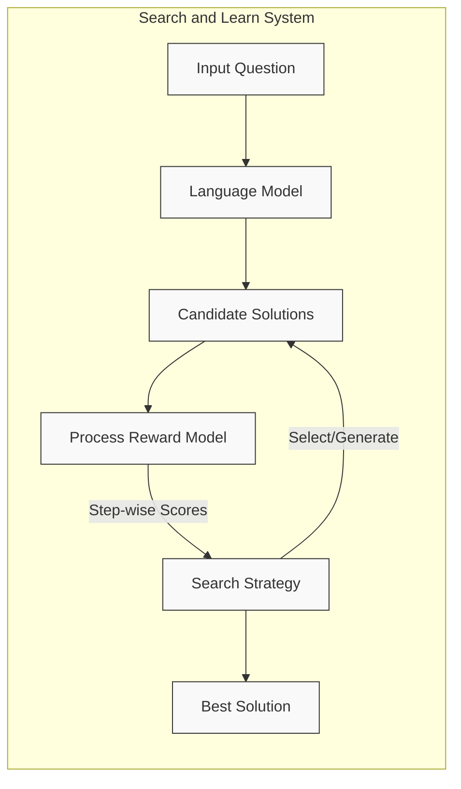
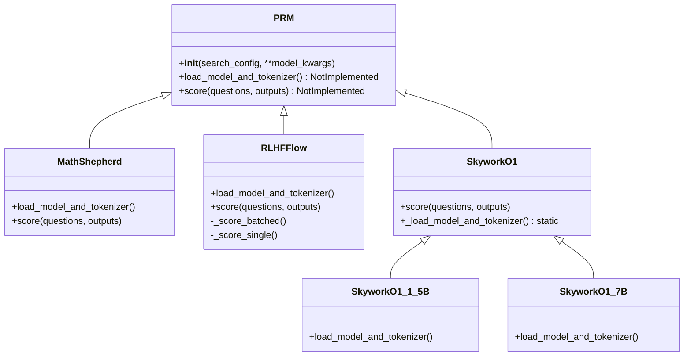
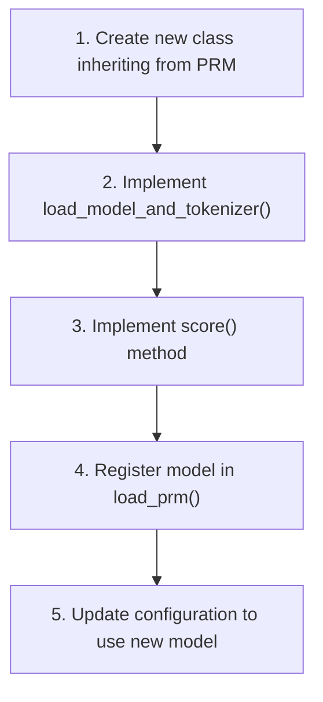
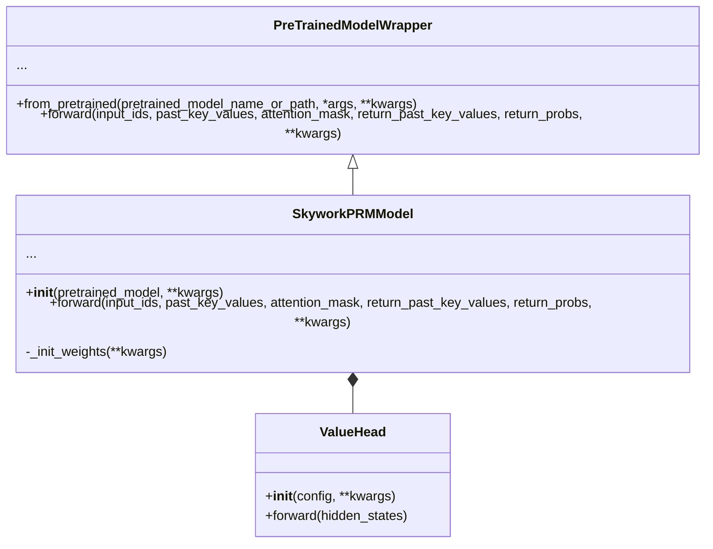

<!-- source: DeepWiki mcp.deepwiki.com · repo huggingface/search-and-learn · page 5.2 Implementing New Reward Models · fetched 2026-10-26 -->

# Implementing New Reward Models

<details>
<summary>Relevant source files</summary>

The following files were used as context for generating this wiki page:

- [src/sal/models/reward_models.py](src/sal/models/reward_models.py)
- [src/sal/models/skywork_o1_prm/io_utils.py](src/sal/models/skywork_o1_prm/io_utils.py)
- [src/sal/models/skywork_o1_prm/modeling_base.py](src/sal/models/skywork_o1_prm/modeling_base.py)
- [src/sal/models/skywork_o1_prm/prm_model.py](src/sal/models/skywork_o1_prm/prm_model.py)

</details>


This guide documents how to implement and integrate new Process Reward Models (PRMs) into the Search and Learn system. PRMs play a critical role in evaluating candidate solutions during search-based inference. For information about how Search strategies use these reward models, see [Search Strategies](#2.2).

## What are Process Reward Models?

Process Reward Models (PRMs) evaluate the quality of Language Model (LLM) outputs, especially focusing on step-by-step reasoning processes. Unlike traditional reward models that only score entire outputs, PRMs assess individual reasoning steps, providing a more granular evaluation of the solution process.

In the Search and Learn system, PRMs are used by search strategies to evaluate candidate solutions and guide the search toward better outcomes.



Sources: [src/sal/models/reward_models.py:72-86]()

## Reward Model Architecture

The Search and Learn system implements a flexible architecture for PRMs through a base class and specific implementations:



Sources: [src/sal/models/reward_models.py:72-341]()

## Implementing a New Reward Model

To implement a new reward model, you need to:

1. Create a new class that inherits from the `PRM` base class
2. Implement the required methods
3. Register the model with the `load_prm` function

### Step 1: Create a New PRM Class

Create a new class that inherits from `PRM`. Your class must implement two methods:

1. `load_model_and_tokenizer`: Loads the model and tokenizer
2. `score`: Scores the provided outputs step-by-step



Sources: [src/sal/models/reward_models.py:72-86]()

### Step 2: Implement Required Methods

#### The `load_model_and_tokenizer` Method

This method loads the pretrained model and tokenizer. It should return a tuple of `(model, tokenizer)`. Here's an example from the `SkyworkO1_7B` implementation:

```python
def load_model_and_tokenizer(self, **model_kwargs) -> tuple[PreTrainedModel, PreTrainedTokenizer]:
    prm_model_path = "Skywork/Skywork-o1-Open-PRM-Qwen-2.5-7B"
    return SkyworkO1._load_model_and_tokenizer(prm_model_path, **model_kwargs)
```

Sources: [src/sal/models/reward_models.py:335-340]()

#### The `score` Method

This method takes:
- A list of questions
- A nested list of candidate outputs for each question
- Returns a nested list of scores for each step in each candidate output

Example implementation from `MathShepherd`:

```python
def score(self, questions: list[str], outputs: list[list[str]]) -> list[list[float]]:
    inputs_for_prm = []
    lengths = []
    for question, output in zip(questions, outputs):
        prompt = self.search_config.system_prompt + "\n" + question + "\n"
        special_outputs = [o.replace("\n\n", " ки\n\n") for o in output]
        special_outputs = [
            o + " ки" if o[-2:] != "\n\n" else o for o in special_outputs
        ]
        inputs_for_prm.extend([f"{prompt} {o}" for o in special_outputs])
        lengths.append(len(output))

    output_scores = batched_math_shepherd_inference(
        self.model,
        self.tokenizer,
        inputs_for_prm,
        self.search_config.prm_batch_size,
    )
    # Reshape scores to match input structure
    cumulative_lengths = list(accumulate(lengths))
    output_scores = [
        output_scores[i:j]
        for i, j in zip([0] + cumulative_lengths[:-1], cumulative_lengths)
    ]

    return output_scores
```

Sources: [src/sal/models/reward_models.py:102-136]()

### Step 3: Register Your Model in `load_prm`

To make your model available to the system, add a condition to the `load_prm` function:

```python
def load_prm(config: Config) -> PRM:
    if config.prm_path == "path/to/your/model":
        return YourPRMClass(config)
    
    # Existing conditions...
    
    raise NotImplementedError(f"PRM {config.prm_path} not implemented")
```

Sources: [src/sal/models/reward_models.py:343-356]()

## Case Study: Implementing a Complex PRM

For more complex scenarios, let's examine how the `SkyworkO1` model is implemented. This model has additional complexity in the form of a specialized model architecture and score computation.

### Model Initialization

The `SkyworkO1` uses a class method to load the model and tokenizer, which is then called by subclasses:

```python
@classmethod
def _load_model_and_tokenizer(cls, prm_model_path, **model_kwargs) -> tuple[PreTrainedModel, PreTrainedTokenizer]:
    tokenizer = AutoTokenizer.from_pretrained(prm_model_path, trust_remote_code=True)
    model = SkyworkPRMModel.from_pretrained(
        prm_model_path,
        device_map="auto",
        torch_dtype=torch.bfloat16,
        **model_kwargs,
    ).eval()

    return model, tokenizer
```

Sources: [src/sal/models/reward_models.py:282-295]()

### Score Computation

The `score` method for `SkyworkO1` demonstrates how to handle custom model output processing:

```python
def score(self, questions: list[str], outputs: list[list[str]]) -> list[list[float]]:
    all_scores = []
    for question, answers in zip(questions, outputs):
        processed_data = [
            prepare_input(question, answer, tokenizer=self.tokenizer, step_token="\n")
            for answer in answers
        ]
        input_ids, steps, reward_flags = zip(*processed_data)
        input_ids, attention_mask, reward_flags = prepare_batch_input_for_model(
            input_ids, reward_flags, self.tokenizer.pad_token_id
        )
        device = self.model.pretrained_model.device
        with torch.no_grad():
            _, _, rewards = self.model(
                input_ids=input_ids.to(device),
                attention_mask=attention_mask.to(device),
                return_probs=True,
            )
            all_step_scores = derive_step_rewards(
                rewards.detach().to("cpu", dtype=torch.float32), reward_flags
            )
        all_scores.append(all_step_scores)
    return all_scores
```

Sources: [src/sal/models/reward_models.py:297-324](), [src/sal/models/skywork_o1_prm/io_utils.py:6-56]()

The custom model uses specialized utility functions:
- `prepare_input`: Tokenizes the input and tracks the positions where rewards should be computed
- `prepare_batch_input_for_model`: Batches inputs with proper padding
- `derive_step_rewards`: Extracts rewards for specific tokens from model outputs

## Custom Architectures: SkyworkPRMModel

For some reward models like `SkyworkO1`, you may need to implement custom model architectures. The `SkyworkPRMModel` is an example:



This model architecture:
1. Wraps a pretrained language model
2. Adds a value head for predicting rewards
3. Tracks reward positions with special flags

Sources: [src/sal/models/skywork_o1_prm/prm_model.py:22-248](), [src/sal/models/skywork_o1_prm/modeling_base.py:66-262]()

## Best Practices

Based on the implemented reward models, here are best practices for implementing your own:

### 1. Efficient Batching

For models that handle batch inference, like `RLHFFlow`, implement proper batching to increase throughput:

```python
def _score_batched(self, questions: list[str], outputs: list[list[str]], batch_size: int = 2):
    # Batch processing implementation
    # ...
```

Sources: [src/sal/models/reward_models.py:213-277]()

### 2. Memory Management

Clear GPU memory after processing batches:

```python
# Clear GPU memory
del inputs_batch, logits, scores
torch.cuda.empty_cache()
```

Sources: [src/sal/models/reward_models.py:65-67]()

### 3. Model Loading Options

Provide configuration options in `load_model_and_tokenizer` for flexibility:

```python
def load_model_and_tokenizer(self, **model_kwargs) -> tuple[PreTrainedModel, PreTrainedTokenizer]:
    model = AutoModelForCausalLM.from_pretrained(
        model_id,
        device_map="auto",
        attn_implementation="flash_attention_2",
        torch_dtype=torch.float16,
        **model_kwargs  # Allow overriding defaults
    ).eval()
    # ...
```

Sources: [src/sal/models/reward_models.py:89-100]()

### 4. Error Handling

Check consistency between inputs and outputs:

```python
assert len(output_score) == len(output), f"{len(output_score)} != {len(output)}"
```

Sources: [src/sal/models/reward_models.py:132-134]()

## Model Registry and Configuration

The `load_prm` function acts as a registry for available reward models:

```python
def load_prm(config: Config) -> PRM:
    if config.prm_path == "peiyi9979/math-shepherd-mistral-7b-prm":
        return MathShepherd(config)

    if config.prm_path == "RLHFlow/Llama3.1-8B-PRM-Deepseek-Data":
        return RLHFFlow(config)

    if config.prm_path == "Skywork/Skywork-o1-Open-PRM-Qwen-2.5-1.5B":
        return SkyworkO1_1_5B(config)

    if config.prm_path == "Skywork/Skywork-o1-Open-PRM-Qwen-2.5-7B":
        return SkyworkO1_7B(config)

    raise NotImplementedError(f"PRM {config.prm_path} not implemented")
```

Sources: [src/sal/models/reward_models.py:343-356]()

To use your custom reward model, specify its path in the configuration:

```yaml
# In your recipe YAML
prm_path: "path/to/your/custom/model"
```

## Summary

Implementing a new reward model in the Search and Learn system involves:

1. Creating a class that inherits from `PRM`
2. Implementing the required methods:
   - `load_model_and_tokenizer`: For loading the model and tokenizer
   - `score`: For scoring solution steps
3. Registering the model in the `load_prm` function
4. Using the model through configuration

For complex models, you may need to implement custom architectures and utility functions to handle specialized processing requirements.