# Page: Overview

# Overview

<details>
<summary>Relevant source files</summary>

The following files were used as context for generating this wiki page:

- [README.md](README.md)
- [recipes/README.md](recipes/README.md)

</details>


Search and Learn is a repository that provides tools and infrastructure for enhancing Language Model capabilities through test-time compute scaling. Rather than relying solely on larger model sizes (which require expensive training), this approach allows models to "think longer" on harder problems by using search algorithms guided by Process Reward Models (PRMs).

For detailed installation instructions, see [Installation and Setup](#1.1). For an explanation of the theoretical underpinnings, see [Key Concepts](#1.2).

## Purpose and Scope

The Search and Learn repository implements techniques that allow open-source models to solve complex problems when given enough "time to think." The repository focuses on two main areas:

1. **Search against verifiers**: Guiding LLMs to search for solutions to "verifiable problems" (math, code) using Process Reward Models to score each step of the reasoning.

2. **Training process reward models**: Providing infrastructure to train reward models that evaluate each step of a reasoning process, offering fine-grained feedback for search methods.

As explained in the project's README, the name is inspired by Rich Sutton's Bitter Lesson: "the great power of general purpose methods, of methods that continue to scale with increased computation... are **search** and **learning**."

Sources: [README.md:10-15]()

## System Architecture

### High-Level System Diagram

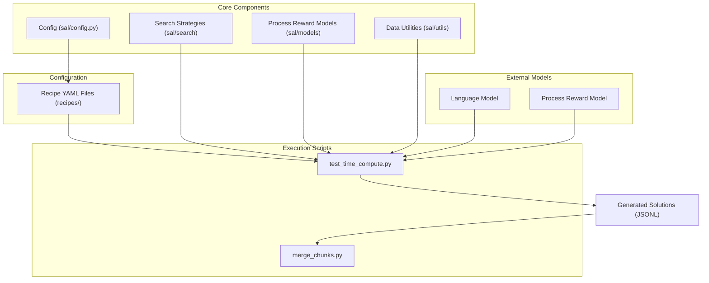

Sources: [README.md:72-84](), [recipes/README.md:1-27]()

### Search Strategies Comparison

The repository implements three main search strategies:

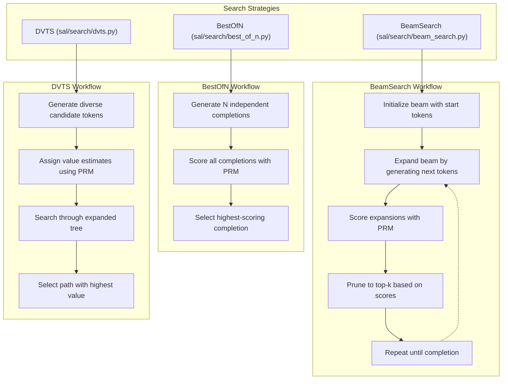

Sources: [README.md:40-43](), [recipes/README.md:3-15]()

### Data Flow Pipeline

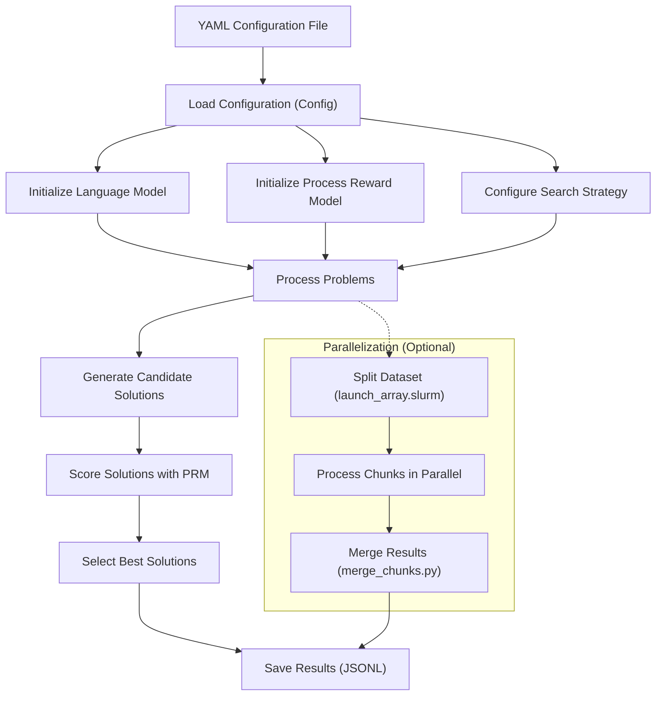

Sources: [recipes/README.md:159-192]()

## Supported Search Strategies

The repository implements three different search strategies, each with different characteristics:

### 1. Best-of-N

The simplest search strategy. It:
- Generates `n` independent solutions to a problem
- Scores each solution using the Process Reward Model
- Selects the highest-scoring solution

This approach is computationally efficient but lacks the guided search aspects of the other strategies.

### 2. Beam Search

A more guided approach that:
- Maintains a beam of the top-k most promising candidate solutions at each step
- Expands each candidate by generating the next token
- Scores all expansions and prunes to keep only the top-k
- Repeats until all candidates are complete

Beam search provides more guidance than Best-of-N but can suffer from lack of diversity.

### 3. Diverse Value Transformation Search (DVTS)

A sophisticated approach that:
- Generates diverse candidate tokens at each step
- Assigns value estimates using the Process Reward Model
- Searches through the expanded tree to find the highest-value path

DVTS combines the exploration benefits of diverse sampling with the exploitation benefits of value-guided search.

Sources: [README.md:40-43](), [recipes/README.md:3-15]()

## Component Relationships

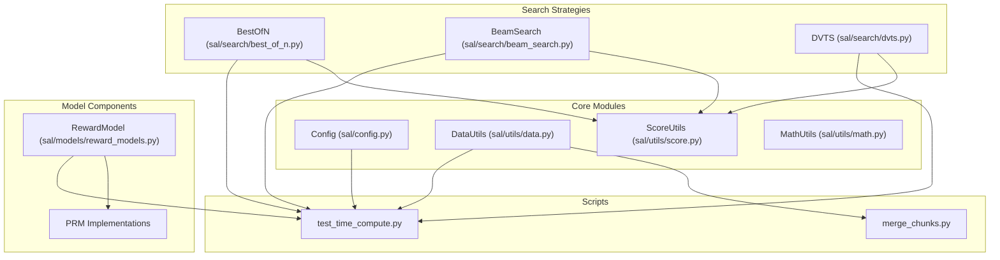

Sources: [README.md:72-84]()

## Getting Started

To get started with Search and Learn:

1. Install the repository:
```bash
pip install -e '.[dev]'
```

2. Select a recipe configuration:
```bash
export CONFIG=recipes/Llama-3.2-1B-Instruct/best_of_n.yaml
```

3. Run test-time compute:
```bash
python scripts/test_time_compute.py $CONFIG
```

Each approach can be launched by specifying the associated YAML configuration file from the `recipes` directory. For more detailed instructions, see [Running Basic Experiments](#3.1).

The repository includes pre-configured recipes for three different base models:
- Llama-3.2-1B-Instruct
- Llama-3.2-3B-Instruct
- Qwen2.5-1.5B-Instruct

And for each of the three search strategies (Best-of-N, Beam Search, and DVTS).

Sources: [README.md:46-62](), [recipes/README.md:17-23](), [recipes/README.md:5-15]()

## Supported Process Reward Models

The system currently supports the following Process Reward Models:

| PRM | Description |
|-----|-------------|
| RLHFlow/Llama3.1-8B-PRM-Deepseek-Data | Default PRM used in the recipes |
| peiyi9979/math-shepherd-mistral-7b-prm | Alternative PRM for evaluation |
| Skywork/Skywork-o1-Open-PRM-Qwen-2.5-1.5B | Skywork PRM for Qwen models |
| Skywork/Skywork-o1-Open-PRM-Qwen-2.5-7B | Larger Skywork PRM variant |

The repository also includes infrastructure for training custom Process Reward Models. For more information, see [Training Process Reward Models](#4).

Sources: [recipes/README.md:86-91](), [recipes/README.md:201-203]()

---

# Page: Installation and Setup

# Installation and Setup

<details>
<summary>Relevant source files</summary>

The following files were used as context for generating this wiki page:

- [.gitignore](.gitignore)
- [LICENSE](LICENSE)
- [README.md](README.md)
- [setup.py](setup.py)

</details>


This document provides comprehensive instructions for setting up the Search and Learn environment, which is required to run test-time compute scaling experiments. For information about key concepts and system architecture, see [Key Concepts](#1.2) and [System Architecture](#2).

## System Requirements

Before installing Search and Learn, ensure your system meets the following requirements:

- Python 3.10.9 or higher
- Git with Large File Storage (LFS) support
- Hugging Face account (for model access and uploading results)

Sources: [setup.py:61-61]()

## Installation Steps

The installation process consists of four main steps: creating a Python environment, installing the package, authenticating with Hugging Face, and setting up Git LFS.

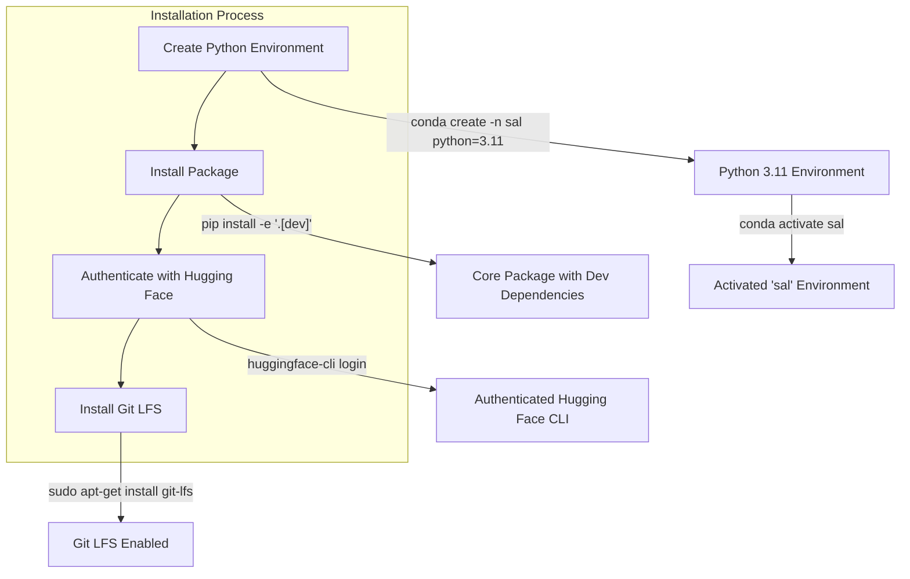

### 1. Creating a Python Environment

First, create a dedicated Python virtual environment using Conda:

```bash
conda create -n sal python=3.11 && conda activate sal
```

This creates an environment named `sal` with Python 3.11 and activates it.

Sources: [README.md:50-52]()

### 2. Installing the Package

Install the Search and Learn package in development mode with optional dependencies:

```bash
pip install -e '.[dev]'
```

This command installs the package in editable mode (`-e`), allowing you to modify the code without reinstalling. The `[dev]` option installs additional development dependencies.

Sources: [README.md:55-55](), [setup.py:24-25]()

### 3. Authenticating with Hugging Face

To access models and push results to the Hugging Face Hub, log in to your Hugging Face account:

```bash
huggingface-cli login
```

This will prompt you for your Hugging Face authentication token, which you can find in your [Hugging Face account settings](https://huggingface.co/settings/tokens).

Sources: [README.md:59-61]()

### 4. Installing Git LFS

To handle large model files when pushing to the Hugging Face Hub, install Git Large File Storage (LFS):

```bash
sudo apt-get install git-lfs
```

Sources: [README.md:65-66]()

## Dependency Structure

Search and Learn relies on several dependencies to function properly. Understanding this structure helps when troubleshooting or extending the system.

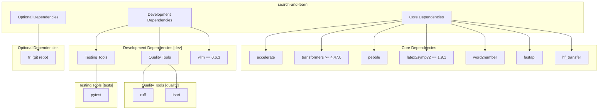

The package is organized with several dependency groups:

- **Core dependencies**: Required for basic functionality
- **Development dependencies [dev]**: Tools for development, testing, and quality assurance
- **TRL dependency [trl]**: Optional transformer reinforcement learning library

Sources: [setup.py:21-34]()

## Package Structure

After installation, the Search and Learn package structure is organized as follows:

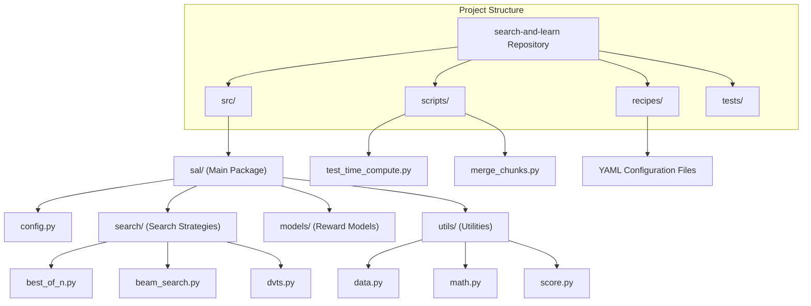

This structure shows where to find key components after installation. The main scripts for running experiments are in the `scripts/` directory, while configuration recipes are in the `recipes/` directory.

Sources: [README.md:74-84]()

## Verifying Installation

To verify your installation is working correctly, you can check the available commands and directory structure:

```bash
# Verify package installation
pip list | grep search-and-learn

# Check directory structure
ls -la recipes/
ls -la scripts/
```

After installation, you should proceed to [Running Basic Experiments](#3.1) to start using the system.

## Troubleshooting Common Issues

| Issue | Possible Cause | Solution |
|-------|---------------|----------|
| `ModuleNotFoundError` | Package not installed correctly | Ensure you're in the correct environment with `conda activate sal` and reinstall with `pip install -e '.[dev]'` |
| Authentication failures | Invalid Hugging Face token | Generate a new token at huggingface.co/settings/tokens and run `huggingface-cli login` again |
| Git LFS errors | Git LFS not properly installed | Run `git lfs install` after installing Git LFS |
| Version conflicts | Incompatible dependency versions | Create a fresh environment and reinstall with specific versions |

Sources: [README.md:46-70](), [setup.py:21-36]()

## Next Steps

After completing the installation and setup, you can:

1. Explore the [Available Recipes](#3.2) for different models and search strategies
2. Follow the [Running Basic Experiments](#3.1) guide to run your first test-time compute experiment
3. Learn about [Scaling with SLURM](#3.3) for larger experiments

Sources: [README.md:33-36]()

---

# Page: Key Concepts

# Key Concepts

<details>
<summary>Relevant source files</summary>

The following files were used as context for generating this wiki page:

- [README.md](README.md)
- [recipes/README.md](recipes/README.md)
- [src/sal/utils/math.py](src/sal/utils/math.py)

</details>


This page provides an overview of the core concepts in the Search and Learn repository, focusing on test-time compute scaling, search strategies, and process reward models. For information about the overall system architecture, see [System Architecture](#2).

## Test-Time Compute Scaling

Test-time compute scaling is an approach to improving language model performance by allocating more computational resources during inference rather than during training. While conventional approaches focus on creating larger models with more parameters (train-time scaling), test-time compute scaling allows smaller models to achieve better performance on complex tasks by giving them more "time to think" during inference.

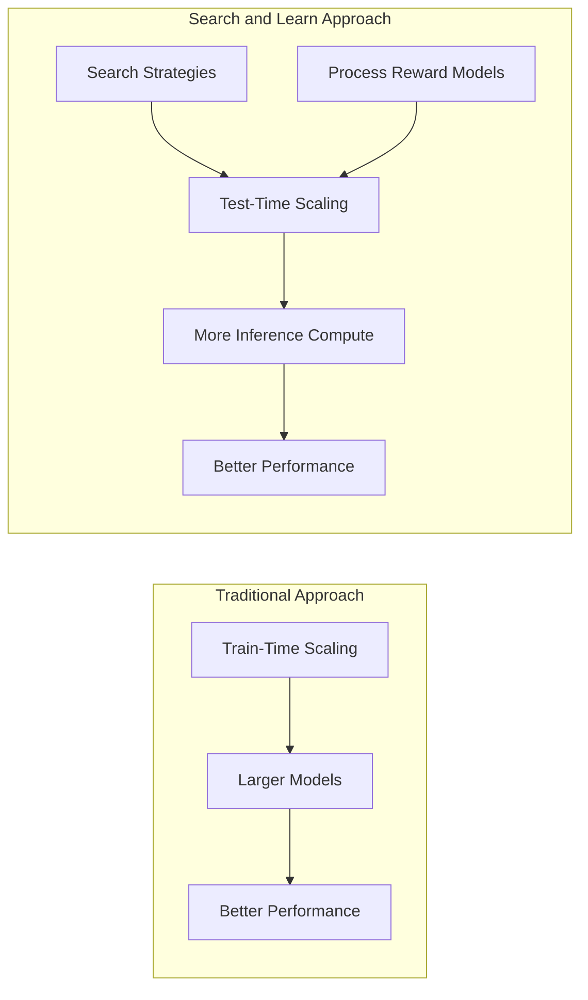

The key insight is that for many complex problems (like math or coding), even smaller models can produce correct solutions if they are allowed to explore multiple solution paths and evaluate their quality.

Sources: [README.md:15-26]()/[recipes/README.md:3-15]()

## Test-Time Compute vs. Model Size Scaling

The Search and Learn repository demonstrates that scaling test-time compute can be more effective than scaling model size for certain tasks, especially for open-source models that don't have the parameter count of the largest proprietary models.

Key advantages of test-time compute scaling:

- **Resource Efficiency**: Increasing test-time compute is typically more affordable than training larger models
- **Accessibility**: Makes advanced capabilities accessible to users of open-source models
- **Problem Adaptability**: Allows dynamically allocating more compute for harder problems

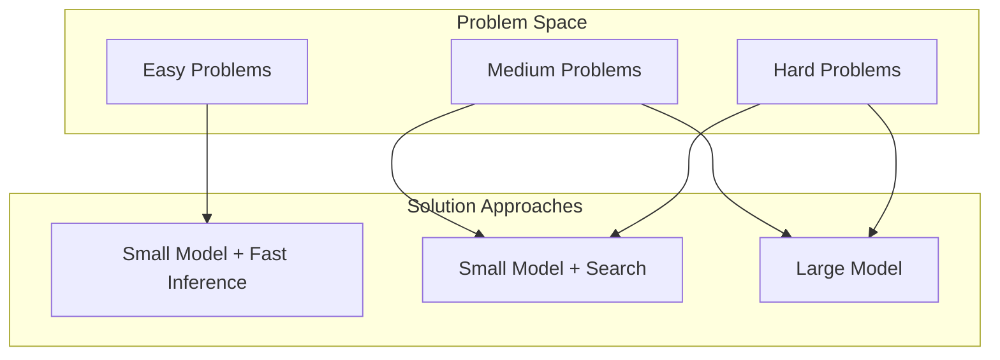

Sources: [README.md:16-24]()

## Search Strategies

The repository implements three main search strategies for test-time compute scaling, each offering different trade-offs between exploration breadth and computational efficiency.

### Best-of-N

Best-of-N is the simplest search strategy, implemented in `sal/search/best_of_n.py`:

1. Generate N independent samples from the language model
2. Score each complete sample using a process reward model
3. Select the sample with the highest score

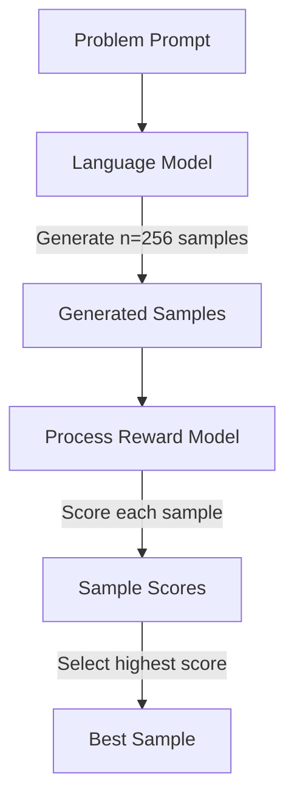

Sources: [recipes/README.md:7-108]()

### Beam Search

Beam Search maintains a "beam" of the most promising solution paths, implemented in `sal/search/beam_search.py`:

1. Start with an initial prompt
2. Generate multiple possible next tokens for each candidate in the beam
3. Score all potential new candidates
4. Keep only the top-k candidates (where k is the beam width)
5. Repeat until generation is complete

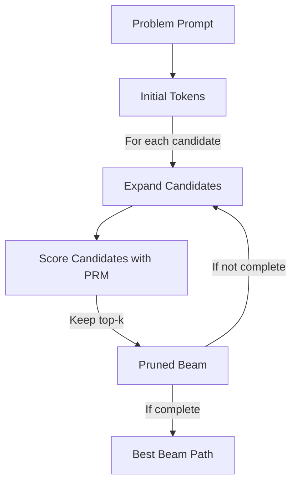

Sources: [recipes/README.md:8-134]()

### Diverse Value Transformation Search (DVTS)

DVTS, implemented in `sal/search/dvts.py`, combines elements of Best-of-N and Beam Search while promoting diversity in the solutions:

1. Generate an initial set of diverse samples
2. Score these samples using a process reward model
3. Use the scores to guide further exploration of promising solution paths
4. Balance exploration and exploitation to find optimal solutions

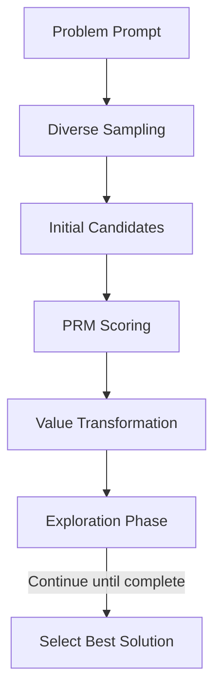

Sources: [recipes/README.md:9-158]()

## Process Reward Models (PRMs)

Process Reward Models (PRMs) are specialized models trained to evaluate the quality of solution paths, providing step-by-step feedback on the reasoning process rather than just scoring the final answer.

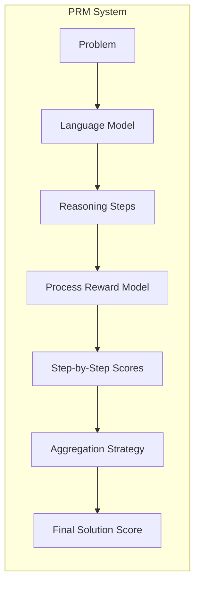

Key characteristics of PRMs:

- Provide fine-grained feedback on each step of the reasoning process
- Can identify promising solution approaches before the complete solution
- Enable effective search by prioritizing high-value solution paths

The repository supports several PRMs, including:
- `RLHFlow/Llama3.1-8B-PRM-Deepseek-Data` (default)
- `peiyi9979/math-shepherd-mistral-7b-prm`
- `Skywork/Skywork-o1-Open-PRM-Qwen-2.5-1.5B`
- `Skywork/Skywork-o1-Open-PRM-Qwen-2.5-7B`

The PRMs are critical components that enable effective search by providing quality signals that guide the exploration of the solution space.

Sources: [recipes/README.md:76-91]()

## Configuration System

The Search and Learn system uses YAML recipe files to configure experiments. These recipes define all aspects of a test-time compute experiment:

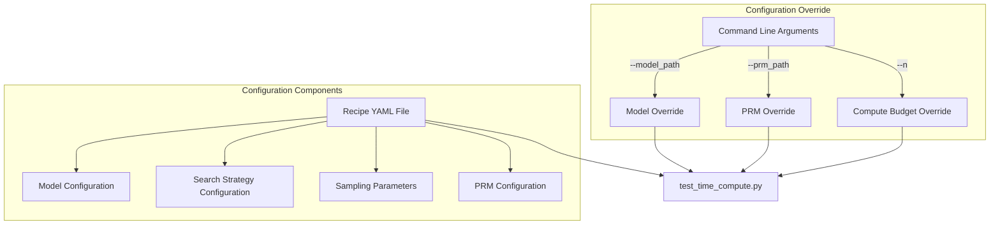

A typical recipe specifies:

1. **Model Selection**: Which language model and process reward model to use
2. **Search Strategy**: Which search algorithm to apply and its parameters
3. **Generation Parameters**: Temperature, top-p, and other sampling parameters
4. **Evaluation Settings**: How results should be evaluated and reported

Recipe files make experiments reproducible and allow easy sharing of specific configurations with the community. The repository provides ready-to-use recipes for different models (Llama-3.2, Qwen2.5) and search strategies.

Sources: [recipes/README.md:17-58]()

## System Workflow

The end-to-end workflow in the Search and Learn system follows these steps:

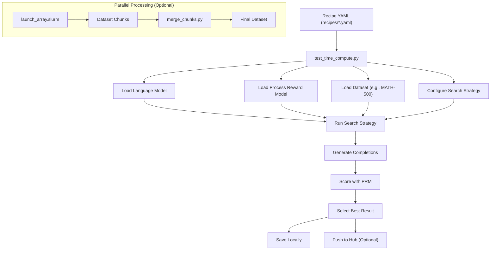

For large-scale experiments, the process can be parallelized using SLURM array jobs, with the dataset split into chunks and results later merged using `scripts/merge_chunks.py`.

Sources: [recipes/README.md:94-196]()

## Mathematical Utilities and Answer Processing

The Search and Learn system includes utilities for processing and evaluating mathematical answers, primarily in `sal/utils/math.py`:

| Utility | Purpose |
|---------|---------|
| `memoized_canonical_form` | Converts math expressions to canonical form using sympy |
| `extract_answer` | Extracts answers from model completions |
| `subsample_completions` | Creates subsets of completions for evaluation at different compute budgets |
| `compute_naive_pred` | Computes predictions based on highest score |
| `compute_weighted_pred` | Computes predictions using score-weighted answer aggregation |
| `compute_maj_pred` | Computes predictions based on majority voting |
| `pass_at_k` | Calculates pass@k metrics for evaluating model performance |

These utilities ensure accurate comparison and evaluation of mathematical solutions, which is crucial for the effectiveness of the search strategies.

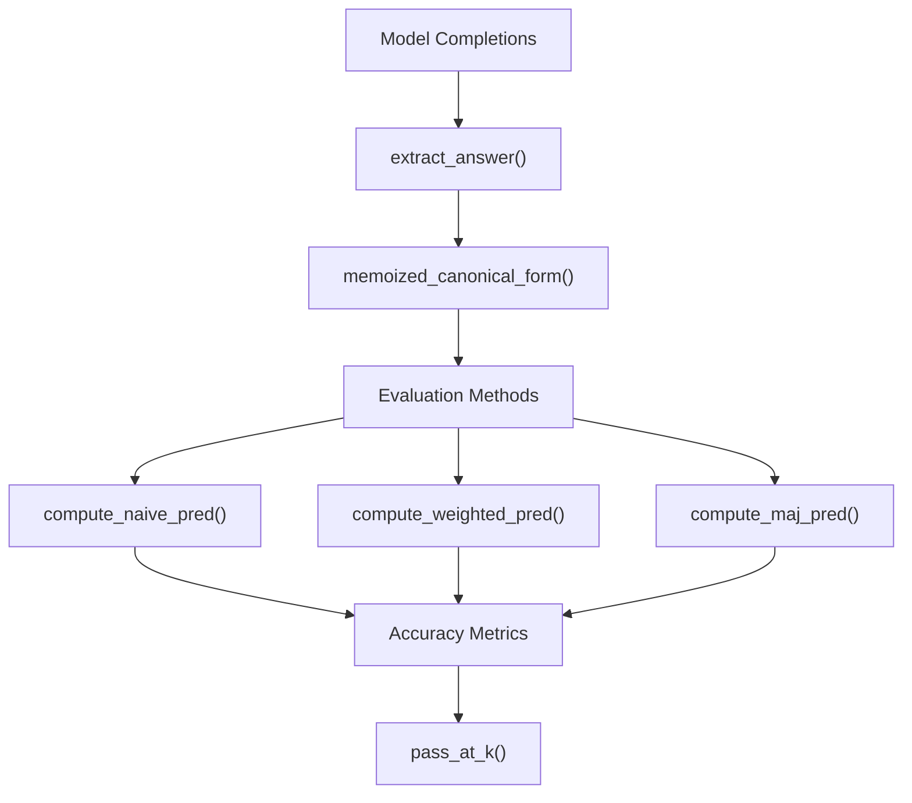

The mathematical utilities handle edge cases like timeout during symbolic computation and provide fallback mechanisms to ensure robust evaluation.

Sources: [src/sal/utils/math.py:30-278]()

---

# Page: System Architecture

# System Architecture

<details>
<summary>Relevant source files</summary>

The following files were used as context for generating this wiki page:

- [README.md](README.md)
- [scripts/test_time_compute.py](scripts/test_time_compute.py)
- [src/sal/config.py](src/sal/config.py)

</details>


This document provides an overview of the Search and Learn system architecture, detailing how its components work together to enable test-time compute scaling for language models. The architecture is designed to allow language models to "think longer" on harder problems through dynamic inference strategies.

For information about specific configuration options, see [Configuration System](#2.1). For details on search algorithms, see [Search Strategies](#2.2).

## Overall System Structure

The following diagram illustrates the main components of the Search and Learn system and their relationships:

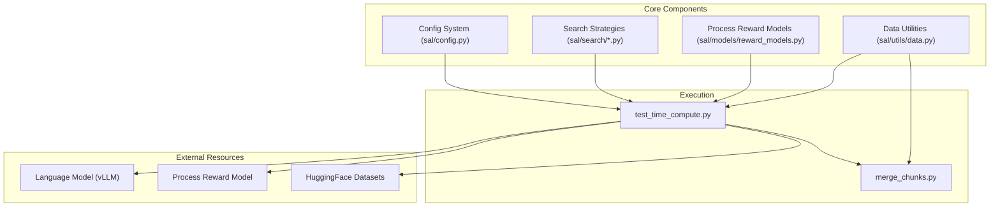

Sources: [scripts/test_time_compute.py:41-70](), [src/sal/config.py:24-106]()

## Execution Flow

The main execution flow of the system is managed by the `test_time_compute.py` script, which processes inputs through the following steps:

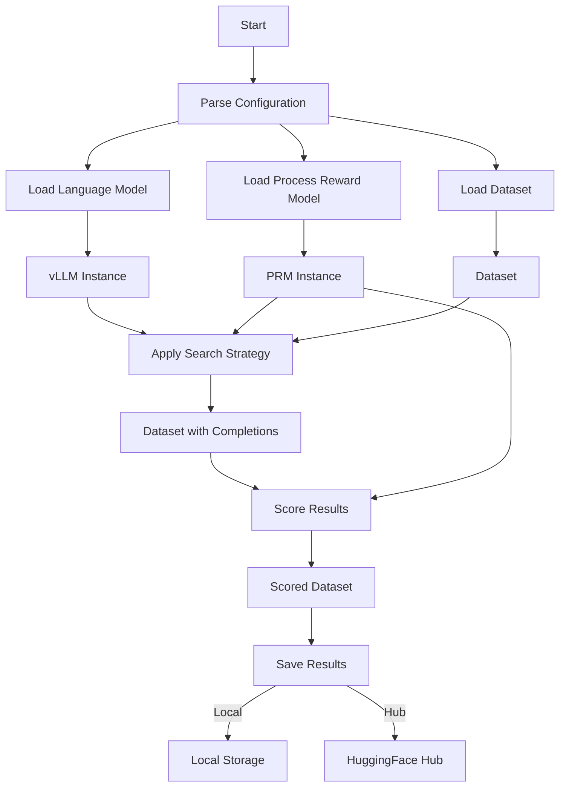

Sources: [scripts/test_time_compute.py:41-70]()

## Search Strategy Architecture

The system implements three search strategies, each with different approaches to exploring the solution space:

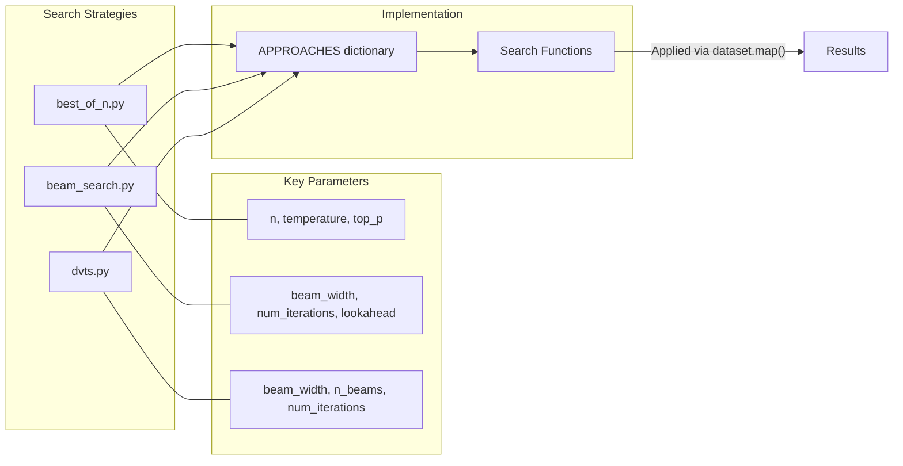

Sources: [scripts/test_time_compute.py:34-38](), [src/sal/config.py:52-76]()

## Configuration System

The configuration system is built around the `Config` dataclass, which defines all parameters for a test-time compute experiment:

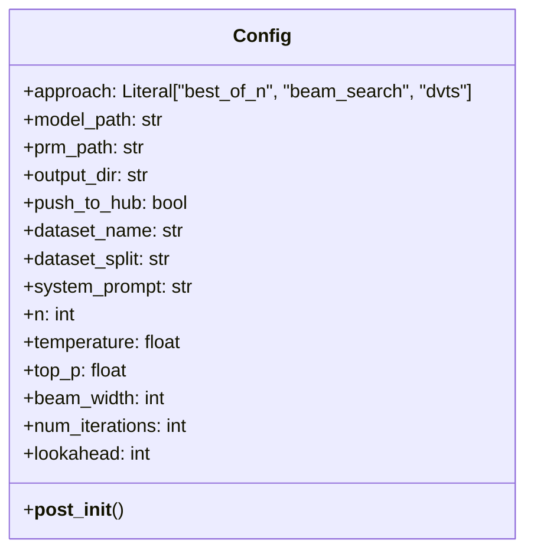

Sources: [src/sal/config.py:24-106]()

## Data and Model Flow

This diagram illustrates how data and models flow through the system during execution:

```mermaid
flowchart TD
    subgraph "Input"
        Config["Config Object from YAML"]
        Dataset["HuggingFace Dataset"]
        Models["Language & Reward Models"]
    end
    
    subgraph "Processing"
        Parser["H4ArgumentParser"]
        ConfigObj["Config Instance"]
        LLM["vLLM Instance"]
        PRM["Process Reward Model"]
        Search["Search Strategy Function"]
    end
    
    subgraph "Output"
        Results["Dataset with Completions & Scores"]
        Storage["Local or Hub Storage"]
    end
    
    Config --> Parser
    Parser --> ConfigObj
    ConfigObj --> LLM
    ConfigObj --> PRM
    Dataset --> Search
    
    LLM --> Search
    PRM --> Search
    ConfigObj --> Search
    
    Search --> Results
    Results --> Storage
```

Sources: [scripts/test_time_compute.py:41-70]()

## Component Roles and Interactions

The following table summarizes the main components and their roles:

| Component | File Path | Role |
|-----------|-----------|------|
| Config | src/sal/config.py | Defines parameters for test-time compute experiments |
| Search Strategies | src/sal/search/*.py | Implements different search algorithms |
| Process Reward Models | src/sal/models/reward_models.py | Loads and manages reward models used to score completions |
| Data Utilities | src/sal/utils/data.py | Handles dataset loading, processing, and saving |
| test_time_compute.py | scripts/test_time_compute.py | Main execution script that orchestrates the process |
| merge_chunks.py | scripts/merge_chunks.py | Merges results from parallelized runs |

Sources: [README.md:26-36](), [scripts/test_time_compute.py:34-38]()

## Search Strategy Implementation Details

The system supports three main search strategies with different strengths and use cases:

```mermaid
graph TD
    subgraph "Best-of-N Implementation"
        BoN_Start["Generate n completions"]
        BoN_Score["Score with PRM"]
        BoN_Select["Select highest score"]
        
        BoN_Start --> BoN_Score
        BoN_Score --> BoN_Select
    end
    
    subgraph "Beam Search Implementation"
        BS_Init["Initialize beam with prefix"]
        BS_Loop["beam_search_loop()"]
        BS_Expand["Expand candidates"]
        BS_Score["Score candidates"]
        BS_Prune["Keep top beam_width"]
        BS_Check["Check completion"]
        BS_Result["Return best beam"]
        
        BS_Init --> BS_Loop
        BS_Loop --> BS_Expand
        BS_Expand --> BS_Score
        BS_Score --> BS_Prune
        BS_Prune --> BS_Check
        BS_Check -->|"Not complete"| BS_Loop
        BS_Check -->|"Complete"| BS_Result
    end
    
    subgraph "DVTS Implementation"
        DVTS_Init["Initialize n_beams beams"]
        DVTS_Loop["dvts_loop()"]
        DVTS_Expand["Expand candidates"]
        DVTS_Score["Score candidates"]
        DVTS_Diversity["Apply diversity across beams"]
        DVTS_Prune["Prune each beam"]
        DVTS_Check["Check completion"]
        DVTS_Result["Return best overall"]
        
        DVTS_Init --> DVTS_Loop
        DVTS_Loop --> DVTS_Expand
        DVTS_Expand --> DVTS_Score
        DVTS_Score --> DVTS_Diversity
        DVTS_Diversity --> DVTS_Prune
        DVTS_Prune --> DVTS_Check
        DVTS_Check -->|"Not complete"| DVTS_Loop
        DVTS_Check -->|"Complete"| DVTS_Result
    end
```

Sources: [scripts/test_time_compute.py:34-38](), [src/sal/config.py:52-76]()

Each strategy has specific configuration parameters:

| Strategy | Description | Key Parameters |
|----------|-------------|----------------|
| Best-of-N | Generate multiple samples, select best | n, temperature, top_p |
| Beam Search | Maintain beam of candidates, expand and prune | beam_width, num_iterations, lookahead |
| DVTS | Multiple diverse beams with optimization | beam_width, n_beams, num_iterations, lookahead |

Sources: [src/sal/config.py:52-76]()

## Code to Concept Mapping

This diagram maps key code entities to system concepts:

```mermaid
graph TD
    subgraph "Code Entities"
        Config["sal.config.Config"]
        TestTimeCompute["scripts.test_time_compute.main()"]
        BestOfN["sal.search.best_of_n"]
        BeamSearch["sal.search.beam_search"]
        DVTS["sal.search.dvts"]
        LoadPRM["sal.models.reward_models.load_prm()"]
        GetDataset["sal.utils.data.get_dataset()"]
        SaveDataset["sal.utils.data.save_dataset()"]
        ScoreFunc["sal.utils.score.score()"]
    end
    
    subgraph "System Concepts"
        Configuration["Experiment Configuration"]
        Orchestration["Workflow Orchestration"]
        Search["Search Strategies"]
        Evaluation["Completion Evaluation"]
        DataManagement["Data Loading & Saving"]
    end
    
    Config --> Configuration
    TestTimeCompute --> Orchestration
    BestOfN --> Search
    BeamSearch --> Search
    DVTS --> Search
    LoadPRM --> Evaluation
    ScoreFunc --> Evaluation
    GetDataset --> DataManagement
    SaveDataset --> DataManagement
```

Sources: [scripts/test_time_compute.py:41-70](), [src/sal/config.py:24-106]()

## Integration with External Systems

The Search and Learn system integrates with several external systems:

```mermaid
graph TD
    subgraph "Search and Learn"
        Core["Core Components"]
        TestTimeCompute["test_time_compute.py"]
    end
    
    subgraph "HuggingFace Ecosystem"
        HFHub["HuggingFace Hub"]
        HFDatasets["HuggingFace Datasets"]
        TokenizerLib["Tokenizers Library"]
    end
    
    subgraph "Inference Systems"
        VLLM["vLLM"]
        PyTorch["PyTorch"]
    end
    
    Core --> TestTimeCompute
    TestTimeCompute --> VLLM
    TestTimeCompute --> HFHub
    TestTimeCompute --> HFDatasets
    VLLM --> PyTorch
    VLLM --> TokenizerLib
```

Sources: [scripts/test_time_compute.py:48-54](), [README.md:45-63]()

## Summary

The Search and Learn system architecture is composed of modular components that work together to enable test-time compute scaling for language models. The system's main strengths are:

1. **Flexibility**: Multiple search strategies can be selected and configured via recipes
2. **Modularity**: Clear separation between configuration, search, evaluation, and data management
3. **Integration**: Seamless integration with the HuggingFace ecosystem and vLLM
4. **Scalability**: Support for parallelization via chunking and merging

The architecture allows for easy experimentation with different search strategies and model combinations, making it a powerful tool for research in test-time compute scaling.

Sources: [README.md:16-25](), [src/sal/config.py:24-106](), [scripts/test_time_compute.py:41-70]()

---

# Page: Configuration System

# Configuration System

<details>
<summary>Relevant source files</summary>

The following files were used as context for generating this wiki page:

- [src/sal/config.py](src/sal/config.py)

</details>


This document describes the configuration system used in the Search and Learn framework. The configuration system provides a centralized way to define and manage parameters for test-time compute scaling experiments. For information about specific search strategies that use these configurations, see [Search Strategies](#2.2).

## Overview

The Search and Learn configuration system uses a dataclass-based approach combined with YAML recipe files to provide a flexible, type-safe way to configure experiments. This design allows for easy parameter management and validation while ensuring reproducibility of experiments.

```mermaid
graph TD
    subgraph "Configuration Flow"
        YAML["Recipe YAML Files"]
        Config["Config Dataclass"]
        Validation["Parameter Validation"]
        Experiment["Experiment Execution"]
    end
    
    YAML -->|"loaded into"| Config
    Config -->|"validates parameters in"| Validation
    Validation -->|"configures"| Experiment
    
    subgraph "Integration with Other Components"
        SearchStrategies["Search Strategies"]
        Models["LLM & PRM"]
        DatasetLoading["Dataset Loading"]
        OutputHandling["Output Handling"]
    end
    
    Config -->|"configures"| SearchStrategies
    Config -->|"specifies"| Models
    Config -->|"defines"| DatasetLoading
    Config -->|"controls"| OutputHandling
```

*Diagram: Configuration System Flow and Integration*

Sources: [src/sal/config.py:24-106]()

## Config Dataclass Structure

The core of the configuration system is the `Config` dataclass defined in `src/sal/config.py`. This class encapsulates all parameters needed for running experiments with the Search and Learn framework.

```mermaid
classDiagram
    class Config {
        +approach: Literal
        +model_path: str
        +gpu_memory_utilization: float
        +prm_path: str
        +output_dir: str
        +num_proc: int
        +push_to_hub: bool
        +hub_dataset_id: str
        +apply_voting: bool
        +dataset_name: str
        +system_prompt: str
        +custom_chat_template: str
        +n: int
        +temperature: float
        +top_p: float
        +prm_batch_size: int
        +search_batch_size: int
        +max_tokens: int
        +agg_strategy: str
        +beam_width: int
        +num_iterations: int
        +lookahead: int
        +filter_duplicates: bool
        +sort_completed: bool
        +__post_init__()
    }
```

*Diagram: Config Dataclass Structure*

Sources: [src/sal/config.py:24-60]()

## Configuration Parameters

The `Config` dataclass groups parameters by their purpose:

### Core Parameters

| Parameter | Type | Default | Description |
|-----------|------|---------|-------------|
| `approach` | Literal | "best_of_n" | Search strategy to use (options: "best_of_n", "beam_search", "dvts") |
| `model_path` | str | "meta-llama/Llama-3.2-1B-Instruct" | Path or HF model ID of the language model |
| `gpu_memory_utilization` | float | 0.5 | Fraction of GPU memory allocated to vLLM (rest used for PRM) |
| `prm_path` | str | "RLHFlow/Llama3.1-8B-PRM-Deepseek-Data" | Path or HF model ID of the Process Reward Model |

Sources: [src/sal/config.py:26-31]()

### Output Configuration

| Parameter | Type | Default | Description |
|-----------|------|---------|-------------|
| `output_dir` | str | None | Directory to save output files |
| `num_proc` | int | None | Number of processes for parallel execution |
| `push_to_hub` | bool | False | Whether to push results to HuggingFace Hub |
| `hub_dataset_id` | str | None | ID for the Hub dataset (auto-generated if None) |
| `hub_dataset_private` | bool | False | Whether the Hub dataset should be private |
| `overwrite_hub_revision` | bool | False | Whether to overwrite existing Hub revisions |
| `apply_voting` | bool | True | Whether to apply voting for final result selection |

Sources: [src/sal/config.py:33-39]()

### Dataset Configuration

| Parameter | Type | Default | Description |
|-----------|------|---------|-------------|
| `dataset_name` | str | "HuggingFaceH4/MATH-500" | Name of the dataset to use |
| `dataset_config` | str | None | Dataset configuration name |
| `dataset_split` | str | "test" | Dataset split to use |
| `dataset_start` | int | None | Start index for dataset slicing |
| `dataset_end` | int | None | End index for dataset slicing |
| `num_samples` | int | None | Number of samples to process |

Sources: [src/sal/config.py:42-47]()

### Chat Template Configuration

| Parameter | Type | Default | Description |
|-----------|------|---------|-------------|
| `system_prompt` | str | *Math problem solving prompt* | System prompt for chat-based models |
| `custom_chat_template` | str | *Custom template* | Custom chat template for formatting messages |

Sources: [src/sal/config.py:50-51]()

### Search Parameters

| Parameter | Type | Default | Description |
|-----------|------|---------|-------------|
| `n` | int | 4 | Number of samples to generate |
| `temperature` | float | 0.8 | Sampling temperature |
| `top_p` | float | 1.0 | Top-p sampling parameter |
| `prm_batch_size` | int | 4 | Batch size for PRM scoring |
| `search_batch_size` | int | 25 | Batch size for search operations |
| `seed` | int | 42 | Random seed for reproducibility |
| `max_tokens` | int | 2048 | Maximum number of tokens to generate |
| `agg_strategy` | str | "last" | Strategy for aggregating scores (options: "last", "min", "prod") |

Sources: [src/sal/config.py:53-60]()

### Strategy-Specific Parameters

| Parameter | Type | Default | Description |
|-----------|------|---------|-------------|
| `beam_width` | int | 4 | Beam width for beam search and DVTS (m in paper) |
| `num_iterations` | int | 40 | Number of iterations for iterative search methods |
| `lookahead` | int | 1 | Lookahead parameter for search strategies |
| `filter_duplicates` | bool | False | Whether to filter duplicate candidates in beam search |
| `sort_completed` | bool | False | Whether to sort completed candidates in beam search |

Sources: [src/sal/config.py:63-69]()

## Parameter Validation and Post-Processing

The `Config` class includes a `__post_init__` method that performs validation and post-processing of configuration parameters:

1. For DVTS approach:
   - Validates that `n` is a multiple of `beam_width`
   - Calculates `n_beams` as `n / beam_width`

2. For beam search approach:
   - Enforces that `search_batch_size` is set to 1 (current limitation)

3. For Hub dataset configuration:
   - Generates a default `hub_dataset_id` if not provided
   - Constructs a revision string based on approach and parameters
   - Adds chunk information to revision if dataset slicing is used
   - Checks for existing revisions to avoid duplicate work

```mermaid
flowchart TD
    Config["Config.__post_init__()"]
    
    subgraph "Approach-specific Validation"
        DVTS{"approach == 'dvts'?"}
        BeamSearch{"approach == 'beam_search'?"}
        
        DVTS -->|"Yes"| DVTSValid{"n % beam_width == 0?"}
        DVTSValid -->|"No"| Error1["Raise ValueError"]
        DVTSValid -->|"Yes"| SetNBeams["Set n_beams = n / beam_width"]
        
        BeamSearch -->|"Yes"| BSValid{"search_batch_size == 1?"}
        BSValid -->|"No"| Error2["Raise ValueError"]
    end
    
    subgraph "Hub Configuration"
        PushToHub{"push_to_hub?"}
        HubDatasetID{"hub_dataset_id is None?"}
        BuildRevision["Build revision string based on approach and parameters"]
        ChunkInfo{"dataset_start and dataset_end are set?"}
        RevisionExists{"revision exists and not overwrite_hub_revision?"}
        
        PushToHub -->|"Yes"| HubDatasetID
        HubDatasetID -->|"Yes"| SetDefaultID["Generate default hub_dataset_id"]
        HubDatasetID -->|"No"| BuildRevision
        SetDefaultID --> BuildRevision
        BuildRevision --> ChunkInfo
        ChunkInfo -->|"Yes"| AddChunkInfo["Add chunk info to revision"]
        ChunkInfo -->|"No"| RevisionExists
        AddChunkInfo --> RevisionExists
        RevisionExists -->|"Yes"| Exit["Exit program"]
    end
    
    Config --> DVTS
    Config --> BeamSearch
    Config --> PushToHub
```

*Diagram: Configuration Validation and Post-Processing Flow*

Sources: [src/sal/config.py:71-106]()

## Integration with the Overall System

The configuration system serves as the central control point for experiment execution in the Search and Learn framework. Configuration parameters flow from the `Config` dataclass to various components:

1. **Search Strategies**: Parameters like `approach`, `n`, `temperature`, and strategy-specific parameters configure the search behavior.

2. **Model Loading**: The `model_path` and `prm_path` parameters specify which language model and process reward model to load.

3. **Dataset Processing**: Dataset parameters control which data to process and how to slice it.

4. **Output Handling**: Output parameters determine where and how to save results, including Hub integration.

Sources: [src/sal/config.py:24-106]()

## Usage Example

While the actual loading of configuration from YAML files is handled elsewhere in the codebase, the configuration structure is designed to be populated from recipe YAML files that match the parameter structure of the `Config` dataclass.

When fully configured, the `Config` instance contains all necessary information to run a complete Search and Learn experiment, ensuring reproducibility and ease of configuration management.

Sources: [src/sal/config.py:24-106]()

---

# Page: Search Strategies

# Search Strategies

<details>
<summary>Relevant source files</summary>

The following files were used as context for generating this wiki page:

- [recipes/README.md](recipes/README.md)
- [src/sal/search/beam_search.py](src/sal/search/beam_search.py)
- [src/sal/search/best_of_n.py](src/sal/search/best_of_n.py)

</details>


This page documents the search strategies implemented in the Search and Learn system. Search strategies are algorithms that explore the space of possible completions from a language model to find high-quality solutions to complex problems. These strategies act as the core computational methods that enable test-time compute scaling for language models.

For information about how Process Reward Models evaluate these completions, see [Process Reward Models](#2.3). For details on configuring search strategies, see [Configuration System](#2.1).

## Overview of Search Strategies

The Search and Learn repository implements three main search strategies, each with different approaches to exploring the solution space:

1. **Best-of-N**: A simple strategy that generates multiple independent completions and selects the best one based on a reward model score
2. **Beam Search**: An iterative strategy that maintains a beam of promising candidates, expanding and pruning them based on reward model scores
3. **DVTS (Diverse Value Transformation Search)**: A strategy that emphasizes diversity of candidates while using value-guided search to explore the solution space

### Search Strategy Comparison

```mermaid
flowchart LR
    subgraph "Common Components"
        Prompt["Problem Prompt"]
        LLM["Language Model"]
        PRM["Process Reward Model"]
        Solution["Final Solution"]
    end

    subgraph "Best-of-N"
        BN1["Generate N Samples"]
        BN2["Score All Samples"]
        BN3["Select Best Sample"]
    end

    subgraph "Beam Search"
        BS1["Initialize Beam"]
        BS2["Generate Next Token(s)"]
        BS3["Score & Prune Beam"]
        BS4["Repeat Until Complete"]
    end

    subgraph "DVTS"
        DV1["Generate Diverse Samples"]
        DV2["Value-Guided Search"]
        DV3["Transform & Select"]
    end

    Prompt --> BN1
    Prompt --> BS1
    Prompt --> DV1
    
    LLM --> BN1
    LLM --> BS2
    LLM --> DV1
    
    BN1 --> BN2
    BN2 --> BN3
    BN3 --> Solution
    
    BS1 --> BS2
    BS2 --> BS3
    BS3 -->|Not Complete| BS2
    BS3 -->|Complete| Solution
    
    DV1 --> DV2
    DV2 --> DV3
    DV3 --> Solution
    
    PRM --> BN2
    PRM --> BS3
    PRM --> DV2
```

Sources: [recipes/README.md:3-15]()

## Best-of-N Strategy

The Best-of-N strategy is the simplest of the three approaches. It generates N independent completions for each prompt and selects the one with the highest score according to a Process Reward Model (PRM).

### Algorithm

```mermaid
sequenceDiagram
    participant User as "User"
    participant Config as "Configuration"
    participant LLM as "Language Model"
    participant PRM as "Process Reward Model"
    participant BestOfN as "best_of_n() Function"
    
    User->>Config: Set n, temperature, top_p, etc.
    User->>BestOfN: Input problem
    BestOfN->>LLM: Generate n completions
    LLM->>BestOfN: Return completions
    BestOfN->>PRM: Score completions
    PRM->>BestOfN: Return scores
    BestOfN->>BestOfN: Select completion with highest score
    BestOfN->>User: Return best completion
```

### Implementation Details

The Best-of-N strategy is implemented in `best_of_n.py`. The main function, `best_of_n()`, takes a batch of prompts, a configuration object, a language model, and a process reward model as inputs, and returns the best completion for each prompt.

Key steps in the implementation:

1. Convert user prompts to chat format using the model's chat template
2. Duplicate each prompt n times to generate n completions
3. Generate completions using vLLM with specified sampling parameters
4. Score all completions using the process reward model
5. Aggregate scores based on the configured strategy (e.g., last token, average)
6. Select the completion with the highest score for each prompt

Key parameters that affect Best-of-N performance:

- `n`: Number of completions to generate per prompt
- `temperature`: Controls randomness in generation
- `top_p`: Probability threshold for nucleus sampling
- `max_tokens`: Maximum length of each completion
- `agg_strategy`: How to aggregate scores (e.g., last, mean)

Sources: [src/sal/search/best_of_n.py:24-97]()

## Beam Search Strategy

Beam Search is a more sophisticated strategy that maintains a beam of promising candidate solutions and iteratively expands them. At each step, all candidates are scored and only the top-k are kept for the next iteration.

### Algorithm

```mermaid
flowchart TD
    Start["Initialize Beam with n empty candidates"]
    Generate["Generate next token(s) for each candidate"]
    Score["Score current state of each candidate"]
    Prune["Keep top (n / beam_width) candidates"]
    Check{"All complete or\nmax iterations?"}
    Select["Select top n completions"]
    End["Return best completion"]
    
    Start --> Generate
    Generate --> Score
    Score --> Prune
    Prune --> Check
    Check -->|No| Generate
    Check -->|Yes| Select
    Select --> End
```

### Implementation Details

The Beam Search strategy is implemented in `beam_search.py`. It uses a helper class `Beam` to track the state of each candidate solution.

Key steps in the implementation:

1. Initialize n beams with empty completions
2. For each iteration:
   - Generate the next token(s) for each active beam
   - Score the current state of each beam
   - Prune the beams to keep only the most promising ones
   - Mark completed beams and add them to the completed list
3. Select the top n completions from the completed beams based on their scores

Key parameters that affect Beam Search performance:

- `n`: Total number of beams to maintain
- `beam_width`: Controls how many beams are kept after each pruning step
- `num_iterations`: Maximum number of iterations
- `lookahead`: Number of tokens to generate in each step
- `filter_duplicates`: Whether to filter out duplicate beams
- `sort_completed`: Whether to sort completed beams by score

Sources: [src/sal/search/beam_search.py:32-223]()

## DVTS (Diverse Value Transformation Search) Strategy

DVTS combines diversity-aware exploration with value-guided search. It generates a diverse set of candidates and uses a value function (PRM) to guide the search toward promising regions of the solution space.

### Algorithm

```mermaid
flowchart TD
    Start["Initialize with problem prompt"]
    Diverse["Generate diverse initial candidates"]
    ValueGuide["Apply value-guided search"]
    Transform["Transform candidates"]
    Score["Score transformed candidates"]
    Select["Select best candidate"]
    End["Return best solution"]
    
    Start --> Diverse
    Diverse --> ValueGuide
    ValueGuide --> Transform
    Transform --> Score
    Score --> Select
    Select --> End
```

### Implementation Characteristics

While the specific implementation details of DVTS are not fully visible in the provided files, from the context we understand:

1. DVTS emphasizes generating a diverse set of initial candidates
2. It uses the Process Reward Model as a value function to guide the search
3. It applies transformations to explore the solution space efficiently
4. Like other strategies, it ultimately selects the candidate with the highest score

Sources: [recipes/README.md:3-15]()

## Code Structure

```mermaid
classDiagram
    class Config {
        +temperature: float
        +top_p: float
        +n: int
        +max_tokens: int
        +system_prompt: str
        +agg_strategy: str
        +custom_chat_template: str
        +beam_width: int
        +num_iterations: int
        +lookahead: int
        +filter_duplicates: bool
        +sort_completed: bool
    }
    
    class PRM {
        +score(prompts, completions) List[List[List[float]]]
    }
    
    class best_of_n {
        +best_of_n(x, config, llm, prm)
    }
    
    class beam_search {
        +beam_search(examples, config, llm, prm)
        -_beam_search(batch_of_prompts, config, llm, prm)
    }
    
    class Beam {
        +prompt: str
        +index: int
        +current_text: str
        +next_texts: List[str]
        +lookahead_texts: List[str]
        +pruned: bool
        +completed: bool
        +stop_reasons: List[str]
        +history: List[str]
        +best_scores: List[float]
        +all_scores: List[float]
        +previous_text: str
        +completion_tokens: int
    }
    
    class dvts {
        +dvts(examples, config, llm, prm)
    }
    
    Config <-- best_of_n
    Config <-- beam_search
    Config <-- dvts
    
    PRM <-- best_of_n
    PRM <-- beam_search
    PRM <-- dvts
    
    beam_search --> Beam
```

Sources: [src/sal/search/best_of_n.py:24-97](), [src/sal/search/beam_search.py:32-223]()

## Usage Example

To use these search strategies, you can run the `test_time_compute.py` script with a configuration file that specifies the search strategy and its parameters:

```bash
# For Best-of-N
python scripts/test_time_compute.py recipes/Llama-3.2-1B-Instruct/best_of_n.yaml

# For Beam Search
python scripts/test_time_compute.py recipes/Llama-3.2-1B-Instruct/beam_search.yaml

# For DVTS
python scripts/test_time_compute.py recipes/Llama-3.2-1B-Instruct/dvts.yaml
```

Each recipe file contains configuration parameters specific to the search strategy. For example, the Best-of-N recipe might specify:
- `n`: 16 (number of completions to generate)
- `temperature`: 0.8 (sampling temperature)
- `top_p`: 1.0 (nucleus sampling parameter)
- `agg_strategy`: "last" (use the score of the last token)

Sources: [recipes/README.md:17-23]()

## Performance Considerations

When choosing a search strategy, consider the following trade-offs:

| Strategy | Compute Efficiency | Solution Quality | Parallelizability | Memory Usage |
|----------|-------------------|------------------|-------------------|--------------|
| Best-of-N | Medium | Good | High | Low |
| Beam Search | Low | Very Good | Medium | Medium |
| DVTS | Medium | Very Good | Medium | Medium |

- **Best-of-N** is the most straightforward and highly parallelizable, making it efficient for large-scale experiments. However, it may not explore the solution space as effectively as the other strategies.
- **Beam Search** can find better solutions by iteratively refining candidates, but it requires more sequential computation steps and has higher memory requirements.
- **DVTS** offers a balance between exploration and exploitation, with special emphasis on diversity, which can help find novel solutions.

Sources: [recipes/README.md:106-157]()

## Scaling Experiments

For running large-scale experiments with any of these search strategies, the repository provides SLURM scripts for parallelization. This allows running the search strategies on a large number of problems in parallel:

```bash
# Example for Best-of-N with parallelization
sbatch recipes/launch_array.slurm recipes/Llama-3.2-1B-Instruct/best_of_n.yaml \
    --n=256 \
    --seed=0 \
    --hub_dataset_id=<YOUR_ORG>/Llama-3.2-1B-Instruct-best_of_n-completions
```

After running parallel jobs, the results can be merged using the `merge_chunks.py` script.

Sources: [recipes/README.md:160-192]()

---

# Page: Process Reward Models

# Process Reward Models

<details>
<summary>Relevant source files</summary>

The following files were used as context for generating this wiki page:

- [src/sal/models/reward_models.py](src/sal/models/reward_models.py)
- [src/sal/models/skywork_o1_prm/io_utils.py](src/sal/models/skywork_o1_prm/io_utils.py)
- [src/sal/models/skywork_o1_prm/modeling_base.py](src/sal/models/skywork_o1_prm/modeling_base.py)
- [src/sal/models/skywork_o1_prm/prm_model.py](src/sal/models/skywork_o1_prm/prm_model.py)

</details>


Process Reward Models (PRMs) are specialized models that evaluate the quality of stepwise solutions in the Search and Learn system. They provide the crucial scoring mechanism that guides search strategies toward better solutions by analyzing intermediate steps rather than just final answers. This document explains how PRMs are implemented, their role in the system, and how they interact with other components.

For information about search strategies that use these models, see [Search Strategies](#2.2). For details on how to train custom PRMs, see [Training Process Reward Models](#4).

## 1. Overview

Process Reward Models evaluate solution quality by examining the reasoning process rather than just the final answer. They assign scores to each step in a solution, allowing search algorithms to select solutions with better reasoning paths. This approach aligns with the core idea of test-time compute scaling: enabling models to explore multiple reasoning paths and select the most promising one.

```mermaid
flowchart TD
    subgraph "Search and Learn System"
        SearchConfig["Config"]
        SearchStrategies["Search Strategies"]
        ProcessRewardModels["Process Reward Models"]
    end
    
    subgraph "Interaction Flow"
        Questions["Questions"]
        Generations["Generated Solutions"]
        Scores["Step-wise Scores"]
        BestSolutions["Best Solutions"]
    end

    Questions --> SearchStrategies
    SearchStrategies --> Generations
    Generations --> ProcessRewardModels
    ProcessRewardModels --> Scores
    Scores --> SearchStrategies
    SearchStrategies --> BestSolutions
    
    SearchConfig --> SearchStrategies
    SearchConfig --> ProcessRewardModels
```

Sources: [src/sal/models/reward_models.py:38-137](), [src/sal/models/reward_models.py:343-356]()

## 2. PRM Class Hierarchy

The system implements a base `PRM` class with several concrete implementations. Each implementation is responsible for loading a specific model and tokenizer, and implementing the scoring logic for that model.

```mermaid
classDiagram
    class PRM {
        +search_config: Config
        +model: PreTrainedModel
        +tokenizer: PreTrainedTokenizer
        +load_model_and_tokenizer()**
        +score(questions, outputs)**
    }
    
    class MathShepherd {
        +load_model_and_tokenizer()
        +score(questions, outputs)
    }
    
    class RLHFFlow {
        +load_model_and_tokenizer()
        +score(questions, outputs)
        +_score_batched()
        +_score_single()
    }
    
    class SkyworkO1 {
        +_load_model_and_tokenizer()
        +score(questions, outputs)
    }
    
    class SkyworkO1_1_5B {
        +load_model_and_tokenizer()
    }
    
    class SkyworkO1_7B {
        +load_model_and_tokenizer()
    }
    
    PRM <|-- MathShepherd
    PRM <|-- RLHFFlow
    PRM <|-- SkyworkO1
    SkyworkO1 <|-- SkyworkO1_1_5B
    SkyworkO1 <|-- SkyworkO1_7B
```

The base `PRM` class defines the interface that all implementations must follow:

1. `load_model_and_tokenizer()`: Loads the model and tokenizer for the specific PRM implementation
2. `score(questions, outputs)`: Scores a batch of outputs for a batch of questions

Sources: [src/sal/models/reward_models.py:72-86](), [src/sal/models/reward_models.py:88-136](), [src/sal/models/reward_models.py:139-277](), [src/sal/models/reward_models.py:280-322](), [src/sal/models/reward_models.py:327-340]()

## 3. PRM Implementations

### 3.1 MathShepherd

MathShepherd is a PRM specifically designed for mathematical problem-solving. It uses the model `peiyi9979/math-shepherd-mistral-7b-prm` and is designed to score solutions to math problems.

Key features:
- Uses special tokens (`ки`) to identify steps in the solution
- Batched inference for efficiency
- Scores each step in the solution

Sources: [src/sal/models/reward_models.py:88-136]()

### 3.2 RLHFFlow

RLHFFlow is a PRM based on Llama 3.1 trained with RLHF (Reinforcement Learning from Human Feedback). It uses the model `RLHFlow/Llama3.1-8B-PRM-Deepseek-Data`.

Key features:
- Uses the plus/minus tokens to represent positive/negative feedback
- Supports both batched and single-example scoring
- Handles multiple steps in each solution

Sources: [src/sal/models/reward_models.py:139-277]()

### 3.3 SkyworkO1

SkyworkO1 is a family of PRMs provided by Skywork AI, available in two sizes: 1.5B and 7B. These models use a specialized `SkyworkPRMModel` architecture.

Key features:
- Specialized ValueHead architecture for scoring
- Handles step-by-step rewards explicitly
- Available in multiple sizes for different compute requirements

Sources: [src/sal/models/reward_models.py:280-340](), [src/sal/models/skywork_o1_prm/prm_model.py:64-98](), [src/sal/models/skywork_o1_prm/io_utils.py:6-56]()

## 4. PRM Scoring Process

The scoring process is a key part of how PRMs evaluate solutions. While each PRM implementation has its own approach, the general flow is similar:

```mermaid
sequenceDiagram
    participant S as "Search Strategy"
    participant P as "PRM (load_prm)"
    participant M as "Model"
    participant T as "Tokenizer"
    participant I as "Input Preparation"
    participant O as "Output Processing"
    
    S->>P: load_prm(config)
    P->>M: Load model
    P->>T: Load tokenizer
    S->>P: score(questions, outputs)
    
    alt MathShepherd
        P->>I: Format with special tokens (ки)
        I->>M: batched_math_shepherd_inference()
        M->>O: Return logits at special token positions
    else RLHFFlow
        P->>I: Prepare conversation format
        I->>M: Apply chat template
        M->>O: Extract scores at dialogue positions
    else SkyworkO1
        P->>I: prepare_input()
        I->>M: prepare_batch_input_for_model()
        M->>O: derive_step_rewards()
    end
    
    O->>P: Process raw scores
    P->>S: Return structured scores
```

For all PRMs, the output of the scoring process is a nested list structure:
- The outer list corresponds to each question
- The middle list corresponds to each candidate solution for that question
- The inner list contains scores for each step in the solution

Sources: [src/sal/models/reward_models.py:38-70](), [src/sal/models/reward_models.py:102-136](), [src/sal/models/reward_models.py:162-277](), [src/sal/models/reward_models.py:297-323]()

## 5. Loading and Using PRMs

PRMs are loaded using the `load_prm` function, which takes a configuration object and returns the appropriate PRM instance:

```mermaid
flowchart TD
    subgraph "load_prm Function"
        Config["Config.prm_path"]
        Decision{"Which PRM?"}
        MathShepherd["MathShepherd"]
        RLHFFlow["RLHFFlow"]
        SkyworkO1_1_5B["SkyworkO1_1_5B"]
        SkyworkO1_7B["SkyworkO1_7B"]
        Error["NotImplementedError"]
    end
    
    Config --> Decision
    Decision -->|"peiyi9979/\nmath-shepherd-mistral-7b-prm"| MathShepherd
    Decision -->|"RLHFlow/\nLlama3.1-8B-PRM-Deepseek-Data"| RLHFFlow
    Decision -->|"Skywork/\nSkywork-o1-Open-PRM-Qwen-2.5-1.5B"| SkyworkO1_1_5B
    Decision -->|"Skywork/\nSkywork-o1-Open-PRM-Qwen-2.5-7B"| SkyworkO1_7B
    Decision -->|"Other"| Error
```

The process to use a PRM in a search strategy involves:

1. Loading the PRM using `load_prm`
2. Generating candidate solutions using a language model
3. Scoring the solutions using PRM's `score` method
4. Using the scores to guide the search strategy

Sources: [src/sal/models/reward_models.py:343-356]()

## 6. SkyworkO1 Architecture Details

The SkyworkO1 PRM uses a specialized model architecture defined in the SkyworkPRMModel class. This model extends a base language model with a value head that produces rewards for each token.

```mermaid
classDiagram
    class PreTrainedModelWrapper {
        +pretrained_model: PreTrainedModel
        +config: PreTrainedConfig
        +from_pretrained()
        +forward()
    }
    
    class SkyworkPRMModel {
        +v_head: ValueHead
        +forward()
        +state_dict()
    }
    
    class ValueHead {
        +dropout: nn.Module
        +summary: nn.Linear
        +forward(hidden_states)
    }
    
    PreTrainedModelWrapper <|-- SkyworkPRMModel
    SkyworkPRMModel *-- ValueHead
```

The key components in the SkyworkO1 architecture:

1. **ValueHead**: A neural network head that converts hidden states to scalar rewards
2. **SkyworkPRMModel**: Wraps a pretrained language model and adds the value head
3. **IO Utilities**: Functions for preparing inputs and processing outputs

The SkyworkO1 model processes inputs by:
1. Tokenizing the problem and response
2. Identifying step boundaries using a special token
3. Computing rewards at each step boundary
4. Aggregating the rewards into a step-wise structure

Sources: [src/sal/models/skywork_o1_prm/prm_model.py:22-61](), [src/sal/models/skywork_o1_prm/prm_model.py:64-198](), [src/sal/models/skywork_o1_prm/io_utils.py:6-56]()

## 7. Integration with Search Strategies

PRMs are a critical component in search strategies, providing the evaluation mechanism that guides the search. The search-score-select loop forms the core of test-time compute scaling:

```mermaid
flowchart TD
    subgraph "Search Strategy Components"
        direction LR
        Config["Config"]
        LLM["Language Model"]
        PRM["Process Reward Model"]
    end
    
    subgraph "Search-Score-Select Loop"
        direction LR
        Generate["Generate Solutions"]
        Score["Score with PRM"]
        Select["Select Best Solutions"]
        Loop["Continue/Refine Search"]
    end
    
    Config --> Generate
    LLM --> Generate
    Generate --> Score
    PRM --> Score
    Score --> Select
    Select --> Loop
    Loop --> Generate
```

The search strategy determines how solutions are generated and refined, while the PRM determines how solutions are evaluated. Different PRMs can be used with different search strategies, allowing for experimentation with different combinations.

Sources: [src/sal/models/reward_models.py:72-86](), [src/sal/models/reward_models.py:343-356]()

## 8. Performance Considerations

When using PRMs, several performance considerations should be kept in mind:

1. **Batch Size**: All PRM implementations support batched inference, which can significantly improve throughput
2. **Model Size**: Larger models (e.g., SkyworkO1_7B vs SkyworkO1_1_5B) provide better quality but require more compute
3. **Memory Management**: PRMs explicitly manage GPU memory with operations like `torch.cuda.empty_cache()`
4. **Precision**: Models use mixed precision (float16 or bfloat16) to reduce memory usage and improve performance

Sources: [src/sal/models/reward_models.py:38-70](), [src/sal/models/reward_models.py:94-100](), [src/sal/models/reward_models.py:146-151](), [src/sal/models/reward_models.py:288-293]()

## 9. Conclusion

Process Reward Models are a fundamental component of the Search and Learn system, providing the ability to evaluate solutions based on their reasoning process rather than just their final answer. The system implements several PRM variants, each with its own strengths and characteristics, and provides a unified interface for using them in search strategies.

By scoring each step in a solution, PRMs enable search strategies to find solutions with better reasoning processes, ultimately leading to more reliable and explainable results.

---

# Page: Data Management

# Data Management

<details>
<summary>Relevant source files</summary>

The following files were used as context for generating this wiki page:

- [src/sal/utils/data.py](src/sal/utils/data.py)
- [src/sal/utils/score.py](src/sal/utils/score.py)

</details>


This page documents the data handling mechanisms in the Search and Learn system, covering how data is loaded, processed, and saved during test-time compute experiments. For information about search strategies, refer to [Search Strategies](#2.2), and for details on process reward models, see [Process Reward Models](#2.3).

## Overview

The Data Management component provides utilities for loading datasets from Hugging Face Hub, processing them through search strategies, and saving results either locally or back to the Hub. These utilities are primarily defined in the `sal/utils/data.py` module and are used extensively by the test-time compute scripts.

```mermaid
flowchart TD
    subgraph "Data Management Flow"
        A["Config Object"] --> B["get_dataset()"]
        B --> C["Dataset"]
        C --> D["Search Strategy\nApplication"]
        D --> E["Results Dataset"]
        E --> F["save_dataset()"]
        F --> G{"Push to Hub?"}
        G -->|Yes| H["Hugging Face Hub\nDataset"]
        G -->|No| I["Local JSONL File"]
    end
```

Sources: [src/sal/utils/data.py:29-79]()

## Dataset Loading

The system provides a straightforward mechanism for loading datasets from Hugging Face Hub through the `get_dataset()` function. This function handles dataset selection based on configuration parameters.

```mermaid
classDiagram
    class Config {
        dataset_name: str
        dataset_split: str
        dataset_start: int
        dataset_end: int
        num_samples: int
    }
    
    class get_dataset {
        <<function>>
        param: Config
        return: Dataset
    }
    
    Config --> get_dataset: provides parameters
    get_dataset --> "HF Dataset": returns
```

The `get_dataset()` function accepts a `Config` object containing dataset parameters and returns a Hugging Face `Dataset` object. It supports:

- Loading a dataset by name and split (`dataset_name`, `dataset_split`)
- Selecting a specific range of examples (`dataset_start`, `dataset_end`)
- Limiting the number of examples (`num_samples`)

Example usage through configuration:
```python
config = Config(
    dataset_name="gsm8k",
    dataset_split="test",
    dataset_start=0,
    dataset_end=100,
    num_samples=None
)
dataset = get_dataset(config)
```

Sources: [src/sal/utils/data.py:29-37]()

## Dataset Saving

After processing, datasets can be saved either to Hugging Face Hub or locally as JSONL files using the `save_dataset()` function:

```mermaid
classDiagram
    class Config {
        push_to_hub: bool
        hub_dataset_id: str
        revision: str
        hub_dataset_private: bool
        output_dir: str
        model_path: str
        approach: str
    }
    
    class save_dataset {
        <<function>>
        param: Dataset
        param: Config
    }
    
    class Dataset {
        push_to_hub()
        to_json()
    }
    
    Config --> save_dataset: provides parameters
    Dataset --> save_dataset: provides data
    save_dataset --> "Hub or Local Storage": saves data
```

The save mechanism is controlled by configuration parameters:

- When `push_to_hub` is `True`:
  - Creates or updates a dataset on Hugging Face Hub using the specified `hub_dataset_id`
  - Uses the specified `revision` as the branch name
  - Sets privacy with `hub_dataset_private`
  - Includes retry logic to handle concurrent push rejections

- When `push_to_hub` is `False`:
  - Saves to a local JSONL file
  - Uses `output_dir` if specified, otherwise defaults to `data/{model_path}`
  - Filename format: `{approach}_completions.jsonl`

Sources: [src/sal/utils/data.py:40-79]()

## Dataset Processing

While not directly part of the data loading or saving, the system includes utilities for processing datasets after they've been loaded and passed through search strategies. The `score.py` module provides functions for scoring and aggregating results:

```mermaid
flowchart LR
    subgraph "Dataset Processing"
        A["Dataset with\nCompletions"] --> B["Aggregate Scores"]
        B --> C["Subsample\nCompletions"]
        C --> D["Extract\nAnswers"]
        D --> E["Compute\nPredictions"]
        E --> F["Processed\nDataset"]
    end
    
    subgraph "Prediction Types"
        G["Weighted\nPredictions"]
        H["Majority\nPredictions"]
        I["Naive\nPredictions"]
    end
    
    E --> G
    E --> H
    E --> I
```

The `score()` function applies a series of transformations to a dataset:

1. Aggregates scores for each completion using strategies like "min", "prod", or "last"
2. For different subset sizes, it:
   - Subsamples completions
   - Extracts answers from completions
   - Computes weighted predictions (based on scores)
   - Computes majority predictions (most common answer)
   - Computes naive predictions (first completion)

This creates a processed dataset with multiple prediction methods at different sample sizes for evaluation.

Sources: [src/sal/utils/score.py:46-86]()

## Integration with System Architecture

The Data Management component integrates with the broader Search and Learn system as shown below:

```mermaid
flowchart TD
    subgraph "Test Time Compute"
        TTC["test_time_compute.py"]
    end
    
    subgraph "Data Management"
        DL["get_dataset()"]
        DS["save_dataset()"]
        DP["score()"]
    end
    
    subgraph "Components"
        C["Config"]
        SS["Search Strategies"]
        RM["Reward Models"]
    end
    
    subgraph "Storage"
        HF["Hugging Face Hub"]
        LS["Local Storage"]
    end
    
    C --> TTC
    TTC --> DL
    DL --> TTC
    TTC --> SS
    SS --> TTC
    TTC --> RM
    RM --> TTC
    TTC --> DP
    DP --> TTC
    TTC --> DS
    DS --> HF
    DS --> LS
```

The Data Management utilities provide the input and output mechanisms for the test-time compute process, working alongside the configuration system, search strategies, and reward models to enable the complete Search and Learn workflow.

Sources: [src/sal/utils/data.py:29-79](), [src/sal/utils/score.py:46-86]()

## Summary

The Data Management component in the Search and Learn system provides:

1. **Dataset Loading**: Functions to load datasets from Hugging Face Hub with configurable selection parameters
2. **Dataset Saving**: Mechanisms to save results either to Hugging Face Hub (with branch management) or locally
3. **Dataset Processing**: Utilities to process and score generated completions

These components work together to form a complete data pipeline for test-time compute experiments, allowing researchers to easily load test data, process it with various search strategies, and save the results for analysis.

---

# Page: Usage Guide

# Usage Guide

<details>
<summary>Relevant source files</summary>

The following files were used as context for generating this wiki page:

- [recipes/README.md](recipes/README.md)
- [scripts/test_time_compute.py](scripts/test_time_compute.py)

</details>


This guide covers how to use the Search and Learn system for enhancing Language Model capabilities through test-time compute scaling. It provides instructions for running experiments with different search strategies, configuring models and datasets, and processing results. 

For information about the system architecture, see [System Architecture](#2), and for details on how Process Reward Models work, see [Process Reward Models](#2.3).

## Basic Execution Flow

The Search and Learn system uses a configuration-driven workflow to apply different search strategies to language models and evaluate their outputs.

```mermaid
flowchart TD
    A["Recipe YAML"] --> B["test_time_compute.py"]
    B --> C["Load Model & PRM"]
    C --> D["Load Dataset"]
    D --> E["Apply Search Strategy"]
    E --> F["Generate Completions"]
    F --> G["Score with PRM"]
    G --> H["Save Results"]
    H --> I["Local Storage"]
    H --> J["Push to Hub (Optional)"]
```

Sources: [scripts/test_time_compute.py:1-74](), [recipes/README.md:17-34]()

## Running Basic Experiments

To run a basic experiment, use the `test_time_compute.py` script with a recipe file:

```shell
python scripts/test_time_compute.py recipes/Llama-3.2-1B-Instruct/best_of_n.yaml
```

This command will:
1. Load the configuration from the specified YAML file
2. Initialize the specified model and Process Reward Model (PRM)
3. Run the Best-of-N search strategy to generate completions
4. Score the completions and save the results

By default, this will generate 4 completions for the first 10 problems of the MATH-500 dataset and save the results locally to `data/{MODEL_PATH}/{APPROACH}.jsonl`.

Sources: [recipes/README.md:17-26](), [scripts/test_time_compute.py:41-70]()

## Available Recipes

The repository provides ready-to-use YAML configurations for various models and search strategies:

| Model | Method |
| :--- | :--- |
| Llama-3.2-1B-Instruct | [Best-of-N](recipes/Llama-3.2-1B-Instruct/best_of_n.yaml) |
| | [Beam search](recipes/Llama-3.2-1B-Instruct/beam_search.yaml) |
| | [DVTS](recipes/Llama-3.2-1B-Instruct/dvts.yaml) |
| Llama-3.2-3B-Instruct | [Best-of-N](recipes/Llama-3.2-3B-Instruct/best_of_n.yaml) |
| | [Beam search](recipes/Llama-3.2-3B-Instruct/beam_search.yaml) |
| | [DVTS](recipes/Llama-3.2-3B-Instruct/dvts.yaml) |
| Qwen2.5-1.5B-Instruct | [Best-of-N](recipes/Qwen2.5-1.5B-Instruct/best_of_n.yaml) |
| | [Beam search](recipes/Qwen2.5-1.5B-Instruct/beam_search.yaml) |
| | [DVTS](recipes/Qwen2.5-1.5B-Instruct/dvts.yaml) |

```mermaid
graph TB
    subgraph "Configuration System"
        config["Config Class"]
        yaml["YAML Recipe"]
        parser["H4ArgumentParser"]
        
        yaml --> |"Parsed by"| parser
        parser --> |"Creates"| config
    end
    
    subgraph "Search Strategies"
        best_of_n["sal.search.best_of_n"]
        beam_search["sal.search.beam_search"]
        dvts["sal.search.dvts"]
    end
    
    subgraph "Execution"
        test_time_compute["test_time_compute.py"]
        approach_fn["approach_fn (strategy)"]
        
        test_time_compute --> |"Selects"| approach_fn
    end
    
    config --> test_time_compute
    approach_fn --> best_of_n
    approach_fn --> beam_search
    approach_fn --> dvts
```

Sources: [recipes/README.md:3-15](), [scripts/test_time_compute.py:34-38]()

## Customizing Experiment Parameters

You can override configuration parameters using command-line arguments:

### Changing the Model

```shell
# Define variables
export CONFIG=recipes/Llama-3.2-1B-Instruct/best_of_n.yaml
export MODEL=meta-llama/Llama-3.2-8B-Instruct

# Run test-time compute
python scripts/test_time_compute.py $CONFIG --model_path=$MODEL
```

### Changing the Dataset

```shell
# Define variables
export CONFIG=recipes/Llama-3.2-1B-Instruct/best_of_n.yaml
export DATASET=AI-MO/aimo-validation-aime

# Run test-time compute
python scripts/test_time_compute.py $CONFIG \
    --dataset_name=$DATASET \
    --dataset_split=train
```

### Changing the Process Reward Model

```shell
# Define variables
export CONFIG=recipes/Qwen2.5-1.5B-Instruct/best_of_n.yaml
export PRM=Skywork/Skywork-o1-Open-PRM-Qwen-2.5-1.5B

# Run test-time compute
python scripts/test_time_compute.py $CONFIG --prm_path=$PRM
```

Currently supported PRMs include:
- `RLHFlow/Llama3.1-8B-PRM-Deepseek-Data` (default)
- `peiyi9979/math-shepherd-mistral-7b-prm`
- `Skywork/Skywork-o1-Open-PRM-Qwen-2.5-1.5B`
- `Skywork/Skywork-o1-Open-PRM-Qwen-2.5-7B`

Sources: [recipes/README.md:49-91]()

### Pushing Results to Hugging Face Hub

To save results to the Hugging Face Hub instead of locally:

```shell
python scripts/test_time_compute.py $CONFIG --push_to_hub=true
```

This will push the completions as a branch on a dataset repository. You can then convert the branch into a dataset config for easier exploration:

```python
from datasets import load_dataset

DATASET_ID="lewtun/Llama-3.2-1B-Instruct-best_of_n-prm-completions"
REVISION="HuggingFaceH4_MATH-500--T-0.8--top_p-1.0--n-4--seed-0--agg_strategy-last"

ds = load_dataset(DATASET_ID, revision=REVISION)
# Push to Hub as a config for exploration
ds.push_to_hub(DATASET_ID, config_name=REVISION)
```

Sources: [recipes/README.md:28-47]()

## Scaling with SLURM

For large-scale experiments, you can use SLURM to parallelize the execution:

```mermaid
flowchart TD
    A["launch_array.slurm"] --> B["Split Dataset"]
    B --> C["Parallel Jobs"]
    C --> D["Push Chunks to Hub"]
    D --> E["merge_chunks.py"]
    E --> F["Complete Dataset"]

    subgraph "Dataset Splitting Process"
        B --> |"Chunk 1"| C1["Job 1"]
        B --> |"Chunk 2"| C2["Job 2"]
        B --> |"Chunk N"| CN["Job N"]
        
        C1 --> D1["Branch 1"]
        C2 --> D2["Branch 2"]
        CN --> DN["Branch N"]
        
        D1 --> E
        D2 --> E
        DN --> E
    end
```

### Running Array Jobs

To parallelize experiments using SLURM:

```shell
sbatch recipes/launch_array.slurm recipes/Llama-3.2-1B-Instruct/best_of_n.yaml \
    --n=256 \
    --seed=0 \
    --hub_dataset_id=YOUR_ORG/Llama-3.2-1B-Instruct-best_of_n-completions
```

This command will:
1. Split the dataset into 20 chunks (default setting)
2. Launch an array job to process each chunk in parallel 
3. Push results for each chunk to separate branches in the specified Hub repository

### Merging Results

After all array jobs complete, merge the results:

```shell
python scripts/merge_chunks.py \
    --dataset_name=YOUR_ORG/Llama-3.2-1B-Instruct-best_of_n-completions \
    --filter_strings seed-0 # Adjust for each seed
```

Sources: [recipes/README.md:160-192]()

## Replicating Blog Post Results

To replicate the results from the [Search and Learn blog post](https://huggingface.co/spaces/HuggingFaceH4/blogpost-scaling-test-time-compute), you need to:

1. Generate completions for each search method and various compute budgets (`n`)
2. Compute the accuracy of each method for a given compute budget

Each search strategy requires a slightly different approach:

### Best-of-N

```shell
export CONFIG=recipes/Llama-3.2-1B-Instruct/best_of_n.yaml
# Repeat for seeds 0-4
export SEED=0 

python scripts/test_time_compute.py $CONFIG \
    --n=256 \
    --num_samples=500 \
    --seed=$SEED
```

### Beam Search

```shell
export CONFIG=recipes/Llama-3.2-1B-Instruct/beam_search.yaml
# Repeat for seeds 0-4
export SEED=0 

for n in 4 16 64 256; do
    python scripts/test_time_compute.py $CONFIG \
        --n=$n \
        --num_samples=500 \
        --seed=$SEED
done
```

### DVTS

```shell
export CONFIG=recipes/Llama-3.2-1B-Instruct/dvts.yaml
# Repeat for seeds 0-4
export SEED=0 

python scripts/test_time_compute.py $CONFIG \
    --n=256 \
    --num_samples=500 \
    --seed=$SEED
```

For evaluating the results, the system uses a fork of the Qwen2.5-Math evaluation repository. See [Training Process Reward Models](#4) for more information on evaluation methods.

Sources: [recipes/README.md:93-199]()

## Hardware Considerations

The experiments in the blog post were run on H100s with 80GB of VRAM. If you're using different hardware, you may need to adjust the `--prm_batch_size` and `--search_batch_size` arguments to fit the models on your available GPU memory.

Sources: [recipes/README.md:102-102]()

---

# Page: Running Basic Experiments

# Running Basic Experiments

<details>
<summary>Relevant source files</summary>

The following files were used as context for generating this wiki page:

- [recipes/README.md](recipes/README.md)
- [scripts/test_time_compute.py](scripts/test_time_compute.py)

</details>


This page guides you through the process of running basic test-time compute experiments using the Search and Learn framework. You'll learn how to use the `test_time_compute.py` script with pre-configured recipes to run different search strategies and evaluate their performance. For more advanced usage including parallelization with SLURM, see [Scaling with SLURM](#3.3).

## Experiment Workflow

The diagram below illustrates the basic workflow for running experiments:

```mermaid
flowchart TD
    A["YAML Configuration"] --> B["test_time_compute.py"]
    B --> C["Load Language Model"]
    B --> D["Load Process Reward Model"]
    B --> E["Load Dataset"]
    C & D & E --> F["Execute Search Strategy"]
    F --> G["Generate Solutions"]
    G --> H["Score Solutions with PRM"]
    H --> I["Select Best Results"]
    I --> J["Save Results"]
    J --> K["Local Storage or HuggingFace Hub"]
```

Sources: [scripts/test_time_compute.py](), [recipes/README.md]()

## Quick Start

To run a basic experiment using a pre-configured recipe:

```bash
# Choose a recipe
export CONFIG=recipes/Llama-3.2-1B-Instruct/best_of_n.yaml

# Run the experiment
python scripts/test_time_compute.py $CONFIG
```

This will run the Best-of-N search strategy using the Llama-3.2-1B-Instruct model on the default MATH-500 dataset.

Sources: [recipes/README.md:17-23]()

## Available Recipes

The repository provides pre-configured YAML recipes for three different search strategies applied to various language models:

```mermaid
graph TD
    subgraph "Search Strategies"
        bestofn["best_of_n.yaml"]
        beam["beam_search.yaml"]
        dvts["dvts.yaml"]
    end
    
    subgraph "Models"
        llama1b["Llama-3.2-1B-Instruct"]
        llama3b["Llama-3.2-3B-Instruct"]
        qwen["Qwen2.5-1.5B-Instruct"]
    end
    
    llama1b --> bestofn
    llama1b --> beam
    llama1b --> dvts
    
    llama3b --> bestofn
    llama3b --> beam
    llama3b --> dvts
    
    qwen --> bestofn
    qwen --> beam
    qwen --> dvts
```

Sources: [recipes/README.md:1-15]()

## Understanding the Code Structure

The `test_time_compute.py` script serves as the entry point for running experiments:

```mermaid
classDiagram
    class test_time_compute {
        +main()
    }
    
    class Config {
        +model_path: str
        +dataset_name: str
        +approach: str
        +n: int
        +seed: int
        ...
    }
    
    class SearchStrategies {
        +best_of_n()
        +beam_search()
        +dvts()
    }
    
    class RewardModel {
        +score_completions()
    }
    
    class DataUtils {
        +get_dataset()
        +save_dataset()
    }
    
    test_time_compute --> Config: uses
    test_time_compute --> SearchStrategies: selects strategy
    test_time_compute --> RewardModel: loads PRM
    test_time_compute --> DataUtils: handles data
```

Sources: [scripts/test_time_compute.py:1-74]()

## Configuration Options

The behavior of `test_time_compute.py` is controlled through YAML configuration files (recipes) and command-line arguments. Here's a breakdown of the key parameters:

| Parameter | Description | Default | Example |
|-----------|-------------|---------|---------|
| `model_path` | Path to language model | Depends on recipe | `meta-llama/Llama-3.2-1B-Instruct` |
| `prm_path` | Path to Process Reward Model | `RLHFlow/Llama3.1-8B-PRM-Deepseek-Data` | `Skywork/Skywork-o1-Open-PRM-Qwen-2.5-1.5B` |
| `approach` | Search strategy | Depends on recipe | `best_of_n`, `beam_search`, or `dvts` |
| `n` | Number of completions or beam width | 4 | 4, 16, 64, 256 |
| `dataset_name` | Dataset to evaluate on | `HuggingFaceH4/MATH-500` | `AI-MO/aimo-validation-aime` |
| `num_samples` | Number of problems to use | 10 | 500 |
| `seed` | Random seed | 0 | 0-4 |
| `push_to_hub` | Whether to push results to Hub | `false` | `true` |

Sources: [scripts/test_time_compute.py:33-43](), [recipes/README.md:25-85]()

## Running Your First Experiment

To run a basic experiment:

1. **Select a recipe**: Choose a YAML configuration file from the `recipes` directory.
2. **Run the experiment**:

```bash
# Define the configuration
export CONFIG=recipes/Llama-3.2-1B-Instruct/best_of_n.yaml

# Run the experiment
python scripts/test_time_compute.py $CONFIG
```

By default, this will:
- Run the Best-of-N search strategy
- Use Llama-3.2-1B-Instruct as the language model
- Generate 4 completions for each problem
- Process the first 10 problems from MATH-500
- Save results locally to `data/{MODEL_PATH}/{APPROACH}.jsonl`

Sources: [recipes/README.md:17-26]()

## Customizing Your Experiment

You can override various settings through command-line arguments:

### Changing the Model

```bash
export CONFIG=recipes/Llama-3.2-1B-Instruct/best_of_n.yaml
export MODEL=meta-llama/Llama-3.2-8B-Instruct

python scripts/test_time_compute.py $CONFIG --model_path=$MODEL
```

Sources: [recipes/README.md:49-58]()

### Changing the Dataset

```bash
export CONFIG=recipes/Llama-3.2-1B-Instruct/best_of_n.yaml
export DATASET=AI-MO/aimo-validation-aime

python scripts/test_time_compute.py $CONFIG \
    --dataset_name=$DATASET \
    --dataset_split=train
```

Sources: [recipes/README.md:64-74]()

### Changing the Process Reward Model

```bash
export CONFIG=recipes/Qwen2.5-1.5B-Instruct/best_of_n.yaml
export PRM=Skywork/Skywork-o1-Open-PRM-Qwen-2.5-1.5B

python scripts/test_time_compute.py $CONFIG --prm_path=$PRM
```

Sources: [recipes/README.md:76-85]()

### Adjusting Search Parameters

You can also adjust the number of completions or beam width by modifying the `n` parameter:

```bash
export CONFIG=recipes/Llama-3.2-1B-Instruct/best_of_n.yaml

python scripts/test_time_compute.py $CONFIG --n=64
```

Sources: [recipes/README.md:106-123]()

## Saving and Sharing Results

By default, results are saved locally. To push them to the Hugging Face Hub:

```bash
export CONFIG=recipes/Llama-3.2-1B-Instruct/best_of_n.yaml

python scripts/test_time_compute.py $CONFIG --push_to_hub=true
```

This will publish your results as a dataset branch, which can then be converted into a dataset config:

```python
from datasets import load_dataset

DATASET_ID="your-username/Llama-3.2-1B-Instruct-best_of_n-prm-completions"
REVISION="HuggingFaceH4_MATH-500--T-0.8--top_p-1.0--n-4--seed-0--agg_strategy-last"

ds = load_dataset(DATASET_ID, revision=REVISION)
# Push to Hub as a config for exploration
ds.push_to_hub(DATASET_ID, config_name=REVISION)
```

Sources: [recipes/README.md:28-47]()

## Execution Flow

The internal flow of `test_time_compute.py` follows this sequence:

```mermaid
sequenceDiagram
    participant User
    participant Script as "test_time_compute.py"
    participant Config as "Config System"
    participant Models as "Model Loading"
    participant Dataset as "Dataset System"
    participant Search as "Search Strategies"
    participant Storage as "Data Storage"
    
    User->>Script: Run with config
    Script->>Config: Parse YAML + arguments
    Script->>Models: Load LLM & PRM
    Script->>Dataset: Load dataset
    Script->>Search: Execute search strategy
    Search->>Models: Generate completions
    Models-->>Search: Return completions
    Search->>Models: Score with PRM
    Models-->>Search: Return scores
    Search->>Script: Return best results
    Script->>Storage: Save dataset
    Storage-->>User: Local file or Hub dataset
```

Sources: [scripts/test_time_compute.py:41-70]()

## Tips for Efficient Experimentation

1. **Start small**: Begin with a small number of problems (default is 10) to make sure your setup works correctly.

2. **GPU requirements**: The experiments require significant GPU memory, especially for larger models or when using larger values of `n`.

3. **Chat templates**: By default, recipes use a custom chat template for Llama 3 models. For other models, use `--custom_chat_template=none`.

4. **Supported PRMs**: The system supports several Process Reward Models:
   - `RLHFlow/Llama3.1-8B-PRM-Deepseek-Data` (default)
   - `peiyi9979/math-shepherd-mistral-7b-prm`
   - `Skywork/Skywork-o1-Open-PRM-Qwen-2.5-1.5B`
   - `Skywork/Skywork-o1-Open-PRM-Qwen-2.5-7B`

5. **Batch sizes**: Adjust `--prm_batch_size` and `--search_batch_size` to fit your hardware capabilities.

Sources: [recipes/README.md:60-91](), [recipes/README.md:102-103]()

## Next Steps

After running basic experiments, you might want to:

1. Run experiments on the full MATH-500 dataset (500 problems)
2. Try different search strategies and compare their performance
3. Scale up your experiments using SLURM parallelization (see [Scaling with SLURM](#3.3))
4. Explore the available recipes (see [Available Recipes](#3.2))
5. Train your own Process Reward Models (see [Training Process Reward Models](#4))

Sources: [recipes/README.md:93-199]()

---

# Page: Scaling with SLURM

# Scaling with SLURM

<details>
<summary>Relevant source files</summary>

The following files were used as context for generating this wiki page:

- [recipes/README.md](recipes/README.md)
- [recipes/launch_array.slurm](recipes/launch_array.slurm)
- [scripts/merge_chunks.py](scripts/merge_chunks.py)

</details>


This page explains how to parallelize large-scale test-time compute experiments using SLURM and how to merge the resulting chunks into a complete dataset. When running experiments with large computation budgets (e.g., `n=256` completions per problem), sequential execution on a single GPU becomes prohibitively slow. For example, with 500 problems, Best-of-N can take ~3 hours while Beam Search and DVTS can take 60+ hours on a single GPU.

For basic experiment execution without parallelization, see [Running Basic Experiments](#3.1).

## Parallelization Architecture

The Search and Learn codebase provides a SLURM-based parallelization system that:
1. Divides the dataset into smaller chunks
2. Processes each chunk in parallel across multiple GPUs
3. Pushes results to the Hugging Face Hub as separate revisions
4. Merges the chunks back into a complete dataset

```mermaid
flowchart TD
    subgraph "Input"
        Config["YAML Configuration"]
        Dataset["Dataset (e.g., MATH-500)"]
    end
    
    subgraph "Parallelization"
        SLURM["launch_array.slurm"]
        SLURM -->|"Creates 20 tasks"| Jobs["Array Jobs (1-20)"]
        
        Jobs -->|"Task 1"| Chunk1["Chunk 1 (0-49)"]
        Jobs -->|"Task 2"| Chunk2["Chunk 2 (50-99)"]
        Jobs -->|"Task 3"| Chunk3["Chunk 3 (100-149)"]
        Jobs -->|"..."| ChunkN["..."]
        Jobs -->|"Task 20"| Chunk20["Chunk 20 (950-999)"]
    end
    
    subgraph "Processing"
        Chunk1 --> TTC1["test_time_compute.py"]
        Chunk2 --> TTC2["test_time_compute.py"]
        Chunk3 --> TTC3["test_time_compute.py"]
        ChunkN --> TTCN["..."]
        Chunk20 --> TTC20["test_time_compute.py"]
    end
    
    subgraph "Storage"
        TTC1 -->|"push_to_hub"| Rev1["Dataset Revision\n(chunk-0-49)"]
        TTC2 -->|"push_to_hub"| Rev2["Dataset Revision\n(chunk-50-99)"]
        TTC3 -->|"push_to_hub"| Rev3["Dataset Revision\n(chunk-100-149)"]
        TTCN -->|"push_to_hub"| RevN["..."]
        TTC20 -->|"push_to_hub"| Rev20["Dataset Revision\n(chunk-950-999)"]
    end
    
    subgraph "Merging"
        Rev1 --> Merge["merge_chunks.py"]
        Rev2 --> Merge
        Rev3 --> Merge
        RevN --> Merge
        Rev20 --> Merge
        Merge --> Final["Complete Dataset"]
    end
    
    Config --> SLURM
    Dataset --> SLURM
```

Sources: [recipes/launch_array.slurm:1-35](), [scripts/merge_chunks.py:1-116](), [recipes/README.md:157-193]()

## Using the SLURM Array Script

The repository provides a SLURM array script that divides your dataset into 20 chunks of approximately 25 problems each (for the MATH-500 dataset).

### Script Parameters

The SLURM script has the following key parameters:

```
#SBATCH --array=1-20%8         # Creates 20 tasks, maximum 8 running concurrently
#SBATCH --gres=gpu:1           # Each task uses 1 GPU
#SBATCH --time=4:00:00         # Time limit of 4 hours per task
```

### Launching Parallel Jobs

To launch a parallelized experiment, use the `launch_array.slurm` script with the appropriate YAML configuration:

```bash
sbatch recipes/launch_array.slurm recipes/Llama-3.2-1B-Instruct/best_of_n.yaml \
    --n=256 \
    --seed=0 \
    --hub_dataset_id=<YOUR_ORG>/Llama-3.2-1B-Instruct-best_of_n-completions
```

This command:
1. Launches 20 SLURM jobs (tasks 1-20)
2. Each job processes a 50-problem chunk of the dataset
3. Results are pushed to the Hugging Face Hub under the specified dataset ID, with different revisions for each chunk

### Examples for Different Search Strategies

Here are examples for running parallelized experiments for each search strategy:

**Best-of-N**:
```bash
sbatch recipes/launch_array.slurm recipes/Llama-3.2-1B-Instruct/best_of_n.yaml \
    --n=256 \
    --seed=0 \
    --hub_dataset_id=<YOUR_ORG>/Llama-3.2-1B-Instruct-best_of_n-completions
```

**Beam Search**:
```bash
# Must be run separately for each value of n
for n in 4 16 64 256; do
    sbatch recipes/launch_array.slurm recipes/Llama-3.2-1B-Instruct/beam_search.yaml \
        --n=$n \
        --seed=0 \
        --hub_dataset_id=<YOUR_ORG>/Llama-3.2-1B-Instruct-beam_search-completions
done
```

**DVTS**:
```bash
sbatch recipes/launch_array.slurm recipes/Llama-3.2-1B-Instruct/dvts.yaml \
    --n=256 \
    --seed=0 \
    --hub_dataset_id=<YOUR_ORG>/Llama-3.2-1B-Instruct-dvts-completions
```

Sources: [recipes/README.md:162-192](), [recipes/launch_array.slurm:10-14]()

## How Chunking Works

The SLURM array script creates 20 tasks, each processing a different portion of the dataset. Here's how the chunking mechanism works:

```mermaid
sequenceDiagram
    participant SlurmScript as "launch_array.slurm"
    participant Task as "SLURM Task (ID: n)"
    participant TestTimeCompute as "test_time_compute.py"
    participant Hub as "HuggingFace Hub"
    
    SlurmScript->>Task: Assign task ID (1-20)
    
    Note over Task: Calculate chunk boundaries
    Task->>Task: STEP = 50
    Task->>Task: DATASET_START = (task_id-1)*STEP
    Task->>Task: DATASET_END = DATASET_START + STEP
    
    Task->>TestTimeCompute: Execute with dataset_start and dataset_end
    TestTimeCompute->>TestTimeCompute: Process only problems in range
    TestTimeCompute->>Hub: Push results as revision with chunk info
    
    Note over Hub: Example revision name:
    Note over Hub: HuggingFaceH4_MATH-500--T-0.8--top_p-1.0--n-256--seed-0--chunk-0-49
```

The key lines in the SLURM script that handle chunking are:

```bash
STEP=50
ENDPOINT=$((SLURM_ARRAY_TASK_COUNT * STEP - STEP))
STARTS=($(seq 0 $STEP $ENDPOINT))
DATASET_START=${STARTS[$SLURM_ARRAY_TASK_ID-1]}
DATASET_END=$((${STARTS[$SLURM_ARRAY_TASK_ID-1]}+$STEP))
```

These calculations determine which portion of the dataset each task should process, and the script passes these values to `test_time_compute.py` with the `--dataset_start` and `--dataset_end` parameters.

Sources: [recipes/launch_array.slurm:20-33]()

## Merging Results

After all SLURM jobs complete, you'll have 20 separate revisions of your dataset on the Hugging Face Hub. The `merge_chunks.py` script combines these chunks into a single complete dataset.

### Merge Process

```mermaid
flowchart TD
    subgraph "Input"
        D["Dataset Name"]
        F["Filter Strings (e.g., seed-0)"]
    end
    
    subgraph "merge_chunks.py"
        GetRevs["get_dataset_revisions()"]
        Filter["Filter revisions by strings"]
        ParallelLoad["Parallel load datasets"]
        Concat["concatenate_datasets()"]
        SanityCheck["Perform sanity checks"]
        Push["push_to_hub()"]
    end
    
    subgraph "Output"
        MergedDataset["Complete merged dataset"]
    end
    
    D --> GetRevs
    F --> Filter
    GetRevs --> Filter
    Filter --> ParallelLoad
    ParallelLoad --> Concat
    Concat --> SanityCheck
    SanityCheck --> Push
    Push --> MergedDataset
```

### Using the Merge Script

To merge dataset chunks, run:

```bash
python scripts/merge_chunks.py \
    --dataset_name=<YOUR_ORG>/Llama-3.2-1B-Instruct-best_of_n-completions \
    --filter_strings seed-0  # Filter to include only specific revisions
```

You can filter which revisions to merge using the `--filter_strings` parameter. For example, to merge only results for seed 0, use `--filter_strings seed-0`.

### Sanity Checks

The merge script performs important validations:
1. Checks for duplicate problems
2. Verifies the expected number of samples (500 for MATH-500 dataset)

If these checks fail, the script will raise an error.

Sources: [scripts/merge_chunks.py:25-39](), [scripts/merge_chunks.py:94-102](), [recipes/README.md:186-193]()

## Workflow Diagram of the Complete Process

Here's a complete workflow diagram showing how the SLURM parallelization and merging process work together:

```mermaid
flowchart TD
    subgraph "Configuration"
        Config["YAML Recipe"]
        Params["Command-line Parameters\n(n, seed, etc.)"]
    end
    
    subgraph "SLURM Parallelization"
        Array["launch_array.slurm\nCreates 20 tasks"]
        Jobs["SLURM Array Jobs"]
    end
    
    subgraph "Execution"
        Chunk1["Chunk 1 (test_time_compute.py)"]
        Chunk2["Chunk 2 (test_time_compute.py)"]
        ChunkN["..."]
        Chunk20["Chunk 20 (test_time_compute.py)"]
    end
    
    subgraph "Hub Storage"
        Rev1["Dataset Revision 1"]
        Rev2["Dataset Revision 2"]
        RevN["..."]
        Rev20["Dataset Revision 20"]
    end
    
    subgraph "Merging"
        Merge["merge_chunks.py"]
        Final["Final Merged Dataset"]
    end
    
    Config --> Array
    Params --> Array
    Array --> Jobs
    
    Jobs --> Chunk1
    Jobs --> Chunk2
    Jobs --> ChunkN
    Jobs --> Chunk20
    
    Chunk1 --> Rev1
    Chunk2 --> Rev2
    ChunkN --> RevN
    Chunk20 --> Rev20
    
    Rev1 --> Merge
    Rev2 --> Merge
    RevN --> Merge
    Rev20 --> Merge
    
    Merge --> Final
```

Sources: [recipes/launch_array.slurm:1-35](), [scripts/merge_chunks.py:1-116](), [recipes/README.md:157-193]()

## Best Practices and Tips

### Resource Considerations

1. **Memory Requirements**: For large models, you may need to adjust the `--prm_batch_size` and `--search_batch_size` parameters to fit within your GPU's VRAM.

2. **Time Allocation**: The default 4-hour time limit per job should be sufficient for processing 50 problems with Best-of-N. For more intensive methods like Beam Search and DVTS, consider increasing the time limit.

3. **Concurrency Limit**: The script limits concurrent tasks to 8 (`--array=1-20%8`). Adjust this based on your available resources.

### Runtime Differences

Different search methods have vastly different computational requirements:
- **Best-of-N**: Fastest, approximately 9 minutes per problem with n=256
- **Beam Search**: Much slower, can take hours per problem with larger beam widths
- **DVTS**: Also slow, comparable to Beam Search

### Error Handling

When a SLURM job fails, it will typically create error logs in the `logs/` directory. Check these logs for debugging information.

If the merge process encounters problems such as missing chunks, verify that all SLURM jobs completed successfully before attempting to merge.

Sources: [recipes/README.md:101-104](), [recipes/launch_array.slurm:3-6]()

---

# Page: Training Process Reward Models

# Training Process Reward Models

<details>
<summary>Relevant source files</summary>

The following files were used as context for generating this wiki page:

- [recipes/training/Qwen2.5-Math-1.5B-Instruct-PRM/train.sh](recipes/training/Qwen2.5-Math-1.5B-Instruct-PRM/train.sh)
- [recipes/training/Qwen2.5-Math-7B-Instruct-PRM/train.sh](recipes/training/Qwen2.5-Math-7B-Instruct-PRM/train.sh)
- [recipes/training/README.md](recipes/training/README.md)

</details>


This page provides a comprehensive guide on how to train Process Reward Models (PRMs) for the Search and Learn system. PRMs are essential components that evaluate the quality of reasoning processes or solutions generated by language models, particularly in domains requiring step-by-step reasoning like mathematics. For information about how PRMs are used within search strategies, see [Search Strategies](#2.2).

## What are Process Reward Models?

Process Reward Models are specialized language models fine-tuned to assess the quality of reasoning processes. Unlike traditional evaluative models that only consider the final answer, PRMs evaluate the entire reasoning path, allowing for more accurate assessments of multi-step problem-solving.

In the Search and Learn framework, PRMs serve as the evaluation mechanism that guides search strategies toward optimal solutions by scoring candidate responses based on their reasoning quality.

```mermaid
graph LR
    subgraph "Process Reward Model Components"
        Input["Input: Problem\n+ Candidate Solution"]
        Processing["Process Evaluation"]
        Output["Output: Quality Score"]
    end
    
    subgraph "Integration"
        SearchStrategy["Search Strategy"]
        LLM["Language Model"]
        PRM["ProcessRewardModel"]
        Results["Ranked Solutions"]
    end
    
    Input --> Processing
    Processing --> Output
    
    LLM --> |"Generate\nCandidates"| SearchStrategy
    SearchStrategy --> |"Candidate\nSolutions"| PRM
    PRM --> |"Quality\nScores"| SearchStrategy
    SearchStrategy --> |"Best\nSolution"| Results
```

Sources: [recipes/training/README.md:1-3]()

## Training Infrastructure

The Search and Learn repository leverages TRL (Transformer Reinforcement Learning) library for training PRMs. Specifically, it uses the PRM trainer introduced in TRL v0.13.0, which simplifies the process of fine-tuning models to evaluate reasoning processes.

```mermaid
flowchart TD
    subgraph "PRM Training Pipeline"
        Install["Install TRL"]
        Data["Dataset Selection\n(prm800k-trl-dedup)"]
        Model["Base Model Selection\n(Qwen Math Models)"]
        Config["Training Configuration"]
        Train["PRM Training\nwith TRL"]
        Publish["Push to HuggingFace Hub"]
    end
    
    Install --> Data
    Install --> Model
    Data --> Train
    Model --> Train
    Config --> Train
    Train --> Publish
```

Sources: [recipes/training/README.md:5-11](), [recipes/training/Qwen2.5-Math-1.5B-Instruct-PRM/train.sh:4-26]()

### Installation Requirements

To train your own PRMs, you need to install TRL and its dependencies:

```bash
pip install -e '.[trl]'
```

This installs the Search and Learn package with TRL-specific dependencies.

Sources: [recipes/training/README.md:7-11]()

## Training Scripts and Models

The repository provides training scripts for two model variations:

| Model | Size | Training Script | SLURM Configuration |
|-------|------|----------------|---------------------|
| Qwen2.5-Math-Instruct | 1.5B | [Qwen2.5-Math-1.5B-Instruct-PRM/train.sh]() | [Qwen2.5-Math-1.5B-Instruct-PRM/prm_qwen_math_1p5b_instruct.slurm]() |
| Qwen2.5-Math-Instruct | 7B | [Qwen2.5-Math-7B-Instruct-PRM/train.sh]() | [Qwen2.5-Math-7B-Instruct-PRM/prm_qwen_math_7b_instruct.slurm]() |

The training scripts use accelerate with DeepSpeed for distributed training, primarily designed for environments with multiple GPUs (like 8xH100 clusters), but can be adapted to available resources.

```mermaid
graph TD
    subgraph "PRM Training Code Organization"
        TRL["TRL Library\n(External)"]
        Scripts["Training Scripts\n(train.sh)"]
        SLURM["SLURM Configurations\n(.slurm files)"]
        Models["Pretrained Models\n(Qwen2.5-Math)"]
        Dataset["PRM Dataset\n(prm800k-trl-dedup)"]
    end
    
    Scripts --> |"uses"| TRL
    SLURM --> |"launches"| Scripts
    Models --> |"base for"| Scripts
    Dataset --> |"trains on"| Scripts
    Scripts --> |"produces"| TrainedPRMs["Trained PRMs"]
```

Sources: [recipes/training/README.md:12-19](), [recipes/training/Qwen2.5-Math-1.5B-Instruct-PRM/train.sh:1-26](), [recipes/training/Qwen2.5-Math-7B-Instruct-PRM/train.sh:1-27]()

### Key Training Parameters

The training scripts include important configuration parameters:

- **Base model**: Qwen2.5-Math-1.5B-Instruct or Qwen2.5-Math-7B-Instruct
- **Dataset**: plaguss/prm800k-trl-dedup
- **Learning rate**: 1.0e-06
- **Batch sizes**: Adjusted based on model size (smaller for larger models)
- **Training epochs**: 1 full epoch
- **Step separator**: "\n\n" (crucial for parsing the reasoning steps)
- **Mixed precision**: BF16

These parameters are optimized for producing effective PRMs while being computationally efficient.

Sources: [recipes/training/Qwen2.5-Math-1.5B-Instruct-PRM/train.sh:4-26](), [recipes/training/Qwen2.5-Math-7B-Instruct-PRM/train.sh:4-26]()

## Trained Models

The Search and Learn project provides two pre-trained PRM models:

1. [HuggingFaceH4/Qwen2.5-Math-7B-Instruct-PRM-0.2](https://huggingface.co/HuggingFaceH4/Qwen2.5-Math-7B-Instruct-PRM-0.2)
2. [HuggingFaceH4/Qwen2.5-Math-1.5B-Instruct-PRM-0.2](https://huggingface.co/HuggingFaceH4/Qwen2.5-Math-1.5B-Instruct-PRM-0.2)

These models can be used directly for evaluating mathematical reasoning processes in your own applications or as part of the Search and Learn system.

Sources: [recipes/training/README.md:30-36]()

## Evaluating PRMs with ProcessBench

The repository integrates with [ProcessBench](https://github.com/huggingface/ProcessBench), a benchmark specifically designed for evaluating PRMs. This allows you to assess your trained models across multiple mathematical reasoning datasets.

```mermaid
flowchart TD
    subgraph "ProcessBench Evaluation Pipeline"
        Install["Clone & Install\nProcessBench"]
        Config["Configure Evaluation\nParameters"]
        Run["Run Evaluation Script"]
        Results["View Performance Metrics\n(Precision, Recall, F1)"]
    end
    
    subgraph "Datasets Evaluated"
        GSM8K["GSM8K"]
        MATH["MATH"]
        OlympiadBench["OlympiadBench"]
        OmniMath["OmniMath"]
    end
    
    Install --> Config
    Config --> Run
    Run --> Results
    
    GSM8K --> Run
    MATH --> Run
    OlympiadBench --> Run
    OmniMath --> Run
```

Sources: [recipes/training/README.md:37-63]()

### Installation

To evaluate your trained PRMs with ProcessBench:

1. Clone the ProcessBench repository
2. Set up a Python environment (3.12 recommended)
3. Install the requirements

```bash
git clone https://github.com/huggingface/ProcessBench.git
uv venv .venv --python 3.12  # or use conda
source .venv/bin/activate
uv pip install -r requirements-trl.txt
```

Sources: [recipes/training/README.md:39-62]()

### Running Evaluations

Navigate to the ProcessBench code directory and run the evaluation script:

```bash
cd code/
python run_eval_prm_trl.py \
    --model_name "YOUR_MODEL_NAME" \
    --output_dir "./outputs" \
    --batch_size 256 \  # Adjust based on your GPU memory
    --sep "\n\n"  # Must match the separator used during training
```

The script evaluates your model on multiple mathematical reasoning datasets and provides detailed metrics including precision, recall, and F1 scores.

Sources: [recipes/training/README.md:64-76]()

### Performance Benchmarks

The provided PRM models achieve the following benchmarks:

**Qwen2.5-Math-1.5B-Instruct-PRM-0.2**:
- GSM8K: F1 Score: 36.56
- MATH: F1 Score: 49.61
- OlympiadBench: F1 Score: 36.07
- OmniMath: F1 Score: 37.00
- Weighted Average: F1 Score: 40.38

**Qwen2.5-Math-7B-Instruct-PRM-0.2**:
- GSM8K: F1 Score: 70.77
- MATH: F1 Score: 62.63
- OlympiadBench: F1 Score: 47.13
- OmniMath: F1 Score: 48.02
- Weighted Average: F1 Score: 54.73

The 7B model significantly outperforms the 1.5B model, demonstrating the value of scale for PRM performance.

Sources: [recipes/training/README.md:78-132]()

## Integration with Search and Learn

Once trained, PRMs are integrated into the Search and Learn system as evaluation components for search strategies. The system loads the PRMs and uses them to score candidate solutions generated during the search process.

```mermaid
graph TD
    subgraph "PRM Integration in Search and Learn"
        Config["Configuration\n(sal/config.py)"]
        RewardModel["RewardModel Class\n(sal/models/reward_models.py)"]
        SearchStrategy["Search Strategy\n(BestOfN/BeamSearch/DVTS)"]
        TestTimeCompute["test_time_compute.py"]
    end
    
    subgraph "PRM Usage Flow"
        LoadModel["1. Load PRM Model"]
        GenerateCandidates["2. Generate Candidate\nSolutions with LLM"]
        ScoreCandidates["3. Score Candidates\nwith PRM"]
        SelectBest["4. Select Best Solution\nBased on Scores"]
    end
    
    Config --> |"specifies"| RewardModel
    RewardModel --> |"implements"| LoadModel
    SearchStrategy --> |"requests"| ScoreCandidates
    TestTimeCompute --> |"orchestrates"| LoadModel
    
    LoadModel --> GenerateCandidates
    GenerateCandidates --> ScoreCandidates
    ScoreCandidates --> SelectBest
```

This integration allows the Search and Learn system to leverage PRMs to improve the quality of solutions generated by language models, particularly for complex reasoning tasks.

Sources: System overview diagram, Component relationships diagram

## Conclusion

Process Reward Models are a critical component of the Search and Learn system, providing the evaluation mechanism that guides search strategies toward optimal solutions. The repository provides comprehensive tools for training and evaluating your own PRMs, as well as pre-trained models that can be used directly.

The combination of TRL for training and ProcessBench for evaluation provides a complete infrastructure for developing and testing PRMs for various reasoning tasks.

For more information on how PRMs are used within search strategies, see [Search Strategies](#2.2), and for details on the overall system architecture, see [System Architecture](#2).

---

# Page: Training Infrastructure

# Training Infrastructure

<details>
<summary>Relevant source files</summary>

The following files were used as context for generating this wiki page:

- [recipes/training/Qwen2.5-Math-1.5B-Instruct-PRM/prm_qwen_math_1p5b_instruct.slurm](recipes/training/Qwen2.5-Math-1.5B-Instruct-PRM/prm_qwen_math_1p5b_instruct.slurm)
- [recipes/training/Qwen2.5-Math-7B-Instruct-PRM/prm_qwen_math_7b_instruct.slurm](recipes/training/Qwen2.5-Math-7B-Instruct-PRM/prm_qwen_math_7b_instruct.slurm)

</details>


## Purpose and Overview

This document describes the SLURM-based infrastructure used for training Process Reward Models (PRMs) in the Search and Learn system. The training infrastructure provides a standardized way to train PRMs across different model sizes and architectures, utilizing high-performance computing resources efficiently.

For information about evaluating the trained PRMs, see [Evaluating with ProcessBench](#4.2).

## Infrastructure Architecture

The PRM training infrastructure is built around SLURM (Simple Linux Utility for Resource Management), a workload manager designed for high-performance computing environments. The system uses recipe-specific SLURM job scripts to train different model configurations.

```mermaid
flowchart TD
    subgraph "Training Infrastructure"
        direction TB
        SlurmJob["SLURM Job Script"]
        TrainScript["Training Script (train.sh)"]
        TRL["Transformer RL Library"]
        Logger["Logging System"]
        
        SlurmJob --> |"launches"| TrainScript
        TrainScript --> |"uses"| TRL
        TrainScript --> |"outputs to"| Logger
    end
    
    subgraph "Computing Resources"
        GPU["GPU Cluster (8 GPUs)"]
        CUDA["CUDA Environment"]
        
        SlurmJob --> |"requests"| GPU
        SlurmJob --> |"loads"| CUDA
    end
    
    subgraph "Model Components"
        PRMModel["Process Reward Model"]
        Checkpoints["Model Checkpoints"]
        
        TrainScript --> |"trains"| PRMModel
        PRMModel --> |"saves"| Checkpoints
    end
```

Sources: [recipes/training/Qwen2.5-Math-1.5B-Instruct-PRM/prm_qwen_math_1p5b_instruct.slurm](), [recipes/training/Qwen2.5-Math-7B-Instruct-PRM/prm_qwen_math_7b_instruct.slurm]()

## SLURM Job Configuration

The training infrastructure uses standardized SLURM job scripts for different model sizes. Each SLURM job script specifies the computing resources required for training and sets up the environment.

### Common SLURM Parameters

| Parameter | Value | Description |
|-----------|-------|-------------|
| `partition` | hopper-prod | The cluster partition to use |
| `qos` | normal | Quality of service level |
| `nodes` | 1 | Number of compute nodes |
| `ntasks-per-node` | 1 | Number of tasks per node |
| `gpus-per-node` | 8 | Number of GPUs allocated per node |
| `time` | 02-00:00:00 | Maximum job duration (2 days) |

Sources: [recipes/training/Qwen2.5-Math-1.5B-Instruct-PRM/prm_qwen_math_1p5b_instruct.slurm:2-10](), [recipes/training/Qwen2.5-Math-7B-Instruct-PRM/prm_qwen_math_7b_instruct.slurm:2-10]()

### Environment Setup

The SLURM scripts perform the following environment setup steps:

1. Load CUDA modules for GPU support
2. Activate the Search and Learn conda environment
3. Set environment variables for logging and debugging
4. Launch the actual training script with appropriate resource allocation

```mermaid
sequenceDiagram
    participant User
    participant SLURM as "SLURM Scheduler"
    participant Node as "Compute Node"
    participant TrainScript as "train.sh"
    
    User->>SLURM: Submit job script
    SLURM->>Node: Allocate resources
    Node->>Node: Load CUDA module
    Node->>Node: Activate conda environment
    Node->>TrainScript: Execute with srun
    TrainScript->>Node: Train PRM model
    TrainScript->>Node: Output logs
    Node->>SLURM: Report job completion
    SLURM->>User: Notify completion
```

Sources: [recipes/training/Qwen2.5-Math-1.5B-Instruct-PRM/prm_qwen_math_1p5b_instruct.slurm:12-19](), [recipes/training/Qwen2.5-Math-7B-Instruct-PRM/prm_qwen_math_7b_instruct.slurm:12-19]()

## Model-Specific Configurations

The training infrastructure supports various model sizes and architectures through model-specific SLURM scripts. Current examples include:

1. **Qwen2.5-Math-1.5B-Instruct-PRM**: A 1.5B parameter model optimized for mathematical reasoning
2. **Qwen2.5-Math-7B-Instruct-PRM**: A larger 7B parameter model with enhanced capabilities

The job names and output paths are configured specifically for each model while maintaining consistent resource allocations and training procedures.

Sources: [recipes/training/Qwen2.5-Math-1.5B-Instruct-PRM/prm_qwen_math_1p5b_instruct.slurm:2](), [recipes/training/Qwen2.5-Math-7B-Instruct-PRM/prm_qwen_math_7b_instruct.slurm:2]()

## Training Execution Flow

The SLURM infrastructure executes PRM training through a series of orchestrated steps:

```mermaid
flowchart TD
    A["SLURM Job Submission"] --> B["Resource Allocation"]
    B --> C["Environment Setup"]
    C --> D["Training Initialization"]
    D --> E["Model Training Loop"]
    E --> F["Checkpointing"]
    F --> |"Continue training"| E
    F --> |"Training complete"| G["Model Evaluation"]
    G --> H["Export Final Model"]
    
    subgraph "SLURM Job Monitoring"
        I["Log Output"]
        J["Error Tracking"]
    end
    
    E --> I
    E --> J
```

Sources: [recipes/training/Qwen2.5-Math-1.5B-Instruct-PRM/prm_qwen_math_1p5b_instruct.slurm](), [recipes/training/Qwen2.5-Math-7B-Instruct-PRM/prm_qwen_math_7b_instruct.slurm]()

## Logging System

Training logs are managed through SLURM's output and error file configuration:

- Standard output logs: `./logs/%x-%j.out`
- Error logs: `./logs/%x-%j.err`

Where:
- `%x` represents the job name (e.g., "PRM-qwen-1.5" or "PRM-qwen-7b")
- `%j` represents the SLURM job ID

Additional logging information is controlled through environment variables like `ACCELERATE_LOG_LEVEL=info`.

Sources: [recipes/training/Qwen2.5-Math-1.5B-Instruct-PRM/prm_qwen_math_1p5b_instruct.slurm:8-9](), [recipes/training/Qwen2.5-Math-7B-Instruct-PRM/prm_qwen_math_7b_instruct.slurm:8-9]()

## Usage Instructions

To use the training infrastructure to train a Process Reward Model:

1. Navigate to the appropriate recipe directory
2. Ensure environment and dependencies are properly set up
3. Submit the SLURM job using the command:
   ```bash
   sbatch prm_qwen_math_[model_size]_instruct.slurm
   ```
4. Monitor job progress through SLURM commands:
   ```bash
   squeue -u [username]
   ```
5. After completion, check logs in the `./logs` directory

The trained model outputs and checkpoint files will be saved according to the configurations in the `train.sh` script.

Sources: [recipes/training/Qwen2.5-Math-1.5B-Instruct-PRM/prm_qwen_math_1p5b_instruct.slurm](), [recipes/training/Qwen2.5-Math-7B-Instruct-PRM/prm_qwen_math_7b_instruct.slurm]()

## Integration with Search and Learn System

The trained Process Reward Models are integrated into the main Search and Learn system for use with various search strategies:

```mermaid
flowchart LR
    subgraph "Training Phase"
        Training["PRM Training Infrastructure"]
        Model["Trained PRM Model"]
        
        Training --> Model
    end
    
    subgraph "Deployment Phase"
        RewardModels["sal/models/reward_models.py"]
        SearchSystem["Search Strategies"]
        
        Model --> RewardModels
        RewardModels --> SearchSystem
    end
    
    subgraph "Testing Phase"
        TestTime["test_time_compute.py"]
        Evaluation["Result Evaluation"]
        
        SearchSystem --> TestTime
        TestTime --> Evaluation
    end
```

Sources: [recipes/training/Qwen2.5-Math-1.5B-Instruct-PRM/prm_qwen_math_1p5b_instruct.slurm](), [recipes/training/Qwen2.5-Math-7B-Instruct-PRM/prm_qwen_math_7b_instruct.slurm]()

---

# Page: Evaluating with ProcessBench

# Evaluating with ProcessBench

<details>
<summary>Relevant source files</summary>

The following files were used as context for generating this wiki page:

- [recipes/training/README.md](recipes/training/README.md)
- [recipes/training/assets/wandb.png](recipes/training/assets/wandb.png)

</details>


This page describes how to evaluate Process Reward Models (PRMs) using the ProcessBench framework. PRMs are a critical component of the Search and Learn system, as they guide the search process by scoring the quality of generated solutions. ProcessBench provides standardized evaluation metrics to assess PRM performance on mathematical reasoning tasks. For information about training PRMs, see [Training Process Reward Models](#4) and [Training Infrastructure](#4.1).

## Installation and Setup

To evaluate PRMs with ProcessBench, you first need to clone the repository and set up the environment:

```bash
git clone https://github.com/huggingface/ProcessBench.git
```

Then install the required dependencies using either UV:

```bash
uv venv .venv --python 3.12
source .venv/bin/activate
uv pip install -r requirements-trl.txt
```

Or using Conda:

```bash
conda create -n processbench python=3.12 && conda activate processbench
pip install -r requirements-trl.txt
```

Sources: [recipes/training/README.md:39-62]()

## Evaluation Process

The diagram below illustrates the overall evaluation workflow:

### ProcessBench Evaluation Workflow

```mermaid
graph TD
    PRM["Process Reward Model"] --> |"Input to"| RunEval["run_eval_prm_trl.py"]
    Dataset["Mathematical Reasoning Datasets"] --> |"Provides test examples"| RunEval
    RunEval --> |"Produces"| Results["Evaluation Metrics"]
    
    subgraph "Evaluation Datasets"
        GSM8K["GSM8K"]
        MATH["MATH"]
        OlymBench["OlympiadBench"]
        OMath["OmniMath"]
    end
    
    GSM8K --> Dataset
    MATH --> Dataset
    OlymBench --> Dataset
    OMath --> Dataset
    
    subgraph "Result Metrics"
        Precision["Precision"]
        Recall["Recall"]
        F1["F1 Score"]
        Weighted["Weighted Averages"]
    end
    
    Results --> Precision
    Results --> Recall
    Results --> F1
    Results --> Weighted
```

To run an evaluation, navigate to the `/code` directory in the ProcessBench repository and execute the `run_eval_prm_trl.py` script:

```bash
cd code/
python run_eval_prm_trl.py \
    --model_name "YOUR_MODEL_NAME" \
    --output_dir "./outputs" \
    --batch_size 256 \
    --sep "\n\n"
```

Key parameters:
- `--model_name`: Name or HuggingFace path of the PRM to evaluate
- `--output_dir`: Directory where evaluation results will be saved
- `--batch_size`: Number of examples to process at once (adjust based on GPU memory)
- `--sep`: Separator token used during PRM training (must match the training separator)

Sources: [recipes/training/README.md:64-74]()

## Evaluation Mechanics

The following diagram illustrates how ProcessBench calculates the evaluation metrics:

### ProcessBench Metrics Calculation

```mermaid
flowchart LR
    PRM["PRM Model"] -->|"Scores solutions"| Preds["Model Predictions"]
    GoldLabels["Ground Truth Labels"] --> Comparison
    Preds --> Comparison["Compare predictions\nwith ground truth"]
    
    Comparison -->|"Count"| TP["True Positives (TP)"]
    Comparison -->|"Count"| FP["False Positives (FP)"]
    Comparison -->|"Count"| FN["False Negatives (FN)"]
    
    TP --> PrecCalc["Precision = TP/(TP+FP)"]
    FP --> PrecCalc
    
    TP --> RecCalc["Recall = TP/(TP+FN)"]
    FN --> RecCalc
    
    PrecCalc --> F1Calc["F1 = 2×(P×R)/(P+R)"]
    RecCalc --> F1Calc
    
    F1Calc --> Results["Final Metrics Report"]
    PrecCalc --> Results
    RecCalc --> Results
```

ProcessBench evaluates a PRM's ability to correctly classify solutions as either correct or incorrect. The evaluation process:

1. Loads the PRM model and test examples from multiple mathematics datasets
2. For each example, has the PRM score the solution
3. Calculates evaluation metrics based on the ground truth labels
4. Reports results for each dataset and weighted averages

Sources: [recipes/training/README.md:78-132]()

## Example Results

Below are example evaluation results for two different PRMs:

### Qwen2.5-Math-1.5B-Instruct-PRM-0.2

```
Individual Results:
----------------------------------------------------------------------
gsm8k         -> Precision: 22.71  Recall: 93.78  F1 Score: 36.56
math          -> Precision: 38.22  Recall: 70.69  F1 Score: 49.61
olympiadbench -> Precision: 27.08  Recall: 53.98  F1 Score: 36.07
omnimath      -> Precision: 27.93  Recall: 54.77  F1 Score: 37.00
Weighted Averages:
----------------------------------------------------------------------
Weighted      -> Precision: 30.09  Recall: 63.81  F1 Score: 40.38
```

### Qwen2.5-Math-7B-Instruct-PRM-0.2

```
Individual Results:
----------------------------------------------------------------------
gsm8k         -> Precision: 62.32  Recall: 81.87  F1 Score: 70.77
math          -> Precision: 58.42  Recall: 67.49  F1 Score: 62.63
olympiadbench -> Precision: 47.35  Recall: 46.90  F1 Score: 47.13
omnimath      -> Precision: 46.38  Recall: 49.79  F1 Score: 48.02
Weighted Averages:
----------------------------------------------------------------------
Weighted      -> Precision: 52.08  Recall: 57.92  F1 Score: 54.73
```

Sources: [recipes/training/README.md:93-102](), [recipes/training/README.md:122-131]()

## Understanding Evaluation Metrics

The metrics reported by ProcessBench are defined as follows:

| Metric | Description |
|--------|-------------|
| Precision | Proportion of solutions identified as correct by the PRM that are actually correct |
| Recall | Proportion of actually correct solutions that are identified as correct by the PRM |
| F1 Score | Harmonic mean of precision and recall: 2 × (Precision × Recall) / (Precision + Recall) |
| Weighted Average | Average metrics weighted by the number of examples in each dataset |

Higher values indicate better performance, with the F1 score providing a balanced measure of precision and recall. Note the significant performance improvement of the 7B model over the 1.5B model.

### Integration with Search and Learn

The following diagram shows how ProcessBench evaluation fits into the larger Search and Learn system:

```mermaid
graph TD
    subgraph "Training Phase"
        PRMTraining["PRM Training\n(TRL Trainer)"]
        TrainingData["PRM Training Data"]
        PRMTraining --> TrainedPRM["Trained PRM Model"]
        TrainingData --> PRMTraining
    end
    
    subgraph "Evaluation Phase"
        TrainedPRM --> ProcessBench["ProcessBench\n(run_eval_prm_trl.py)"]
        EvalData["Math Reasoning\nDatasets"] --> ProcessBench
        ProcessBench --> Metrics["Evaluation Metrics\n(Precision, Recall, F1)"]
    end
    
    subgraph "Deployment Phase"
        TrainedPRM --> |"If metrics are\nsatisfactory"| SearchSystem["Search and Learn System"]
        SearchSystem --> |"Uses PRM to\nscore solutions"| GeneratedSolutions["Higher Quality Solutions"]
    end
```

In the overall Search and Learn system, PRMs with higher ProcessBench scores typically lead to more effective search results when used in search algorithms like Best-of-N, Beam Search, or DVTS.

Sources: [recipes/training/README.md:1-36]()

## Performance Considerations

When running ProcessBench evaluations, consider:

- Batch size should be adjusted based on available GPU memory
- For Qwen2.5-Math-1.5B-Instruct, a batch size of 256 takes approximately 0.5 hours on an H100
- For Qwen2.5-Math-7B-Instruct, a batch size of 128 takes approximately 2 hours on an H100

Sources: [recipes/training/README.md:64-67]()

## Available PRM Models

The repository includes example PRMs that have been evaluated with ProcessBench:

- [HuggingFaceH4/Qwen2.5-Math-7B-Instruct-PRM-0.2](https://huggingface.co/HuggingFaceH4/Qwen2.5-Math-7B-Instruct-PRM-0.2)
- [HuggingFaceH4/Qwen2.5-Math-1.5B-Instruct-PRM-0.2](https://huggingface.co/HuggingFaceH4/Qwen2.5-Math-1.5B-Instruct-PRM-0.2)

These models can be used directly in the Search and Learn system or as references for evaluating your own PRMs.

Sources: [recipes/training/README.md:29-36]()

---

# Page: Extending the System

# Extending the System

<details>
<summary>Relevant source files</summary>

The following files were used as context for generating this wiki page:

- [src/sal/config.py](src/sal/config.py)
- [src/sal/models/reward_models.py](src/sal/models/reward_models.py)
- [src/sal/search/best_of_n.py](src/sal/search/best_of_n.py)

</details>


This document provides guidance for developers who want to extend the Search and Learn system with custom components. The system is designed to be modular and extensible, allowing you to add new search strategies, implement custom Process Reward Models (PRMs), and extend the configuration system to accommodate new features.

For information about running existing search strategies, see [Usage Guide](#3). For training new PRMs, see [Training Process Reward Models](#4).

## System Extension Architecture

The Search and Learn system is built with extensibility in mind, featuring several key extension points. The following diagram illustrates the major extensible components and their relationships:

```mermaid
classDiagram
    class "Configuration System" {
        Config
        YAML Recipes
    }
    
    class "Search Strategies" {
        best_of_n()
        beam_search()
        dvts()
        custom_strategy()
    }
    
    class "Process Reward Models" {
        PRM (Abstract Base Class)
        MathShepherd
        RLHFFlow
        SkyworkO1
        CustomPRM
    }
    
    class "Integration Points" {
        load_prm()
        test_time_compute.py
    }
    
    "Configuration System" --> "Search Strategies" : configures
    "Configuration System" --> "Process Reward Models" : configures
    "Search Strategies" --> "Process Reward Models" : uses
    "Process Reward Models" --> "Integration Points" : registered via
    "Search Strategies" --> "Integration Points" : registered via
    "Configuration System" --> "Integration Points" : loaded by
```

**Diagram: Extension Points in the Search and Learn System**

Sources: [src/sal/config.py](), [src/sal/models/reward_models.py](), [src/sal/search/best_of_n.py]()

The system can be extended in the following key areas:

1. **Custom Search Strategies**: Implement new algorithms for generating and selecting text completions.
2. **Custom Process Reward Models**: Create new models for evaluating the quality of generated solutions.
3. **Configuration Extensions**: Add new parameters to the configuration system to support new features.

## Creating Custom Search Strategies

Search strategies are responsible for generating completions and selecting the best ones based on PRM scores. The system currently includes Best-of-N, Beam Search, and DVTS strategies.

```mermaid
flowchart TD
    subgraph "Implementing a Custom Search Strategy"
        A["1. Create Function with Standard Interface"]
        B["2. Implement Generation Logic"]
        C["3. Call PRM Scoring"]
        D["4. Select Best Results"]
        E["5. Register Strategy in Config"]
        
        A --> B
        B --> C
        C --> D
        D --> E
    end
    
    subgraph "Function Interface"
        F["def custom_strategy(x, config: Config, llm: LLM, prm: PRM)"]
    end
    
    A --- F
```

**Diagram: Custom Search Strategy Implementation Process**

Sources: [src/sal/search/best_of_n.py:24-97](), [src/sal/config.py:26]()

### Implementation Steps

1. **Create a new Python file** in the `src/sal/search/` directory.

2. **Implement your search strategy function** with the following signature:
   ```python
   def custom_strategy(x, config: Config, llm: LLM, prm: PRM):
       # Implementation here
       return x
   ```

3. **Add your strategy to the Config class** by updating the `approach` field's type annotation in [src/sal/config.py]():

   ```python
   approach: Literal["best_of_n", "beam_search", "dvts", "custom_strategy"] = "best_of_n"
   ```

4. **Implement custom validation logic** if needed in the `__post_init__` method of the `Config` class.

### Implementation Guidelines

Your search strategy function should:

1. **Generate completions** using the provided language model (`llm`).
2. **Score completions** using the provided process reward model (`prm`).
3. **Select the best completion(s)** based on scores.
4. **Update the input dictionary `x`** with:
   - `completions`: All generated completions
   - `scores`: Scores for all completions
   - `pred`: The selected best completion
   - `completion_tokens`: Token counts for the completions

### Example: Best-of-N Implementation

The [src/sal/search/best_of_n.py:24-97]() provides a good reference implementation for developing your own search strategy:

1. It formats conversations and applies the chat template
2. Duplicates prompts to generate multiple completions
3. Calls the LLM to generate completions
4. Uses the PRM to score the completions
5. Selects the completion with the highest score
6. Updates the input dictionary with the results

Sources: [src/sal/search/best_of_n.py:24-97](), [src/sal/config.py:26-66]()

## Implementing New Reward Models

Process Reward Models (PRMs) evaluate the quality of generated text. The system uses an abstract base class `PRM` that custom implementations should inherit from.

```mermaid
classDiagram
    class PRM {
        <<abstract>>
        +__init__(search_config, **model_kwargs)
        +load_model_and_tokenizer() : tuple
        +score(questions, outputs) : list
    }
    
    class CustomPRM {
        +load_model_and_tokenizer() : tuple
        +score(questions, outputs) : list
    }
    
    class load_prm {
        <<function>>
        +load_prm(config) : PRM
    }
    
    PRM <|-- CustomPRM : inherits
    CustomPRM --> load_prm : registered in
```

**Diagram: Custom PRM Implementation**

Sources: [src/sal/models/reward_models.py:72-86](), [src/sal/models/reward_models.py:343-356]()

### Implementation Steps

1. **Create a new class** that inherits from the `PRM` base class.

2. **Implement required methods**:
   - `load_model_and_tokenizer`: Load and return the model and tokenizer.
   - `score`: Score the outputs for the given questions.

3. **Register your PRM** in the `load_prm` function in [src/sal/models/reward_models.py]().

### Example Implementation

```python
class CustomPRM(PRM):
    def load_model_and_tokenizer(self, **model_kwargs) -> tuple[PreTrainedModel, PreTrainedTokenizer]:
        # Load and return your model and tokenizer
        tokenizer = AutoTokenizer.from_pretrained("your-model-path")
        model = AutoModelForCausalLM.from_pretrained(
            "your-model-path",
            device_map="auto",
            torch_dtype=torch.float16,
            **model_kwargs
        ).eval()
        return model, tokenizer

    def score(self, questions: list[str], outputs: list[list[str]]) -> list[list[float]]:
        # Implement your scoring logic
        # Return a list of scores for each question's outputs
```

### Registering a Custom PRM

To register your custom PRM, add a conditional branch to the `load_prm` function:

```python
def load_prm(config: Config) -> PRM:
    # Existing conditions...
    
    if config.prm_path == "your/custom/prm/path":
        return CustomPRM(config)
        
    # Fallback
    raise NotImplementedError(f"PRM {config.prm_path} not implemented")
```

Sources: [src/sal/models/reward_models.py:72-86](), [src/sal/models/reward_models.py:343-356]()

## Extending the Configuration System

The configuration system is based on a Python dataclass defined in [src/sal/config.py](). You can extend it to support new parameters for your custom components.

```mermaid
flowchart TD
    A["Config Dataclass"] --> B["Default Values"]
    A --> C["Type Annotations"]
    A --> D["Validation Logic"]
    
    subgraph "Extension Process"
        E["1. Add New Fields"]
        F["2. Set Default Values"]
        G["3. Add Type Annotations"]
        H["4. Update __post_init__ for Validation"]
        I["5. Update YAML Recipes"]
    end
    
    B --- E
    B --- F
    C --- G
    D --- H
```

**Diagram: Configuration System Extension Process**

Sources: [src/sal/config.py:24-106]()

### Adding New Parameters

1. **Add new fields** to the `Config` dataclass with appropriate type annotations and default values.

2. **Update the `__post_init__` method** if your new parameters require validation or affect other parameters.

3. **Create or update YAML recipes** in the `recipes/` directory to include your new parameters.

### Example: Adding a Parameter for a Custom Search Strategy

```python
@dataclass
class Config:
    # Existing fields...
    
    # New fields for custom search strategy
    custom_strategy_param1: int = 10
    custom_strategy_param2: float = 0.5
    
    def __post_init__(self):
        # Existing validation...
        
        # Validation for new parameters
        if self.approach == "custom_strategy":
            if self.custom_strategy_param1 < 1:
                raise ValueError("custom_strategy_param1 must be at least 1")
```

Sources: [src/sal/config.py:24-106]()

## Testing and Validation

When extending the system, it's important to test your custom components thoroughly.

### Testing Search Strategies

1. Create a small dataset with representative problems.
2. Run your custom search strategy on the dataset.
3. Compare results with baseline strategies (e.g., Best-of-N).
4. Check that your strategy correctly populates all expected fields in the output.

### Testing Process Reward Models

1. Create a dataset with problems and known good/bad solutions.
2. Run your PRM on the dataset to ensure it correctly scores the solutions.
3. Compare scores with other PRMs to ensure consistency.
4. Test edge cases, such as very short or very long outputs.

### Strategy-PRM Compatibility

Ensure your custom strategy works correctly with different PRMs, and your custom PRM works with different strategies.

```mermaid
flowchart TD
    A["test_time_compute.py"] --> B["Config"]
    B --> C["Search Strategy"]
    B --> D["Process Reward Model"]
    C --> E["Generate Completions"]
    E --> F["Score with PRM"]
    D --> F
    F --> G["Select Best Results"]
    G --> H["Output Results"]
    
    subgraph "Testing Framework"
        I["1. Create Test Dataset"]
        J["2. Define Test Configuration"]
        K["3. Run End-to-End Test"]
        L["4. Validate Results"]
    end
```

**Diagram: Testing Framework for Custom Components**

Sources: [src/sal/search/best_of_n.py:24-97](), [src/sal/models/reward_models.py:72-86]()

## Conclusion

The Search and Learn system is designed to be modular and extensible, allowing you to add custom search strategies and process reward models. By following the guidelines in this document, you can extend the system to meet your specific needs while maintaining compatibility with the existing components.

Remember to thoroughly test your custom components and update the configuration system appropriately to support any new parameters they require.

---

# Page: Creating Custom Search Strategies

# Creating Custom Search Strategies

<details>
<summary>Relevant source files</summary>

The following files were used as context for generating this wiki page:

- [src/sal/search/beam_search.py](src/sal/search/beam_search.py)
- [src/sal/search/best_of_n.py](src/sal/search/best_of_n.py)

</details>


This page explains how to implement custom search strategies for the Search and Learn system. Search strategies are core components that determine how to explore the space of possible completions from a language model to find high-quality solutions according to a Process Reward Model (PRM).

For information about using existing search strategies, see [Search Strategies](#2.2). For implementing new reward models, see [Implementing New Reward Models](#5.2).

## Search Strategy Overview

Search strategies in the Search and Learn system are functions that take a set of prompts, generate completions using a language model, score them using a process reward model, and return the best completions. The system currently includes these built-in strategies:

- **Best-of-N**: Generates multiple independent completions and selects the highest-scoring one
- **Beam Search**: Maintains a beam of promising candidates, iteratively extending and pruning them
- **DVTS (Diverse Value Transformation Search)**: Generates diverse candidates through value-guided exploration

```mermaid
graph TD
    subgraph "Search Strategy Interface"
        Input["Input:
        - Prompts
        - Config
        - Language Model
        - Process Reward Model"]
        
        Process["Process:
        1. Generate completions
        2. Score completions
        3. Select best results"]
        
        Output["Output:
        - All completions
        - Best predictions
        - Scores
        - Token counts"]
        
        Input --> Process --> Output
    end
```

Sources: [src/sal/search/best_of_n.py:24-97](), [src/sal/search/beam_search.py:200-223]()

## Search Strategy Interface

All search strategies follow a consistent interface pattern:

```mermaid
classDiagram
    class SearchStrategy {
        +function_name(examples, config, llm, prm)
        -Internal implementation
        +Returns dictionary or updated examples
    }
    
    class Config {
        +system_prompt: str
        +n: int
        +temperature: float
        +max_tokens: int
        +top_p: float
        +agg_strategy: str
        +Strategy-specific parameters
    }
    
    class LLM {
        +generate()
        +get_tokenizer()
    }
    
    class PRM {
        +score(prompts, completions)
    }
    
    SearchStrategy --> Config : uses
    SearchStrategy --> LLM : generates text with
    SearchStrategy --> PRM : scores with
```

Sources: [src/sal/search/best_of_n.py:24-97](), [src/sal/search/beam_search.py:200-223]()

### Parameters

Every search strategy function takes these parameters:

1. **examples/x**: The dataset examples containing prompts (typically a dictionary with a "problem" key)
2. **config**: A `Config` object with parameters for the strategy
3. **llm**: The language model instance (VLLM)
4. **prm**: The process reward model for scoring completions

### Return Value

Search strategies must return either:

1. The updated examples dictionary with added fields:
   - `completions`: List of all generated completions for each prompt
   - `scores`: List of scores for each completion
   - `pred`: List of selected best completions
   - `completion_tokens`: List of token counts for each completion

2. Or a results dictionary with the same fields

## Anatomy of a Search Strategy

Let's examine the core components of a search strategy by looking at the existing implementations.

### Best-of-N Strategy

The Best-of-N strategy follows these steps:

```mermaid
flowchart TD
    A["Input prompts"] --> B["Format with chat template"]
    B --> C["Generate N completions per prompt"]
    C --> D["Score completions with PRM"]
    D --> E["Select best completion for each prompt"]
    E --> F["Return results"]
```

Key implementation aspects:
1. Duplicates each prompt N times to enable batch generation
2. Configures sampling parameters (temperature, max_tokens, top_p)
3. Generates completions using the language model
4. Scores all completions using the process reward model
5. Aggregates scores and selects the best completion for each prompt

Sources: [src/sal/search/best_of_n.py:24-97]()

### Beam Search Strategy

Beam Search is more complex and follows an iterative approach:

```mermaid
flowchart TD
    A["Input prompts"] --> B["Initialize beams"]
    B --> C["For each iteration"]
    C --> D["Generate next tokens for active beams"]
    D --> E["Score current completions"]
    E --> F["Prune low-scoring beams"]
    F --> G{More iterations?}
    G -->|Yes| C
    G -->|No| H["Select best completions"]
    H --> I["Return results"]
```

Key implementation aspects:
1. Maintains a "beam" of candidate completions for each prompt
2. Iteratively extends each candidate by generating more tokens
3. Scores candidates and prunes low-scoring ones
4. Continues until reaching the maximum number of iterations
5. Returns the best completions from completed beams

Sources: [src/sal/search/beam_search.py:32-197](), [src/sal/search/beam_search.py:200-223]()

## Implementing a Custom Search Strategy

To implement a custom search strategy, follow these steps:

### 1. Create a New Module

Create a new Python file in the `src/sal/search/` directory, e.g., `my_strategy.py`.

### 2. Define the Strategy Function

Implement a function with the standard interface:

```python
def my_strategy(examples, config: Config, llm: LLM, prm: PRM):
    # Implementation goes here
    results = {
        "completions": [],  # List of lists of completions
        "scores": [],       # List of lists of scores
        "pred": [],         # List of best completions
        "completion_tokens": []  # List of lists of token counts
    }
    
    # Process each prompt
    for prompt in examples["problem"]:
        # Your custom search logic here
        
        # Add results for this prompt
        results["completions"].append(completions_for_prompt)
        results["scores"].append(scores_for_prompt)
        results["pred"].append(best_completion_for_prompt)
        results["completion_tokens"].append(token_counts_for_prompt)
    
    return results
```

### 3. Leverage Existing Utilities

You can use these common utilities in your implementation:

- For tokenization and chat formatting:
  ```python
  tokenizer = llm.get_tokenizer()
  if config.custom_chat_template is not None:
      tokenizer.chat_template = config.custom_chat_template
  templated_convs = tokenizer.apply_chat_template(
      convs, tokenize=False, add_generation_prompt=True
  )
  ```

- For generating completions:
  ```python
  sampling_params = SamplingParams(
      temperature=config.temperature,
      max_tokens=config.max_tokens,
      top_p=config.top_p,
      n=1,
  )
  responses = llm.generate(
      templated_convs,
      sampling_params=sampling_params,
      use_tqdm=False,
  )
  ```

- For scoring and aggregating:
  ```python
  scores = prm.score(prompts, completions)
  agg_scores = [
      [aggregate_scores(s, config.agg_strategy) for s in score]
      for score in scores
  ]
  ```

Sources: [src/sal/search/best_of_n.py:24-97](), [src/sal/search/beam_search.py:32-197]()

## Example Custom Strategy: Temperature Annealing

Here's an outline for a custom strategy that gradually reduces temperature during generation:

```mermaid
flowchart TD
    A["Input prompts"] --> B["Set initial high temperature"]
    B --> C["Generate first batch of completions"]
    C --> D["Score completions"]
    D --> E["Keep top-K completions"]
    E --> F["Reduce temperature"]
    F --> G{Temperature > min?}
    G -->|Yes| C
    G -->|No| H["Select best final completions"]
    H --> I["Return results"]
```

Key aspects to implement:
1. Start with a high temperature to encourage exploration
2. Generate completions and score them
3. Filter to keep only the most promising candidates
4. Gradually reduce temperature to refine solutions
5. Return the best completions after reaching minimum temperature

## Considerations for Custom Strategies

When implementing a custom search strategy, consider these aspects:

1. **Efficiency**: 
   - Batch generation where possible
   - Avoid unnecessary computation

2. **Resource Management**:
   - Be mindful of memory usage for large beams or many candidates
   - Consider token budget constraints

3. **Diversity**:
   - Implement mechanisms to maintain diversity in candidates
   - Consider techniques like nucleus sampling or explicit diversity objectives

4. **Early Stopping**:
   - Consider when to stop generation early if optimal solutions are found
   - Implement safeguards against infinite loops

5. **Configuration**:
   - Define strategy-specific parameters in the Config class
   - Provide sensible defaults with clear documentation

## Integration with the System

To use your custom search strategy with the Search and Learn system:

1. Import your strategy in `scripts/test_time_compute.py`
2. Add your strategy to the mapping of strategy names to functions
3. Create a recipe YAML file that specifies your strategy
4. Run experiments using your strategy:
   ```bash
   python scripts/test_time_compute.py --config recipes/your_strategy_recipe.yaml
   ```

## Advanced Techniques

Consider these advanced techniques for sophisticated search strategies:

1. **Hybrid approaches**: Combine different search strategies (e.g., start with Best-of-N then refine with Beam Search)

2. **Adaptive parameters**: Dynamically adjust search parameters based on progress or difficulty

3. **Multi-objective optimization**: Balance multiple objectives (e.g., quality, diversity, simplicity)

4. **Custom scoring functions**: Implement domain-specific scoring beyond the PRM

5. **Learning-based search**: Use a learned policy to guide the search process

Sources: [src/sal/search/best_of_n.py](), [src/sal/search/beam_search.py]()

By following this guide, you can implement custom search strategies that optimize for specific requirements or explore novel approaches to finding high-quality completions through test-time compute scaling.

---

# Page: Implementing New Reward Models

# Implementing New Reward Models

<details>
<summary>Relevant source files</summary>

The following files were used as context for generating this wiki page:

- [src/sal/models/reward_models.py](src/sal/models/reward_models.py)
- [src/sal/models/skywork_o1_prm/io_utils.py](src/sal/models/skywork_o1_prm/io_utils.py)
- [src/sal/models/skywork_o1_prm/modeling_base.py](src/sal/models/skywork_o1_prm/modeling_base.py)
- [src/sal/models/skywork_o1_prm/prm_model.py](src/sal/models/skywork_o1_prm/prm_model.py)

</details>


This guide documents how to implement and integrate new Process Reward Models (PRMs) into the Search and Learn system. PRMs play a critical role in evaluating candidate solutions during search-based inference. For information about how Search strategies use these reward models, see [Search Strategies](#2.2).

## What are Process Reward Models?

Process Reward Models (PRMs) evaluate the quality of Language Model (LLM) outputs, especially focusing on step-by-step reasoning processes. Unlike traditional reward models that only score entire outputs, PRMs assess individual reasoning steps, providing a more granular evaluation of the solution process.

In the Search and Learn system, PRMs are used by search strategies to evaluate candidate solutions and guide the search toward better outcomes.

```mermaid
flowchart LR
    subgraph "Search and Learn System"
        Question["Input Question"]
        LLM["Language Model"]
        Strategy["Search Strategy"]
        Solutions["Candidate Solutions"]
        PRM["Process Reward Model"]
        Best["Best Solution"]
    end

    Question --> LLM
    LLM --> Solutions
    Solutions --> PRM
    PRM --> |"Step-wise Scores"| Strategy
    Strategy --> |"Select/Generate"| Solutions
    Strategy --> Best

    classDef component fill:#f9f9f9,stroke:#333,stroke-width:1px;
    class Question,LLM,Strategy,Solutions,PRM,Best component;
```

Sources: [src/sal/models/reward_models.py:72-86]()

## Reward Model Architecture

The Search and Learn system implements a flexible architecture for PRMs through a base class and specific implementations:

```mermaid
classDiagram
    class PRM {
        +__init__(search_config, **model_kwargs)
        +load_model_and_tokenizer() NotImplemented
        +score(questions, outputs) NotImplemented
    }
    
    class MathShepherd {
        +load_model_and_tokenizer()
        +score(questions, outputs)
    }
    
    class RLHFFlow {
        +load_model_and_tokenizer()
        +score(questions, outputs)
        -_score_batched()
        -_score_single()
    }
    
    class SkyworkO1 {
        +score(questions, outputs)
        +_load_model_and_tokenizer() static
    }
    
    class SkyworkO1_1_5B {
        +load_model_and_tokenizer()
    }
    
    class SkyworkO1_7B {
        +load_model_and_tokenizer()
    }
    
    PRM <|-- MathShepherd
    PRM <|-- RLHFFlow
    PRM <|-- SkyworkO1
    SkyworkO1 <|-- SkyworkO1_1_5B
    SkyworkO1 <|-- SkyworkO1_7B
```

Sources: [src/sal/models/reward_models.py:72-341]()

## Implementing a New Reward Model

To implement a new reward model, you need to:

1. Create a new class that inherits from the `PRM` base class
2. Implement the required methods
3. Register the model with the `load_prm` function

### Step 1: Create a New PRM Class

Create a new class that inherits from `PRM`. Your class must implement two methods:

1. `load_model_and_tokenizer`: Loads the model and tokenizer
2. `score`: Scores the provided outputs step-by-step

```mermaid
flowchart TD
    A["1. Create new class inheriting from PRM"]
    B["2. Implement load_model_and_tokenizer()"]
    C["3. Implement score() method"]
    D["4. Register model in load_prm()"]
    E["5. Update configuration to use new model"]
    
    A --> B
    B --> C
    C --> D
    D --> E
```

Sources: [src/sal/models/reward_models.py:72-86]()

### Step 2: Implement Required Methods

#### The `load_model_and_tokenizer` Method

This method loads the pretrained model and tokenizer. It should return a tuple of `(model, tokenizer)`. Here's an example from the `SkyworkO1_7B` implementation:

```python
def load_model_and_tokenizer(self, **model_kwargs) -> tuple[PreTrainedModel, PreTrainedTokenizer]:
    prm_model_path = "Skywork/Skywork-o1-Open-PRM-Qwen-2.5-7B"
    return SkyworkO1._load_model_and_tokenizer(prm_model_path, **model_kwargs)
```

Sources: [src/sal/models/reward_models.py:335-340]()

#### The `score` Method

This method takes:
- A list of questions
- A nested list of candidate outputs for each question
- Returns a nested list of scores for each step in each candidate output

Example implementation from `MathShepherd`:

```python
def score(self, questions: list[str], outputs: list[list[str]]) -> list[list[float]]:
    inputs_for_prm = []
    lengths = []
    for question, output in zip(questions, outputs):
        prompt = self.search_config.system_prompt + "\n" + question + "\n"
        special_outputs = [o.replace("\n\n", " ки\n\n") for o in output]
        special_outputs = [
            o + " ки" if o[-2:] != "\n\n" else o for o in special_outputs
        ]
        inputs_for_prm.extend([f"{prompt} {o}" for o in special_outputs])
        lengths.append(len(output))

    output_scores = batched_math_shepherd_inference(
        self.model,
        self.tokenizer,
        inputs_for_prm,
        self.search_config.prm_batch_size,
    )
    # Reshape scores to match input structure
    cumulative_lengths = list(accumulate(lengths))
    output_scores = [
        output_scores[i:j]
        for i, j in zip([0] + cumulative_lengths[:-1], cumulative_lengths)
    ]

    return output_scores
```

Sources: [src/sal/models/reward_models.py:102-136]()

### Step 3: Register Your Model in `load_prm`

To make your model available to the system, add a condition to the `load_prm` function:

```python
def load_prm(config: Config) -> PRM:
    if config.prm_path == "path/to/your/model":
        return YourPRMClass(config)
    
    # Existing conditions...
    
    raise NotImplementedError(f"PRM {config.prm_path} not implemented")
```

Sources: [src/sal/models/reward_models.py:343-356]()

## Case Study: Implementing a Complex PRM

For more complex scenarios, let's examine how the `SkyworkO1` model is implemented. This model has additional complexity in the form of a specialized model architecture and score computation.

### Model Initialization

The `SkyworkO1` uses a class method to load the model and tokenizer, which is then called by subclasses:

```python
@classmethod
def _load_model_and_tokenizer(cls, prm_model_path, **model_kwargs) -> tuple[PreTrainedModel, PreTrainedTokenizer]:
    tokenizer = AutoTokenizer.from_pretrained(prm_model_path, trust_remote_code=True)
    model = SkyworkPRMModel.from_pretrained(
        prm_model_path,
        device_map="auto",
        torch_dtype=torch.bfloat16,
        **model_kwargs,
    ).eval()

    return model, tokenizer
```

Sources: [src/sal/models/reward_models.py:282-295]()

### Score Computation

The `score` method for `SkyworkO1` demonstrates how to handle custom model output processing:

```python
def score(self, questions: list[str], outputs: list[list[str]]) -> list[list[float]]:
    all_scores = []
    for question, answers in zip(questions, outputs):
        processed_data = [
            prepare_input(question, answer, tokenizer=self.tokenizer, step_token="\n")
            for answer in answers
        ]
        input_ids, steps, reward_flags = zip(*processed_data)
        input_ids, attention_mask, reward_flags = prepare_batch_input_for_model(
            input_ids, reward_flags, self.tokenizer.pad_token_id
        )
        device = self.model.pretrained_model.device
        with torch.no_grad():
            _, _, rewards = self.model(
                input_ids=input_ids.to(device),
                attention_mask=attention_mask.to(device),
                return_probs=True,
            )
            all_step_scores = derive_step_rewards(
                rewards.detach().to("cpu", dtype=torch.float32), reward_flags
            )
        all_scores.append(all_step_scores)
    return all_scores
```

Sources: [src/sal/models/reward_models.py:297-324](), [src/sal/models/skywork_o1_prm/io_utils.py:6-56]()

The custom model uses specialized utility functions:
- `prepare_input`: Tokenizes the input and tracks the positions where rewards should be computed
- `prepare_batch_input_for_model`: Batches inputs with proper padding
- `derive_step_rewards`: Extracts rewards for specific tokens from model outputs

## Custom Architectures: SkyworkPRMModel

For some reward models like `SkyworkO1`, you may need to implement custom model architectures. The `SkyworkPRMModel` is an example:

```mermaid
classDiagram
    class PreTrainedModelWrapper {
        +from_pretrained(pretrained_model_name_or_path, *args, **kwargs)
        +forward(input_ids, past_key_values, attention_mask, return_past_key_values, return_probs, **kwargs)
        ...
    }
    
    class SkyworkPRMModel {
        +__init__(pretrained_model, **kwargs)
        +forward(input_ids, past_key_values, attention_mask, return_past_key_values, return_probs, **kwargs)
        -_init_weights(**kwargs)
        ...
    }
    
    class ValueHead {
        +__init__(config, **kwargs)
        +forward(hidden_states)
    }
    
    PreTrainedModelWrapper <|-- SkyworkPRMModel
    SkyworkPRMModel *-- ValueHead
```

This model architecture:
1. Wraps a pretrained language model
2. Adds a value head for predicting rewards
3. Tracks reward positions with special flags

Sources: [src/sal/models/skywork_o1_prm/prm_model.py:22-248](), [src/sal/models/skywork_o1_prm/modeling_base.py:66-262]()

## Best Practices

Based on the implemented reward models, here are best practices for implementing your own:

### 1. Efficient Batching

For models that handle batch inference, like `RLHFFlow`, implement proper batching to increase throughput:

```python
def _score_batched(self, questions: list[str], outputs: list[list[str]], batch_size: int = 2):
    # Batch processing implementation
    # ...
```

Sources: [src/sal/models/reward_models.py:213-277]()

### 2. Memory Management

Clear GPU memory after processing batches:

```python
# Clear GPU memory
del inputs_batch, logits, scores
torch.cuda.empty_cache()
```

Sources: [src/sal/models/reward_models.py:65-67]()

### 3. Model Loading Options

Provide configuration options in `load_model_and_tokenizer` for flexibility:

```python
def load_model_and_tokenizer(self, **model_kwargs) -> tuple[PreTrainedModel, PreTrainedTokenizer]:
    model = AutoModelForCausalLM.from_pretrained(
        model_id,
        device_map="auto",
        attn_implementation="flash_attention_2",
        torch_dtype=torch.float16,
        **model_kwargs  # Allow overriding defaults
    ).eval()
    # ...
```

Sources: [src/sal/models/reward_models.py:89-100]()

### 4. Error Handling

Check consistency between inputs and outputs:

```python
assert len(output_score) == len(output), f"{len(output_score)} != {len(output)}"
```

Sources: [src/sal/models/reward_models.py:132-134]()

## Model Registry and Configuration

The `load_prm` function acts as a registry for available reward models:

```python
def load_prm(config: Config) -> PRM:
    if config.prm_path == "peiyi9979/math-shepherd-mistral-7b-prm":
        return MathShepherd(config)

    if config.prm_path == "RLHFlow/Llama3.1-8B-PRM-Deepseek-Data":
        return RLHFFlow(config)

    if config.prm_path == "Skywork/Skywork-o1-Open-PRM-Qwen-2.5-1.5B":
        return SkyworkO1_1_5B(config)

    if config.prm_path == "Skywork/Skywork-o1-Open-PRM-Qwen-2.5-7B":
        return SkyworkO1_7B(config)

    raise NotImplementedError(f"PRM {config.prm_path} not implemented")
```

Sources: [src/sal/models/reward_models.py:343-356]()

To use your custom reward model, specify its path in the configuration:

```yaml
# In your recipe YAML
prm_path: "path/to/your/custom/model"
```

## Summary

Implementing a new reward model in the Search and Learn system involves:

1. Creating a class that inherits from `PRM`
2. Implementing the required methods:
   - `load_model_and_tokenizer`: For loading the model and tokenizer
   - `score`: For scoring solution steps
3. Registering the model in the `load_prm` function
4. Using the model through configuration

For complex models, you may need to implement custom architectures and utility functions to handle specialized processing requirements.