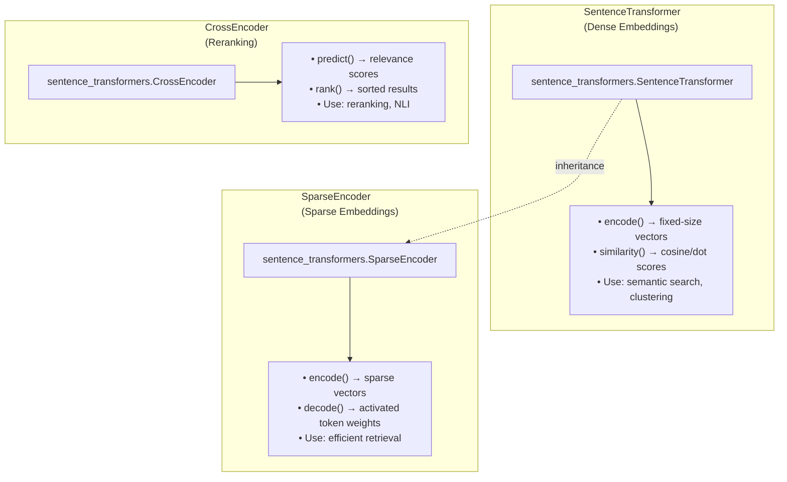
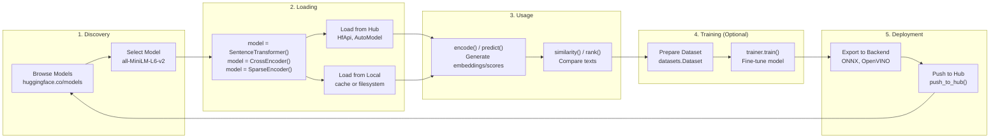
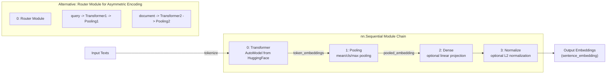
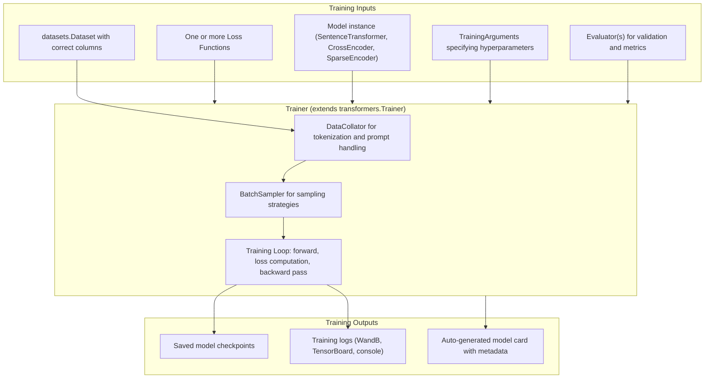
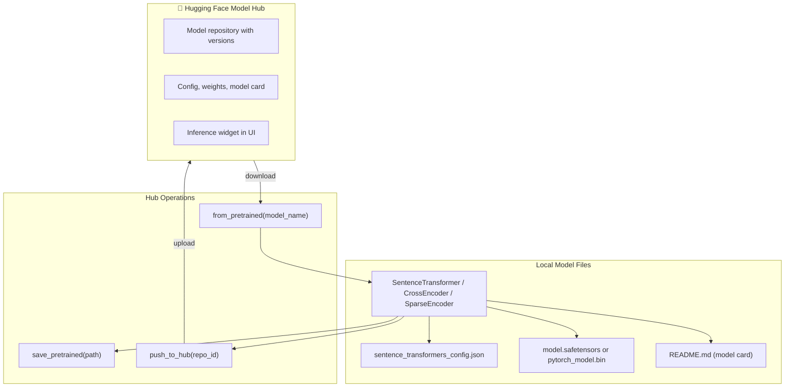
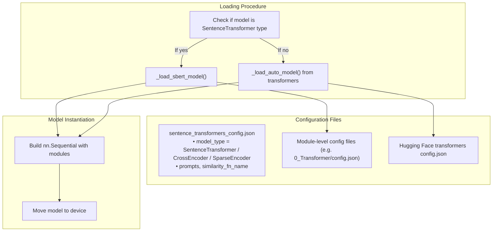

<!-- source: DeepWiki mcp.deepwiki.com · repo huggingface/sentence-transformers · page 1 Overview · fetched 2026-10-26 -->

# Overview

<details>
<summary>Relevant source files</summary>

The following files were used as context for generating this wiki page:

- [.gitignore](.gitignore)
- [.pre-commit-config.yaml](.pre-commit-config.yaml)
- [Makefile](Makefile)
- [README.md](README.md)
- [docs/img/BiEncoder.png](docs/img/BiEncoder.png)
- [docs/img/CrossEncoder.png](docs/img/CrossEncoder.png)
- [docs/installation.md](docs/installation.md)
- [docs/publications.md](docs/publications.md)
- [index.rst](index.rst)
- [pyproject.toml](pyproject.toml)
- [sentence_transformers/__init__.py](sentence_transformers/__init__.py)

</details>


The Sentence Transformers library is a Python framework designed for computing embeddings, performing semantic search, and reranking text efficiently. It supports three primary model architectures optimized for distinct natural language processing tasks:

- `SentenceTransformer`: Produces fixed-dimensional dense sentence embeddings.
- `CrossEncoder`: Outputs relevance scores by jointly encoding input sentence pairs.
- `SparseEncoder`: Generates sparse embeddings suited for efficient retrieval.

This page introduces the library's architecture, underlying components, and their interaction patterns.

For installation instructions, see [Installation and Setup](#2.1). For training details, see [Training Models](#5). For comprehensive API documentation, refer to [API Reference](#9).

---

## Library Purpose and Scope

Sentence Transformers supports the full machine learning lifecycle in embedding-based NLP:

1. **Model Discovery** — Browse 15,000+ pre-trained models on Hugging Face Hub.
2. **Inference** — Load models and compute embeddings or similarity scores quickly.
3. **Training** — Fine-tune or train models from scratch, with support for 40+ loss functions.
4. **Evaluation** — Assess model performance across tasks with specialized evaluators.
5. **Deployment** — Export to ONNX/OpenVINO backends, perform quantization, and share models on the Hub.

This comprehensive approach enables applications such as semantic search, paraphrase mining, and reranking.

**Sources:** [README.md:1-19](), [index.rst:9-17]()

---

## Three Model Architectures



### SentenceTransformer

The `SentenceTransformer` class generates dense, fixed-size vector embeddings from variable-length textual inputs. Architecturally, it is implemented as an `nn.Sequential` module chain consisting of:

- **Transformer**: Provides token embeddings from pretrained models (e.g., BERT, RoBERTa).
- **Pooling**: Aggregates token embeddings into a single sentence vector (mean, max, CLS pooling).
- **Dense** (optional): Projects embeddings to a different dimension.
- **Normalize** (optional): Applies L2 normalization.

Key functions:
- `encode(sentences)`: Converts sentences into dense embeddings.
- `encode_query(sentences)`: Encodes queries (used with Router modules for asymmetric processing).
- `encode_document(sentences)`: Encodes documents (used with Router).
- `similarity(embeddings1, embeddings2)`: Computes cosine or dot product similarity between embeddings.

**Sources:** [sentence_transformers/sentence_transformer/model.py:61-163](), [README.md:54-86]()

### CrossEncoder

`CrossEncoder` models jointly encode pairs of sentences or inputs to produce similarity or relevance scores. Unlike bi-encoders (`SentenceTransformer`), CrossEncoder concatenates inputs and passes through a sequence classification model, improving accuracy at the expense of inference speed.

Implemented using Hugging Face's `AutoModelForSequenceClassification`, key methods include:

- `predict(pairs)`: Scores input pairs individually.
- `rank(query, documents)`: Reranks multiple documents by relevance to a query.

Supports both regression output (`num_labels=1`) and classification.

**Sources:** [sentence_transformers/cross_encoder/CrossEncoder.py:48-116](), [README.md:87-130]()

### SparseEncoder

The `SparseEncoder` extends the bi-encoder paradigm to output high-dimensional sparse vectors, where only a small subset of vocabulary dimensions have non-zero activations. It uses specialized modules including:

- **MLMTransformer**: Transformer backbone pretrained for masked language modeling.
- **SpladePooling**: Activation-based pooling producing sparse token representations.
- **SparseAutoEncoder**: Compresses high-dimensional sparse vectors efficiently.

Key methods:
- `encode(sentences, convert_to_sparse_tensor=True)`: Produces sparse embeddings.
- `decode(embedding, top_k=None)`: Retrieves active token-weight pairs from sparse vectors.
- `sparsity(embeddings)`: Computes sparsity statistics on outputs.

Sparse vectors enable efficient indexing and retrieval for very large corpora.

**Sources:** [sentence_transformers/sparse_encoder/SparseEncoder.py:27-129](), [README.md:132-166]()

---

## Core System Architecture

```mermaid
graph TB
    subgraph User["User Interface"]
        API["Public API<br/>sentence_transformers/__init__.py"]
    end
    
    subgraph Models["Model Classes"]
        ST["SentenceTransformer<br/>sentence_transformer/model.py"]
        CE["CrossEncoder<br/>cross_encoder/CrossEncoder.py"]
        SE["SparseEncoder<br/>sparse_encoder/SparseEncoder.py"]
    end
    
    subgraph Modules["Model Modules"]
        Trans["Transformer<br/>models/Transformer.py"]
        Pool["Pooling<br/>models/Pooling.py"]
        Router["Router<br/>models/Router.py"]
        MLM["MLMTransformer<br/>sparse_encoder/models/MLMTransformer.py"]
        Splade["SpladePooling<br/>sparse_encoder/models/SpladePooling.py"]
    end
    
    subgraph Training["Training System"]
        STTrainer["SentenceTransformerTrainer<br/>sentence_transformer/trainer.py"]
        CETrainer["CrossEncoderTrainer<br/>cross_encoder/trainer.py"]
        SETrainer["SparseEncoderTrainer<br/>sparse_encoder/trainer.py"]
        Args["TrainingArguments<br/>training_args.py"]
        Loss["Loss Functions<br/>losses/, cross_encoder/losses/,<br/>sparse_encoder/losses/"]
    end
    
    subgraph Evaluation["Evaluation System"]
        Eval["SentenceEvaluator<br/>evaluation/SentenceEvaluator.py"]
        CEEval["CrossEncoder Evaluators<br/>cross_encoder/evaluation/"]
        SEEval["Sparse Evaluators<br/>sparse_encoder/evaluation/"]
    end
    
    subgraph Hub["Hugging Face Ecosystem"]
        HFHub["🤗 Hugging Face Hub<br/>15,000+ models"]
        ModelCard["Model Cards<br/>model_card.py"]
        Backend["Export Backends<br/>backend/"]
    end
    
    API --> ST
    API --> CE
    API --> SE
    
    ST --> Trans
    ST --> Pool
    ST --> Router
    SE --> MLM
    SE --> Splade
    CE -.uses.-> Trans
    
    ST --> STTrainer
    CE --> CETrainer
    SE --> SETrainer
    STTrainer --> Loss
    CETrainer --> Loss
    SETrainer --> Loss
    STTrainer --> Args
    
    STTrainer --> Eval
    CETrainer --> CEEval
    SETrainer --> SEEval
    
    ST --> HFHub
    CE --> HFHub
    SE --> HFHub
    ST --> ModelCard
    CE --> ModelCard
    SE --> ModelCard
    ST --> Backend
    CE --> Backend
    SE --> Backend
```



This architecture shows clear modular separation with:

- **User Level API** in `sentence_transformers/__init__.py`.
- **Model Classes** implementing core inference logic.
- **Modules** implementing reusable neural components.
- **Training subsystem** handling datasets, losses, trainers, and arguments.
- **Evaluation modules** integrating benchmarking and metrics.
- **Hub integration** for loading, saving, and sharing models.
- **Export backends** enabling ONNX and OpenVINO inference.

**Sources:** [sentence_transformers/__init__.py:1-73](), [README.md:1-296]()

---

## Model Lifecycle



Users find pre-trained models on Hugging Face Hub, load them locally or via API, get embeddings or rerank results, optionally fine-tune models on custom datasets, and finally export or share trained models. This lifecycle supports research and production use cases seamlessly.

**Sources:** [sentence_transformers/SentenceTransformer.py:226-350](), [sentence_transformers/cross_encoder/CrossEncoder.py:119-227]()

---

## Package Structure

The library organizes its codebase by functionality:

| Directory / Module          | Purpose                                            |
|----------------------------|--------------------------------------------------|
| `sentence_transformer/`    | Main SentenceTransformer dense embedding module  |
| `cross_encoder/`           | CrossEncoder models, trainers, losses, evaluators|
| `sparse_encoder/`          | SparseEncoder models, trainers, losses, evaluators|
| `models/`                  | Modular components: Transformer, Pooling, Router, Dense, Normalize |
| `losses/`                  | Task-specific loss functions (>20) for training  |
| `evaluation/`              | Evaluators for IR, similarity, classification tasks |
| `trainer.py`               | `SentenceTransformerTrainer` implementation       |
| `training_args.py`         | Training configuration class                       |
| `model_card.py`            | Automatic model card generation                    |
| `backend/`                 | ONNX and OpenVINO export and inference helpers    |
| `sampler/`                 | Batch sampling strategies                          |
| `util.py`                  | Utilities: similarity metrics, mining, quantization|

The codebase ensures modularity, scalability, and extensibility.

**Sources:** [sentence_transformers/__init__.py:1-73](), [pyproject.toml:62-64]()

---

## Module Composition (SentenceTransformer)



Details:

- `SentenceTransformer` subclasses `nn.Sequential`, chaining modules that operate on a `features` dict.
- Each module implements a `forward(features: dict) -> dict` method, progressively augmenting or modifying features.
- `Transformer` loads pretrained HF models to generate token-level embeddings.
- `Pooling` aggregates token embeddings into sentence-level representations.
- Optional `Dense` and `Normalize` modules apply affine and normalization transforms.
- The `Router` module supports asymmetric pipelines, useful in retrieval scenarios (different query/document encoders).

This modular design facilitates easy extension and customization.

**Sources:** [sentence_transformers/sentence_transformer/model.py:61-163](), [sentence_transformers/models/Transformer.py:37-59](), [sentence_transformers/models/Pooling.py:9-41]()

---

## Training System Components



The training framework supports:

- Models of all three types.
- Different dataset formats, managed with Hugging Face `datasets`.
- Numerous task-specific loss functions.
- TrainingArguments allowing configurable epochs, learning rate, batch size.
- Evaluators to integrate validation and metrics during training.
- Trainer classes that extend Hugging Face `Trainer` to orchestrate the entire process.

**Sources:** [sentence_transformers/sentence_transformer/trainer.py:1-50](), [sentence_transformers/sentence_transformer/training_args.py:1-50]()

---

## Integration with Hugging Face Hub



Key points:

- All model types have `from_pretrained()` and `save_pretrained()` methods for loading/saving.
- Models automatically cache downloaded weights/configs locally.
- `push_to_hub()` uploads models and associated files (config, model card) to the Hub.
- Fully supports model versioning with branches and commits.
- Model cards are auto-generated including usage, metrics, training info, and carbon footprint metadata.

**Sources:** [sentence_transformers/sentence_transformer/model.py:226-315](), [sentence_transformers/util.py:47-56]()

---

## Backend Support

The library supports three major backends for inference:

| Backend      | Usage                      | Advantages                       |
|--------------|----------------------------|--------------------------------|
| **PyTorch**  | `backend='torch'` (default) | Full feature support, training enabled |
| **ONNX**     | `backend='onnx'`            | Faster inference, quantization support |
| **OpenVINO** | `backend='openvino'`        | Optimized for Intel CPUs, fastest CPU inference |

Example usage:

```python
# PyTorch (default, full functionality)
model = SentenceTransformer("model-name")

# ONNX backend for optimized inference
model = SentenceTransformer("model-name", backend="onnx")

# OpenVINO for Intel CPU acceleration
model = SentenceTransformer("model-name", backend="openvino")
```

The library includes export helpers such as `export_optimized_onnx_model()` and `export_static_quantized_openvino_model()` to convert models for backend use.

**Sources:** [sentence_transformers/__init__.py:10-14]()

---

## Model Configuration



Configuration hierarchy:

- Top-level `sentence_transformers_config.json` defines model type, task prompts, similarity function.
- Each module (Transformer, Pooling, etc.) has its own config directory and JSON file.
- Standard Hugging Face Transformer configs are also used.

This layered configuration enables flexible model assembly.

**Sources:** [sentence_transformers/sentence_transformer/model.py:226-350](), [sentence_transformers/util.py:47-56]()

---

## Model Card Generation

The library automatically creates comprehensive model cards including:

- Model architecture metadata (type, base model, language, license)
- Training configuration (datasets, loss functions, hyperparameters)
- Evaluation metrics and benchmarks
- Usage examples demonstrating typical API patterns
- Carbon footprint tracking using codecarbon integration

This is achieved via:

- `SentenceTransformerModelCardData` and related classes capturing metadata during training.
- Jinja2 template rendering of README.md files.
- Callbacks updating metadata after each training step.

This ensures rich, informative model documentation is consistently produced.

**Sources:** [sentence_transformers/model_card.py:1-100](), [README.md:249-279]()

---

## Key Classes Reference

| Class                | Location                                          | Description                          |
|----------------------|--------------------------------------------------|------------------------------------|
| `SentenceTransformer`| `sentence_transformer/model.py:61`               | Dense embedding model implementation |
| `CrossEncoder`       | `cross_encoder/CrossEncoder.py:48`                | Reranking model                     |
| `SparseEncoder`      | `sparse_encoder/SparseEncoder.py:27`              | Sparse embedding model              |
| `Transformer`        | `models/Transformer.py:37`                         | Token embedding module              |
| `Pooling`            | `models/Pooling.py:9`                              | Pooling strategies module           |
| `Router`             | `models/Router.py:1`                               | Task-based routing module           |
| `SentenceTransformerTrainer` | `sentence_transformer/trainer.py:1`          | Training orchestration              |
| `SentenceEvaluator`  | `evaluation/SentenceEvaluator.py:1`                | Base evaluation class               |

**Sources:** [sentence_transformers/__init__.py:1-73]()

---

This overview provides the fundamental understanding of the sentence-transformers library's purpose, architecture, model types, and system design to onboard technical users effectively. Further pages detail installation, usage, model internals, and development.

---

