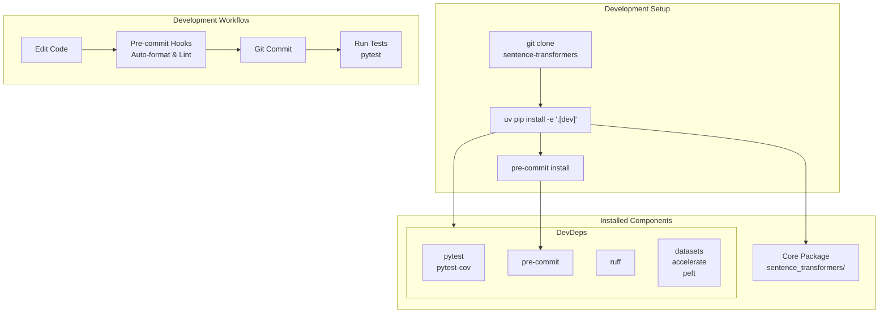
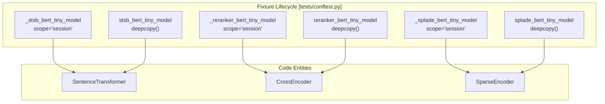
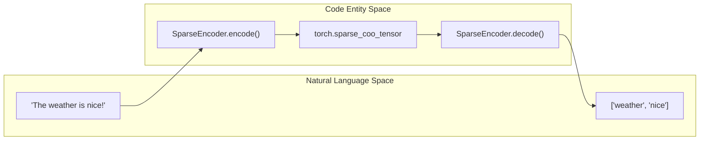

<!-- source: DeepWiki mcp.deepwiki.com · repo huggingface/sentence-transformers · page 10 Development and Testing · fetched 2026-10-26 -->

# Development and Testing

<details>
<summary>Relevant source files</summary>

The following files were used as context for generating this wiki page:

- [.github/workflows/min-versions.yml](.github/workflows/min-versions.yml)
- [.github/workflows/quality.yml](.github/workflows/quality.yml)
- [.github/workflows/sync-skills.yml](.github/workflows/sync-skills.yml)
- [.github/workflows/tests.yml](.github/workflows/tests.yml)
- [tests/__init__.py](tests/__init__.py)
- [tests/base/modules/test_dense.py](tests/base/modules/test_dense.py)
- [tests/base/modules/test_transformer.py](tests/base/modules/test_transformer.py)
- [tests/base/test_data_collator.py](tests/base/test_data_collator.py)
- [tests/base/test_trainer.py](tests/base/test_trainer.py)
- [tests/conftest.py](tests/conftest.py)
- [tests/cross_encoder/test_pretrained.py](tests/cross_encoder/test_pretrained.py)
- [tests/sentence_transformer/modules/test_static_embedding.py](tests/sentence_transformer/modules/test_static_embedding.py)
- [tests/sentence_transformer/test_model.py](tests/sentence_transformer/test_model.py)
- [tests/sentence_transformer/test_pretrained.py](tests/sentence_transformer/test_pretrained.py)
- [tests/sparse_encoder/test_model.py](tests/sparse_encoder/test_model.py)
- [tests/sparse_encoder/test_opensearch_models.py](tests/sparse_encoder/test_opensearch_models.py)
- [tests/sparse_encoder/test_pretrained.py](tests/sparse_encoder/test_pretrained.py)
- [tests/util/test_retrieval.py](tests/util/test_retrieval.py)
- [tests/util/test_similarity.py](tests/util/test_similarity.py)

</details>


This page provides comprehensive guidance for developers who want to contribute to the Sentence Transformers library, including setting up a development environment, running tests, understanding the test structure, and maintaining code quality. For information about training models or using the library, see [Training Models](#5) or [Getting Started](#2).

## Development Environment Setup

### Installation for Development

To set up a development environment, first clone the repository and install the package in editable mode with development dependencies:

```bash
git clone https://github.com/huggingface/sentence-transformers
cd sentence-transformers
pip install -e ".[dev]"
```

The library utilizes `uv` for high-performance dependency management in CI environments, which developers can also use locally for faster setups [ .github/workflows/tests.yml:59-63](). The `dev` extra installs core training dependencies (`datasets`, `accelerate`), testing tools (`pytest`, `pytest-cov`), and code quality tools (`pre-commit`, `ruff`).

After installation, set up pre-commit hooks:

```bash
pre-commit install
```

Sources: [.github/workflows/tests.yml:59-63](), [.github/workflows/quality.yml:28-31]()

### Development Environment Architecture



Sources: [.github/workflows/tests.yml:75-81](), [.github/workflows/quality.yml:30-34]()

## Test Organization and Structure

### Test Directory Layout

Tests are organized in a hierarchical structure mirroring the package organization:

```
tests/
├── conftest.py                    # Root-level fixtures (SentenceTransformer models)
├── base/                          # Tests for base modules and trainers
│   ├── modules/                   # Module-specific tests (Transformer, Dense)
│   └── test_trainer.py            # SentenceTransformerTrainer tests
├── cross_encoder/
│   ├── conftest.py               # CrossEncoder fixtures
│   └── test_*.py                 # CrossEncoder-specific tests
└── sparse_encoder/
    ├── conftest.py               # SparseEncoder fixtures
    └── test_*.py                 # SparseEncoder-specific tests
```

Sources: [tests/conftest.py:11-17](), [tests/sparse_encoder/test_model.py:14-17](), [tests/base/modules/test_transformer.py:19-24]()

### Test Fixture Architecture

The test suite uses a two-tier fixture pattern to balance speed and isolation. Session-scoped fixtures (prefixed with `_`) load models once, while function-scoped fixtures provide a `deepcopy` to ensure test isolation [tests/conftest.py:20-48]().



Sources: [tests/conftest.py:20-48](), [tests/conftest.py:101-114](), [tests/conftest.py:117-130]()

### Key Test Fixtures

| Fixture Name | Scope | Class Association | Purpose |
|-------------|-------|-----------|---------|
| `stsb_bert_tiny_model` | function | `SentenceTransformer` | Fast BERT-tiny for dense tests [tests/conftest.py:31-33]() |
| `reranker_bert_tiny_model` | function | `CrossEncoder` | Tiny reranker for CE tests [tests/conftest.py:112-114]() |
| `splade_bert_tiny_model` | function | `SparseEncoder` | SPLADE model for sparse tests [tests/conftest.py:127-130]() |
| `csr_bert_tiny_model` | function | `SparseEncoder` | CSR sparse model variant [tests/conftest.py:159-161]() |
| `cache_dir` | function | N/A | Temp directory for CI cleanup [tests/conftest.py:193-200]() |

Sources: [tests/conftest.py:31-161]()

## Running Tests

### CI Configuration and Matrix

The library is tested across a wide matrix of environments to ensure compatibility:
- **Python Versions**: 3.10, 3.11, 3.12, 3.13 [.github/workflows/tests.yml:24]()
- **OS**: Ubuntu, Windows [.github/workflows/tests.yml:25]()
- **Transformers Versions**: Support for both `<5.0.0` and `>=5.0.0` [.github/workflows/tests.yml:26]()

### Execution Commands

Run the full test suite:
```bash
python -m pytest --durations 20 -sv tests/
```

To run quality checks (linting):
```bash
make check
```

Sources: [.github/workflows/tests.yml:93-95](), [.github/workflows/quality.yml:32-34]()

### Code Quality and Linting

The project uses `ruff` for linting and formatting, enforced via `pre-commit` [.github/workflows/quality.yml:30-34]().
A dedicated `Minimum version tests` workflow ensures that the library remains compatible with the lowest versions of dependencies specified in `pyproject.toml`, resolving dependencies at their `lowest-direct` versions [.github/workflows/min-versions.yml:64-66]().

Sources: [.github/workflows/quality.yml:30-34](), [.github/workflows/min-versions.yml:64-66]()

## Implementation Detail: Sparse and Cross Encoder Testing

### Pretrained Model Validation

The library validates a wide array of third-party models. `test_pretrained_model_bf16_sdpa` in both sparse and cross-encoder tests ensures that loading models with `torch.bfloat16` and `sdpa` attention implementation produces expected similarity scores [tests/sparse_encoder/test_pretrained.py:111-126](), [tests/cross_encoder/test_pretrained.py:127-137]().

### Sparse Decoding Logic

The `SparseEncoder.decode` method is tested heavily to ensure it correctly transforms sparse tensors back into human-readable tokens and weights [tests/sparse_encoder/test_model.py:35-42]().



Sources: [tests/sparse_encoder/test_model.py:35-55](), [tests/sparse_encoder/test_model.py:134-144]()

## AI Agent Skills (Development Automation)

The repository includes a "skill" for AI coding agents (like Claude Code) located in `skills/train-sentence-transformers/`. A specialized workflow `Sync skill to huggingface/skills` automatically pushes updates to the Hugging Face skills marketplace whenever a new version tag is pushed [.github/workflows/sync-skills.yml:1-11](). This skill provides production-ready script templates and a smoke-test protocol for automated training tasks [.github/workflows/sync-skills.yml:28-43]().

Sources: [.github/workflows/sync-skills.yml:1-43]()

## Testing Infrastructure Components

| Component | File Path | Role |
|-----------|-----------|------|
| **Unit Tests** | `.github/workflows/tests.yml` | Main CI pipeline for multi-version testing |
| **Min Versions** | `.github/workflows/min-versions.yml` | Validates compatibility with lowest supported dependencies |
| **Quality** | `.github/workflows/quality.yml` | Runs `ruff` and `pre-commit` checks |
| **Fixtures** | `tests/conftest.py` | Centralized model loading and isolation logic |
| **Skill Sync** | `.github/workflows/sync-skills.yml` | Automates AI Agent skill deployment |

Sources: [.github/workflows/tests.yml:1-12](), [.github/workflows/min-versions.yml:1-25](), [.github/workflows/quality.yml:1-15](), [tests/conftest.py:1-18]()

---

