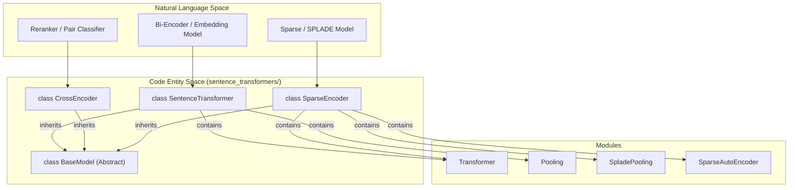
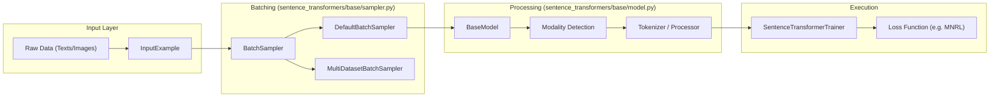

<!-- source: DeepWiki mcp.deepwiki.com · repo huggingface/sentence-transformers · page 11 Glossary · fetched 2026-10-26 -->

# Glossary

Relevant source files

The following files were used as context for generating this wiki page:

- [.gitignore](.gitignore)
- [.pre-commit-config.yaml](.pre-commit-config.yaml)
- [Makefile](Makefile)
- [README.md](README.md)
- [docs/cross_encoder/training_overview.md](docs/cross_encoder/training_overview.md)
- [docs/installation.md](docs/installation.md)
- [docs/package_reference/sparse_encoder/losses.md](docs/package_reference/sparse_encoder/losses.md)
- [docs/publications.md](docs/publications.md)
- [docs/sentence_transformer/training_overview.md](docs/sentence_transformer/training_overview.md)
- [docs/sparse_encoder/loss_overview.md](docs/sparse_encoder/loss_overview.md)
- [docs/sparse_encoder/training_overview.md](docs/sparse_encoder/training_overview.md)
- [examples/sentence_transformer/training/matryoshka/README.md](examples/sentence_transformer/training/matryoshka/README.md)
- [index.rst](index.rst)
- [pyproject.toml](pyproject.toml)
- [sentence_transformers/__init__.py](sentence_transformers/__init__.py)
- [sentence_transformers/base/modality.py](sentence_transformers/base/modality.py)
- [sentence_transformers/base/modality_types.py](sentence_transformers/base/modality_types.py)
- [sentence_transformers/base/model.py](sentence_transformers/base/model.py)
- [sentence_transformers/base/modules/transformer.py](sentence_transformers/base/modules/transformer.py)
- [sentence_transformers/cross_encoder/__init__.py](sentence_transformers/cross_encoder/__init__.py)
- [sentence_transformers/cross_encoder/evaluation/__init__.py](sentence_transformers/cross_encoder/evaluation/__init__.py)
- [sentence_transformers/cross_encoder/model.py](sentence_transformers/cross_encoder/model.py)
- [sentence_transformers/sentence_transformer/__init__.py](sentence_transformers/sentence_transformer/__init__.py)
- [sentence_transformers/sentence_transformer/model.py](sentence_transformers/sentence_transformer/model.py)
- [sentence_transformers/sparse_encoder/__init__.py](sentence_transformers/sparse_encoder/__init__.py)
- [sentence_transformers/sparse_encoder/losses/__init__.py](sentence_transformers/sparse_encoder/losses/__init__.py)
- [sentence_transformers/sparse_encoder/losses/cached_splade.py](sentence_transformers/sparse_encoder/losses/cached_splade.py)
- [sentence_transformers/sparse_encoder/model.py](sentence_transformers/sparse_encoder/model.py)
- [tests/base/test_modality.py](tests/base/test_modality.py)
- [tests/base/test_model.py](tests/base/test_model.py)

This page provides definitions and technical context for codebase-specific terms, jargon, and domain concepts used within the `sentence-transformers` library. It is intended to assist onboarding engineers in navigating the architectural abstractions and data flow of the system.

## Core Model Architectures

The library supports three primary model architectures, each serving different performance and accuracy requirements.

### SentenceTransformer (Bi-Encoder)
A **Bi-Encoder** architecture that maps input text (or other modalities) into a dense vector space. Each input is processed independently.
*   **Implementation**: Inherits from `BaseModel` and `FitMixin` [sentence_transformers/sentence_transformer/model.py:41-41]().
*   **Data Flow**: Typically consists of a `Transformer` module followed by a `Pooling` module [docs/sentence_transformer/training_overview.md:75-78]().
*   **Key Method**: `encode()` for computing dense embeddings [sentence_transformers/sentence_transformer/model.py:161-161]().

### CrossEncoder (Reranker)
An architecture where two inputs are processed simultaneously by the transformer, allowing for full cross-attention between tokens. It outputs a score or label rather than an embedding.
*   **Implementation**: Inherits from `BaseModel` and `FitMixin` [sentence_transformers/cross_encoder/model.py:35-35]().
*   **Role**: Used as a **Reranker** in "Retrieve & Rerank" pipelines to improve precision on a subset of documents [docs/cross_encoder/training_overview.md:16-18]().
*   **Key Methods**: `predict()` for scores [sentence_transformers/cross_encoder/model.py:228-228]() and `rank()` for sorting candidates [sentence_transformers/cross_encoder/model.py:381-381]().

### SparseEncoder (SPLADE)
A model that produces sparse, high-dimensional embeddings (often matching the vocabulary size of the tokenizer). It frequently utilizes the **SPLADE** (Sparse Lexical and Expansion) mechanism.
*   **Implementation**: Inherits from `BaseModel` [sentence_transformers/sparse_encoder/model.py:35-35]().
*   **Modules**: Uses `SpladePooling` [sentence_transformers/sparse_encoder/modules/splade_pooling.py:11-11]() and `SparseAutoEncoder` [sentence_transformers/sparse_encoder/modules/sparse_auto_encoder.py:12-12]().
*   **Output**: Returns a `torch.sparse_coo_tensor` or a **CSR** (Compressed Sparse Row) matrix [sentence_transformers/sparse_encoder/model.py:226-228]().

### Model Relationship Diagram
The following diagram maps the high-level system names to their internal code entities.

**Model Architecture to Code Entity Mapping**

Sources: [sentence_transformers/base/model.py:50-80](), [sentence_transformers/sentence_transformer/model.py:41-41](), [sentence_transformers/cross_encoder/model.py:35-35](), [sentence_transformers/sparse_encoder/model.py:35-35]()

---

## Domain Concepts & Training Jargon

### MRL / Matryoshka
**Matryoshka Representation Learning** allows a model to produce embeddings where the first $N$ dimensions contain most of the information. This enables "truncating" embeddings to smaller sizes without a significant loss in accuracy [sentence_transformers/util.py:123-125]().
*   **Related Code**: `MatryoshkaLoss` and `truncate_embeddings` [sentence_transformers/util.py:123-123]().

### MNRL (MultipleNegativesRankingLoss)
A widely used loss function for training Bi-Encoders where only positive pairs are provided; other samples in the batch serve as negatives.
*   **Hard Negatives**: Additional "difficult" incorrect examples provided to `InputExample` to improve model discriminative power [sentence_transformers/sentence_transformer/readers.py:8-12]().

### GISTEmbed
A training technique (Guided In-sample Selection of Training Negatives) used to improve embedding models by leveraging a teacher model to select better negatives.

### TSDAE & SimCSE
*   **TSDAE**: Transformer-based Sequential Denoising Auto-Encoder, an unsupervised pre-training method.
*   **SimCSE**: Simple Contrastive Learning of Sentence Embeddings, another unsupervised method using dropout as noise.

### MTEB & BEIR
*   **MTEB**: Massive Text Embedding Benchmark. The library is frequently benchmarked against the MTEB leaderboard [README.md:17-17]().
*   **BEIR**: A heterogeneous benchmark for Information Retrieval.
*   **NanoBEIR**: A smaller, faster version of BEIR used for quick evaluation during development.

### CSR (Compressed Sparse Row)
A memory-efficient format for storing sparse matrices. `SparseEncoder` uses CSR tensors to handle embeddings that are mostly zeros [sentence_transformers/__init__.py:48-49]().

### FLOPS Regularizer
Used in sparse models to penalize high computational costs during inference, encouraging the model to activate fewer dimensions [sentence_transformers/sparse_encoder/losses/splade_loss.py:15-20]().

---

## Technical Components & Configuration

### modules.json
A configuration file found in model directories that defines the sequence of `nn.Module` objects to be loaded [docs/sentence_transformer/training_overview.md:67-68]().

### config_sentence_transformers.json
The primary configuration file that stores model metadata, including the `model_type` (e.g., "sentence_transformer", "cross_encoder") [sentence_transformers/base/model.py:76-79]().

### Router
A module used in asymmetric models to route different inputs (e.g., query vs. document) to different sub-networks or prompts [sentence_transformers/base/modules/router.py:12-15]().

### Modality
Refers to the type of input data: `text`, `image`, `audio`, or `video` [sentence_transformers/base/modality_types.py:18-22]().
*   **unpad_inputs**: A technique used in multimodal or variable-length processing to remove padding tokens for efficiency.

### BatchSamplers
Classes that determine how data is grouped into batches during training.
*   **DefaultBatchSampler**: Standard sequential/shuffled sampling [sentence_transformers/base/sampler.py:16-16]().
*   **MultiDatasetBatchSampler**: Handles sampling from multiple datasets with potentially different loss functions [sentence_transformers/base/sampler.py:105-105]().

### PEFT / LoRA
**Parameter-Efficient Fine-Tuning** (e.g., Low-Rank Adaptation). The library supports loading and saving adapters via `PeftAdapterMixin` [sentence_transformers/base/peft_mixin.py:15-18]().

### StaticEmbedding
A module that uses fixed token embeddings (like Word2Vec or GloVe) instead of a transformer, offering extreme speed at the cost of context-awareness [docs/sentence_transformer/training_overview.md:118-121]().

### Agent Skill
A feature introduced in v5.5.0 that allows AI coding agents (like Claude Code) to interact with the library to automate training tasks [index.rst:4-4]().

---

## Data Flow Diagram

The following diagram illustrates the transition from raw input data to the internal representations used by the `Trainer` and `Loss` functions.

**Training Data Flow to Code Entities**

Sources: [sentence_transformers/sentence_transformer/readers.py:8-12](), [sentence_transformers/base/sampler.py:15-16](), [sentence_transformers/base/modality.py:154-155](), [sentence_transformers/sentence_transformer/trainer.py:26-26]()

---

## Summary Table of Key Classes

| Term | Code Pointer | Description |
| :--- | :--- | :--- |
| **SimilarityFunction** | `sentence_transformers.util.SimilarityFunction` | Enum for Cosine, Dot, Euclidean, Manhattan [sentence_transformers/util/similarity.py:10-10]() |
| **CachedLoss** | `sentence_transformers.losses.CachedMultipleNegativesRankingLoss` | Optimized loss that caches representations to allow for larger effective batch sizes. |
| **device_map** | `BaseModel.__init__(model_kwargs=...)` | Configuration for distributing model layers across multiple GPUs [sentence_transformers/base/model.py:133-134]() |
| **SpladePooling** | `sentence_transformers.sparse_encoder.modules.SpladePooling` | Log-saturation effect on token embeddings for sparsity [sentence_transformers/sparse_encoder/modules/splade_pooling.py:11-11]() |
| **InputExample** | `sentence_transformers.readers.InputExample` | Standard container for a training row (texts, label) [sentence_transformers/sentence_transformer/readers.py:8-8]() |

Sources: [sentence_transformers/util/similarity.py:10-15](), [sentence_transformers/base/model.py:130-140](), [sentence_transformers/sentence_transformer/readers.py:8-25]()