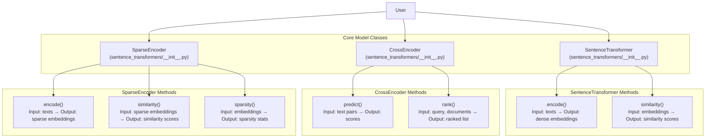
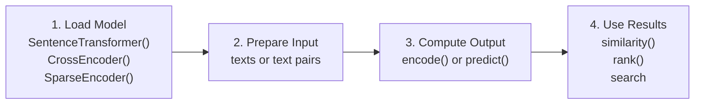
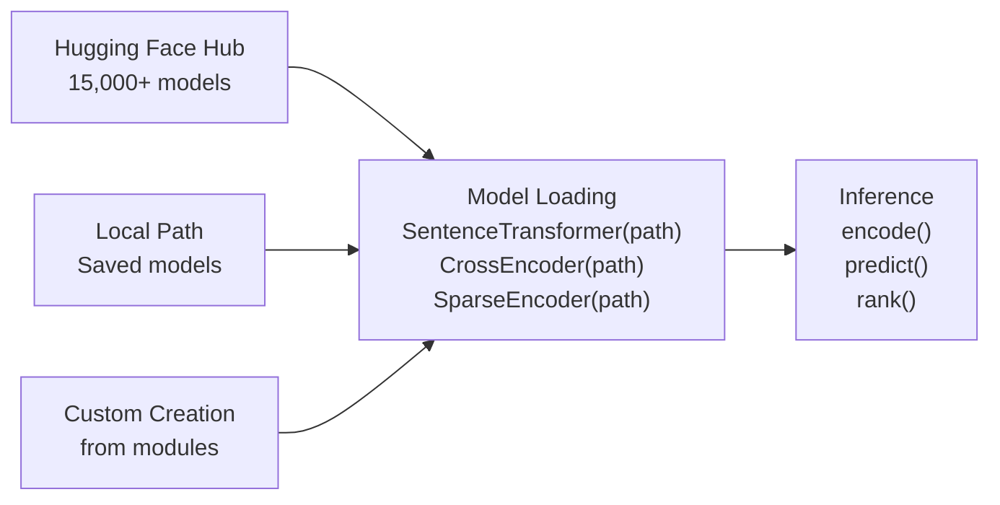
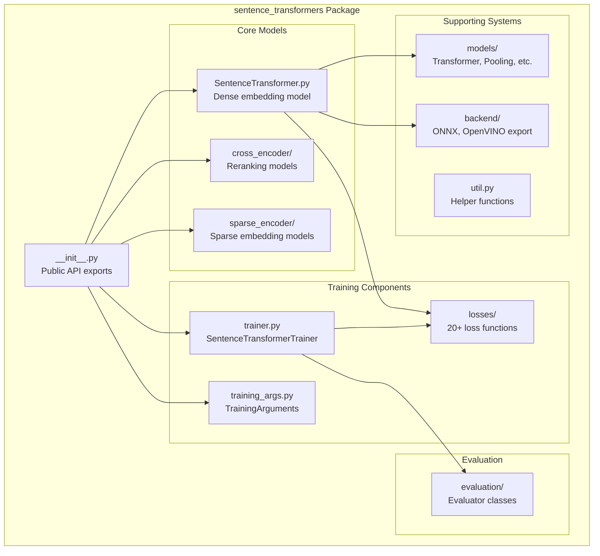

<!-- source: DeepWiki mcp.deepwiki.com · repo huggingface/sentence-transformers · page 2 Getting Started · fetched 2026-10-26 -->

# Getting Started

<details>
<summary>Relevant source files</summary>

The following files were used as context for generating this wiki page:

- [README.md](README.md)
- [docs/cross_encoder/pretrained_models.md](docs/cross_encoder/pretrained_models.md)
- [docs/cross_encoder/usage/custom_models.rst](docs/cross_encoder/usage/custom_models.rst)
- [docs/cross_encoder/usage/usage.rst](docs/cross_encoder/usage/usage.rst)
- [docs/installation.md](docs/installation.md)
- [docs/publications.md](docs/publications.md)
- [docs/quickstart.rst](docs/quickstart.rst)
- [docs/sentence_transformer/dataset_overview.md](docs/sentence_transformer/dataset_overview.md)
- [docs/sentence_transformer/pretrained_models.md](docs/sentence_transformer/pretrained_models.md)
- [docs/sentence_transformer/usage/usage.rst](docs/sentence_transformer/usage/usage.rst)
- [examples/sentence_transformer/training/multimodal/README.md](examples/sentence_transformer/training/multimodal/README.md)
- [examples/sentence_transformer/training/multimodal/training_visual_document_retrieval.py](examples/sentence_transformer/training/multimodal/training_visual_document_retrieval.py)
- [index.rst](index.rst)

</details>


This page provides an introduction to Sentence Transformers and guides you through installation and basic usage. For detailed installation instructions, see [Installation and Setup](#2.1). For more comprehensive examples, see [Quick Start Guide](#2.2).

## Overview

Sentence Transformers is a library for computing embeddings, performing reranking, and generating sparse representations for text. The library provides three main model types, each designed for different use cases:

**Model Type Summary:**

| Model Class | Purpose | Output | Typical Use Cases |
|------------|---------|--------|-------------------|
| `SentenceTransformer` | Dense embeddings | Fixed-size vectors (e.g., 384, 768 dimensions) | Semantic search, clustering, similarity comparison |
| `CrossEncoder` | Reranking | Similarity scores for text pairs | Reranking search results, pair classification |
| `SparseEncoder` | Sparse embeddings | High-dimensional sparse vectors (vocabulary size) | Efficient retrieval, interpretable search, lexical+semantic search |



Sources: [sentence_transformers/__init__.py:1-73](), [README.md:54-166]()

## Installation

The library requires **Python 3.10+**, **PyTorch 1.11.0+**, and **transformers v4.41.0+**.

**Basic Installation:**

```bash
pip install -U sentence-transformers
```

**Installation with Training Support:**

```bash
pip install -U "sentence-transformers[train]"
```

**Installation with Backend Optimization:**

```bash
# ONNX backend
pip install -U "sentence-transformers[onnx-gpu]"

# OpenVINO backend
pip install -U "sentence-transformers[openvino]"
```

For complete installation instructions including conda installation and source installation, see [Installation and Setup](#2.1).

Sources: [README.md:21-48](), [docs/installation.md:1-180](), [pyproject.toml:35-56]()

## Basic Usage Workflow

The typical workflow for using Sentence Transformers follows this pattern:



Sources: [README.md:54-166](), [index.rst:25-132]()

## Quick Examples

### SentenceTransformer: Dense Embeddings

`SentenceTransformer` models encode text into fixed-size dense vectors. These embeddings can be compared using cosine similarity, dot product, or euclidean distance.

```python
from sentence_transformers import SentenceTransformer

# 1. Load a pretrained model
model = SentenceTransformer("sentence-transformers/all-MiniLM-L6-v2")

# 2. Encode sentences
sentences = [
    "The weather is lovely today.",
    "It's so sunny outside!",
    "He drove to the stadium.",
]
embeddings = model.encode(sentences)
print(embeddings.shape)
# => (3, 384)

# 3. Calculate similarities
similarities = model.similarity(embeddings, embeddings)
print(similarities)
# => tensor([[1.0000, 0.6660, 0.1046],
#            [0.6660, 1.0000, 0.1411],
#            [0.1046, 0.1411, 1.0000]])
```

**Key Methods:**
- `encode(sentences)`: Converts text to embeddings
- `similarity(embeddings1, embeddings2)`: Computes similarity scores between embeddings

Sources: [README.md:56-85](), [index.rst:37-63]()

### CrossEncoder: Reranking

`CrossEncoder` models score text pairs directly, making them ideal for reranking candidate documents or classifying relationships between texts.

```python
from sentence_transformers import CrossEncoder

# 1. Load a pretrained CrossEncoder
model = CrossEncoder("cross-encoder/ms-marco-MiniLM-L6-v2")

# 2. Define query and passages
query = "How many people live in Berlin?"
passages = [
    "Berlin had a population of 3,520,031 registered inhabitants in an area of 891.82 square kilometers.",
    "Berlin has a yearly total of about 135 million day visitors, making it one of the most-visited cities in the European Union.",
    "In 2013 around 600,000 Berliners were registered in one of the more than 2,300 sport and fitness clubs.",
]

# 3a. Predict scores for pairs
scores = model.predict([(query, passage) for passage in passages])
print(scores)
# => [8.607139 5.506266 6.352977]

# 3b. Or rank passages directly
ranks = model.rank(query, passages, return_documents=True)
print("Query:", query)
for rank in ranks:
    print(f"- #{rank['corpus_id']} ({rank['score']:.2f}): {rank['text']}")
```

**Key Methods:**
- `predict(text_pairs)`: Scores pairs of texts
- `rank(query, documents)`: Ranks documents by relevance to query

Sources: [README.md:87-130](), [index.rst:65-98]()

### SparseEncoder: Sparse Embeddings

`SparseEncoder` models generate high-dimensional sparse vectors, combining lexical and semantic information for efficient and interpretable retrieval.

```python
from sentence_transformers import SparseEncoder

# 1. Load a pretrained SparseEncoder
model = SparseEncoder("naver/splade-cocondenser-ensembledistil")

# 2. Encode sentences
sentences = [
    "The weather is lovely today.",
    "It's so sunny outside!",
    "He drove to the stadium.",
]
embeddings = model.encode(sentences)
print(embeddings.shape)
# => [3, 30522] - sparse representation with vocabulary size dimensions

# 3. Calculate similarities
similarities = model.similarity(embeddings, embeddings)
print(similarities)
# => tensor([[   35.629,     9.154,     0.098],
#            [    9.154,    27.478,     0.019],
#            [    0.098,     0.019,    29.553]])

# 4. Check sparsity statistics
stats = SparseEncoder.sparsity(embeddings)
print(f"Sparsity: {stats['sparsity_ratio']:.2%}")
# => Sparsity: 99.84%
```

**Key Methods:**
- `encode(sentences)`: Converts text to sparse embeddings
- `similarity(embeddings1, embeddings2)`: Computes similarity scores
- `sparsity(embeddings)`: Returns sparsity statistics (ratio, active dimensions, FLOPS)

Sources: [README.md:132-166](), [index.rst:100-131]()

## Model Discovery and Selection

Over **15,000 pre-trained models** are available on the Hugging Face Hub. The library automatically downloads models when you provide a model name or path.



**Loading Models:**

```python
from sentence_transformers import SentenceTransformer

# From Hugging Face Hub
model = SentenceTransformer("sentence-transformers/all-mpnet-base-v2")

# Short form for sentence-transformers organization
model = SentenceTransformer("all-mpnet-base-v2")

# From local path
model = SentenceTransformer("/path/to/saved/model")

# From custom path on Hub
model = SentenceTransformer("username/model-name")
```

For recommended models and performance benchmarks, see:
- [Model Catalog](#4.2) for model catalog
- [Model Architecture](#3) for understanding model types

Sources: [README.md:168-175](), [index.rst:4-7](), [docs/sentence_transformer/pretrained_models.md:1-218]()

## Library Structure



**Key Files and Their Purposes:**

| File/Directory | Purpose | Key Exports |
|---------------|---------|-------------|
| `__init__.py` | Main entry point | `SentenceTransformer`, `CrossEncoder`, `SparseEncoder`, `*Trainer`, `*TrainingArguments` |
| `SentenceTransformer.py` | Dense embedding model | `SentenceTransformer` class |
| `cross_encoder/` | Reranking subsystem | `CrossEncoder`, `CrossEncoderTrainer` |
| `sparse_encoder/` | Sparse embedding subsystem | `SparseEncoder`, `SparseEncoderTrainer` |
| `losses/` | Training loss functions | 20+ loss classes for different training scenarios |
| `evaluation/` | Evaluation metrics | Evaluator classes for different tasks |
| `models/` | Model components | `Transformer`, `Pooling`, `Dense`, `Normalize`, `Router` modules |
| `backend/` | Export utilities | ONNX and OpenVINO export functions |

Sources: [sentence_transformers/__init__.py:1-73]()

## Next Steps

After installation and basic usage, explore these topics:

**For Using Pre-trained Models:**
- [Model Catalog](#4.2) - Browse and select pre-trained models
- [Loading and Inference](#4.1) - Advanced inference techniques and prompts
- [Backend Optimization](#8.3) - Speed up inference with ONNX/OpenVINO

**For Training Models:**
- [Training Overview](#5.1) - Understand the training pipeline
- [Dataset Preparation](#5.2) - Format your training data
- [Loss Functions](#5.3) - Select appropriate loss functions
- [Training Configuration](#5.4) - Configure hyperparameters

**For Understanding Architecture:**
- [SentenceTransformer Architecture](#3.1) - Modular design and components
- [CrossEncoder Architecture](#3.2) - Sequence classification approach
- [SparseEncoder Architecture](#3.3) - Sparsity mechanisms

**For Advanced Features:**
- [Router Module for Asymmetric Models](#8.1) - Separate query/document encoders
- [Multi-Dataset Training](#8.2) - Train on multiple datasets simultaneously
- [Prompt Engineering](#8.5) - Use prompts with instruction-tuned models

Sources: [index.rst:133-153](), [README.md:176-231]()

---

