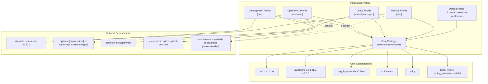
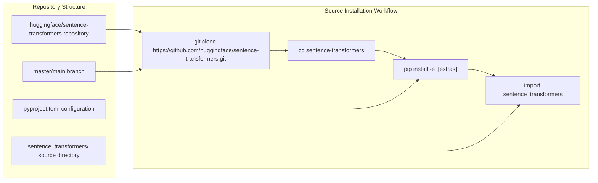
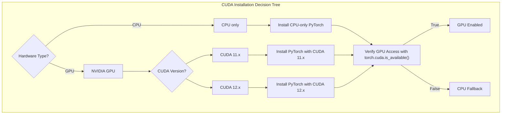
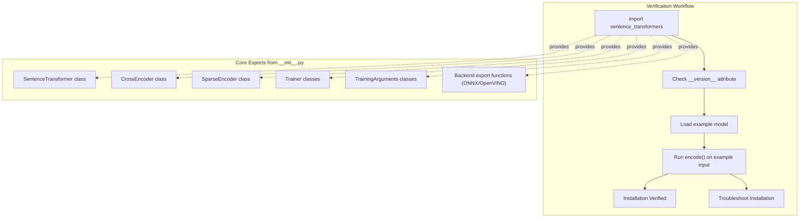

<!-- source: DeepWiki mcp.deepwiki.com · repo huggingface/sentence-transformers · page 2.1 Installation and Setup · fetched 2026-10-26 -->

# Installation and Setup

<details>
<summary>Relevant source files</summary>

The following files were used as context for generating this wiki page:

- [.gitignore](.gitignore)
- [.pre-commit-config.yaml](.pre-commit-config.yaml)
- [Makefile](Makefile)
- [README.md](README.md)
- [docs/installation.md](docs/installation.md)
- [docs/publications.md](docs/publications.md)
- [index.rst](index.rst)
- [pyproject.toml](pyproject.toml)
- [sentence_transformers/__init__.py](sentence_transformers/__init__.py)

</details>


This page provides detailed installation instructions for the Sentence Transformers library. It covers system requirements, installation methods, and setup for different use cases including inference, training, and optimized backends. For information on using pre-trained models after installation, see [Loading and Inference](#4.1). For training setup and configuration, see [Training Configuration](#5.4).

## Purpose and Scope

This document covers:
- System requirements and dependencies
- Installation via pip, conda, and from source
- Optional feature installation (training, ONNX, OpenVINO)
- GPU/CUDA setup
- Development environment configuration
- Installation verification

## System Requirements

The library has the following minimum requirements as specified in [pyproject.toml:1-44]():

| Requirement      | Minimum Version | Notes                        |
|------------------|-----------------|------------------------------|
| Python           | 3.9+            | Supported up to 3.13         |
| PyTorch          | 1.11.0+         | Required for all functionality|
| transformers     | 4.41.0+         | Core Hugging Face integration |
| huggingface-hub  | 0.20.0+         | Model loading and sharing     |

**Core Dependencies:**
- `transformers` (>=4.41.0, <5.0.0) – Base transformer models
- `torch` (>=1.11.0) – Deep learning framework
- `scikit-learn` – Machine learning utilities
- `scipy` – Scientific computing
- `tqdm` – Progress bars
- `Pillow` – Image processing
- `typing_extensions` (>=4.5.0) – Type hints

Sources: [pyproject.toml:1-44](), [README.md:23](), [docs/installation.md:3]()

## Installation Profiles

The library offers several installation profiles to support different use cases. Each profile installs the core package plus additional optional dependencies.



**Profile Descriptions:**

| Profile      | Command                                | Use Case                    | Key Additions                         |
|--------------|--------------------------------------|-----------------------------|-------------------------------------|
| **Default**  | `pip install sentence-transformers`  | Loading, saving, inference   | Core dependencies only               |
| **Training** | `pip install "sentence-transformers[train]"` | Model training and fine-tuning | `datasets`, `accelerate`             |
| **ONNX**     | `pip install "sentence-transformers[onnx]"`  | CPU-optimized inference       | `optimum[onnxruntime]`               |
| **ONNX-GPU** | `pip install "sentence-transformers[onnx-gpu]"` | GPU-optimized ONNX inference  | `optimum[onnxruntime-gpu]`           |
| **OpenVINO** | `pip install "sentence-transformers[openvino]"` | Intel hardware optimization  | `optimum-intel[openvino]`            |
| **Development** | `pip install "sentence-transformers[dev]"` | Contributing to the library  | All above plus testing and formatting tools|

Profiles can also be combined via comma-separated extras, e.g., `pip install "sentence-transformers[train,onnx-gpu]"`.

Sources: [pyproject.toml:51-56](), [docs/installation.md:1-10](), [README.md:21-48]()

## Installation Methods

### Installation via pip

The recommended installation method is using pip from the Python Package Index (PyPI).

**Default Installation:**
```bash
pip install -U sentence-transformers
```

**Training Setup:**
```bash
pip install -U "sentence-transformers[train]"

# Recommended additions for training monitoring
pip install wandb        # For training experiment tracking
pip install codecarbon   # For carbon emissions tracking
```

**ONNX Backend:**
```bash
# GPU and CPU support
pip install -U "sentence-transformers[onnx-gpu]"

# CPU only
pip install -U "sentence-transformers[onnx]"
```

**OpenVINO Backend:**
```bash
pip install -U "sentence-transformers[openvino]"
```

**Development Setup:**
```bash
pip install -U "sentence-transformers[dev]"
```

The `-U` flag upgrades to the latest version if already installed.

Sources: [README.md:25-29](), [docs/installation.md:13-60]()

### Installation via Conda

Conda installation is available via the `conda-forge` channel for the base package and some extras. Note that extras like ONNX and OpenVINO should be installed via pip after conda install.

**Default Installation:**
```bash
conda install -c conda-forge sentence-transformers
```

**Training Setup:**
```bash
conda install -c conda-forge sentence-transformers accelerate datasets

# Recommended additions for monitoring
pip install wandb
pip install codecarbon
```

**Backend Extras (after conda install):**
```bash
pip install -U "sentence-transformers[onnx-gpu]"
pip install -U "sentence-transformers[openvino]"
```

**Development Setup:**
```bash
conda install -c conda-forge sentence-transformers accelerate datasets pre-commit pytest ruff
```

Sources: [README.md:31-35](), [docs/installation.md:63-111]()

### Installation from Source

Installing from source provides access to the bleeding-edge development branch.



**Direct GitHub Installation Examples:**
```bash
# Default install from GitHub
pip install git+https://github.com/huggingface/sentence-transformers.git

# With training extras
pip install "sentence-transformers[train] @ git+https://github.com/huggingface/sentence-transformers.git"

# With ONNX GPU extras
pip install "sentence-transformers[onnx-gpu] @ git+https://github.com/huggingface/sentence-transformers.git"
```

**Editable Installation for Development:**

```bash
git clone https://github.com/huggingface/sentence-transformers
cd sentence-transformers
pip install -e ".[train,dev]"
```

This creates an editable install where changes in the source affect the installed package immediately.

**Development Workflow Setup:**

```bash
pre-commit install  # Setup git hooks for code quality checks
pytest              # Run tests to verify installation
ruff check .        # Lint and check code formatting
```

Sources: [README.md:37-43](), [README.md:233-247](), [docs/installation.md:113-176](), [pyproject.toml:56-64]()

## GPU and CUDA Configuration

To use GPU acceleration, PyTorch must be installed with compatible CUDA support. Sentence Transformers leverage PyTorch's CUDA capabilities but do not require additional setup.



**Steps:**

1. Check your installed CUDA version:
```bash
nvidia-smi
```
2. Install PyTorch with the corresponding CUDA version from [PyTorch Get Started](https://pytorch.org/get-started/locally/):
```bash
# Example for CUDA 11.8
pip install torch torchvision torchaudio --index-url https://download.pytorch.org/whl/cu118
```
3. Verify GPU availability in Python:
```python
import torch
print(torch.cuda.is_available())
```

Sentence Transformers models (`SentenceTransformer`, `CrossEncoder`, `SparseEncoder`) automatically use GPU if available.

Sources: [README.md:45-48](), [docs/installation.md:177-180]()

## Installation Verification

After installation, verify that the library was installed correctly, imports without errors, and basic functionality works.



**Basic Import Test:**
```python
import sentence_transformers

print(f"Version: {sentence_transformers.__version__}")

from sentence_transformers import SentenceTransformer, CrossEncoder, SparseEncoder

print("Core classes imported successfully")
```

**Functional Test:**
```python
from sentence_transformers import SentenceTransformer

model = SentenceTransformer("all-MiniLM-L6-v2")
embeddings = model.encode("This is a test sentence.")

print(f"Embedding shape: {embeddings.shape}")
print(f"Device: {model.device}")
```

**Training Installation Test:**
```python
from sentence_transformers import SentenceTransformerTrainer, SentenceTransformerTrainingArguments
from sentence_transformers.losses import MultipleNegativesRankingLoss

print("Training components imported successfully")
```

**Backend Export Test:**
```python
from sentence_transformers.backend import export_optimized_onnx_model, export_static_quantized_openvino_model

print("Backend export utilities available")
```

The `__init__.py` file defines all public APIs as listed in [sentence_transformers/__init__.py:10-73]().

Sources: [sentence_transformers/__init__.py:1-73](), [README.md:50-166](), [index.rst:19-132]()

## Package Structure and Imports

Understanding what core modules are exposed by the package helps with verifying installation and development.

```mermaid
graph TB
    subgraph "Top-Level Imports from __init__.py"
        Init["sentence_transformers/__init__.py<br/>Version: 5.7.0.dev0"]
    end
    
    subgraph "Core Model Classes"
        ST["SentenceTransformer<br/>(sentence_transformers.sentence_transformer.model)"]
        CE["CrossEncoder<br/>(sentence_transformers.cross_encoder)"]
        SE["SparseEncoder<br/>(sentence_transformers.sparse_encoder)"]
    end
    
    subgraph "Training Components"
        STTrainer["SentenceTransformerTrainer<br/>(sentence_transformers.sentence_transformer.trainer)"]
        STArgs["SentenceTransformerTrainingArguments<br/>(sentence_transformers.sentence_transformer.training_args)"]
        CETrainer["CrossEncoderTrainer<br/>(sentence_transformers.cross_encoder)"]
        CEArgs["CrossEncoderTrainingArguments<br/>(sentence_transformers.cross_encoder)"]
        SETrainer["SparseEncoderTrainer<br/>(sentence_transformers.sparse_encoder)"]
        SEArgs["SparseEncoderTrainingArguments<br/>(sentence_transformers.sparse_encoder)"]
    end
    
    subgraph "Backend Utilities"
        ONNX["export_optimized_onnx_model<br/>export_dynamic_quantized_onnx_model<br/>(sentence_transformers.backend)"]
        OpenVINO["export_static_quantized_openvino_model<br/>(sentence_transformers.backend)"]
    end
    
    subgraph "Utilities"
        Quantize["quantize_embeddings<br/>(sentence_transformers.util.quantization)"]
        Similarity["SimilarityFunction<br/>(sentence_transformers.util.similarity)"]
        Mining["mine_hard_negatives<br/>(sentence_transformers.util)"]
        Samplers["DefaultBatchSampler<br/>MultiDatasetDefaultBatchSampler"]
    end
    
    Init --> ST
    Init --> CE
    Init --> SE
    Init --> STTrainer
    Init --> STArgs
    Init --> CETrainer
    Init --> CEArgs
    Init --> SETrainer
    Init --> SEArgs
    Init --> ONNX
    Init --> OpenVINO
    Init --> Quantize
    Init --> Similarity
    Init --> Mining
    Init --> Samplers
```



These modules are imported and exposed in [sentence_transformers/__init__.py:10-37]() and designated public in the `__all__` list at [sentence_transformers/__init__.py:47-72](). The package version is defined at [sentence_transformers/__init__.py:3]().

Sources: [sentence_transformers/__init__.py:1-73]()

## Common Installation Issues

| Issue                  | Symptom                                    | Resolution                                                |
|------------------------|--------------------------------------------|-----------------------------------------------------------|
| CUDA Not Available     | `torch.cuda.is_available()` returns False  | Install PyTorch with CUDA support for your GPU and CUDA version. |
| Missing training deps   | `ModuleNotFoundError: No module named 'datasets'` | Install training extra: `pip install "sentence-transformers[train]"` |
| Missing ONNX deps       | `ModuleNotFoundError: No module named 'optimum'` | Install ONNX extra: `pip install "sentence-transformers[onnx]"` |
| Version conflicts      | Dependency resolution or runtime errors     | Use isolated virtual environment; use compatible package versions per pyproject.toml |
| Wrong Transformers version | Model load errors or incompatibility       | Ensure `transformers>=4.41.0,<5.0.0` installed              |
| Python unsupported     | Installation fails or syntax errors          | Upgrade to Python 3.9 or above                             |

**Debugging Tips:**

1. Check Python version:
```bash
python --version  # Should be 3.9+
```

2. Confirm `sentence-transformers` installation path:
```python
import sentence_transformers
print(sentence_transformers.__file__)
```

3. Verify dependencies installed:
```bash
pip list | grep -E "(sentence-transformers|torch|transformers|huggingface-hub)"
```

4. Test in clean virtual environment:
```bash
python -m venv test_env
source test_env/bin/activate  # or test_env\Scripts\activate on Windows
pip install sentence-transformers
python -c "import sentence_transformers; print(sentence_transformers.__version__)"
```

Sources: [pyproject.toml:14-44](), [README.md:45-48](), [docs/installation.md:177-180]()

## Development Setup

For developers or contributors, a full editable installation with additional tools is recommended.

**Steps:**

```bash
# 1. Clone the repository
git clone https://github.com/huggingface/sentence-transformers
cd sentence-transformers

# 2. Create and activate a virtual environment (recommended)
python -m venv venv
source venv/bin/activate  # Windows: venv\Scripts\activate

# 3. Install in editable mode with dev extras
pip install -e ".[dev]"

# 4. Set up pre-commit git hooks for code quality
pre-commit install

# 5. Run tests to verify setup
pytest tests/

# 6. Check code style and lint
ruff check .
```

**Development Extras Include:**
- `datasets` – For dataset loading/testing
- `accelerate` – For training acceleration tests
- `pre-commit` – For Git hooks
- `pytest` and `pytest-cov` – For running and reporting tests
- `peft` – For parameter-efficient fine-tuning tests
- `transformers[vision,audio,video]` – For multimodal tests

These are defined in the `[project.optional-dependencies]` section of [pyproject.toml:56-68]().

**Environment Variables:**

The package automatically configures:
- `CODECARBON_LOG_LEVEL=error` if `codecarbon` is installed and not set
- Suppresses PyTorch sparse CSR warning messages

Sources: [README.md:233-247](), [pyproject.toml:56-105](), [sentence_transformers/__init__.py:39-45]()

---

This completes the detailed installation and setup documentation for the Sentence Transformers library.

Sources:  
- [README.md:21-67](), [README.md:70-147](), [sentence_transformers/__init__.py:1-73](), [docs/installation.md:1-180](), [pyproject.toml:1-68]()

---

