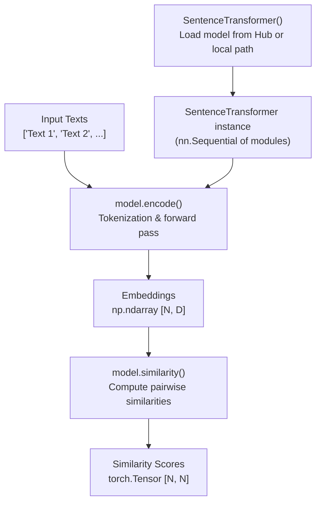
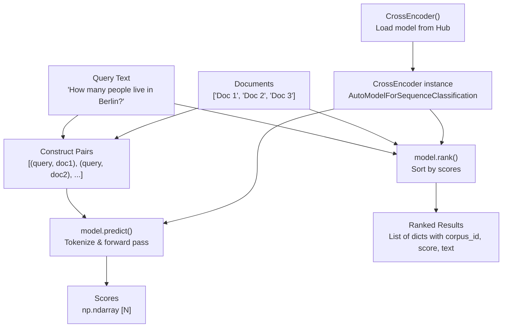
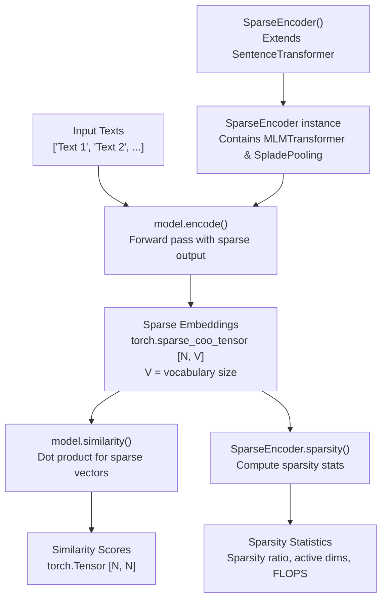
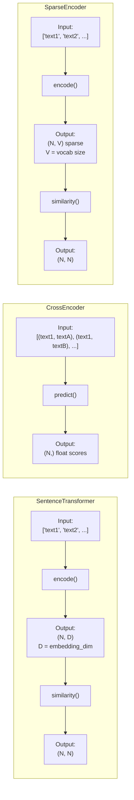

<!-- source: DeepWiki mcp.deepwiki.com · repo huggingface/sentence-transformers · page 2.2 Quick Start Guide · fetched 2026-10-26 -->

# Quick Start Guide

<details>
<summary>Relevant source files</summary>

The following files were used as context for generating this wiki page:

- [README.md](README.md)
- [docs/cross_encoder/pretrained_models.md](docs/cross_encoder/pretrained_models.md)
- [docs/cross_encoder/usage/custom_models.rst](docs/cross_encoder/usage/custom_models.rst)
- [docs/cross_encoder/usage/usage.rst](docs/cross_encoder/usage/usage.rst)
- [docs/installation.md](docs/installation.md)
- [docs/publications.md](docs/publications.md)
- [docs/quickstart.rst](docs/quickstart.rst)
- [docs/sentence_transformer/dataset_overview.md](docs/sentence_transformer/dataset_overview.md)
- [docs/sentence_transformer/pretrained_models.md](docs/sentence_transformer/pretrained_models.md)
- [docs/sentence_transformer/usage/usage.rst](docs/sentence_transformer/usage/usage.rst)
- [examples/sentence_transformer/training/multimodal/README.md](examples/sentence_transformer/training/multimodal/README.md)
- [examples/sentence_transformer/training/multimodal/training_visual_document_retrieval.py](examples/sentence_transformer/training/multimodal/training_visual_document_retrieval.py)
- [index.rst](index.rst)

</details>


This guide offers simple, practical examples for loading models, encoding text, computing similarity scores, and using each of the three core model types in the Sentence Transformers library: `SentenceTransformer` (embedding models), `CrossEncoder` (reranker models), and `SparseEncoder` (sparse embedding models). It includes explanations on key classes and methods as well as their data flow and output shapes.

For installation instructions, see the [Installation and Setup](#2.1) section. For detailed usage and advanced features, refer to the respective architecture and usage sections for each model type.

---

## Working with Embedding Models (`SentenceTransformer`)

The `SentenceTransformer` class generates dense fixed-size vector embeddings given input texts (or other modalities in multimodal models). These embeddings enable efficient similarity computations and are widely used for semantic search, clustering, paraphrase mining, and classification.

### Loading a Model

```python
from sentence_transformers import SentenceTransformer

# Load a pretrained Sentence Transformer model from Hugging Face Hub
model = SentenceTransformer("all-MiniLM-L6-v2")
```

- The `SentenceTransformer` constructor downloads and loads a model given a model name or local path.
- Models from the "sentence-transformers" organization require no prefix when loading.
- The loaded `model` is an instance of the `SentenceTransformer` class, internally defined as a subclass of `torch.nn.Sequential` combining modules such as Transformer and Pooling.
- This modular design allows for flexible configuration and extension.

### Encoding Sentences

```python
sentences = [
    "The weather is lovely today.",
    "It's so sunny outside!",
    "He drove to the stadium.",
]
embeddings = model.encode(sentences)
print(embeddings.shape)
# Output: (3, 384)
```

- The `encode()` method tokenizes input texts, processes them through the model, and returns fixed-size embeddings.
- By default, embeddings are returned as numpy `ndarray` of shape `[num_sentences, embedding_dim]`.
- Supports batch processing, normalization, device specification, and progress bars.
- For multimodal models, `encode()` accepts diverse inputs like images or videos in addition to text.

### Computing Similarities

```python
similarities = model.similarity(embeddings, embeddings)
print(similarities)
# Output (tensor):
# [[1.0000, 0.6660, 0.1046],
#  [0.6660, 1.0000, 0.1411],
#  [0.1046, 0.1411, 1.0000]]
```

- The `similarity()` method computes cosine similarity between embedding vectors by default.
- Accepts two embedding matrices and returns a similarity matrix.
- Useful for clustering or ranking based on semantic similarity.

---

### SentenceTransformer Workflow Diagram



---

## Working with Reranker Models (`CrossEncoder`)

The `CrossEncoder` class encodes pairs of texts jointly, producing scores that reflect their similarity or relevance. These models are often used to rerank search results retrieved by other methods.

### Loading a Model

```python
from sentence_transformers import CrossEncoder

# Load a pretrained CrossEncoder reranker model
model = CrossEncoder("cross-encoder/ms-marco-MiniLM-L6-v2")
```

- `CrossEncoder` class is implemented as a subclass of `torch.nn.Sequential`.
- Typically loads models using `transformers.AutoModelForSequenceClassification`.
- Can be configured with activation functions like `Sigmoid` to get output between 0 and 1.

### Predicting Scores for Text Pairs

```python
query = "How many people live in Berlin?"
passages = [
    "Berlin had a population of 3,520,031 registered inhabitants in 891.82 km².",
    "Berlin has about 135 million yearly day visitors.",
    "Around 600,000 Berliners are registered in fitness clubs.",
]

# Predict similarity/relevance scores
scores = model.predict([(query, p) for p in passages])
print(scores)
# Output: [8.607139, 5.506266, 6.352977]
```

- The `predict()` method accepts a list of text pairs `(text1, text2)` and outputs float scores.
- Scores indicate how well the pair matches semantically or in a retrieval context.

### Ranking Documents for a Query

```python
ranks = model.rank(query, passages, return_documents=True)

print("Query:", query)
for rank in ranks:
    print(f"- #{rank['corpus_id']} ({rank['score']:.2f}): {rank['text']}")
# query and ranked documents output
```

- The `rank()` method scores documents for a query and returns them sorted by descending score.
- Each ranked result contains:
  - `corpus_id`: Original index of the document
  - `score`: Relevance score
  - `text`: Document text (if `return_documents=True`)

---

### CrossEncoder Workflow Diagram



---

## Working with Sparse Embedding Models (`SparseEncoder`)

The `SparseEncoder` class produces high-dimensional sparse embeddings where most elements are zero, leveraging vocabulary-sized representations. These are useful for efficient retrieval with inverted indices and interpretable importance weights.

### Loading a Model

```python
from sentence_transformers import SparseEncoder

# Load a pretrained SparseEncoder model (e.g., SPLADE)
model = SparseEncoder("naver/splade-cocondenser-ensembledistil")
```

- `SparseEncoder` extends `SentenceTransformer`, adding modules like `MLMTransformer` and `SpladePooling` to generate sparse vectors.
- Output vectors have dimensions equal to the vocabulary size (e.g., 30,000+).

### Encoding Sentences

```python
sentences = [
    "The weather is lovely today.",
    "It's so sunny outside!",
    "He drove to the stadium.",
]
embeddings = model.encode(sentences)
print(embeddings.shape)
# Output: [3, 30522] (sparse vector size)
```

- Sparse embeddings are typically returned as sparse tensors (e.g., `torch.sparse_coo_tensor`) for memory efficiency.
- Most vector entries are zero; only a small subset are active.

### Computing Similarities

```python
similarities = model.similarity(embeddings, embeddings)
print(similarities)
# tensor([[35.629, 9.154, 0.098],
#         [ 9.154, 27.478, 0.019],
#         [ 0.098, 0.019, 29.553]])
```

- For sparse embeddings, similarity is computed as dot product rather than cosine similarity.
- Values represent the weighted overlap of active features, serving as relevance signals.

### Checking Sparsity Stats

```python
stats = SparseEncoder.sparsity(embeddings)
print(f"Sparsity: {stats['sparsity_ratio']:.2%}")
# Example Output: Sparsity: 99.84%
```

- `sparsity()` computes statistics such as sparsity ratio, count of active dimensions per embedding, and float operations estimates.
- Useful for diagnostics and optimization.

---

### SparseEncoder Workflow Diagram



---

## Key Methods Summary

| Model Type             | Load Model                        | Generate Embeddings                  | Compare Texts                         | Special Methods             |
|-----------------------|---------------------------------|------------------------------------|-------------------------------------|-----------------------------|
| **SentenceTransformer** | `SentenceTransformer(model_name)` | `model.encode(texts)`               | `model.similarity(emb1, emb2)`       | `encode_query()`, `encode_document()` |
| **CrossEncoder**        | `CrossEncoder(model_name)`       | _no embeddings_                    | `model.predict(pairs)`                | `rank(query, docs)`          |
| **SparseEncoder**       | `SparseEncoder(model_name)`      | `model.encode(texts)`              | `model.similarity(emb1, emb2)`       | `sparsity(embeddings)`, `decode(embeddings)` |

---

## encode() Method Parameters (for SentenceTransformer and SparseEncoder)

Key parameters include:

- `batch_size` (int, default=32): Number of inputs processed per batch.
- `show_progress_bar` (bool): Whether to display progress bars.
- `convert_to_numpy` (bool, default=True): Return numpy arrays instead of PyTorch tensors.
- `convert_to_tensor` (bool, default=False): Return PyTorch tensors instead of numpy arrays.
- `normalize_embeddings` (bool, default=False): L2-normalize embeddings to unit length.
- `device` (str, optional): Device for computation (`"cpu"`, `"cuda"`, etc.).

Example usage with parameters:

```python
embeddings = model.encode(
    sentences,
    batch_size=64,
    show_progress_bar=True,
    normalize_embeddings=True,
    device="cuda"
)
```

---

## predict() Method Parameters (for CrossEncoder)

Key parameters:

- `batch_size` (int, default=32): Number of pairs processed in one batch.
- `show_progress_bar` (bool): Show progress bar during prediction.
- `activation_fn` (callable, optional): Activation function applied to raw model outputs (often `torch.nn.Sigmoid()`).
- `convert_to_numpy` (bool, default=True): Return numpy arrays instead of tensors.
- `apply_softmax` (bool, default=False): For multi-class models, apply softmax to produce probabilities.

Example:

```python
scores = model.predict(
    pairs,
    batch_size=64,
    show_progress_bar=True,
    convert_to_numpy=True
)
```

---

## Output Shapes Reference



---

## Next Steps

- For training and fine-tuning models on your datasets, see the [Training Models](#5).
- Choose models from the pretrained catalogs for each model type: [Model Catalog](#4.2), [Model Catalog](#4.2), and [Model Catalog](#4.2).
- Explore advanced usage and optimization in the model-specific usage and architecture guides.
- Use the [Evaluation System Overview](#6.1) to evaluate model performance with various metrics.

---

# Sources

- README.md:1-166, 115-147
- sentence_transformers/SentenceTransformer.py:61-407, 683-1010, 1223-1350
- sentence_transformers/cross_encoder/CrossEncoder.py:48-227, 118-343, 392-585
- sentence_transformers/sparse_encoder/SparseEncoder.py:27-180, 412-710
- docs/sentence_transformer/usage/usage.rst:3-144
- docs/cross_encoder/usage/usage.rst:1-137
- docs/quickstart.rst:1-120

---

