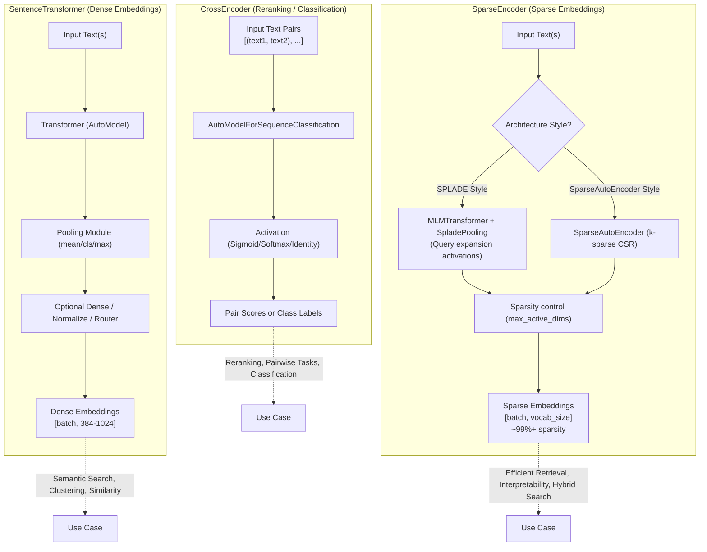
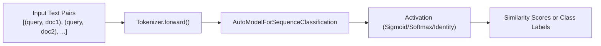
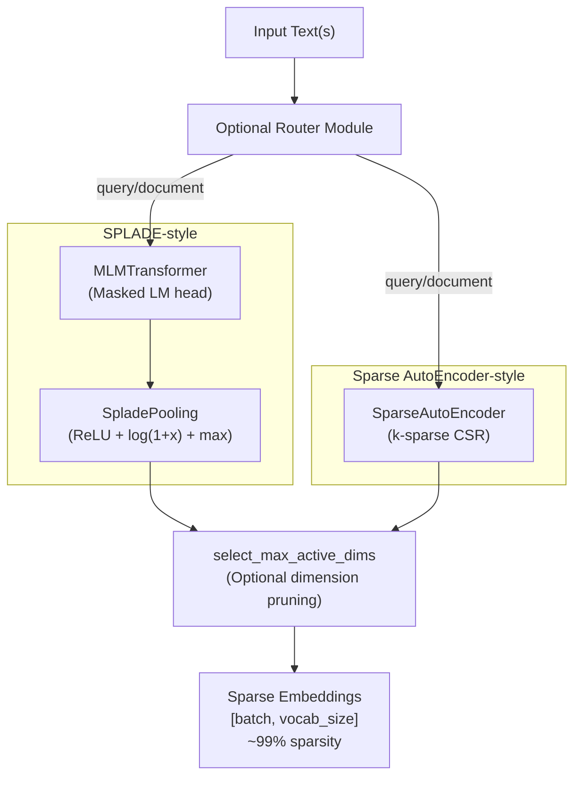
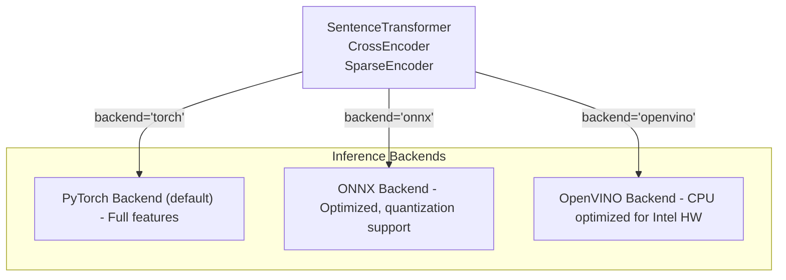
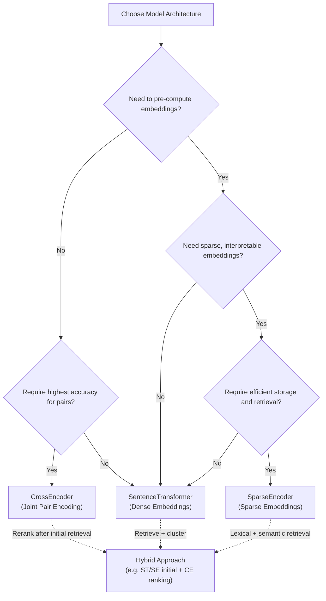

<!-- source: DeepWiki mcp.deepwiki.com · repo huggingface/sentence-transformers · page 3 Model Architecture · fetched 2026-10-26 -->

# Model Architecture

<details>
<summary>Relevant source files</summary>

The following files were used as context for generating this wiki page:

- [.gitignore](.gitignore)
- [.pre-commit-config.yaml](.pre-commit-config.yaml)
- [Makefile](Makefile)
- [pyproject.toml](pyproject.toml)
- [sentence_transformers/__init__.py](sentence_transformers/__init__.py)
- [sentence_transformers/base/model.py](sentence_transformers/base/model.py)
- [sentence_transformers/base/modules/transformer.py](sentence_transformers/base/modules/transformer.py)
- [sentence_transformers/cross_encoder/model.py](sentence_transformers/cross_encoder/model.py)
- [sentence_transformers/sentence_transformer/model.py](sentence_transformers/sentence_transformer/model.py)
- [sentence_transformers/sparse_encoder/model.py](sentence_transformers/sparse_encoder/model.py)
- [tests/base/test_model.py](tests/base/test_model.py)

</details>


This document provides an overview of the three main model architectures in the Sentence Transformers library: `SentenceTransformer`, `CrossEncoder`, and `SparseEncoder`. Each architecture is optimized for different use cases, balancing accuracy, efficiency, and output format differences.

For comprehensive technical details, model internals, and advanced usage, refer to the child pages:
- [SentenceTransformer Architecture](#3.1)
- [CrossEncoder Architecture](#3.2)
- [SparseEncoder Architecture](#3.3)

## Architecture Comparison

The three model types address distinct tasks and have unique structural and output differences:

| Feature                   | SentenceTransformer                                | CrossEncoder                                   | SparseEncoder                            |
|---------------------------|--------------------------------------------------|-----------------------------------------------|-----------------------------------------|
| **Use Cases**             | Semantic search, clustering, similarity search  | Reranking, pairwise classification            | Efficient lexical+semantic retrieval    |
| **Input**                 | Single text or list of texts                      | Pairs of texts (sentence pairs)                | Single text or list of texts             |
| **Output**                | Dense embeddings (typ. 384–1024 dimensions)      | Scores or classification labels (regression or classification output) | Sparse embeddings (vocab-sized, e.g. 30k dimensions) |
| **Embedding Independence** | Embeddings of individual sentences are independent and cacheable | No; pairs are jointly encoded                  | Embeddings are independent and cacheable |
| **Inference Speed**       | Fast, single forward pass per text                | Slower; needs a forward pass per pair          | Fast, single forward pass per text      |
| **Accuracy**              | Good general semantic accuracy                     | Best pair scoring accuracy due to joint encoding | Good; interpretable token-level sparsity |
| **Base Class**            | `nn.Sequential` modular design                     | Based on `AutoModelForSequenceClassification` | Inherits from `SentenceTransformer`    |
| **Modularity**            | Fully modular (`Transformer` + `Pooling` + optional modules) | Less modular, monolithic model                  | Modular, specialized for sparse encodings |

Sources: [sentence_transformers/sentence_transformer/model.py:41-163](), [sentence_transformers/cross_encoder/model.py:35-116](), [sentence_transformers/sparse_encoder/model.py:35-129]()

---

## High-Level Architecture Overview



Sources: [sentence_transformers/sentence_transformer/model.py:41-163](), [sentence_transformers/cross_encoder/model.py:35-116](), [sentence_transformers/sparse_encoder/model.py:35-129](), [sentence_transformers/base/modules/transformer.py:37-59](), [sentence_transformers/sentence_transformer/modules/pooling.py:9-42]()

---

## Common Loading and Initialization Patterns

All three model types share similar APIs for loading models from either local paths or the Hugging Face Hub:

```python
from sentence_transformers import SentenceTransformer, CrossEncoder, SparseEncoder

# Load pre-trained models
model_st = SentenceTransformer("all-MiniLM-L6-v2")
model_ce = CrossEncoder("cross-encoder/ms-marco-MiniLM-L6-v2")
model_se = SparseEncoder("naver/splade-cocondenser-ensembledistil")

# Or load local saved models
model_local = SentenceTransformer("/path/to/my/model")
```

Shared initialization parameters include:

| Parameter            | Description                                            | Applies To           |
|----------------------|--------------------------------------------------------|---------------------|
| `device`             | Computation device: `"cuda"`, `"cpu"`, `"mps"`, `"npu"` | All                 |
| `cache_folder`       | Folder for caching models                              | All                 |
| `trust_remote_code`  | Allow executing Hub custom modeling code              | All                 |
| `revision`           | Specific Hub model version (branch, tag, or commit)   | All                 |
| `model_kwargs`       | Extra kwargs for Hugging Face transformer model loading | All               |
| `processor_kwargs`   | Extra kwargs for tokenizer/processor                   | All                 |
| `backend`            | Inference backend: `"torch"` (default), `"onnx"`, or `"openvino"` | All       |

Sources: [sentence_transformers/sentence_transformer/model.py:167-223](), [sentence_transformers/cross_encoder/model.py:119-136](), [sentence_transformers/sparse_encoder/model.py:133-152]()

---

## SentenceTransformer: Modular Dense Embeddings

`SentenceTransformer` is designed as a modular pipeline built from a list of PyTorch modules called sequentially. Its base architecture most commonly includes:

1. **Transformer Module**: A Hugging Face `AutoModel` that produces contextual token embeddings.
2. **Pooling Module**: Aggregates token embeddings to produce a fixed-size sentence embedding (e.g., mean, CLS token, or max pooling).
3. **Optional Modules**: Such as a dense feed-forward layer, normalization, and a Router module for asymmetric encoding scenarios.


This modular design enables easy customization. You can build custom models from any combination of modules:

```python
from sentence_transformers import SentenceTransformer
from sentence_transformers.models import Transformer, Pooling

transformer = Transformer("bert-base-uncased")
pooling = Pooling(transformer.get_word_embedding_dimension(), pooling_mode="mean")
model = SentenceTransformer(modules=[transformer, pooling])
```

Key encoding methods include:
- `encode()`: General embedding of texts
- `encode_query()`: Optimized for encoding queries (e.g., for asymmetric retrieval)
- `encode_document()`: Optimized for encoding documents

For an in-depth technical explanation, see the child page [SentenceTransformer Architecture](#3.1).

Sources: [sentence_transformers/sentence_transformer/model.py:41-163](), [sentence_transformers/sentence_transformer/model.py:352-355](), [sentence_transformers/base/modules/transformer.py:37-59](), [sentence_transformers/sentence_transformer/modules/pooling.py:9-42]()

---

## CrossEncoder: Joint Pair Encoding for Reranking and Classification

`CrossEncoder` jointly encodes pairs of sentences through an `AutoModelForSequenceClassification` architecture, producing a scalar similarity score or probability distribution for classification tasks.



Modes supported:
- **Reranking Mode**: With `num_labels=1`, outputs a real-valued similarity score per pair. Used for reranking candidate results.
- **Classification Mode**: With `num_labels>1`, outputs classification logits for tasks like entailment or semantic textual similarity classification.

Key decoding methods:
- `predict()`: Compute score or classification probabilities for sentence pairs
- `rank()`: Rank documents by relevance using pairwise scoring (works only with reranking mode)

For detailed guidance, see [CrossEncoder Architecture](#3.2).

Sources: [sentence_transformers/cross_encoder/model.py:35-116](), [sentence_transformers/cross_encoder/model.py:229-257](), [sentence_transformers/cross_encoder/model.py:392-439]()

---

## SparseEncoder: Sparse Embeddings with Interpretability and Efficiency

`SparseEncoder` produces high-dimensional sparse vector representations aligned with vocabulary tokens, enabling efficient and interpretable retrieval. It extends the `SentenceTransformer` but produces sparse embeddings rather than dense ones.

Two main architectural styles are supported:

1. **SPLADE-style**: Uses a masked language modeling transformer (`MLMTransformer`) combined with `SpladePooling` that applies activations and log transforms to get sparse vectors emphasizing query expansion.
2. **Sparse AutoEncoder (SAE) style**: Uses a `SparseAutoEncoder` module that learns sparse codes under sparsity constraints (k-sparse CSR format).



Notable features:
- **Sparsity Control** via `max_active_dims`, allowing runtime control of non-zero components.
- High interpretability: embedding dimensions correspond to vocabulary tokens.
- Efficient storage and fast retrieval in large-scale systems.

Main encoding methods:
- `encode()`: Encodes input text to sparse embeddings
- `encode_query()`: Query-optimized encoding
- `encode_document()`: Document encoding
- `decode()`: Converts sparse embeddings back to tokens for interpretation

For technical details, see [SparseEncoder Architecture](#3.3).

Sources: [sentence_transformers/sparse_encoder/model.py:35-129](), [sentence_transformers/sparse_encoder/modules/__init__.py:1-3](), [sentence_transformers/sparse_encoder/model.py:171-179]()

---

## Backend and Inference Optimization

All three architectures support multiple inference backends to optimize runtime performance:



Usage example specifying backend:

```python
# Using default PyTorch backend
model = SentenceTransformer("model-name", backend="torch")

# Using ONNX backend (for faster inference & quantization)
model = CrossEncoder("cross-encoder-model", backend="onnx")

# Using OpenVINO backend (optimized CPU inference on Intel)
model = SparseEncoder("sparse-encoder-model", backend="openvino")
```

Sources: [sentence_transformers/sentence_transformer/model.py:186-202](), [sentence_transformers/cross_encoder/model.py:135-136](), [sentence_transformers/base/modules/transformer.py:65-76]()

---

## Architecture Selection Guide



**When to use each:**

| Architecture         | Use Cases                                               | Scenarios to Avoid                          |
|----------------------|---------------------------------------------------------|---------------------------------------------|
| **SentenceTransformer** | Semantic search, clustering, similarity tasks, large-scale fast inference with precomputable embeddings | When only exact pairwise accuracy matters, or embedding interpretability is required |
| **CrossEncoder**       | Reranking, semantic textual similarity classification, entailment, situations that require maximum accuracy per pair | Large scale inference due to lower speed; precomputing embeddings not supported |
| **SparseEncoder**      | Efficient large-scale lexical-semantic retrieval, hybrid search, interpretable sparse vectors | Tasks requiring dense semantic representations or very short queries |

Common practical pattern is a two-stage retrieval: first use `SentenceTransformer` or `SparseEncoder` for quick initial retrieval, then apply `CrossEncoder` for fast reranking of top-k candidates.

Sources: [README.md], [index.rst]

---

## Model Configuration and Persistence

Each architecture maintains configuration data for reproducible loading and saving:

| Class                 | Config Storage Location                                    | Key Config Fields                                      |
|-----------------------|------------------------------------------------------------|-------------------------------------------------------|
| `SentenceTransformer` | Internal config dictionary (`self._model_config`)          | `model_type`, `prompts`, `default_prompt_name`, `similarity_fn_name` |
| `CrossEncoder`         | Underlying transformer's `config.sentence_transformers`    | `activation_fn`, `version`                             |
| `SparseEncoder`        | Inherits SentenceTransformer config + sparsity parameters  | Same as SentenceTransformer + `max_active_dims`       |

Models support `save_pretrained()` and `from_pretrained()` with config persistence:

```python
# Save model and config
model.save_pretrained("/path/to/save")

# Reload model with saved config
model = SentenceTransformer("/path/to/save")
```

Sources: [sentence_transformers/sentence_transformer/model.py:196-201](), [sentence_transformers/cross_encoder/model.py:302-316](), [sentence_transformers/sparse_encoder/model.py:171-179]()

---

# Summary

The Sentence Transformers library provides three core model architectures designed to optimize for diverse tasks:

- `SentenceTransformer` for fast, precomputable dense embeddings suitable for semantic search and clustering.
- `CrossEncoder` for maximum accuracy in pairwise scoring and classification at reranking stage.
- `SparseEncoder` for sparse, interpretable, and efficient lexical-semantic retrieval at large scale.

Selecting the appropriate architecture depends on your application requirements for speed, accuracy, interpretability, and the size of the data.

For detailed architectural design, decoder methods, and training strategies, please consult the child pages dedicated to each model type.

---

**Sources:**

- [sentence_transformers/__init__.py:16-33]()
- [sentence_transformers/sentence_transformer/model.py:41-163,167-223,352-355,186-202]()
- [sentence_transformers/cross_encoder/model.py:35-116,119-136,229-257,302-316,392-439]()
- [sentence_transformers/sparse_encoder/model.py:35-129,133-152,171-179]()
- [sentence_transformers/base/modules/transformer.py:37-59,65-76]()
- [sentence_transformers/sentence_transformer/modules/pooling.py:9-42]()

---

