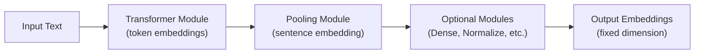
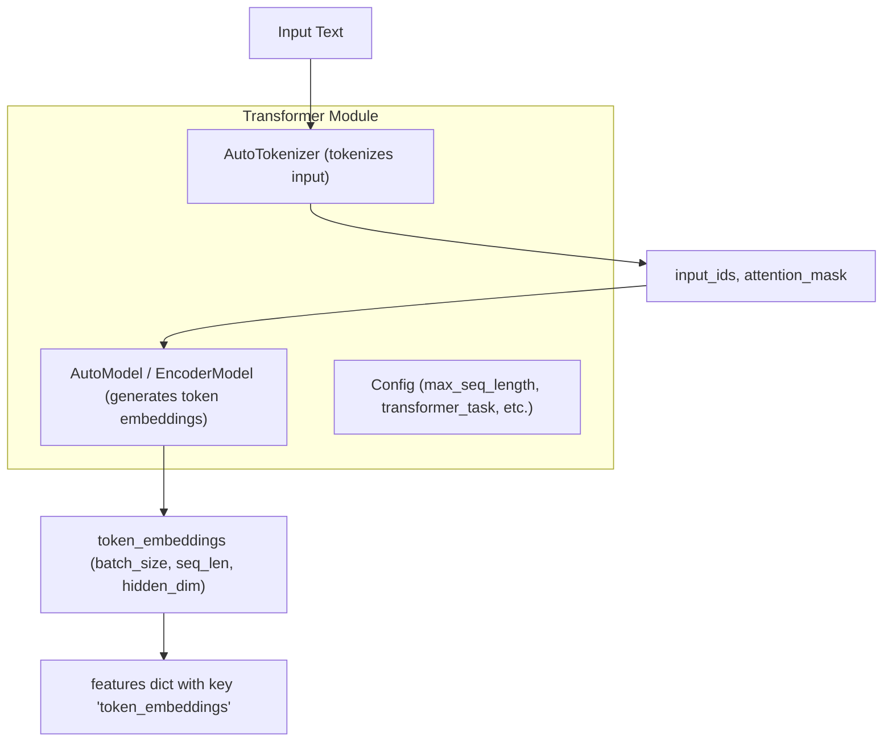
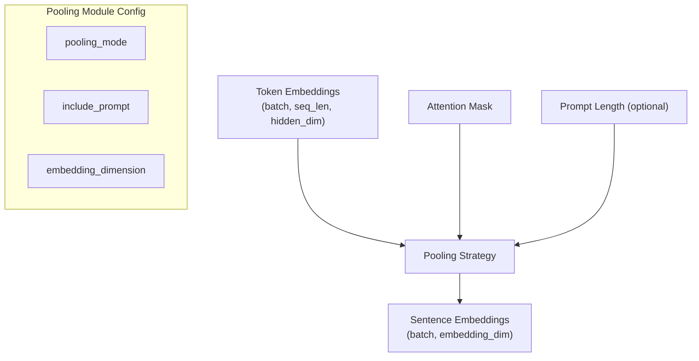
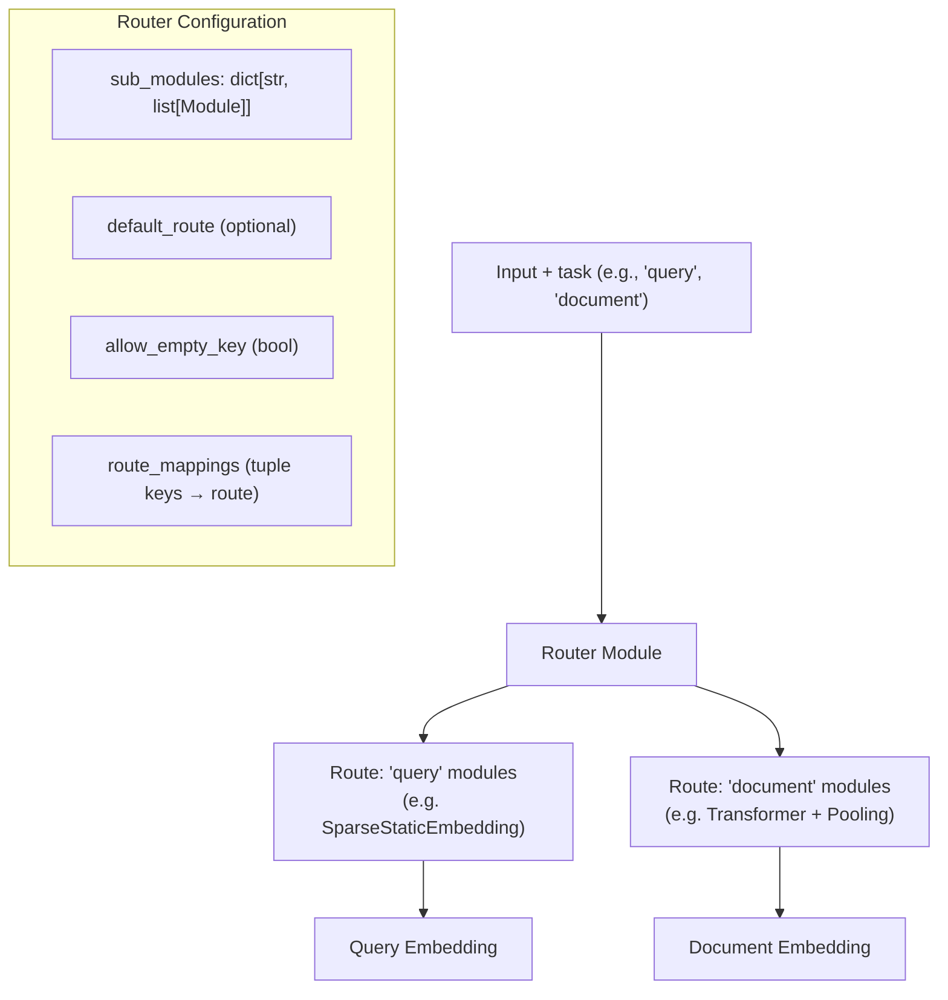
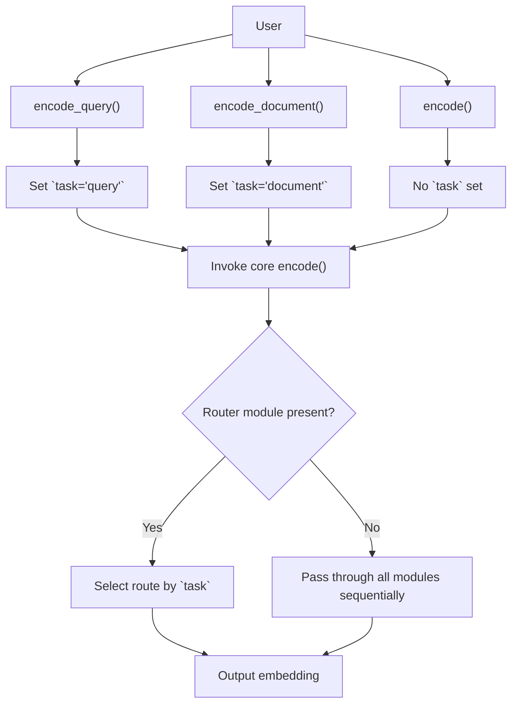
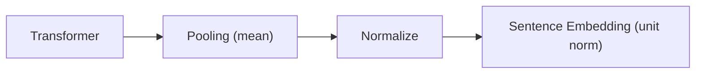
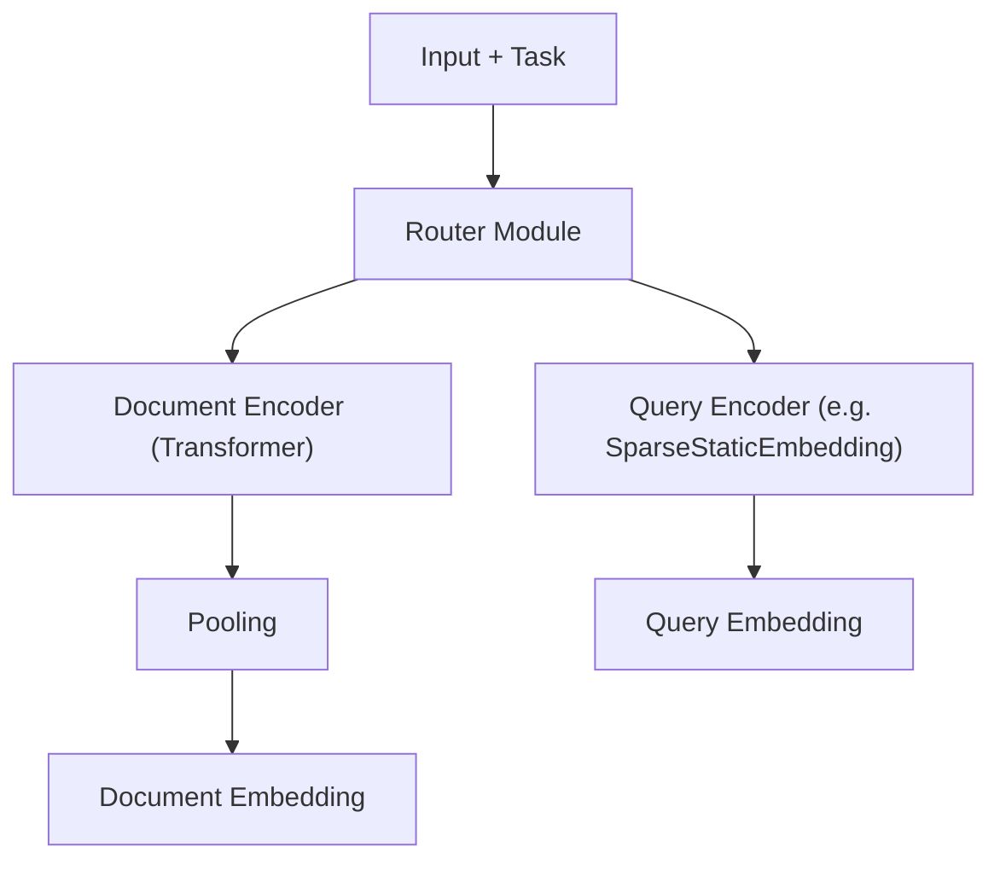
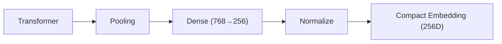
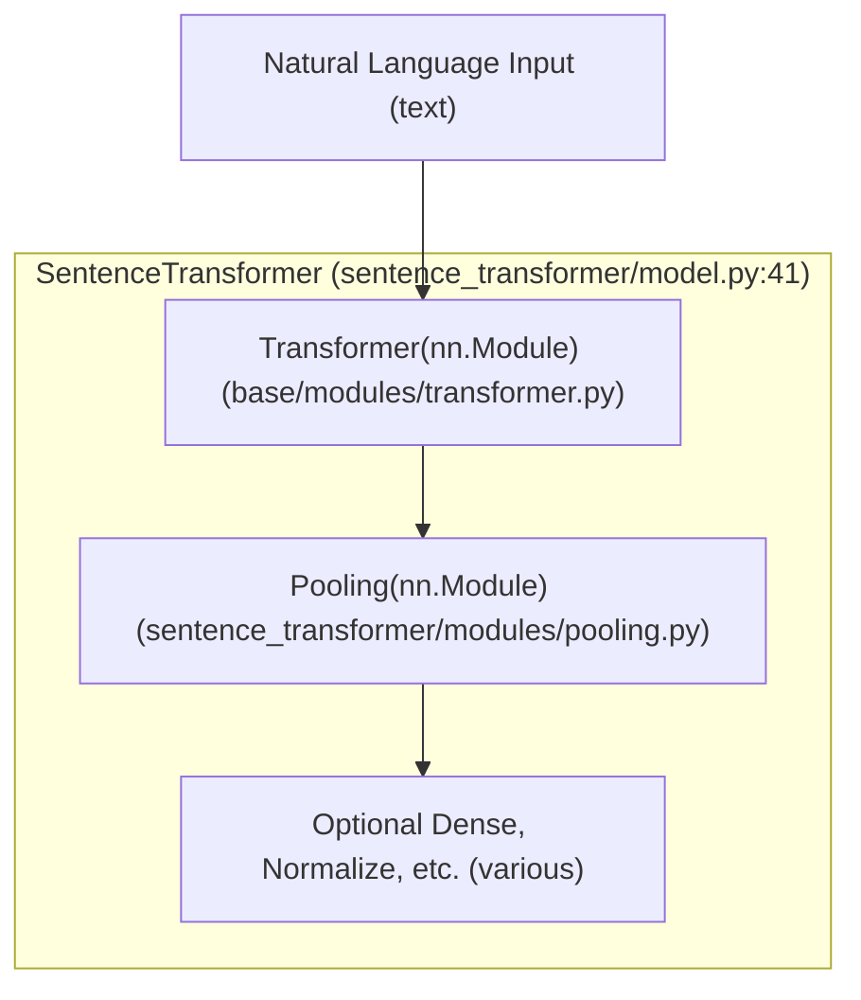
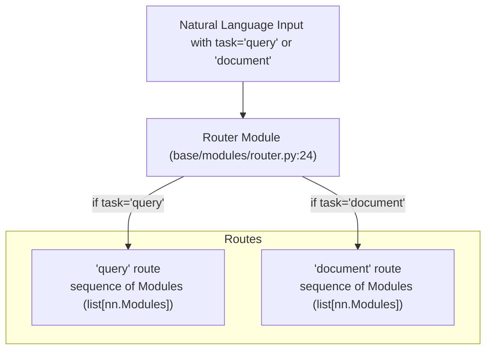

<!-- source: DeepWiki mcp.deepwiki.com · repo huggingface/sentence-transformers · page 3.1 SentenceTransformer Architecture · fetched 2026-10-26 -->

# SentenceTransformer Architecture

<details>
<summary>Relevant source files</summary>

The following files were used as context for generating this wiki page:

- [docs/migration_guide.md](docs/migration_guide.md)
- [docs/sentence_transformer/usage/custom_models.rst](docs/sentence_transformer/usage/custom_models.rst)
- [sentence_transformers/base/evaluation/evaluator.py](sentence_transformers/base/evaluation/evaluator.py)
- [sentence_transformers/base/evaluation/sequential.py](sentence_transformers/base/evaluation/sequential.py)
- [sentence_transformers/base/model.py](sentence_transformers/base/model.py)
- [sentence_transformers/base/modules/router.py](sentence_transformers/base/modules/router.py)
- [sentence_transformers/base/modules/transformer.py](sentence_transformers/base/modules/transformer.py)
- [sentence_transformers/cross_encoder/model.py](sentence_transformers/cross_encoder/model.py)
- [sentence_transformers/sentence_transformer/model.py](sentence_transformers/sentence_transformer/model.py)
- [sentence_transformers/sentence_transformer/modules/pooling.py](sentence_transformers/sentence_transformer/modules/pooling.py)
- [sentence_transformers/sparse_encoder/losses/flops.py](sentence_transformers/sparse_encoder/losses/flops.py)
- [sentence_transformers/sparse_encoder/model.py](sentence_transformers/sparse_encoder/model.py)
- [sentence_transformers/util/decorators.py](sentence_transformers/util/decorators.py)
- [sentence_transformers/util/misc.py](sentence_transformers/util/misc.py)
- [tests/base/modules/test_router.py](tests/base/modules/test_router.py)
- [tests/base/test_model.py](tests/base/test_model.py)
- [tests/sentence_transformer/modules/test_pooling.py](tests/sentence_transformer/modules/test_pooling.py)
- [tests/util/test_decorators.py](tests/util/test_decorators.py)
- [tests/util/test_misc.py](tests/util/test_misc.py)

</details>


## Purpose and Scope

This document provides a comprehensive deep dive into the `SentenceTransformer` class architecture — the core model type for generating dense sentence embeddings. It explores its modular design philosophy, the integration of Transformer and Pooling modules, the role of the Router module for asymmetric architectures, and the encoding methods supported. This detailed exposition aids in understanding the internal workings, data flow, and modifiability of SentenceTransformer models.

For complementary architecture details, refer to:
- [CrossEncoder Architecture (3.2)](3.2)
- [SparseEncoder Architecture (3.3)](3.3)

---

## Overview: Modular Sequential Design

The `SentenceTransformer` class inherits from `BaseModel`, which itself extends `nn.Sequential`. This fundamental design means the model operates as a sequence of modules, each receiving and returning a dictionary of features that progressively enrich or transform the data.

The typical pipeline includes a Transformer module producing token embeddings, followed by a Pooling module generating sentence embeddings, and optionally, additional modules for embedding transformations (Dense, Normalize, etc.).



Each module implements a callable `forward(features: dict) -> dict` interface, enabling flexible chaining and feature propagation.

**Sources:** [sentence_transformers/sentence_transformer/model.py:41-171]() [sentence_transformers/base/model.py:50-120]() [sentence_transformers/base/modules/transformer.py:20-300]() [sentence_transformers/sentence_transformer/modules/pooling.py:60-150]()

---

## Core Components

### Transformer Module

The `Transformer` module is the foundational building block that encapsulates a Hugging Face transformers model (e.g., `BertModel`, `RobertaModel`, `T5EncoderModel`). It transforms tokenized input text into a contextualized embedding sequence.



Key features and properties:

- **`auto_model`**: The encapsulated pretrained transformer instance loaded via Hugging Face `AutoModel`.
- **`tokenizer`**: Tokenizer for preprocessing input into IDs.
- **`max_seq_length`**: Inputs truncated/padded to this maximum length.
- **`backend`**: Supports `"torch"`, `"onnx"`, and `"openvino"` backends for inference.
- **Forward behavior**: Processes features dictionary, returns updated features with outputs such as `token_embeddings`, and possibly `all_layer_embeddings`.

**Sources:** [sentence_transformers/base/modules/transformer.py:10-350]()

### Pooling Module

The `Pooling` module aggregates variable-length token embeddings into fixed-size sentence embeddings, supporting multiple pooling strategies.

Supported pooling modes:

| Mode                | Description                                  |
|---------------------|----------------------------------------------|
| `"cls"`             | Use the embedding of the first token (CLS). |
| `"mean"` (default)  | Mean pooling over all tokens.                 |
| `"max"`             | Max pooling over all tokens.                  |
| `"lasttoken"`       | Use last non-padding token embedding.        |
| `"mean_sqrt_len_tokens"` | Mean pooling scaled by sqrt of token length.   |
| `"weightedmean"`    | Weighted mean pooling by position weights.   |



**Notable Configuration:**

- `pooling_mode`: Can be a single or multiple pooling modes (tuple) concatenated.
- `include_prompt`: If `False`, excludes prompt tokens from pooling by masking prompt token positions.
- `embedding_dimension`: Input token embedding size.

This pooling mechanism allows both simple and composite representations by concatenating the results of multiple pooling strategies.

**Sources:** [sentence_transformers/sentence_transformer/modules/pooling.py:68-163]()

---

## Optional Components

### Dense and Normalize Modules

After pooling, the following modules may be optionally appended:

- **Dense Module**: A linear layer that applies a transformation (e.g., to reduce embedding dimension or add nonlinearity).
- **Normalize Module**: L2-normalizes embeddings, enforcing unit norm for similarity operations.
- **LayerNorm, WeightedLayerPooling, etc.**: Additional embedding normalization or pooling variations.

These modules form a pipeline for richer or more specialized embedding spaces and are typically appended after pooling.

**Sources:** [sentence_transformers/sentence_transformer/model.py:340-365]()

### The Router Module: Enabling Asymmetric Architectures

The `Router` module enables flexible, task- and modality-dependent routing of input through different module sub-chains. It is essential for asymmetric encoders used in efficient retrieval architectures where queries and documents are encoded differently.



**Design:**

- The Router maintains a dictionary of routes, each represented by a list of modules bundled into an `nn.Sequential`.
- At inference/training, the `task` (route key) dictates which chained modules process the input.
- Allows efficient asymmetric encoders, where query and document inputs follow different pipelines.

**Example training argument for Router mapping:**
```python
router_mapping={
    "question": "query",
    "positive": "document",
    "negative": "document",
}
```

This explicit dataset-to-route mapping instructs the trainer how to route different input columns accordingly.

**Sources:** [sentence_transformers/base/modules/router.py:24-323]() [sentence_transformers/sentence_transformer/model.py:370-410]() [tests/base/modules/test_router.py:80-190]()

---

## The Forward Pass in SentenceTransformer

The forward pass integrates tokenization, prompt application, modular processing, and embedding extraction in multiple batch-processing methods.

```mermaid
graph TB
    encode_call["`encode()` called"] --> Tokenize["Tokenize inputs with first module's tokenizer"]
    Tokenize --> ApplyPrompt["Apply prompt prefix if specified"]
    ApplyPrompt --> FeaturesDict["Format features dict with tokenized inputs"]
    
    FeaturesDict --> ForwardModules["Pass features through nn.Sequential modules"]
    ForwardModules --> ExtractEmbedding["Extract 'sentence_embedding' from features"]
    ExtractEmbedding --> PostProcess["Optional: truncate_dim, normalize, quantize"]
    PostProcess --> OutputEmbeddings["Return final sentence embeddings"]

    subgraph BatchModes["Batch processing modes"]
      direction LR
      EncodeBatch["_encode_batch"]
      EncodeIterable["encode with IterableDataset"]
      EncodeSingle["encode_single"]
    end
```

Detailed steps:

- **Tokenization**: Uses the tokenizer from the first module (usually Transformer) to convert text into IDs and attention masks.
- **Prompt Handling**: Prepends configurable prompt strings if provided, allowing prompt tuning or instruction tuning.
- **Module Execution**: Inputs flow through each module sequentially; `forward` receives and returns a feature dict.
- **Embedding extraction**: The key `sentence_embedding` in the feature dict is the final dense embedding output.
- **Post-processing**: Optional operations like truncation of embedding dimension, L2 normalization, or INT8 quantization for efficient storage and similarity calculation.

**Sources:** [sentence_transformers/sentence_transformer/model.py:980-1200]() [sentence_transformers/base/model.py:50-85]() [sentence_transformers/base/modules/router.py:75-130]()

---

## Encoding Methods and Task-Aware Routing

`SentenceTransformer` offers three main encoding entry points that differ primarily by how they handle prompts and routing for asymmetric models:

| Method             | Purpose           | Sets `task` | Uses Prompt Named      |
|--------------------|-------------------|-------------|-----------------------|
| `encode()`         | General encoding  | No          | None or default       |
| `encode_query()`   | Encode queries    | `"query"`   | `"query"` prompt      |
| `encode_document()`| Encode documents  | `"document"`| `"document"` prompt   |



When:

- No prompts are configured (empty or missing),
- and no Router module is present,

all three methods behave identically.

This layered API allows specialized model usage (e.g., asymmetric encoders) with minimal code changes.

**Sources:** [sentence_transformers/sentence_transformer/model.py:440-675]()

---

## Model Configuration and Initialization

### Loading and Creating SentenceTransformer Models

Common initialization patterns include:

- **Load pretrained by name or local path**:
```python
from sentence_transformers import SentenceTransformer
model = SentenceTransformer("sentence-transformers/all-MiniLM-L6-v2")
```

- **Load pretrained with custom configuration (prompts, truncation, device, etc.)**:
```python
model = SentenceTransformer(
    "sentence-transformers/all-MiniLM-L6-v2",
    prompts={"query": "query: ", "document": "passage: "},
    default_prompt_name="query",
    truncate_dim=256,
    model_kwargs={"torch_dtype": "float16"},
)
```

- **Build from custom modules**:
```python
from sentence_transformers.sentence_transformer.modules import Transformer, Pooling

transformer = Transformer("bert-base-uncased", max_seq_length=256)
pooling = Pooling(transformer.get_embedding_dimension(), pooling_mode="mean")

model = SentenceTransformer(modules=[transformer, pooling])
```

### Model Files and Configuration

A saved SentenceTransformer model folder includes:

```
model_name_or_path/
├── config_sentence_transformers.json    # Model-level configuration (prompts, similarity etc.)
├── modules.json                         # List of modules, order and type
├── 0_Transformer/                      # First module files and config
│   ├── config.json
│   ├── model.safetensors
│   ├── tokenizer_config.json
│   └── sentence_bert_config.json        # Transformer-specific config (e.g., task, modality)
└── 1_Pooling/
    └── config.json                      # Pooling configuration (embedding_dimension, pooling_mode, etc.)
```

**Example `modules.json`:**

```json
[
  {
    "idx": 0,
    "name": "0",
    "path": "0_Transformer",
    "type": "sentence_transformers.base.modules.transformer.Transformer"
  },
  {
    "idx": 1,
    "name": "1",
    "path": "1_Pooling",
    "type": "sentence_transformers.sentence_transformer.modules.pooling.Pooling"
  }
]
```

### Prompts and Similarity Configuration

- Prompts allows prepending text to inputs for specialized tasks or instruction tuning.
- The similarity function (default `"cosine"`) is configurable via `config_sentence_transformers.json`.

**Sources:** [sentence_transformers/sentence_transformer/model.py:150-400]() [sentence_transformers/sentence_transformer/model.py:1545-1670]() [sentence_transformers/base/modules/transformer.py:160-220]()

---

## Architecture Variants

### 1. Standard Dense Embedding Model

Typical pipeline for semantic textual similarity and general embeddings:



- Transformer produces token-level embeddings.
- Pooling converts them to fixed-size sentence embeddings.
- Normalize enforces unit length for cosine similarity.

---

### 2. Asymmetric Retrieval Model Using Router

Combines lightweight encoders for queries and heavy encoders for documents to optimize retrieval speed and quality.



Enables:

- Efficient query encoding (fast, small).
- Full transformer encoding for documents (more expressive).
- Task-based routing for encode_query vs encode_document.

---

### 3. Multi-stage Sentence Embedding Model

Models embedding dimension transitions and normalization for storage-optimized embeddings:



- Dense layer reduces dimension.
- Normalize ensures embedding stability and similarity fidelity.

---

## Natural Language Space to Code Entity Space Mapping Diagrams

### SentenceTransformer Model and Modules



### Router Module for Asymmetric Encoding with Tasks



---

# Summary

The `SentenceTransformer` class leverages a modular, sequential architecture typical of PyTorch’s `nn.Sequential`, composed primarily of Transformer and Pooling modules to generate fixed-size embeddings. Optional modules like Dense and Normalize enrich embedding representations. The Router module enables complex asymmetric encoders by routing inputs dynamically based on tasks or modalities, facilitating efficient retrieval architectures.

Encoding methods (`encode()`, `encode_query()`, `encode_document()`) leverage this routing and prompt system, providing flexible inference APIs aligned with task-specific needs. Model initialization supports loading from pretrained models, building from custom module lists, and configurable prompts and similarity.

This layered design balances customization, efficiency, and ease of use, forming a core part of the Sentence Transformers ecosystem.

---

**Sources:**  
- [sentence_transformers/sentence_transformer/model.py:40-670, 980-1200, 150-420, 1540-1670]()  
- [sentence_transformers/base/modules/transformer.py:10-350]()  
- [sentence_transformers/sentence_transformer/modules/pooling.py:60-165]()  
- [sentence_transformers/base/modules/router.py:20-320]()  
- [tests/base/modules/test_router.py:20-190]()

---

