<!-- source: DeepWiki mcp.deepwiki.com · repo huggingface/sentence-transformers · page 3.2 CrossEncoder Architecture · fetched 2026-10-26 -->

# CrossEncoder Architecture

<details>
<summary>Relevant source files</summary>

The following files were used as context for generating this wiki page:

- [docs/package_reference/cross_encoder/modules.md](docs/package_reference/cross_encoder/modules.md)
- [examples/cross_encoder/training/multimodal/training_doodles_any_to_any.py](examples/cross_encoder/training/multimodal/training_doodles_any_to_any.py)
- [examples/cross_encoder/training/multimodal/training_doodles_feature_extraction.py](examples/cross_encoder/training/multimodal/training_doodles_feature_extraction.py)
- [sentence_transformers/base/model.py](sentence_transformers/base/model.py)
- [sentence_transformers/base/modules/transformer.py](sentence_transformers/base/modules/transformer.py)
- [sentence_transformers/cross_encoder/model.py](sentence_transformers/cross_encoder/model.py)
- [sentence_transformers/cross_encoder/modules/__init__.py](sentence_transformers/cross_encoder/modules/__init__.py)
- [sentence_transformers/cross_encoder/modules/logit_score.py](sentence_transformers/cross_encoder/modules/logit_score.py)
- [sentence_transformers/sentence_transformer/model.py](sentence_transformers/sentence_transformer/model.py)
- [sentence_transformers/sparse_encoder/model.py](sentence_transformers/sparse_encoder/model.py)
- [tests/base/test_model.py](tests/base/test_model.py)

</details>


## Purpose and Scope

This page documents the `CrossEncoder` architecture, a core model type in the Sentence Transformers library designed for **joint encoding** of text pairs to produce similarity scores or classification labels. Unlike `SentenceTransformer` models that encode sentences independently (bi-encoder), `CrossEncoder` processes both sentences together allowing finer-grained interactions between sentence tokens. This results in higher accuracy for pairwise tasks such as reranking, semantic textual similarity (STS), and natural language inference (NLI).

This page explains the internal implementation, data flow, modes of operation (reranking vs classification), and key methods (`predict` and `rank`). For training details, refer to the training docs; for usage patterns, see the usage docs.

---

## Architecture Overview

The `CrossEncoder` architecture jointly encodes two input texts and applies a classification or regression head over the combined representation. The model consists of:

- **Input:** Text pair (e.g., query and document)
- **Tokenizer:** Hugging Face `AutoTokenizer` tokenizes both texts together as a single input sequence
- **Transformer:** Hugging Face `AutoModelForSequenceClassification` processes tokenized input jointly
- **Head:** Final classification/regression head producing one or more output values
- **Activation:** Applied activation function (typically Sigmoid for regression or Identity for classification)

The key characteristic is that the input is encoded jointly, enabling cross-attention between the two sentences in the transformer layers.

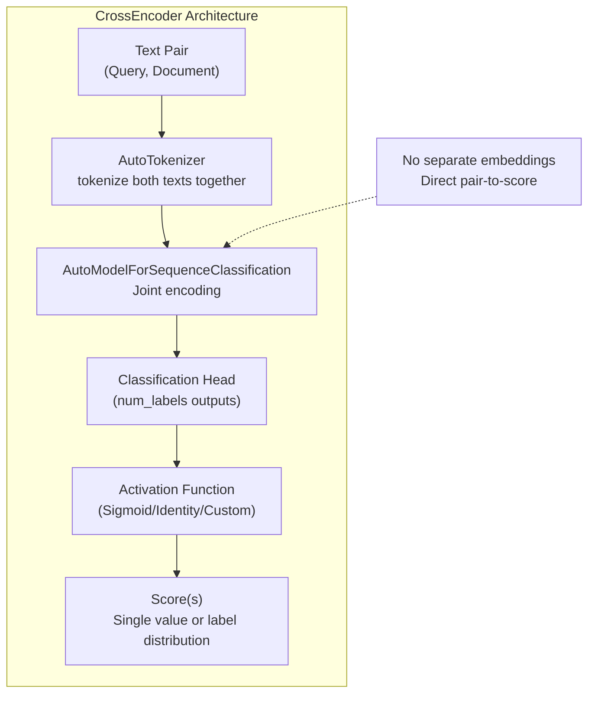

### Comparison with SentenceTransformer

| Aspect                         | SentenceTransformer (Bi-Encoder)             | CrossEncoder                             |
| ------------------------------|----------------------------------------------|----------------------------------------|
| Encoding                      | Independently encode each sentence            | Jointly encode sentence pairs          |
| Output                       | Dense embeddings (e.g., 768-dim vectors)      | Scores or classification logits        |
| Comparison                   | Post-hoc with similarity function             | Computed internally via classification |
| Inference Speed              | Fast (precompute embeddings)                   | Slower (process each pair)              |
| Typical Use Case             | Retrieval, clustering                           | Reranking, pairwise classification     |
| Accuracy                    | Moderate                                        | High (cross-attention across pairs)    |

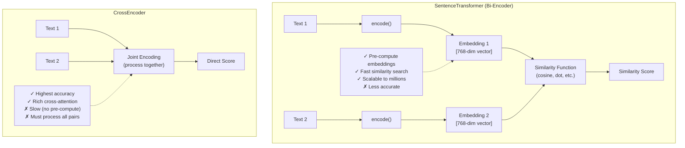

**Typical retrieval pipeline:** Retrieve with bi-encoder, rerank top candidates with CrossEncoder for best accuracy.

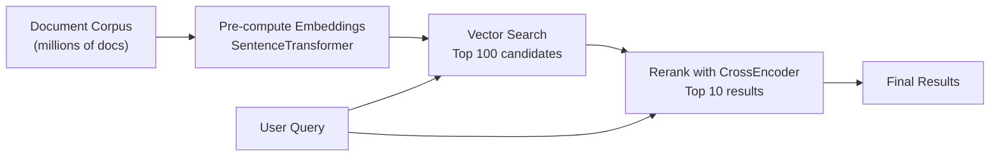

Sources: [sentence_transformers/cross_encoder/model.py:35-116](), [README.md]()

---

## Core Components

### 1. `CrossEncoder` Class Overview

The main class is `CrossEncoder` that inherits from the base model and fit mixin to support training. It wraps a Hugging Face transformer model for sequence classification.

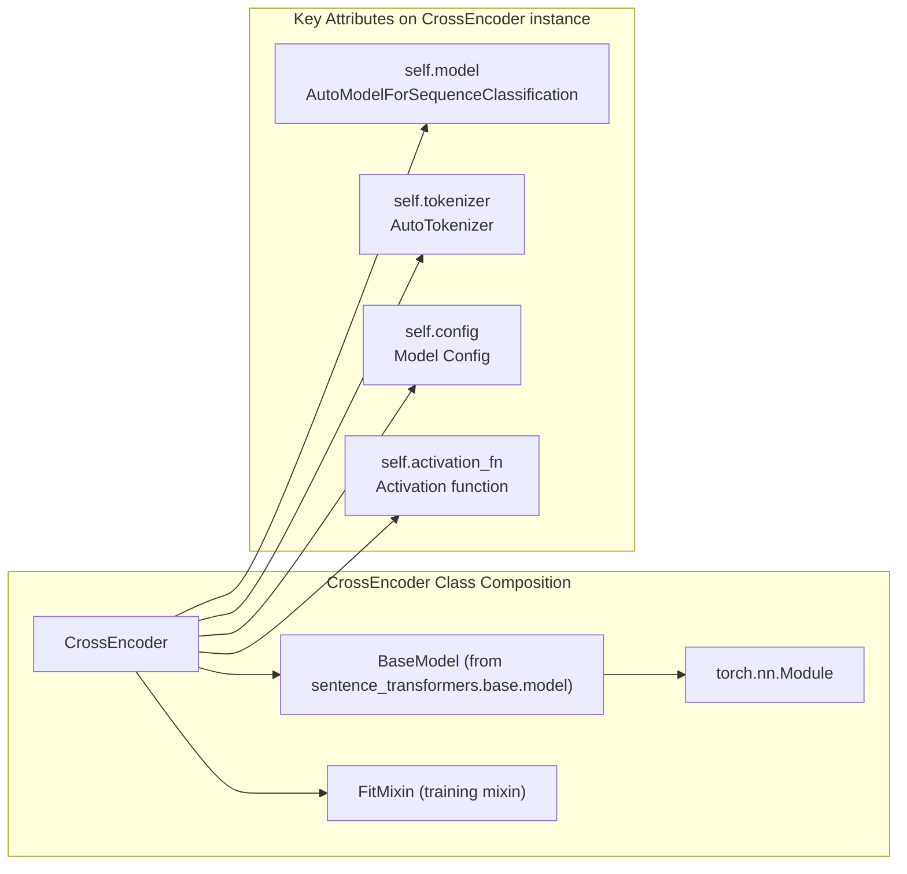

Sources: [sentence_transformers/cross_encoder/model.py:35-116]()

---

### 2. Model Initialization and Loading

When creating a `CrossEncoder`, the constructor loads or initializes these components:

- **Configuration (`AutoConfig`):** Loaded from model name or path, with optional `config_kwargs` applied. It preserves `sentence_transformers` metadata including versions and custom config. If `num_labels` is not specified and the classifier head is untrained, defaults to regression (`num_labels=1`).

- **Transformer Model:** Loaded either as standard PyTorch model (`AutoModelForSequenceClassification`) or using accelerated backends (ONNX or OpenVINO) if specified by `backend` argument.

- **Tokenizer:** `AutoTokenizer.from_pretrained` used to tokenize input pairs together, respecting max length and tokenizer arguments.

- **Activation Function:** Set automatically based on `num_labels` (Sigmoid for single-label regression, Identity otherwise) or overridden by user.

The initialization logic includes setting default values for parameters such as `classifier_dropout` in config and optionally trusting remote code.

Key snippet illustrating backend-dependent model loading:

```python
if backend == "torch":
    self.model = AutoModelForSequenceClassification.from_pretrained(
        model_name_or_path, config=config, **model_kwargs
    )
elif backend == "onnx":
    self.model = load_onnx_model(
        model_name_or_path=model_name_or_path,
        config=config,
        task_name="sequence-classification",
        **model_kwargs,
    )
elif backend == "openvino":
    self.model = load_openvino_model(
        model_name_or_path=model_name_or_path,
        config=config,
        task_name="sequence-classification",
        **model_kwargs,
    )
```

Sources: [sentence_transformers/cross_encoder/model.py:119-258]()

---

### 3. Number of Labels (`num_labels`) and Model Mode

`num_labels` controls model behavior:

- If `num_labels=1`, model runs in **regression mode**, outputting a single scalar score (typical for reranking).
- If `num_labels > 1`, model outputs classification logits for multiple classes (e.g., NLI with 3 labels).
- If unspecified and the classifier head is randomly initialized (no trained weights), `num_labels` is set to 1.

Simplified decision flow:

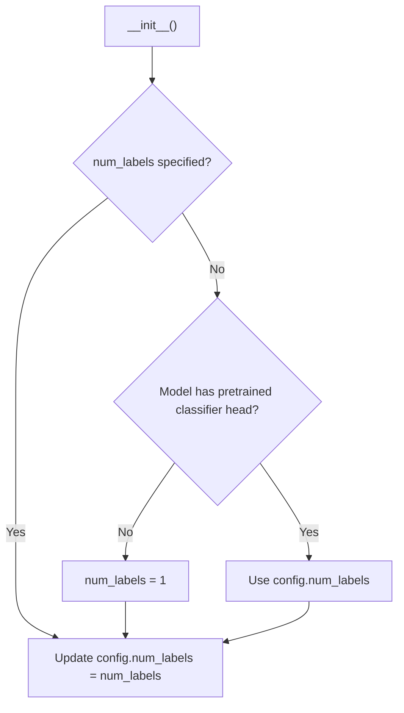

This setting affects both the classifier head and downstream activation.

Sources: [sentence_transformers/cross_encoder/model.py:167-176]()

---

### 4. Activation Function Semantics

CrossEncoder applies an activation function to output logits before returning scores:

- For **single-label regression (`num_labels=1`)**, default is `nn.Sigmoid()` producing scores between 0 and 1.
- For **multi-label classification (`num_labels>1`)**, default is identity `(lambda x: x)` returning raw logits; optionally apply softmax externally.
- Can override activation function explicitly in constructor or during prediction.

Activation logic overview:

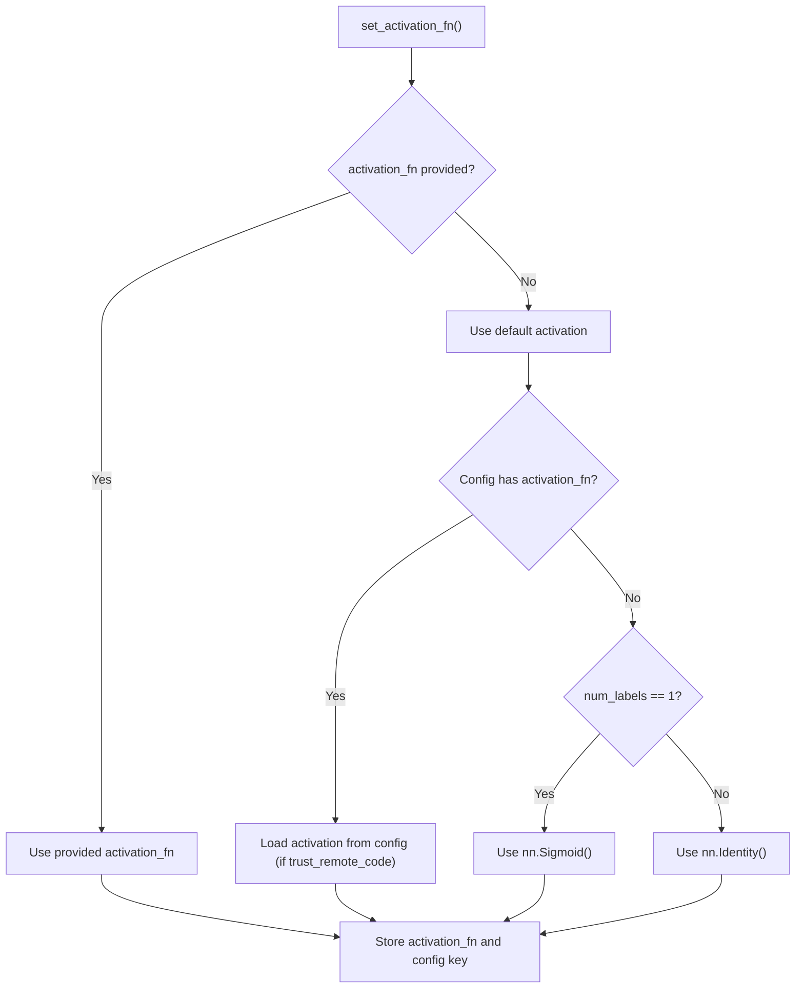

Sources: [sentence_transformers/cross_encoder/model.py:267-301]()

---

### 5. Tokenization and Input Processing

For prediction and ranking, input consists of pairs of sentences `(query, document)`:

- The tokenizer jointly encodes these pairs, adding special tokens and attention masks.
- Truncation and padding are applied to conform inputs into fixed length tensors.
- The tokenizer call looks like:

```python
features = self.tokenizer(
    batch,  # List of (text1, text2) pairs
    padding=True,
    truncation=True,
    return_tensors="pt",
)
```

This enables the transformer to apply cross-attention between the tokenized texts.

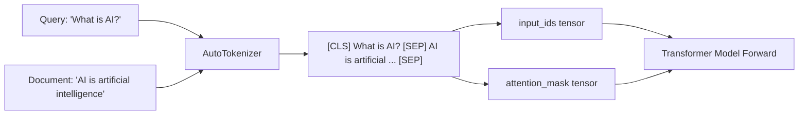

Sources: [sentence_transformers/cross_encoder/model.py:458-463]()

---

## Operating Modes

### Regression Mode (`num_labels=1`): Reranking & Similarity Scoring

- Produces a single scalar score per pair indicating relevance or similarity.
- The final activation is a sigmoid mapping logits to a [0, 1] range.
- Common in reranking tasks like MS MARCO passage ranking.

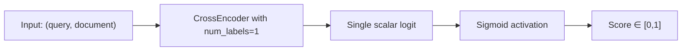

Sources: [sentence_transformers/cross_encoder/model.py:298-300]()

---

### Classification Mode (`num_labels > 1`): Label Prediction

- Produces logits per class (e.g., contradiction, neutral, entailment in NLI).
- Default activation is identity (raw logits), user can apply softmax downstream.
- Useful for natural language inference or multi-class classification.

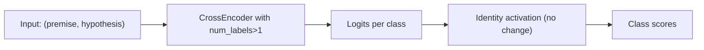

Sources: [sentence_transformers/cross_encoder/model.py:300]()

---

## Key Methods

### 1. `predict()` Method: Batch Inference on Text Pairs

The `predict` method computes scores for pairs of sentences in batches.

Signature:

```python
def predict(
    sentences: list[tuple[str, str]] | tuple[str, str],
    batch_size: int = 32,
    show_progress_bar: bool | None = None,
    activation_fn: Callable | None = None,
    apply_softmax: bool = False,
    convert_to_numpy: bool = True,
    convert_to_tensor: bool = False,
) -> list[torch.Tensor] | np.ndarray | torch.Tensor
```

**Workflow:**

1. Inputs normalized to a list if single pair given.
2. Tokenize batch of pairs jointly.
3. Forward through transformer model.
4. Apply activation function.
5. Optionally apply softmax (if `apply_softmax=True` and logits have >1 dimension).
6. Extract scalar if single-label regression mode.
7. Convert to tensor or numpy or return as list as requested.
8. Optionally display progress bar.

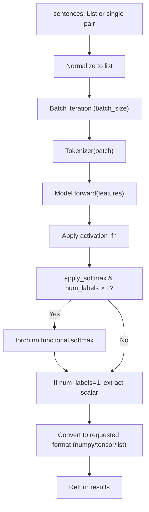

- If `sentences` is a single pair, a single scalar or array is returned.
- If `num_labels=1`, returns flat scores, else 2D arrays with one row per pair and column per class.

Sources: [sentence_transformers/cross_encoder/model.py:392-486]()

---

### 2. `rank()` Method: Efficient Reranking of Documents for a Query

`rank()` ranks a list of documents by relevance to a single query using the model.

Signature:

```python
def rank(
    query: str,
    documents: list[str],
    top_k: int | None = None,
    return_documents: bool = True,
    batch_size: int = 32,
    show_progress_bar: bool | None = None,
    activation_fn: Callable | None = None,
    apply_softmax: bool = False,
    convert_to_tensor: bool = True,
) -> list[dict[str, int | float | str]]
```

**Key steps:**

- Checks the model runs in regression mode (`num_labels == 1`), else raises error.
- Constructs all pairs `(query, doc_i)` for documents.
- Runs `predict()` on all pairs.
- Sorts pairs by descending score.
- Returns a list of dictionaries containing `corpus_id`, `score`, and optionally `text`.
- Supports limiting to top-K results.

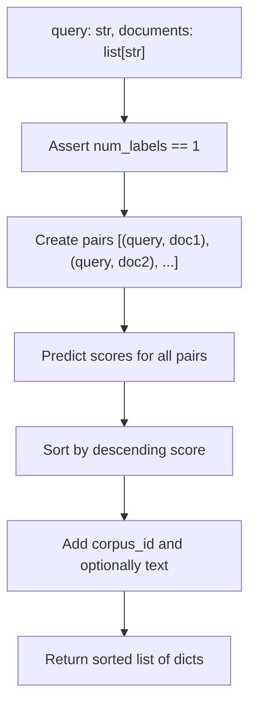

Typical output list format:

```python
[
    {"corpus_id": 0, "score": 8.61, "text": "Most relevant document"},
    {"corpus_id": 5, "score": 6.35, "text": "Second most relevant"},
    {"corpus_id": 2, "score": 5.51, "text": "Third most relevant"},
    ...
]
```

Sources: [sentence_transformers/cross_encoder/model.py:488-627]()

---

## Backend Support

`CrossEncoder` supports multiple backends for inference to optimize speed on different hardware:

| Backend   | Description                                      | Use Case                             |
|-----------|------------------------------------------------|------------------------------------|
| `torch`   | Standard PyTorch inference                       | Default, full compatibility         |
| `onnx`    | ONNX Runtime inference and quantization support | Faster inference on CPU/GPU         |
| `openvino`| OpenVINO optimization for Intel CPUs            | Performance on Intel hardware       |

Backend is controlled by the constructor `backend` argument; model loading differs by backend but all expose the same API.

```python
if backend == "torch":
    self.model = AutoModelForSequenceClassification.from_pretrained(...)
elif backend == "onnx":
    self.model = load_onnx_model(...)
elif backend == "openvino":
    self.model = load_openvino_model(...)
```

Sources: [sentence_transformers/cross_encoder/model.py:229-258]()

---

## Model Card Integration and Configuration Management

`CrossEncoder` integrates with the model card system via `CrossEncoderModelCardData`. This captures:

- Training metadata
- Evaluation metrics
- Library versions
- Model hyperparameters

When saving or pushing models, this information is included to generate rich model cards for sharing.

Configuration values specific to `CrossEncoder` are stored under the `config.sentence_transformers` namespace, including:

- Activation function path string
- Version of `sentence-transformers` used for training
- Other custom parameters

This config persistence facilitates correct model reconstruction later.

Example config setting method:

```python
def set_config_value(self, key: str, value) -> None:
    if not hasattr(self.config, "sentence_transformers"):
        self.config.sentence_transformers = {}
    self.config.sentence_transformers[key] = value
```

Sources: [sentence_transformers/cross_encoder/model.py:144-147](), [sentence_transformers/cross_encoder/model.py:302-315]()

---

# Summary Mermaid Diagrams Connecting Natural Language Concepts to Code Entities

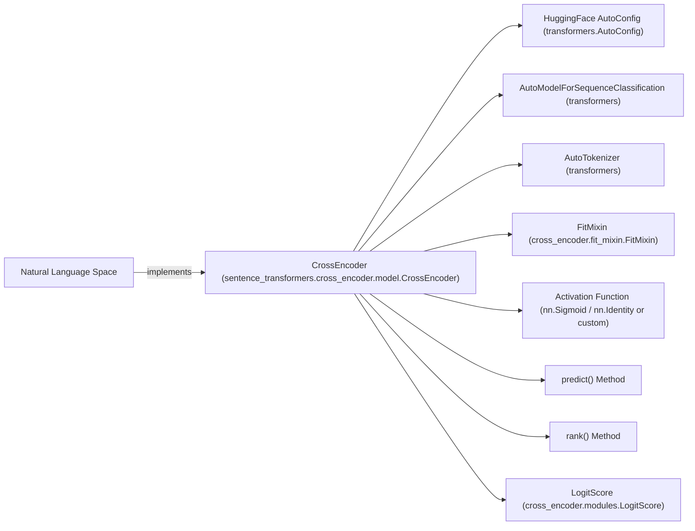

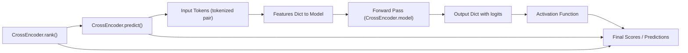

---

# References and Sources

- `sentence_transformers/cross_encoder/model.py` [35-116](), [119-258](), [267-301](), [392-627]()
- `sentence_transformers/cross_encoder/modules/logit_score.py` [8-54]()
- Relevant README and example scripts in `examples/cross_encoder/`
- `sentence_transformers/base/model.py` for base class and infrastructure

This concludes the detailed technical documentation of the CrossEncoder architecture in the Sentence Transformers codebase.

---

