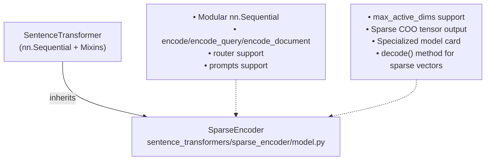
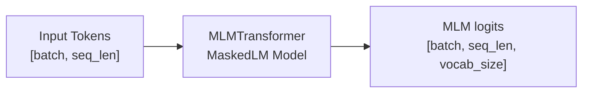
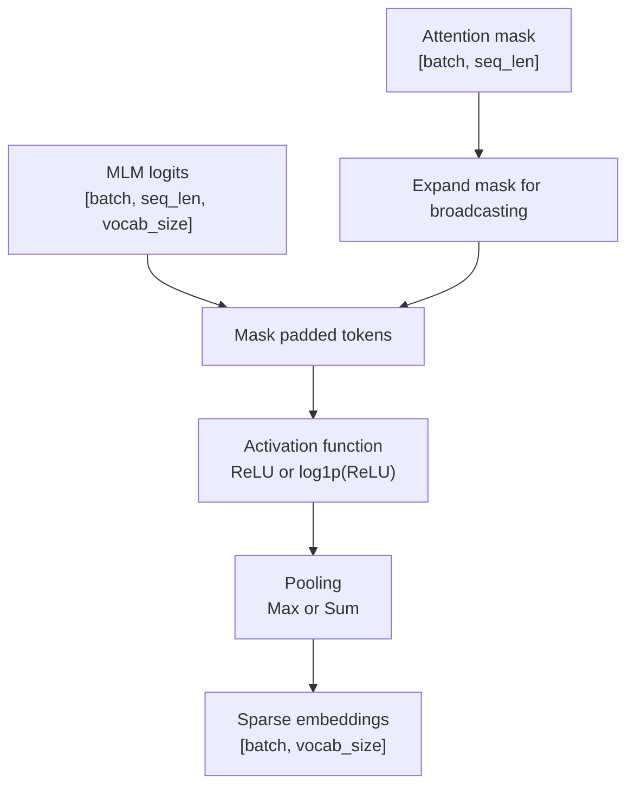
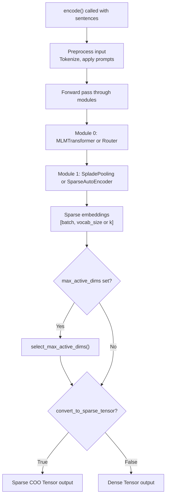
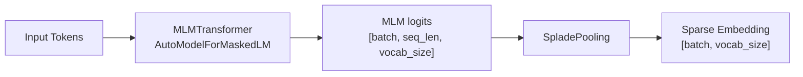
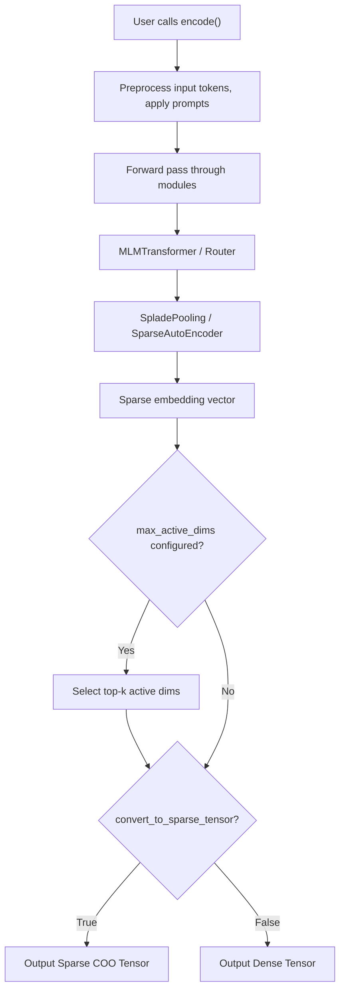
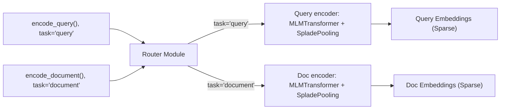

<!-- source: DeepWiki mcp.deepwiki.com · repo huggingface/sentence-transformers · page 3.3 SparseEncoder Architecture · fetched 2026-10-26 -->

# SparseEncoder Architecture

<details>
<summary>Relevant source files</summary>

The following files were used as context for generating this wiki page:

- [docs/package_reference/sentence_transformer/modules.md](docs/package_reference/sentence_transformer/modules.md)
- [docs/package_reference/sparse_encoder/losses.md](docs/package_reference/sparse_encoder/losses.md)
- [docs/sparse_encoder/loss_overview.md](docs/sparse_encoder/loss_overview.md)
- [sentence_transformers/base/model.py](sentence_transformers/base/model.py)
- [sentence_transformers/base/modules/transformer.py](sentence_transformers/base/modules/transformer.py)
- [sentence_transformers/cross_encoder/__init__.py](sentence_transformers/cross_encoder/__init__.py)
- [sentence_transformers/cross_encoder/evaluation/__init__.py](sentence_transformers/cross_encoder/evaluation/__init__.py)
- [sentence_transformers/cross_encoder/model.py](sentence_transformers/cross_encoder/model.py)
- [sentence_transformers/sentence_transformer/__init__.py](sentence_transformers/sentence_transformer/__init__.py)
- [sentence_transformers/sentence_transformer/model.py](sentence_transformers/sentence_transformer/model.py)
- [sentence_transformers/sentence_transformer/modules/clip_model.py](sentence_transformers/sentence_transformer/modules/clip_model.py)
- [sentence_transformers/sparse_encoder/__init__.py](sentence_transformers/sparse_encoder/__init__.py)
- [sentence_transformers/sparse_encoder/losses/__init__.py](sentence_transformers/sparse_encoder/losses/__init__.py)
- [sentence_transformers/sparse_encoder/model.py](sentence_transformers/sparse_encoder/model.py)
- [sentence_transformers/sparse_encoder/modules/mlm_transformer.py](sentence_transformers/sparse_encoder/modules/mlm_transformer.py)
- [tests/base/test_model.py](tests/base/test_model.py)

</details>


## Purpose and Scope

This page provides an in-depth technical overview of the `SparseEncoder` model architecture within the sentence-transformers library. SparseEncoder models produce sparse, high-dimensional embeddings designed to combine the interpretability and efficiency of traditional lexical search with the semantic understanding of modern neural models. This architecture is especially suited for retrieval tasks requiring large vocabularies but efficient sparse vector representations.

The contents here explain:
- The core building modules: `MLMTransformer`, `SpladePooling`, and `SparseAutoEncoder`.
- How sparsity is controlled, including the `max_active_dims` parameter.
- Forward pass data flow and encoding methods with task routing.
- Utility methods relevant to sparse embeddings.

For usage instructions, training, and loss considerations, consult other parts of the documentation.

---

## Inheritance and Relationship to SentenceTransformer

`SparseEncoder` inherits from `SentenceTransformer`, leveraging its modular sequential design but specializing in sparse encoding structures.



Key differences include:
- Output dimension: SparseEncoder outputs vectors of vocabulary size (e.g., 30,522), typically very sparse; SentenceTransformer outputs dense, lower-dimensional vectors (e.g., 384-1024).
- Modules: SparseEncoder replaces the usual transformer+pooling with `MLMTransformer` and `SpladePooling`, or optionally uses `SparseAutoEncoder`.
- Output type: Sparse COO tensors by default.
- Supports explicit sparsity control via `max_active_dims`.

Sources: [sentence_transformers/sparse_encoder/model.py:35-130](), [sentence_transformers/sentence_transformer/model.py:41-107]()

---

## Architecture Components

### MLMTransformer

The `MLMTransformer` module is a specialized `Transformer` that uses a Masked Language Modeling head (MLM head) instead of standard outputs, producing logits over the entire vocabulary for each token in the input sequence.



Key points:
- Instantiated from `AutoModelForMaskedLM` loading a pretrained MLM model.
- Outputs masked language model prediction logits rather than pooled token embeddings.
- The output feature dimension corresponds to `vocab_size`, returned as `token_embeddings`.
- `get_sentence_embedding_dimension()` returns vocabulary size instead of hidden layer size.
- Supports inference on backends such as ONNX and OpenVINO using the `"fill-mask"` task setting.

This module is deprecated as a standalone and replaced by the more general `Transformer` with `transformer_task="fill-mask"`, but retained for backward compatibility.

Sources: [sentence_transformers/sparse_encoder/modules/mlm_transformer.py:15-49](), [sentence_transformers/sparse_encoder/modules/mlm_transformer.py:25-54]()

---

### SpladePooling

The `SpladePooling` module converts the MLM logits for each token into sparse sentence embeddings by applying activation functions and pooling across the sequence dimension.



Implementation aspects:
- Two supported pooling strategies:
  - `"max"` (default, SPLADEv2+)
  - `"sum"` (original SPLADE paper)
- Activation functions:
  - `"relu"` (standard)
  - `"log1p_relu"`: Modified activation used by OpenSearch SPLADE variant where a `log(1+x)` transformation is applied.
- To reduce memory footprint, pooling can be performed on chunks of tokens controlled by parameter `chunk_size`.
- The forward pass:
  - Attention mask is expanded to broadcast over vocabulary dimension.
  - MLM logits masked to ignore padding tokens.
  - Activation applied (ReLU followed optionally by log1p).
  - Pooling aggregations over tokens to produce final sparse embedding.
  
Sources: [sentence_transformers/sparse_encoder/modules/splade_pooling.py:10-142]()

---

### SparseAutoEncoder

`SparseAutoEncoder` is an alternative module for sparse embeddings using an encoder-decoder architecture that learns a lower-dimensional sparse latent space.

Features:
- Maps dense inputs from the Transformer to sparse representations with dimension `k` (typically much smaller than vocab size).
- Learns a sparse latent code that can be reconstructed to dense embeddings.
- Outputs are in Compressed Sparse Row (CSR) format for efficient storage and computation.
- Requires different training loss such as `CSRLoss` to optimize reconstruction quality.

In `SparseEncoder`, if the module list contains a `SparseAutoEncoder`, `max_active_dims` is assigned to `k` automatically.

Sources: [sentence_transformers/sparse_encoder/model.py:170-179](), [sentence_transformers/sparse_encoder/modules/sparse_auto_encoder.py] (conceptual info)

---

## Module Composition Patterns

`SparseEncoder` supports several architectural patterns composed as sequential modules in the `nn.Sequential` model:

```mermaid
graph TB
    subgraph SPLADE Model
        TextInputS["Text Input"]
        MLMTransformerS["MLMTransformer"]
        SpladePoolingS["SpladePooling"]
        SparseEmbeddingS["Sparse Embedding<br/>Size = vocab_size"]
        
        TextInputS --> MLMTransformerS --> SpladePoolingS --> SparseEmbeddingS
    end

    subgraph SAE Model
        TextInputA["Text Input"]
        TransformerA["Transformer (Dense)"]
        SparseAutoEncoderA["SparseAutoEncoder"]
        SparseEmbeddingA["Sparse Embedding<br/>Size = k (latent dim)"]
        
        TextInputA --> TransformerA --> SparseAutoEncoderA --> SparseEmbeddingA
    end

    subgraph Asymmetric Model with Router
        TextInputR["Text Input"]
        Router["Router Module"]
        QueryMLM["MLMTransformer (query)"]
        QueryPool["SpladePooling (query)"]
        DocumentMLM["MLMTransformer (document)"]
        DocumentPool["SpladePooling (document)"]
        QueryEmb["Query Sparse Embedding"]
        DocumentEmb["Document Sparse Embedding"]

        TextInputR --> Router
        Router -->|query| QueryMLM --> QueryPool --> QueryEmb
        Router -->|document| DocumentMLM --> DocumentPool --> DocumentEmb
    end
```



Explanations:
- **SPLADE Model:** The most common configuration; vocab-sized output with heavy sparsity (~99.8%). Implements expansions of tokens into sparse vectors using MLM + SpladePooling.
- **SAE Model:** Learns a compressed sparse space using an encoder-decoder on dense transformer outputs.
- **Asymmetric Model:** Uses task-specific encoders selectable via a `Router` module to encode queries and documents differently, improving retrieval efficiency and accuracy.

Sources: [sentence_transformers/sparse_encoder/model.py:170-179](), [tests/sparse_encoder/test_sparse_encoder.py:172-197]()

---

## Forward Pass and Sparsity Control

### Data Flow in Forward Pass



Details:
- Input text is preprocessed and tokenized, potentially with prompts applied.
- Forward pass sends tokens through the MLMTransformer; if routing is used, Router chooses the path.
- MLM logits or dense embeddings are passed to SpladePooling or SparseAutoEncoder for final sparse vector.
- `max_active_dims`, if specified, limits the number of non-zero dimensions by retaining the top-k largest values.
- Final output is a sparse COO tensor by default, or dense if `convert_to_sparse_tensor=False`.

### max_active_dims Parameter

Control sparsity by limiting dimensions with non-zero values:
- If set, top-k largest embedding dimensions per example are retained; others zeroed out.
- Helps reduce storage and compute cost dramatically in retrieval systems.
- Initialized during model construction from:
  1. The explicit `max_active_dims` parameter if provided.
  2. If a `SparseAutoEncoder` module is present, assigns `k` (latent dim) automatically.
  3. Otherwise `None` (no pruning).
- Can be overridden per call in encode methods.

Sources: [sentence_transformers/sparse_encoder/model.py:130-179](), [sentence_transformers/sparse_encoder/model.py:410-479]()

---

## Encode Methods and Task Routing

The `SparseEncoder` class overrides `encode`, `encode_query`, and `encode_document` from `SentenceTransformer` to support sparse outputs and better routing for asymmetric models.

### Encoding Signatures and Differences

```python
# Generic encoding method:
encode(
    sentences,
    prompt_name=None,
    prompt=None,
    batch_size=32,
    convert_to_tensor=True,          # Defaults True unlike SentenceTransformer
    convert_to_sparse_tensor=True,   # Sparse tensor output enabled by default
    save_to_cpu=False,
    max_active_dims=None,            # Override default sparsity limit per call
    **kwargs,
)

# Query-specific encoding (auto sets task="query"):
encode_query(sentences, task="query", ...)

# Document-specific encoding (auto sets task="document"):
encode_document(sentences, task="document", ...)
```

| Parameter | SentenceTransformer Default | SparseEncoder Default |
|-----------|-----------------------------|----------------------|
| convert_to_tensor | False | True |
| convert_to_sparse_tensor | N/A | True |
| save_to_cpu | N/A | False |

SparseEncoder results are typically sparse COO tensors by default.

### Task Parameter and Router Support

For asymmetric SparseEncoder models, a special `Router` module can route inputs depending on the `task` argument:
- `task="query"` triggers encoding through a query-specific encoder.
- `task="document"` triggers encoding through a document-specific encoder.

Router enables separate representation spaces optimized for queries versus documents.

### Prompt Selection

Prompt names handled by SparseEncoder:
- `encode_query()` uses prompt name `"query"` by default.
- `encode_document()` tries prompts in order `"document"`, `"passage"`, and `"corpus"` until found.

Sources: [sentence_transformers/sparse_encoder/model.py:180-410]()

---

## Utility Methods

### decode() Method

The `decode()` method converts sparse embeddings back to human-readable token-weight pairs. It handles both sparse tensors and dense tensor formats.

Usage example:

```python
model = SparseEncoder("naver/splade-cocondenser-ensembledistil")
embeddings = model.encode(["Hello world"])
decoded = model.decode(embeddings, top_k=10)
# Returns a list of (token, value) sorted by value descending.
```

This is useful for inspecting which tokens contributed to the sparse representation.

### sparsity() Static Method

Provides statistics on the sparsity of given embeddings:

- Fraction of zero values (`sparsity_ratio`).
- Average number of active (non-zero) dimensions (`active_dims`).
- Total dimension count.

This helps monitor sparsity during training or inference.

Sources: [tests/sparse_encoder/test_sparse_encoder.py:30-170](), [README.md:163-165]()

---

## Backend Support

SparseEncoder supports multiple runtime backends for inference similar to SentenceTransformer:

| Backend   | Model Format | Description           | Key Arguments           |
|-----------|--------------|-----------------------|------------------------|
| `torch`   | PyTorch      | Default, used for training and inference | Default                  |
| `onnx`    | ONNX Runtime | Faster inference (2-3x speedup)         | `provider="CPUExecutionProvider"` |
| `openvino`| OpenVINO     | Intel CPU optimized inference            |                            |

At initialization, specify the backend with:

```python
model = SparseEncoder("model-name", backend="onnx")
```

The `MLMTransformer` internally sets `task_name="fill-mask"` for ONNX/OpenVINO compatibility.

Sources: [sentence_transformers/sparse_encoder/model.py:95-103](), [sentence_transformers/sparse_encoder/modules/mlm_transformer.py:25-55]()

---

# Summary

`SparseEncoder` is a powerful model type in the sentence-transformers library focused on generating interpretable and efficient sparse embeddings. It combines a specialized MLM transformer backbone with SPLADE-style pooling or sparse autoencoding to represent text as sparse high-dimensional vectors. Sparsity control through `max_active_dims` and flexible routing supports a variety of deployment and retrieval use cases with significant memory and speed advantages.

---

# Mermaid Diagrams Summary

### Diagram 1: Class Inheritance and Feature Comparison


---

### Diagram 2: SparseEncoder Component Modules and Data Flow



---

### Diagram 3: Architecture Patterns Supported

```mermaid
graph TB
    subgraph SPLADE
        TextInS["Text Input"]
        MLMTransS["MLMTransformer"]
        PoolingS["SpladePooling"]
        OutS["Sparse Embedding (vocab size)"]
        TextInS --> MLMTransS --> PoolingS --> OutS
    end
    subgraph SAE
        TextInA["Text Input"]
        DenseTransA["Transformer (Dense)"]
        SAEAutoEncoder["SparseAutoEncoder"]
        OutA["Sparse Embedding (latent dim k)"]
        TextInA --> DenseTransA --> SAEAutoEncoder --> OutA
    end
    subgraph AsymmetricRouter
        TextInR["Text Input"]
        Router["Router"]
        QueryMLM["MLMTransformer (query)"]
        QueryPool["SpladePooling"]
        DocMLM["MLMTransformer (document)"]
        DocPool["SpladePooling"]
        QueryEmb["Query Sparse Embeddings"]
        DocEmb["Document Sparse Embeddings"]
        TextInR --> Router
        Router -->|query| QueryMLM --> QueryPool --> QueryEmb
        Router -->|document| DocMLM --> DocPool --> DocEmb
    end
```



---

### Diagram 4: Forward Pass and max_active_dims Filtering



---

### Diagram 5: Encoding with Router and Task Routing



---

# References

- [sentence_transformers/sparse_encoder/model.py:35-479]()
- [sentence_transformers/sparse_encoder/modules/mlm_transformer.py:15-49]()
- [sentence_transformers/sparse_encoder/modules/splade_pooling.py:10-142]()
- [tests/sparse_encoder/test_sparse_encoder.py:30-170]()
- [README.md:132-166,163-165]()

---

