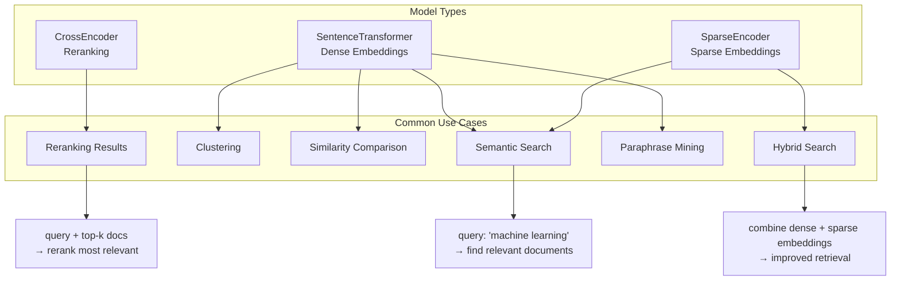
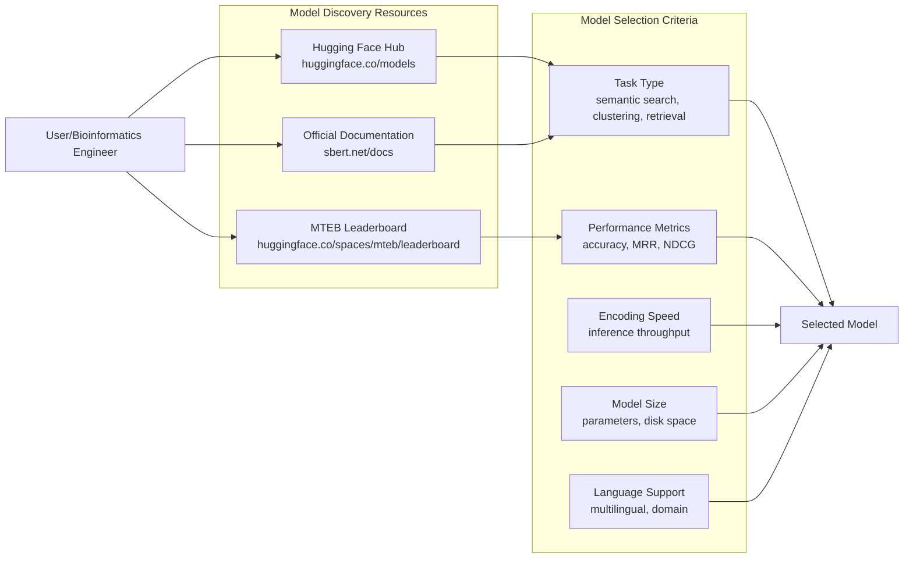
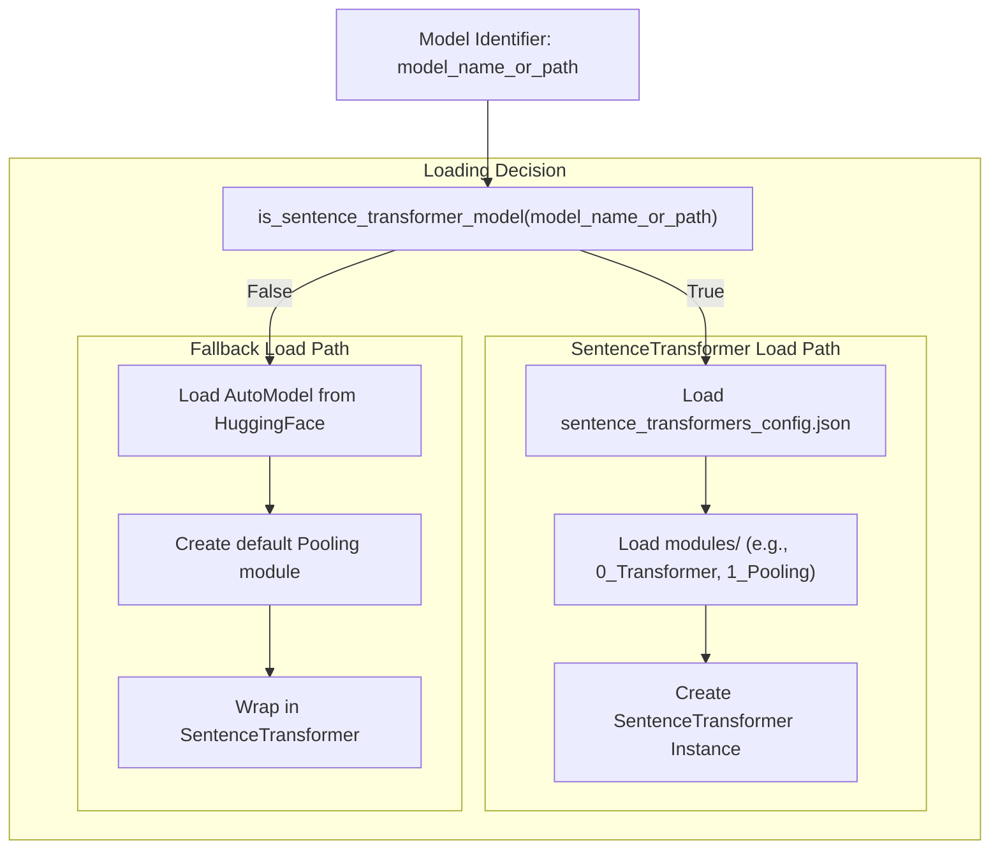
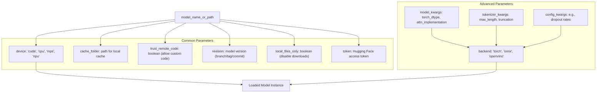
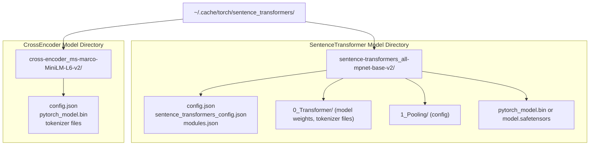
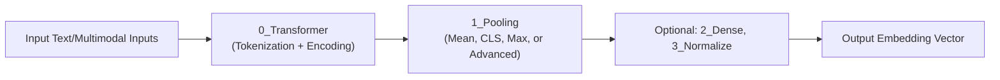
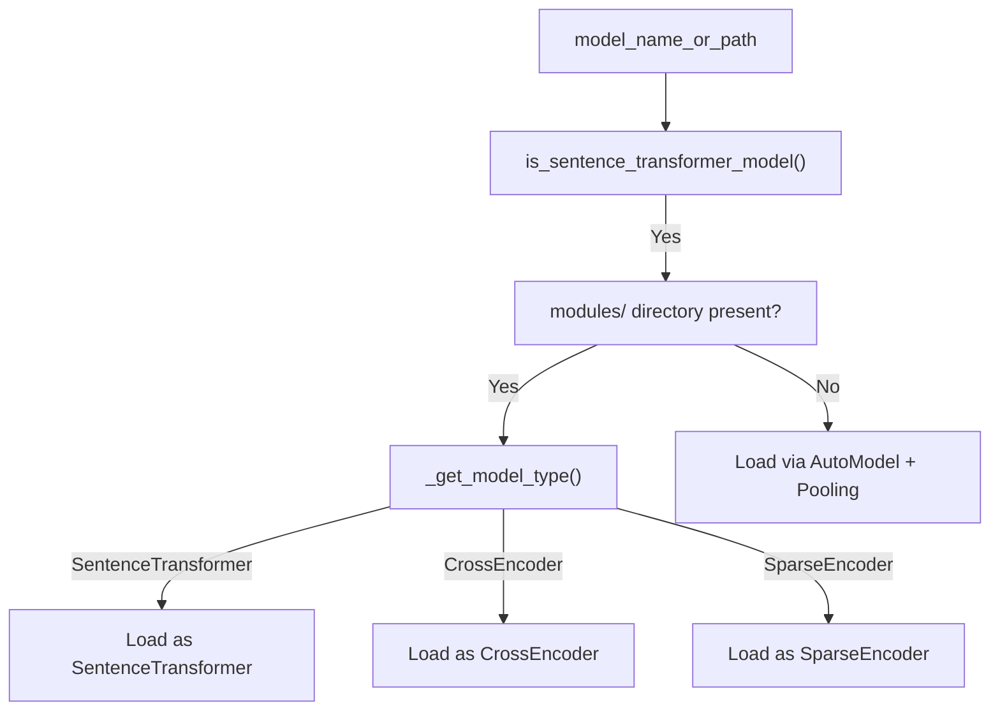

<!-- source: DeepWiki mcp.deepwiki.com · repo huggingface/sentence-transformers · page 4 Using Pre-trained Models · fetched 2026-10-26 -->

# Using Pre-trained Models

<details>
<summary>Relevant source files</summary>

The following files were used as context for generating this wiki page:

- [docs/_static/html/models_en_sentence_embeddings.html](docs/_static/html/models_en_sentence_embeddings.html)
- [docs/cross_encoder/pretrained_models.md](docs/cross_encoder/pretrained_models.md)
- [docs/cross_encoder/usage/custom_models.rst](docs/cross_encoder/usage/custom_models.rst)
- [docs/cross_encoder/usage/usage.rst](docs/cross_encoder/usage/usage.rst)
- [docs/pretrained-models/ce-msmarco.md](docs/pretrained-models/ce-msmarco.md)
- [docs/pretrained-models/msmarco-v1.md](docs/pretrained-models/msmarco-v1.md)
- [docs/pretrained-models/msmarco-v2.md](docs/pretrained-models/msmarco-v2.md)
- [docs/pretrained-models/msmarco-v3.md](docs/pretrained-models/msmarco-v3.md)
- [docs/pretrained-models/msmarco-v5.md](docs/pretrained-models/msmarco-v5.md)
- [docs/pretrained-models/nq-v1.md](docs/pretrained-models/nq-v1.md)
- [docs/quickstart.rst](docs/quickstart.rst)
- [docs/sentence_transformer/dataset_overview.md](docs/sentence_transformer/dataset_overview.md)
- [docs/sentence_transformer/pretrained_models.md](docs/sentence_transformer/pretrained_models.md)
- [docs/sentence_transformer/usage/usage.rst](docs/sentence_transformer/usage/usage.rst)
- [examples/sentence_transformer/training/multimodal/README.md](examples/sentence_transformer/training/multimodal/README.md)
- [examples/sentence_transformer/training/multimodal/training_visual_document_retrieval.py](examples/sentence_transformer/training/multimodal/training_visual_document_retrieval.py)

</details>


This page provides an overview of discovering, loading, and using pre-trained models from the Hugging Face Hub. The Sentence Transformers library includes three primary model types—**SentenceTransformer** for dense embeddings, **CrossEncoder** for pairwise reranking, and **SparseEncoder** for sparse lexical embeddings—each with thousands of pre-trained models publicly available.

For in-depth technical details on loading models and performing inference, see [Loading and Inference](#4.1). For an extensive overview of available pre-trained models with benchmarks and selection advice, refer to [Model Catalog](#4.2). To explore how to train or fine-tune models, consult [Training Models](#5).

---

## Model Types and Use Cases

The library provides three distinct and optimally designed model architectures for a variety of NLP tasks:



| Model Type       | Core Class           | Output Format                      | Best For                                | Typical Speed                     |
|------------------|---------------------|----------------------------------|---------------------------------------|----------------------------------|
| Dense Embeddings | `SentenceTransformer` | Fixed-size dense vectors (e.g., 384, 768, 1024 dims) | General semantic tasks, clustering, similarity comparisons, retrieval first stage | Very fast (up to ~18,000 sentences/sec on GPU for small models) |
| Reranker         | `CrossEncoder`        | Single scalar score per input pair | High-precision reranking of candidate pairs (second stage in retrieval pipelines) | Slower due to pairwise computations |
| Sparse Embeddings| `SparseEncoder`       | High-dimensional sparse vectors (thousands of dims, >99% sparse) | Lexical or hybrid retrieval, explainable retrieval features | Fast with sparsity optimizations |

**Sources:** [sentence_transformers/SentenceTransformer.py:61-163](), [sentence_transformers/cross_encoder/CrossEncoder.py:48-116](), [sentence_transformers/sparse_encoder/SparseEncoder.py:27-129](), [docs/_static/html/models_en_sentence_embeddings.html:1-228]()

---

## Discovering Pre-trained Models

### Hugging Face Hub

There are over 15,000 pre-trained Sentence Transformers models uploaded on the Hugging Face Hub. The main places for discovery are:

- **Official models:** https://huggingface.co/sentence-transformers
- **Community models:** https://huggingface.co/models?library=sentence-transformers

These provide broad coverage of model architectures, sizes, languages, and training data.



### MTEB Leaderboard

The [Massive Text Embeddings Benchmark (MTEB)](https://huggingface.co/spaces/mteb/leaderboard) provides a comprehensive leaderboard ranking models on 56+ tasks. While a useful reference, keep in mind:

- Top models may require significant compute resources.
- Leaderboard results do not guarantee optimal performance on your custom tasks.
- Experimentation with multiple models is essential.

### Model Naming Conventions

Official Sentence Transformers models often follow naming patterns that reflect training data or usage:

- **all-***: General-purpose models trained on billion+ training pairs, e.g., `all-mpnet-base-v2`
- **msmarco-***: Trained on MS MARCO large-scale retrieval dataset, e.g., `msmarco-distilbert-dot-v5`
- **multi-qa-***: Trained on multi-domain question answering data, e.g., `multi-qa-mpnet-base-cos-v1`
- **nq-***: Based on Natural Questions dataset settings

Suffixes denote properties:

- `-v2`, `-v5`: Version numbers indicating different releases
- `-cos`: Tuned for cosine similarity
- `-dot`: Tuned for dot-product similarity (often for retrieval efficiency)

**Sources:** [docs/sentence_transformer/pretrained_models.md:4-9, 45-47](), [docs/pretrained-models/msmarco-v5.md:1-48](), [docs/pretrained-models/nq-v1.md:1-31]()

---

## Loading Models

All three model types are loaded similarly by specifying the model identifier (name or path) from Hugging Face Hub. The loader handles caching, device placement, and configuration.



### SentenceTransformer Models

Example usage:

```python
from sentence_transformers import SentenceTransformer

# Load a SentenceTransformer model (organization prefix optional for official models)
model = SentenceTransformer("all-mpnet-base-v2")

# Encode texts
embeddings = model.encode([
    "The weather is lovely today.",
    "It's so sunny outside!",
])
print(embeddings.shape)  # e.g., (2, 768)
```

The class encapsulates loading transformer layers, pooling, normalization, and handles device allocation and caching automatically.

### CrossEncoder Models

Used for pairwise scoring:

```python
from sentence_transformers import CrossEncoder

model = CrossEncoder("cross-encoder/ms-marco-MiniLM-L6-v2")

query = "How many people live in Berlin?"
passages = [
    "Berlin had a population of 3,520,031 registered inhabitants.",
    "Berlin is the capital of Germany.",
]

scores = model.predict([(query, passage) for passage in passages])
print(scores)  # e.g., array([8.6, 5.5])
```

CrossEncoder models require input pairs and output scalar relevance or similarity scores.

### SparseEncoder Models

Generate sparse lexical embeddings:

```python
from sentence_transformers import SparseEncoder

model = SparseEncoder("naver/splade-cocondenser-ensembledistil")

embeddings = model.encode([
    "The weather is lovely today.",
    "It's so sunny outside!",
])
print(embeddings.shape)  # e.g., (2, 30522) vocabulary size

# Check sparsity level
stats = SparseEncoder.sparsity(embeddings)
print(f"Sparsity ratio: {stats['sparsity_ratio']:.2%}")  # Typically >99%
```

SparseEncoder models produce very high-dimensional but extremely sparse representations suitable for lexical search and hybrid models.

**Sources:** [sentence_transformers/SentenceTransformer.py:61-163, 226-350](), [sentence_transformers/cross_encoder/CrossEncoder.py:48-116](), [sentence_transformers/sparse_encoder/SparseEncoder.py:27-152]()

---

## Basic Configuration Options

When loading models, several configuration options can be specified to customize behavior:



### Common Parameters Overview

| Parameter           | Description                                     | Example                |
|---------------------|------------------------------------------------|------------------------|
| `device`            | Device to run model on (GPU, CPU, etc.)       | `"cuda"` or `"cpu"`    |
| `cache_folder`      | Where to store cached models locally           | `"/my/cache/path"`      |
| `trust_remote_code` | Allow execution of remote custom modules       | `True` (use cautiously) |
| `revision`          | Specific model version to load                  | `"main"`, `"v1.0"`, commit SHA |
| `local_files_only`  | Use local cached files only, no downloads      | `True`                 |
| `token`             | Authentication token for private models        | `"hf_xxx"`             |

**Sources:** [sentence_transformers/SentenceTransformer.py:167-213]()

### Advanced Parameters Sample

```python
model = SentenceTransformer(
    "all-mpnet-base-v2",
    device="cuda",
    model_kwargs={
        "torch_dtype": "auto",  # or torch.float16, torch.bfloat16
        "attn_implementation": "flash_attention_2"
    },
    backend="onnx",  # Use ONNX optimized backend
)
```

These options enable users to optimize performance or specify particular model loading details.

**Sources:** [sentence_transformers/SentenceTransformer.py:92-137](), [sentence_transformers/models/Transformer.py:65-121]()

---

## Model Organization and Files

Downloaded models are stored locally with a consistent directory and file structure facilitating module-based loading and efficient caching.



### Module Chain Overview (Sentence Transformer)



Models are composed of modular blocks, enabling flexible architecture customization.

**Sources:** [sentence_transformers/SentenceTransformer.py:214-216, 352-355](), [sentence_transformers/models/Transformer.py:37-59](), [sentence_transformers/models/Pooling.py:9-62]()

---

## Model File Formats and Backward Compatibility

The library supports multiple model storage formats:

| Format            | File Extension           | Description                          | Usage                                  |
|-------------------|-------------------------|------------------------------------|---------------------------------------|
| PyTorch           | `.bin`, `.pt`            | Standard checkpoint files           | Used by all backends (converted as needed) |
| SafeTensors       | `.safetensors`           | Fast, secure serialization          | Preferred for PyTorch backend          |
| ONNX              | `.onnx`                  | Optimized runtime models            | Used with ONNX backend                  |
| OpenVINO          | `.xml` + `.bin`          | CPU optimized inference             | Used with OpenVINO backend              |

By default, SafeTensors are preferred if available:

```python
model = SentenceTransformer("all-mpnet-base-v2")  # uses .safetensors if found

model_pt = SentenceTransformer(
    "all-mpnet-base-v2",
    model_kwargs={"use_safetensors": False}  # force PyTorch format
)
```

Backward compatibility mechanisms detect and convert older model formats automatically:



Legacy model loading works transparently. For example, loading `"bert-base-uncased"` will load as a SentenceTransformer if compatible, and the library autocompletes known model prefixes.

**Sources:** [sentence_transformers/SentenceTransformer.py:309-350](), [sentence_transformers/util.py:464-495](), [tests/test_sentence_transformer.py:44-77]()

---

## Next Steps

- For hands-on instructions and API details on loading models and running inference with the encode, predict, and rank methods, see [Loading and Inference](#4.1).

- Explore currently available models, see performance metrics across tasks, and get guidance on which model to select at [Model Catalog](#4.2).

- To master training and fine-tuning your own models, see the [Training Models](#5) section.

**Sources:** [README.md:1-296](), [docs/sentence_transformer/pretrained_models.md:1-150](), [docs/cross_encoder/pretrained_models.md:1-110](), [docs/sentence_transformer/usage/usage.rst:1-150](), [docs/cross_encoder/usage/usage.rst:1-130]()

---

