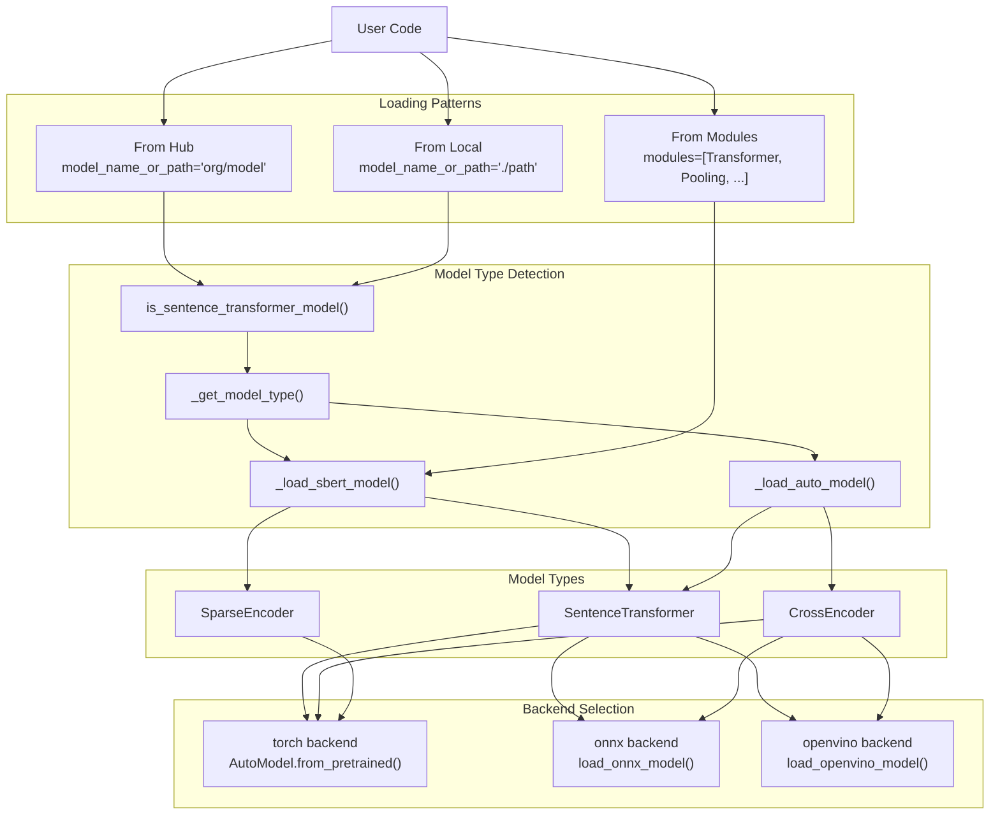
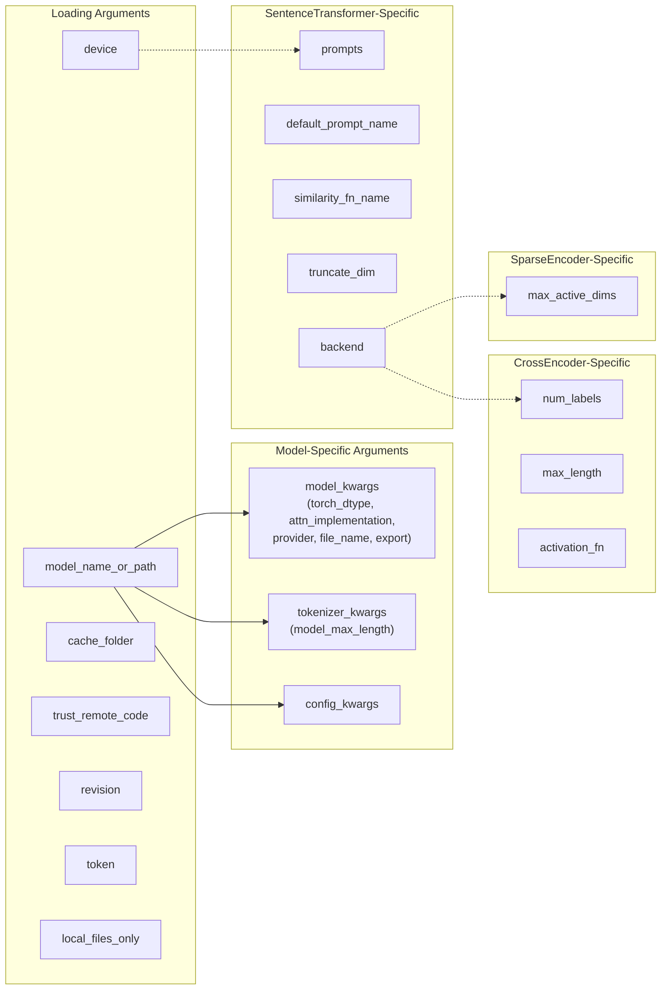
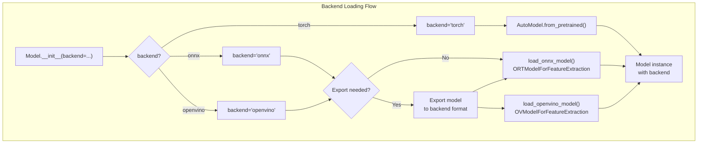
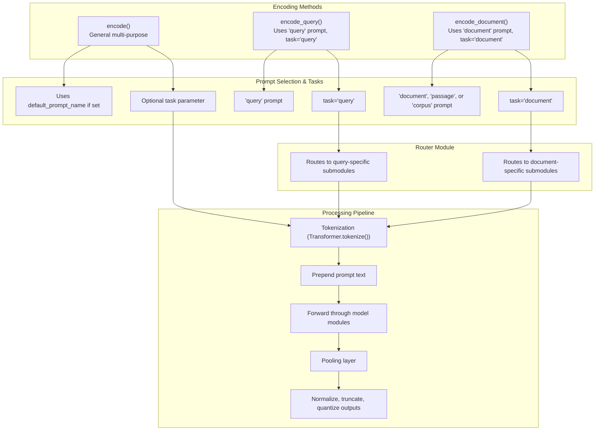
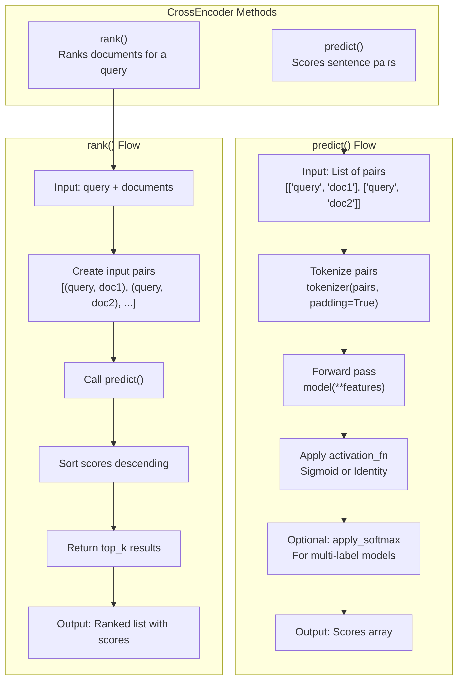
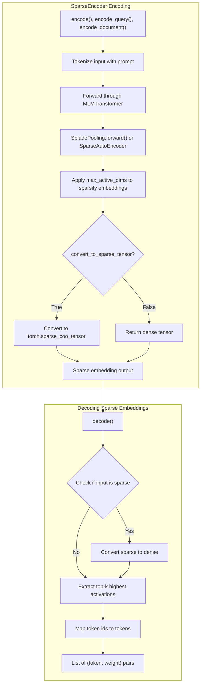
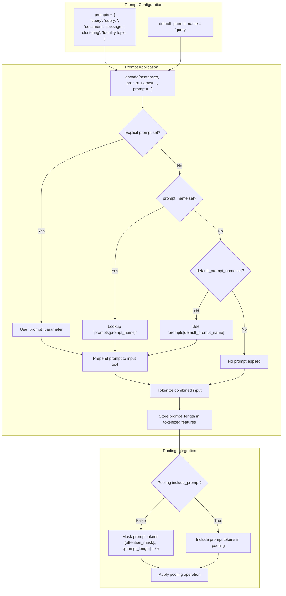

<!-- source: DeepWiki mcp.deepwiki.com · repo huggingface/sentence-transformers · page 4.1 Loading and Inference · fetched 2026-10-26 -->

# Loading and Inference

<details>
<summary>Relevant source files</summary>

The following files were used as context for generating this wiki page:

- [docs/cross_encoder/pretrained_models.md](docs/cross_encoder/pretrained_models.md)
- [docs/cross_encoder/usage/custom_models.rst](docs/cross_encoder/usage/custom_models.rst)
- [docs/cross_encoder/usage/efficiency.rst](docs/cross_encoder/usage/efficiency.rst)
- [docs/cross_encoder/usage/usage.rst](docs/cross_encoder/usage/usage.rst)
- [docs/img/benchmark_fa2_unpadding.png](docs/img/benchmark_fa2_unpadding.png)
- [docs/quickstart.rst](docs/quickstart.rst)
- [docs/sentence_transformer/dataset_overview.md](docs/sentence_transformer/dataset_overview.md)
- [docs/sentence_transformer/pretrained_models.md](docs/sentence_transformer/pretrained_models.md)
- [docs/sentence_transformer/usage/efficiency.rst](docs/sentence_transformer/usage/efficiency.rst)
- [docs/sentence_transformer/usage/usage.rst](docs/sentence_transformer/usage/usage.rst)
- [docs/sparse_encoder/usage/efficiency.rst](docs/sparse_encoder/usage/efficiency.rst)
- [examples/sentence_transformer/training/multimodal/README.md](examples/sentence_transformer/training/multimodal/README.md)
- [examples/sentence_transformer/training/multimodal/training_visual_document_retrieval.py](examples/sentence_transformer/training/multimodal/training_visual_document_retrieval.py)
- [sentence_transformers/backend/utils.py](sentence_transformers/backend/utils.py)
- [sentence_transformers/base/modality.py](sentence_transformers/base/modality.py)
- [sentence_transformers/base/modality_types.py](sentence_transformers/base/modality_types.py)
- [sentence_transformers/sparse_encoder/losses/cached_splade.py](sentence_transformers/sparse_encoder/losses/cached_splade.py)
- [tests/base/test_modality.py](tests/base/test_modality.py)

</details>


This page details how to load pre-trained models and perform inference using the Sentence Transformers library. It covers the three primary model types — SentenceTransformer, CrossEncoder, and SparseEncoder — their loading mechanisms, inference APIs, prompt handling, backend options, and advanced inference features such as quantization and dimension truncation.

For training guidance, see [Training Overview](#5.1). For model selection, see [Model Catalog](#4.2).

---

## Model Loading Overview

The library supports flexible model loading patterns:

- Load models from the Hugging Face Hub by specifying a model identifier.
- Load models from a local directory.
- Create models from custom module chains.

The loading workflow automatically detects the model type and configures the backend.



**Sources:** [sentence_transformers/SentenceTransformer.py:226-350](), [sentence_transformers/cross_encoder/CrossEncoder.py:119-227](), [sentence_transformers/sparse_encoder/SparseEncoder.py:133-180]()

---

### Loading from Hugging Face Hub

To load a pretrained model from the Hub, specify the model ID:

```python
from sentence_transformers import SentenceTransformer, CrossEncoder, SparseEncoder

model = SentenceTransformer("sentence-transformers/all-mpnet-base-v2")
cross_encoder = CrossEncoder("cross-encoder/ms-marco-MiniLM-L6-v2")
sparse_model = SparseEncoder("naver/splade-cocondenser-ensembledistil")
```

For models under the official organizations, the organization prefix can be omitted and is added automatically.

**Sources:** [sentence_transformers/SentenceTransformer.py:301-308]()

---

### Loading from Local Directory

Models saved locally can be loaded by specifying the directory path:

```python
model = SentenceTransformer("./my_saved_model")
```

The loader reads the configuration and weights from the directory.

**Sources:** [sentence_transformers/SentenceTransformer.py:301-304]()

---

### Creating Models from Modules

You can construct custom models by composing modules like `Transformer` and `Pooling`:

```python
from sentence_transformers import SentenceTransformer
from sentence_transformers.models import Transformer, Pooling

transformer = Transformer("bert-base-uncased")
pooling = Pooling(transformer.get_word_embedding_dimension())
model = SentenceTransformer(modules=[transformer, pooling])
```

**Sources:** [sentence_transformers/SentenceTransformer.py:352-355]()

---

## Loading Configuration

Loading supports a rich parameter set enabling fine control. The main loading arguments influence model initialization, tokenizer setup, prompts, and backend configuration:



**Sources:** [sentence_transformers/SentenceTransformer.py:65-137](), [sentence_transformers/cross_encoder/CrossEncoder.py:56-115](), [sentence_transformers/sparse_encoder/SparseEncoder.py:133-151]()

---

### Key Loading Parameters Summary

| Parameter           | Applies To          | Description                                                                                   |
|---------------------|--------------------|-----------------------------------------------------------------------------------------------|
| `device`            | All                | Compute device (e.g., `"cuda"`, `"cpu"`, `"mps"`, `"npu"`)                                   |
| `cache_folder`      | All                | Directory for caching downloaded models                                                      |
| `trust_remote_code` | All                | Whether to trust and run custom code from Hugging Face Hub                                   |
| `revision`          | All                | Model checkpoint version from the Hub (branch, tag, commit)                                  |
| `token`             | All                | HF token for authentication with private models                                             |
| `backend`           | ST, CE             | Inference backend: `"torch"` (default), `"onnx"`, `"openvino"`                               |
| `model_kwargs`      | All                | Additional kwargs passed to the underlying transformer model (e.g., dtype, provider)         |
| `prompts`           | ST, SE             | Dictionary of prompt strings keyed by prompt names                                           |
| `default_prompt_name` | ST, SE           | Default prompt name to use if none specified at encode time                                  |
| `num_labels`        | CE                 | Number of output labels (1 for regression, >1 for multi-label classification)                |
| `max_active_dims`   | SE                 | Maximum non-zero dimensions in sparse embeddings output                                      |

---

## Inference Backends

The library supports three inference backends enabling optimized processing and compatibility:



### PyTorch Backend (Default)

- Uses native PyTorch and Hugging Face transformers.
- Supports PEFT adapters, mixed precision, and custom attention implementations.
- Automatically uses best available device.

Example:

```python
model = SentenceTransformer("all-MiniLM-L6-v2", backend="torch")
```

**Sources:** [sentence_transformers/models/Transformer.py:184-198]()

---

### ONNX Backend

- Uses ONNX Runtime for optimized inference.
- Supports exporting models to ONNX, quantization, and multiple execution providers (CPU, CUDA).
- Export occurs on first load or if forced.

Example:

```python
model = SentenceTransformer(
    "all-MiniLM-L6-v2",
    backend="onnx",
    model_kwargs={"provider": "CUDAExecutionProvider", "file_name": "model_quantized.onnx", "export": True}
)
```

**Sources:** [sentence_transformers/models/Transformer.py:199-205](), [sentence_transformers/backend/__init__.py]()

---

### OpenVINO Backend

- Optimized for Intel hardware.
- Exports models to OpenVINO IR format.
- Supports CPU and integrated GPU acceleration.

Example:

```python
model = SentenceTransformer(
    "all-MiniLM-L6-v2",
    backend="openvino",
    model_kwargs={"file_name": "openvino_model.xml", "export": True}
)
```

**Sources:** [sentence_transformers/models/Transformer.py:206-212]()

---

## SentenceTransformer Inference

### Overview of Encoding Methods

SentenceTransformer provides three related encoding methods:



**Sources:** [sentence_transformers/SentenceTransformer.py:446-681]()

---

### Basic Encoding (`encode()`)

Encodes a list of texts or multimodal inputs and returns dense embeddings.

```python
sentences = ["The weather is lovely today.", "It's so sunny outside!"]
embeddings = model.encode(sentences)  # numpy array of shape (2, embedding_dim)
```

Supports many arguments like batch size, output format, and device management.

| Parameter          | Type         | Description                                       |
|--------------------|--------------|-------------------------------------------------|
| `batch_size`       | int          | Number of inputs per batch (default: 32)        |
| `show_progress_bar`| bool         | Display progress bar during encoding             |
| `output_value`     | str          | `"sentence_embedding"`, `"token_embeddings"`, or `None` for full output dicts |
| `convert_to_numpy` | bool         | Return NumPy array (default: True)                |
| `convert_to_tensor`| bool         | Return PyTorch tensor instead                      |
| `device`           | str or list  | Compute device(s), e.g., `"cuda:0"`, or list for multi-GPU |
| `normalize_embeddings` | bool     | L2 normalize output embeddings                    |
| `precision`        | str          | Output precision for quantization, e.g. `"float32"`, `"int8"` |
| `truncate_dim`     | int          | Truncate embedding dimension for Matryoshka models |

**Sources:** [sentence_transformers/SentenceTransformer.py:682-1100]()

---

### Query and Document Encoding

For retrieval tasks, encode queries and documents separately:

```python
query_embeddings = model.encode_query([
    "What is the capital of France?",
    "How to bake a cake?"
])

doc_embeddings = model.encode_document([
    "Paris is the capital of France.",
    "To bake a cake, preheat the oven to 350°F."
])
```

Differences from `encode()`:

- Use task-specific prompts if available.
- Set task parameters (`"query"` or `"document"`) to route through asymmetric submodels when applicable.

**Sources:** [sentence_transformers/SentenceTransformer.py:446-573]()

---

### Multi-Process Encoding

For large datasets, encoding can be parallelized over multiple devices or processes to maximize throughput:

```python
# Option 1: Provide a list of devices:
embeddings = model.encode(sentences, device=["cuda:0", "cuda:1", "cuda:2", "cuda:3"])

# Option 2: Use multiprocessing pool interface:
pool = model.start_multi_process_pool(["cuda:0", "cuda:1"])
embeddings = model.encode_multi_process(sentences, pool)
model.stop_multi_process_pool(pool)
```

**Sources:** [sentence_transformers/SentenceTransformer.py:1102-1249]()

---

## CrossEncoder Inference

CrossEncoder jointly encodes input pairs and outputs similarity or classification scores.



**Sources:** [sentence_transformers/cross_encoder/CrossEncoder.py:344-571]()

---

### Scoring Sentence Pairs (`predict()`)

Scores a single or batch of input pairs (e.g., question and document):

```python
# Single input pair
score = model.predict(["I love cats", "Cats are amazing"])

# Multiple pairs
scores = model.predict([
    ["I love cats", "Cats are amazing"],
    ["I prefer dogs", "Dogs are loyal"]
])
```

Parameters include options to override activation functions and to convert outputs as numpy arrays or tensors.

**Sources:** [sentence_transformers/cross_encoder/CrossEncoder.py:392-486]()

---

### Ranking Documents (`rank()`)

Ranks a set of documents for a given query by predicting scores for each pair and sorting results:

```python
query = "What is the capital of France?"
documents = [
    "Berlin is the capital of Germany.",
    "Paris is the capital of France.",
    "London is the capital of England.",
]

results = model.rank(query, documents, top_k=2, return_documents=True)
# Output:
# [
#   {'corpus_id': 1, 'score': 0.95, 'text': 'Paris is the capital of France.'},
#   {'corpus_id': 0, 'score': 0.32, 'text': 'Berlin is the capital of Germany.'}
# ]
```

**Sources:** [sentence_transformers/cross_encoder/CrossEncoder.py:488-571]()

---

## SparseEncoder Inference

SparseEncoder produces sparse embeddings suitable for efficient retrieval. The output is typically a sparse COO tensor or dense tensor with many zero values.



**Sources:** [sentence_transformers/sparse_encoder/SparseEncoder.py:412-581]()

---

### Encoding with SparseEncoder

```python
model = SparseEncoder("naver/splade-cocondenser-ensembledistil")

# Encode queries (sparse tensor output)
query_embeddings = model.encode_query("How to bake a cake?")

# Encode documents
doc_embeddings = model.encode_document([
    "To bake a cake, preheat oven to 350°F.",
    "Mix flour, sugar, and eggs together."
])
```

Parameters:

| Parameter                | Description                                                |
|--------------------------|------------------------------------------------------------|
| `convert_to_sparse_tensor` | Return sparse COO tensor (default `True`)                |
| `save_to_cpu`            | Move output to CPU                                          |
| `max_active_dims`        | Limit number of non-zero dimensions                         |

**Sources:** [sentence_transformers/sparse_encoder/SparseEncoder.py:181-410]()

---

### Decoding Sparse Embeddings

The `decode()` method maps sparse embeddings back to tokens with weights for interpretability:

```python
embeddings = model.encode("How to bake a cake?")
decoded = model.decode(embeddings, top_k=10)
# Output: [('bake', 0.95), ('cake', 0.89), ('how', 0.67), ...]
```

**Sources:** [sentence_transformers/sparse_encoder/SparseEncoder.py:583-695]()

---

## Prompt Handling

Prompting enables models, particularly instruction-tuned or asymmetric, to optimize encoding behavior for different tasks.



**Sources:** [sentence_transformers/SentenceTransformer.py:189-192](), [sentence_transformers/SentenceTransformer.py:1376-1481](), [sentence_transformers/models/Pooling.py:142-152]()

---

### Setting and Using Prompts

Prompts can be configured during model initialization or dynamically modified:

```python
# At initialization
model = SentenceTransformer(
    "intfloat/e5-base-v2",
    prompts={
        "query": "query: ",
        "passage": "passage: "
    },
    default_prompt_name="query"
)

# Later modification
model.prompts["custom"] = "Classify the sentiment: "
```

During encoding, prompts are applied in this priority:

1. Explicit `prompt` parameter
2. `prompt_name` lookup in `prompts`
3. `default_prompt_name` if set
4. No prompt applied otherwise

```python
embeddings = model.encode(sentences, prompt_name="query")
embeddings = model.encode(sentences, prompt="Retrieve: ")
```

**Sources:** [sentence_transformers/SentenceTransformer.py:189-192](), [sentence_transformers/SentenceTransformer.py:1376-1427]()

---

### INSTRUCTOR Models Special Handling

INSTRUCTOR models require pooling layers to exclude prompt tokens from pooling by default:

```python
# Auto-detected for known instructor models
model = SentenceTransformer("hkunlp/instructor-base")

# For custom instructor models
model.set_pooling_include_prompt(False)
```

**Sources:** [sentence_transformers/SentenceTransformer.py:388-403]()

---

## Advanced Inference Options

### Quantization

Supported to reduce embedding size and accelerate similarity search, albeit with some quality trade-offs:

```python
embeddings = model.encode(sentences, precision="int8")
```

| Precision | Description               | Usage                                                         |
|-----------|---------------------------|---------------------------------------------------------------|
| float32   | Default full precision    | Maximum accuracy                                               |
| int8      | Signed 8-bit integer      | 4x compression, slight quality degradation                     |
| uint8     | Unsigned 8-bit integer    | 4x compression                                                |
| binary    | 1-bit binary              | 32x compression, larger quality loss                           |
| ubinary   | Unsigned 1-bit            | 32x compression                                               |

**Sources:** [sentence_transformers/SentenceTransformer.py:1212-1227](), [sentence_transformers/quantization.py]()

---

### Dimension Truncation (Matryoshka Models)

For models trained with nested dimensionality (Matryoshka), embeddings can be truncated to smaller dimensions:

```python
model = SentenceTransformer("nomic-ai/nomic-embed-text-v1.5", truncate_dim=256)
embeddings = model.encode(sentences, truncate_dim=128)
```

This accelerates downstream retrieval while retaining reasonable performance.

**Sources:** [sentence_transformers/SentenceTransformer.py:181](), [sentence_transformers/util.py:truncate_embeddings]()

---

### Output Control

- Output token embeddings instead of sentence embeddings:

```python
token_embeddings = model.encode(sentences, output_value="token_embeddings")
```

- Return all outputs (e.g., inputs, token embeddings, sentence embeddings) for debugging:

```python
outputs = model.encode(sentences, output_value=None)
# List of dicts with keys like "input_ids", "attention_mask", "token_embeddings", "sentence_embedding"
```

**Sources:** [sentence_transformers/SentenceTransformer.py:854-903]()

---

### Device Management

- The library automatically detects and uses available hardware devices.
- Users can explicitly specify devices or provide a list for multi-device parallelism.

```python
model = SentenceTransformer("all-MiniLM-L6-v2")           # Auto device selection (GPU > MPS > CPU)
model = SentenceTransformer("all-MiniLM-L6-v2", device="cpu")

embeddings = model.encode(sentences, device=["cuda:0", "cuda:1"])  # Multi-GPU encoding
```

- Models can be moved between devices with `.to(device)`.

**Sources:** [sentence_transformers/SentenceTransformer.py:217-219](), [sentence_transformers/util.py:get_device_name]()

---

### Batch Size Optimization

Batch size influences memory footprint and throughput. Small batches reduce memory use; large batches improve speed.

```python
embeddings = model.encode(sentences, batch_size=8)
embeddings = model.encode(sentences, batch_size=128)
```

**Sources:** [sentence_transformers/SentenceTransformer.py:1024-1096]()

---

## Model-Specific Utilities

### Metadata Access

```python
dim = model.get_sentence_embedding_dimension()
max_len = model.max_seq_length
tokenizer = model.tokenizer
backend = model.get_backend()
model_kwargs = model.get_model_kwargs()  # e.g., ['task', 'truncate_dim']
```

**Sources:** [sentence_transformers/SentenceTransformer.py:408-414](), [sentence_transformers/SentenceTransformer.py:416-444]()

---

### Similarity Computation

The SentenceTransformer's built-in methods compute similarities efficiently:

```python
# Compute similarity matrix between two embedding sets
similarities = model.similarity(embeddings1, embeddings2)

# Pairwise similarities
similarities = model.similarity_pairwise(embeddings1, embeddings2)
```

Uses the configured similarity function, such as cosine, dot, euclidean, or manhattan.

**Sources:** [sentence_transformers/SentenceTransformer.py:1669-1811]()

---

### Saving and Configuration Persistence

When saving models, various files are exported:

- `config_sentence_transformers.json` with prompts, similarity function, and special config.
- `modules.json` for module composition.
- Transformer configs and weights.

Example:

```python
model.save("./my_model")
```

**Sources:** [sentence_transformers/SentenceTransformer.py:1967-2181]()

---

# Summary

This page has covered the full lifecycle of loading Sentence Transformers models, performing inference via encode/predict/rank APIs, handling multimodal and prompt-based inputs, utilizing optimized backends (Torch, ONNX, OpenVINO), and employing advanced inference features like quantization and multi-device encoding.

These mechanisms provide a rich and flexible interface for applying Sentence Transformers models in production and research.

---

**Sources:**

- [sentence_transformers/SentenceTransformer.py:65-355, 408-1100, 1210-1481, 1669-1811, 1900-2181]()
- [sentence_transformers/cross_encoder/CrossEncoder.py:56-227, 344-571]()
- [sentence_transformers/sparse_encoder/SparseEncoder.py:133-695]()
- [sentence_transformers/models/Transformer.py:164-214]()
- [sentence_transformers/backend/__init__.py]()
- [sentence_transformers/util.py]()
- [sentence_transformers/quantization.py]()

---

