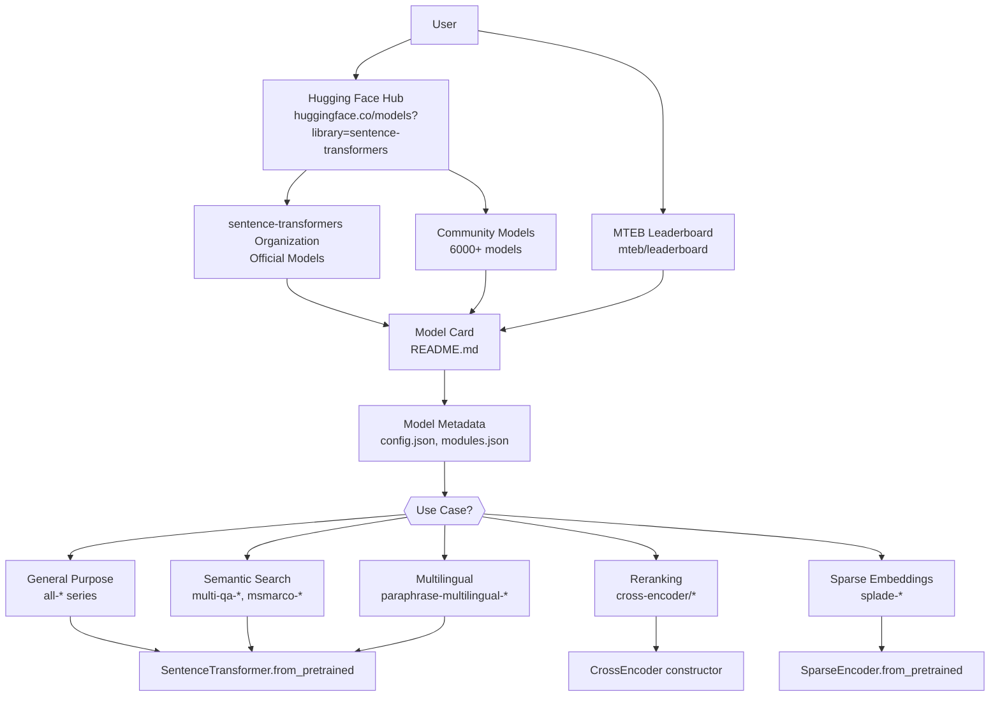
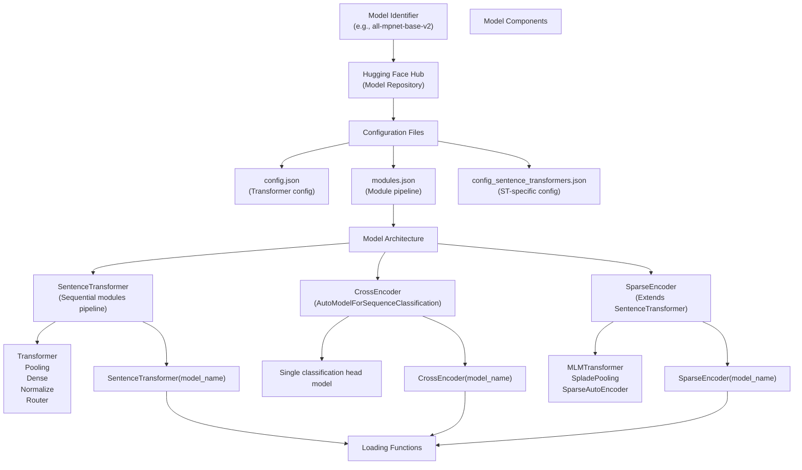
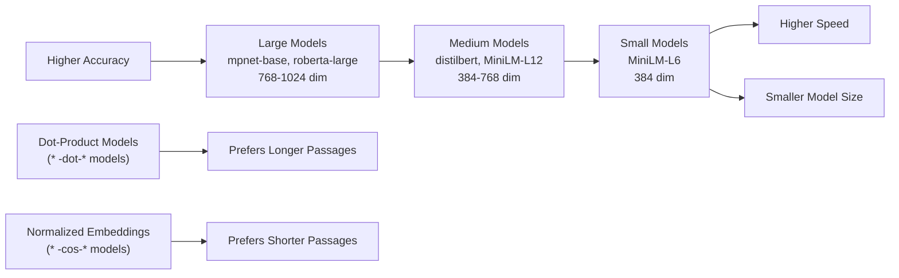
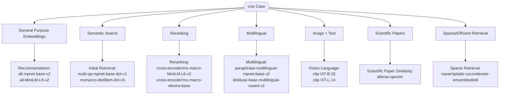

<!-- source: DeepWiki mcp.deepwiki.com · repo huggingface/sentence-transformers · page 4.2 Model Catalog · fetched 2026-10-26 -->

# Model Catalog

<details>
<summary>Relevant source files</summary>

The following files were used as context for generating this wiki page:

- [docs/_static/css/custom.css](docs/_static/css/custom.css)
- [docs/_static/html/models_en_sentence_embeddings.html](docs/_static/html/models_en_sentence_embeddings.html)
- [docs/_static/js/custom.js](docs/_static/js/custom.js)
- [docs/cross_encoder/pretrained_models.md](docs/cross_encoder/pretrained_models.md)
- [docs/cross_encoder/usage/custom_models.rst](docs/cross_encoder/usage/custom_models.rst)
- [docs/cross_encoder/usage/usage.rst](docs/cross_encoder/usage/usage.rst)
- [docs/pretrained-models/ce-msmarco.md](docs/pretrained-models/ce-msmarco.md)
- [docs/pretrained-models/msmarco-v1.md](docs/pretrained-models/msmarco-v1.md)
- [docs/pretrained-models/msmarco-v2.md](docs/pretrained-models/msmarco-v2.md)
- [docs/pretrained-models/msmarco-v3.md](docs/pretrained-models/msmarco-v3.md)
- [docs/pretrained-models/msmarco-v5.md](docs/pretrained-models/msmarco-v5.md)
- [docs/pretrained-models/nli-models.md](docs/pretrained-models/nli-models.md)
- [docs/pretrained-models/nq-v1.md](docs/pretrained-models/nq-v1.md)
- [docs/pretrained-models/sts-models.md](docs/pretrained-models/sts-models.md)
- [docs/pretrained-models/wikipedia-sections-models.md](docs/pretrained-models/wikipedia-sections-models.md)
- [docs/quickstart.rst](docs/quickstart.rst)
- [docs/sentence_transformer/dataset_overview.md](docs/sentence_transformer/dataset_overview.md)
- [docs/sentence_transformer/pretrained_models.md](docs/sentence_transformer/pretrained_models.md)
- [docs/sentence_transformer/usage/usage.rst](docs/sentence_transformer/usage/usage.rst)
- [docs/sparse_encoder/pretrained_models.md](docs/sparse_encoder/pretrained_models.md)
- [examples/sentence_transformer/applications/clustering/README.md](examples/sentence_transformer/applications/clustering/README.md)
- [examples/sentence_transformer/domain_adaptation/README.md](examples/sentence_transformer/domain_adaptation/README.md)
- [examples/sentence_transformer/training/multimodal/README.md](examples/sentence_transformer/training/multimodal/README.md)
- [examples/sentence_transformer/training/multimodal/training_visual_document_retrieval.py](examples/sentence_transformer/training/multimodal/training_visual_document_retrieval.py)
- [examples/sparse_encoder/applications/semantic_search/semantic_search_splade_index.py](examples/sparse_encoder/applications/semantic_search/semantic_search_splade_index.py)

</details>


This page provides a comprehensive overview of the available pre-trained models within the `sentence-transformers` ecosystem, encompassing the three primary model types:

- **SentenceTransformer** (dense embedding models)
- **CrossEncoder** (reranking models)
- **SparseEncoder** (sparse embedding models)

We cover model discovery sources, performance benchmarks, model architectures, selection guidance, and usage patterns. This is aimed at helping you identify the right model for your specific tasks such as semantic similarity, semantic search, reranking, cross-lingual applications, or multimodal embeddings.

For details on loading and using these models programmatically, please see [Loading and Inference (4.1)](./4.1.md). For fine-tuning and training guidance, see [Training Models (5)](./5.md).

---

## Model Discovery and Sources

The `sentence-transformers` ecosystem hosts more than 15,000 pre-trained models accessible via the Hugging Face Hub. These models are organized primarily into:

### Official Models

- Hosted under the **sentence-transformers** organization on Hugging Face.
- Extensively evaluated and maintained by the core developers.
- Loadable with simplified names (organization prefix can be omitted):

```python
from sentence_transformers import SentenceTransformer

# Direct load from sentence-transformers org
model = SentenceTransformer("all-mpnet-base-v2")
```

### Community Models

- Developed and uploaded by the broader community.
- Filterable by the `sentence-transformers` library tag on Hugging Face.
- Requires full model path specification:

```python
model = SentenceTransformer("username/custom-model")
```

### MTEB Leaderboard

The **Massive Text Embedding Benchmark (MTEB)** leaderboard aggregates evaluation results across more than 56 diverse tasks to help identify strong performing models:

- Link: https://huggingface.co/spaces/mteb/leaderboard
- Note: leaderboard results provide guidance but **may not perfectly predict** performance on your specific downstream task.

#### Model Discovery Flow Diagram



Sources: [docs/sentence_transformer/pretrained_models.md:4-7](), [README.md:17]()

---

## Model Categories and Representative Models

### General Purpose Dense Models (`all-*` series)

These models are trained on over one billion text pairs from diverse datasets to provide high-quality, general-purpose sentence embeddings. They produce normalized embeddings, usually with mean pooling over transformers such as MPNet or MiniLM.

| Model                   | Embedding Dim | Max Seq Length | Speed (sent/sec GPU) | Size (MB) | Avg. Performance (Sentence/ Search %) |
|------------------------|---------------|----------------|----------------------|-----------|---------------------------------------|
| all-mpnet-base-v2      | 768           | 384            | 2,800                | 420       | 69.57 / 57.02                         |
| all-MiniLM-L12-v2      | 384           | 256            | 7,500                | 120       | 68.70 / 50.82                         |
| all-MiniLM-L6-v2       | 384           | 256            | 14,200               | 80        | 68.06 / 49.54                         |
| all-distilroberta-v1   | 768           | 512            | 4,000                | 290       | 68.73 / 50.94                         |

Usage example:

```python
from sentence_transformers import SentenceTransformer

model = SentenceTransformer("all-mpnet-base-v2")
embeddings = model.encode(["Text 1", "Text 2"])
# embeddings are unit normalized, usable with dot, cosine, or Euclidean similarity
```

Sources: [docs/sentence_transformer/pretrained_models.md:41-48](), [docs/_static/html/models_en_sentence_embeddings.html:520-551]()

---

### Semantic Search Models

Specifically fine-tuned for retrieval tasks where queries are matched to relevant passages.

#### Multi-QA Models

Trained on a diverse 215M question-answer pairs corpus spanning various domains.

- **Dot-product similarity models**:

| Model                               | MRR@10 | Queries / sec (GPU) |
|------------------------------------|--------|---------------------|
| multi-qa-mpnet-base-dot-v1          | 57.60  | 4,000               |
| multi-qa-distilbert-dot-v1          | 52.51  | 7,000               |
| multi-qa-MiniLM-L6-dot-v1           | 49.19  | 18,000              |

- **Cosine-normalized embeddings models** (unit vectors):

| Model                               | MRR@10 | Queries / sec (GPU) |
|------------------------------------|--------|---------------------|
| multi-qa-mpnet-base-cos-v1          | 57.46  | 4,000               |
| multi-qa-distilbert-cos-v1          | 52.83  | 7,000               |
| multi-qa-MiniLM-L6-cos-v1           | 51.83  | 18,000              |

Sources: [docs/sentence_transformer/pretrained_models.md:52-103]()

---

#### MSMARCO Passage Models

Trained on over 500k real web query-passage pairs from Bing search.

| Model                                    | MRR@10 (MSMARCO) | NDCG@10 (TREC DL19) | Speed (sent/sec GPU) |
|-----------------------------------------|------------------|---------------------|----------------------|
| msmarco-bert-base-dot-v5                 | 38.08            | 70.51               | 4,000                |
| msmarco-distilbert-dot-v5                | 37.25            | 70.14               | 7,000                |
| msmarco-distilbert-base-tas-b            | 34.43            | 70.24               | 7,000                |
| msmarco-MiniLM-L6-cos-v5                 | 32.27            | 67.46               | 18,000               |

**Notes:**

- Models labeled `-dot-` produce unnormalized embeddings optimal for dot product similarity; avoid cosine similarity.
- Models labeled `-cos-` or `all-*` produce normalized embeddings modulating results with cosine or Euclidean metrics.
- Dot-product models prefer longer passages; normalized models slightly favor shorter passages.

Sources: [docs/pretrained-models/msmarco-v5.md:1-51](), [docs/sentence_transformer/pretrained_models.md:104-124]()

---

### Multilingual Models

Produce aligned embeddings across many languages (50+ to 109 languages), useful for cross-lingual similarity and retrieval.

| Model                                    | Languages Supported | Embedding Dim | Speed (sent/sec GPU) | Use Case            |
|------------------------------------------|---------------------|---------------|----------------------|---------------------|
| paraphrase-multilingual-mpnet-base-v2    | 50+                 | 768           | 2,500                | High-quality general |
| paraphrase-multilingual-MiniLM-L12-v2    | 50+                 | 384           | 7,500                | Fast, decent quality |
| distiluse-base-multilingual-cased-v2     | 50+                 | 512           | 4,000                | Balanced performance |
| distiluse-base-multilingual-cased-v1     | 15                  | 512           | 4,000                | High quality 15 langs|
| LaBSE (bitext mining)                     | 109                 | 768           | Moderate             | Parallel sentence mining |

Sources: [docs/sentence_transformer/pretrained_models.md:128-145]()

---

### CrossEncoder Models (Reranking)

CrossEncoders encode query and passage pairs together (input concatenation), scoring pairs for ranking. They are more accurate than bi-encoders but slower as each pair is processed separately.

**Popular MSMARCO CrossEncoders:**

| Model                                | MRR@10 (MS MARCO Dev) | Architecture     | Use Case           |
|-------------------------------------|-----------------------|------------------|--------------------|
| cross-encoder/ms-marco-MiniLM-L6-v2 | ~39                   | MiniLM-L6        | Fast reranker       |
| cross-encoder/ms-marco-electra-base  | ~41                   | ELECTRA-base     | High quality rerank |

Usage example:

```python
from sentence_transformers import CrossEncoder

model = CrossEncoder("cross-encoder/ms-marco-MiniLM-L6-v2", activation_fn=torch.nn.Sigmoid())
scores = model.predict([
    ("Query text", "Passage 1"),
    ("Query text", "Passage 2"),
])
```

Sources: [docs/pretrained-models/ce-msmarco.md](), [docs/cross_encoder/pretrained_models.md:1-120]()

---

### SparseEncoder Models

Sparse Encoders create highly sparse (99%+) embeddings modeled to be compatible with inverted index search engines, efficiently combining lexical matching with neural signals.

**Core SPLADE Models:**

| Model                                                                 | MS MARCO MRR@10 | BEIR average nDCG@10 | Parameters |
|-----------------------------------------------------------------------|-----------------|---------------------|------------|
| naver/splade-v3                                                      | 40.2            | 51.7                | 109M       |
| opensearch-project/opensearch-neural-sparse-encoding-v2-distill     | NA              | **52.8**            | 67M        |
| naver/splade-cocondenser-selfdistil                                  | 37.6            | 50.7                | 109M       |

**Key features:**

- Use modules like `MLMTransformer`, `SpladePooling`, and `SparseAutoEncoder`.
- Return sparse matrices for efficient similarity/nearest neighbor search.
- Well suited for large-scale information retrieval.

Example usage:

```python
from sentence_transformers import SparseEncoder

model = SparseEncoder("naver/splade-v3")
query_emb = model.encode_query(["example query"])
doc_emb = model.encode_document(["document text here"])
```

Sources: [docs/sparse_encoder/pretrained_models.md:1-70](), [README.md:132-166]()

---

### Specialized Models

#### Vision-Language (CLIP) Models

For text-image and image-image similarity, zero-shot image classification:

| Model                          | ImageNet Top-1 Accuracy | Use Case            |
|--------------------------------|-------------------------|---------------------|
| clip-ViT-L-14                 | 75.4%                   | Highest quality     |
| clip-ViT-B-16                 | 68.1%                   | Balanced            |
| clip-ViT-B-32                 | 63.3%                   | Lightweight & fast  |
| clip-ViT-B-32-multilingual-v1 | -                       | 50+ languages       |

#### INSTRUCTOR Models

- Accept task-specific textual prompts to adapt embedding behavior on-the-fly.
- Examples: `hkunlp/instructor-base`, `hkunlp/instructor-large`, `hkunlp/instructor-xl`
- Unlike regular SentenceTransformer models, excluded prompts from pooling.

Example:

```python
model = SentenceTransformer("hkunlp/instructor-large")
embeddings = model.encode(
    ["Scientific paper 1", "Scientific paper 2"],
    prompt="Represent the scientific paper for retrieval: "
)
```

#### Scientific Similarity - SPECTER

- `allenai-specter`: trained on citation graphs to embed scientific papers for similarity and search.

Sources: [docs/sentence_transformer/pretrained_models.md:147-217]()

---

## Model Architecture and Configuration Flow



Sources: [docs/sentence_transformer/pretrained_models.md:16-27]()

---

## Performance Benchmarks and Evaluation

### Evaluation Datasets

Models are evaluated on a broad range of benchmark suites:

- **Sentence Embeddings (14 datasets total):**  
  STS tasks (e.g., STSb, SICK-R), classification, clustering, semantic similarity datasets  
- **Semantic Search (6 datasets total):**  
  TREC-COVID, NFCorpus, Natural Questions, HotpotQA, FiQA, ArguAna  
- **MSMARCO-specific:**  
  MS MARCO Passage Ranking (MRR@10), TREC Deep Learning 2019 & 2020 benchmarks (NDCG@10)

### Common Metrics

| Metric           | Description                          | Use Case                       |
|------------------|------------------------------------|--------------------------------|
| **MRR@10**       | Mean Reciprocal Rank at 10          | Effectiveness ranking the first relevant document |
| **NDCG@10**      | Normalized Discounted Cumulative Gain at 10 | Cumulative ranking quality considering rank positions |
| **MAP**          | Mean Average Precision               | Overall retrieval ranking quality |
| **Recall@k**     | Fraction of relevant docs in top k   | Retrieval coverage evaluation   |
| **Spearman/Pearson** | Correlation with human similarity judgments | Semantic textual similarity |

### Performance vs. Speed Tradeoff



**Examples:**

- `all-mpnet-base-v2` — Highest accuracy but slower and larger (2,800 sent/sec GPU; 420MB)
- `all-MiniLM-L12-v2` — Balanced accuracy and speed (7,500 sent/sec; 120MB)
- `all-MiniLM-L6-v2` — Fastest and smallest (14,200 sent/sec; 80MB)

Sources: [docs/_static/html/models_en_sentence_embeddings.html:128-137](), [docs/pretrained-models/msmarco-v5.md:47-51]()

---

## Model Selection Guidance

### By Use Case



### Selection Criteria

1. **Task Requirements:**

   - Use **general embeddings** (`all-*` series) for wide semantic similarity.
   - Use **semantic search models** (`multi-qa-*`, `msmarco-*`) for question-answer retrieval.
   - Use **CrossEncoders** (`cross-encoder/*`) to rerank candidate sets for highest accuracy.
   - Use **multilingual models** (`paraphrase-multilingual-*`) for cross-lingual tasks.
   - Use **SparseEncoder** models or small dense models when performance critical and sparse representations preferred.

2. **Performance-Specific Choices:**

   - Highest quality: `all-mpnet-base-v2`, `multi-qa-mpnet-base-*`
   - Balance quality and speed: `all-MiniLM-L12-v2`, `msmarco-distilbert-*`
   - Maximum speed: `all-MiniLM-L6-v2`, `multi-qa-MiniLM-L6-*`

3. **Infrastructure Constraints:**

   - For limited memory or low-resource devices, prefer MiniLM-L6 variants (~80-120 MB).
   - For CPU inference, balance model size/speed. ONNX / OpenVINO backends available.
   - For GPU inference, larger models become feasible.

4. **Document Characteristics:**

   - Short documents (<128 tokens): smaller max sequence lengths suffice.
   - Longer documents: models supporting max sequence lengths of 512 tokens or chunking strategies.

5. **Embedding Properties:**

   - Need **normalized embeddings**: use `*-cos-*` or `all-*` models.
   - Prefer **longer passages**: dot-product trained models (`*-dot-*`).
   - Combine dense with **BM25 or sparse** models for optimal recall.

Sources: [docs/sentence_transformer/pretrained_models.md:30-38]()

### Recommended Evaluation Strategy

When selecting a model:

1. Start from candidates listed on the MTEB leaderboard.
2. Filter candidates by size based on your hardware constraints.
3. Benchmark shortlisted models on a representative sample of your data.
4. Measure task-specific metrics (e.g., precision@k).
5. Profile inference speed on your actual deployment platform.
6. Consider ensemble strategies combining dense + sparse or bi-encoder + cross-encoder setups.

Sources: [docs/sentence_transformer/pretrained_models.md:30-38]()

---

## Model Properties and Compatibility

### Embedding Characteristics

| Property           | Models                | Recommended Similarity Functions            | Notes                          |
|--------------------|-----------------------|---------------------------------------------|--------------------------------|
| Normalized         | `all-*`, `*-cos-*`    | dot-product, cosine similarity, Euclidean   | All produce similar distances  |
| Unnormalized       | `*-dot-*`             | dot-product only                             | Embedding lengths vary         |
| Sparse             | `splade-*`, SAE       | dot-product on sparse CSR matrices          | Use sparse similarity search   |

### Pipeline Module Patterns (From `modules.json`)

| Model Category           | Pipeline Modules                              | Comments                                  |
|-------------------------|----------------------------------------------|-------------------------------------------|
| SentenceTransformer     | ["Transformer", "Pooling", "Normalize"]      | Typical dense embedding pipeline          |
| Router-based (Asymmetric) | ["Transformer", "Pooling", "Router"]        | For models with query/document prompt     |
| INSTRUCTOR models       | ["Transformer", "Pooling"]                    | Prompt excluded from pooling              |
| SparseEncoder (SPLADE)  | ["MLMTransformer", "SpladePooling"]           | Specialized sparse model architecture     |
| SparseEncoder (SAE)     | ["Transformer", "Pooling", "SparseAutoEncoder"] | Alternative sparse encoder architecture  |

### Compatibility Summary

| Model Type            | Supports `.encode()` | Supports `.predict()` | Supports `.rank()` | ONNX Export | OpenVINO Export |
|-----------------------|---------------------|---------------------|-------------------|-------------|-----------------|
| SentenceTransformer    | ✓                   | ✗                   | ✗                 | ✓           | ✓               |
| CrossEncoder          | ✗                   | ✓                   | ✓                 | ✓           | ✓               |
| SparseEncoder         | ✓                   | ✗                   | ✗                 | ✓           | ✓               |

Sources: [docs/sentence_transformer/pretrained_models.md:161-212](), [README.md:54-166]()

---

## Model Card Structure on Hugging Face Hub

Each model includes a **model card** containing:

- **Base model** and architecture details.
- **Maximum input sequence length**.
- **Embedding dimension and pooling method**.
- **Embedding normalization status**.
- **Training datasets used**.
- **Performance metrics and benchmarks**.
- **Recommended similarity metrics and usage instructions**.

Additional details vary by model type:

| Model Type          | Content Highlights in Model Card                                            |
|---------------------|-----------------------------------------------------------------------------|
| SentenceTransformer | Pipeline config (`modules.json`), `.encode()` examples, similarity examples, prompt usage, router config |
| CrossEncoder        | Number of labels or regression targets, `.predict()` and `.rank()` usage examples, reranking details       |
| SparseEncoder       | Sparsity stats, FLOPS estimates, vector database compatibility notes                                  |

Sources: [docs/_static/html/models_en_sentence_embeddings.html:153-220]()

---

## Model Families Reference

### Official Model Families

| Family                    | Description                                    | Models Examples                                 |
|---------------------------|------------------------------------------------|------------------------------------------------|
| General Purpose           | Large-scale trained models for many tasks      | `all-mpnet-base-v2`, `all-MiniLM-L6-v2`        |
| Semantic Search           | Trained for QA, search query matching          | `multi-qa-*`, `msmarco-*`, `nq-*`              |
| Multilingual              | Cross-lingual sentence embeddings               | `paraphrase-multilingual-mpnet-base-v2`, `LaBSE` |
| Specialized               | Image-Text, instruction-tuned, scientific docs | `clip-ViT-*`, `hkunlp/instructor-*`, `allenai-specter` |

### Common Community Model Patterns

- `{org}/sentence-t5-*`: T5-based encoder models
- `{org}/{domain}-*`: Domain or language specialized models
- `{org}/*-gte-*` or `*-e5-*`: General text embedding series

Sources: [docs/sentence_transformer/pretrained_models.md:41-217]()

---

## Loading Model Configurations and Customization Examples

You can customize model loading with device, backend, and trust settings:

```python
from sentence_transformers import SentenceTransformer

# Load with GPU device
model = SentenceTransformer("all-mpnet-base-v2", device="cuda")

# Load with remote code trusted (required for some community models)
model = SentenceTransformer("custom/model-path", trust_remote_code=True)

# Load model using ONNX backend
model = SentenceTransformer(
    "all-mpnet-base-v2",
    backend="onnx",
    model_kwargs={"file_name": "model.onnx"},
)
```

Accessing model attributes:

```python
# Transformer config parameters
max_seq_len = model.model_config.max_position_embeddings

# Embedding dimension
embed_dim = model.get_sentence_embedding_dimension()

# Maximum sequence length for this model
max_seq_len = model.max_seq_length

# Check normalization in pipeline
modules = model.modules()
has_normalize = any(mod.__class__.__name__ == "Normalize" for mod in modules)
```

Sources: [docs/sentence_transformer/pretrained_models.md:16-27](), [README.md:1-166]()

---

## Summary

The Sentence Transformers ecosystem offers a rich catalog of pre-trained models, tailored for diverse use cases from general sentence embeddings to multilingual, multimodal, reranking, sparse retrieval, and specialized scientific or instruction-following scenarios. Through detailed metadata, model cards, and performance benchmarks, practitioners can select and deploy models optimized for their tasks and infrastructure.

For the most current model listings and community contributions, visit:

- **Official models:** https://huggingface.co/sentence-transformers
- **All models with filter:** https://huggingface.co/models?library=sentence-transformers
- **MTEB leaderboard:** https://huggingface.co/spaces/mteb/leaderboard

---

Sources:  
- [docs/sentence_transformer/pretrained_models.md](docs/sentence_transformer/pretrained_models.md:1-217)  
- [docs/pretrained-models/msmarco-v5.md](docs/pretrained-models/msmarco-v5.md:1-60)  
- [docs/pretrained-models/ce-msmarco.md](docs/pretrained-models/ce-msmarco.md:1-63)  
- [docs/cross_encoder/pretrained_models.md](docs/cross_encoder/pretrained_models.md:1-105)  
- [docs/sparse_encoder/pretrained_models.md](docs/sparse_encoder/pretrained_models.md:1-70)  
- [docs/_static/html/models_en_sentence_embeddings.html](docs/_static/html/models_en_sentence_embeddings.html:100-600)  
- [docs/sentence_transformer/usage/usage.rst](docs/sentence_transformer/usage/usage.rst:1-150)

---

