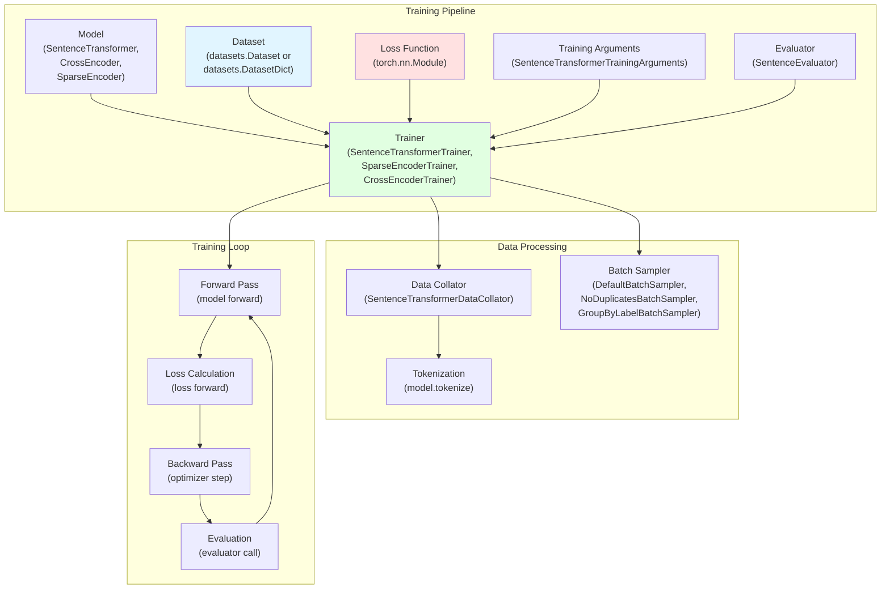
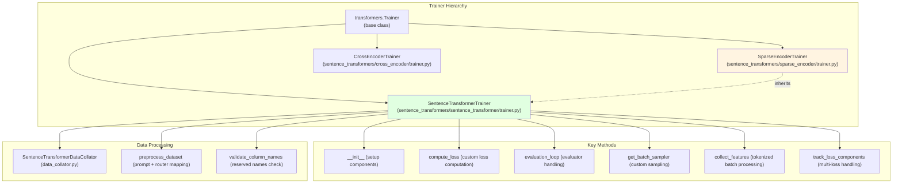
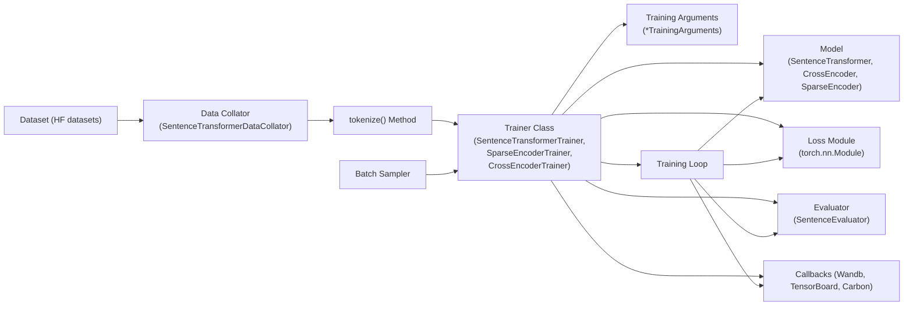

<!-- source: DeepWiki mcp.deepwiki.com · repo huggingface/sentence-transformers · page 5 Training Models · fetched 2026-10-26 -->

# Training Models

<details>
<summary>Relevant source files</summary>

The following files were used as context for generating this wiki page:

- [docs/cross_encoder/training_overview.md](docs/cross_encoder/training_overview.md)
- [docs/sentence_transformer/training_overview.md](docs/sentence_transformer/training_overview.md)
- [docs/sparse_encoder/training_overview.md](docs/sparse_encoder/training_overview.md)
- [examples/sentence_transformer/training/matryoshka/README.md](examples/sentence_transformer/training/matryoshka/README.md)
- [sentence_transformers/base/training_args.py](sentence_transformers/base/training_args.py)
- [sentence_transformers/cross_encoder/trainer.py](sentence_transformers/cross_encoder/trainer.py)
- [sentence_transformers/sentence_transformer/trainer.py](sentence_transformers/sentence_transformer/trainer.py)
- [sentence_transformers/sparse_encoder/trainer.py](sentence_transformers/sparse_encoder/trainer.py)

</details>


This page provides a comprehensive overview of the training system in Sentence Transformers, covering the architecture, components, and workflow for fine-tuning models. The training framework supports three model types: `SentenceTransformer`, `CrossEncoder`, and `SparseEncoder`, each with specialized trainers and loss functions.

For detailed information about specific aspects of training:
- Dataset preparation and formatting: see [Training Overview](#5.1), [Dataset Preparation](#5.2)
- Loss function options and usage: see [Loss Functions](#5.3)
- Training arguments and hyperparameters: see [Training Configuration](#5.4)
- Trainer internals and multi-dataset training: see [The Trainer System](#5.5)

---

## Training Architecture

The Sentence Transformers training system builds on Hugging Face Transformers' `Trainer` class, enhancing it with embedding-specific features tailored for efficient fine-tuning of embedding models. Each training run involves orchestrating six core components, forming a modular and extensible pipeline.



**Summary**: The trainer coordinates the interaction between the model, input datasets, loss function, training arguments, and evaluators, while handling data collation, batch sampling, tokenization, and the training loop's forward and backward passes.

Sources: [docs/sentence_transformer/training_overview.md:18-48](), [sentence_transformers/sentence_transformer/trainer.py:36-130]()

---

## The Six Training Components

Training Sentence Transformer models requires the following components, each playing a specific role:

### 1. Model (Required)

The primary model to fine-tune, which belongs to one of the three main classes:

- **`SentenceTransformer`**: Dense embedding models with transformer + pooling layers.
- **`CrossEncoder`**: Models that rerank or classify input pairs using a transformer-based sequence classifier.
- **`SparseEncoder`**: Sparse embedding models (SPLADE, CSR) that produce sparse high-dimensional embeddings.

Models can be loaded from pretrained checkpoints or built from modules programmatically.

```python
# Load pretrained SentenceTransformer
from sentence_transformers import SentenceTransformer
model = SentenceTransformer("sentence-transformers/all-MiniLM-L6-v2")

# Create from modules (transformer + pooling)
from sentence_transformers.models import Transformer, Pooling
transformer = Transformer("bert-base-uncased")
pooling = Pooling(transformer.get_word_embedding_dimension(), pooling_mode="mean")
model = SentenceTransformer(modules=[transformer, pooling])
```

Sources: [docs/sentence_transformer/training_overview.md:33-131](), [sentence_transformers/sentence_transformer/trainer.py:53-100](), [docs/sparse_encoder/training_overview.md:60-115](), [docs/cross_encoder/training_overview.md:50-100]()

### 2. Dataset (Required)

Input data for training, often provided as Hugging Face `datasets.Dataset` or `DatasetDict`. Data columns must match the requirements of the chosen loss function (e.g., text pairs, labels, scores).

```python
from datasets import load_dataset

# Single dataset example
train_dataset = load_dataset("sentence-transformers/all-nli", split="train")

# Multi-dataset example for joint training
train_dataset = {
    "nli": load_dataset("sentence-transformers/all-nli", split="train"),
    "stsb": load_dataset("sentence-transformers/stsb", split="train"),
}
```

Sources: [docs/sentence_transformer/training_overview.md:40-60](), [sentence_transformers/sentence_transformer/trainer.py:60-90]()

### 3. Loss Function (Required)

A `torch.nn.Module` implementing the training loss. The library includes many losses adapted to each model type:

- SentenceTransformer: 20+ losses like `CoSENTLoss`, `MultipleNegativesRankingLoss`, `MatryoshkaLoss`.
- CrossEncoder: Losses like `BinaryCrossEntropyLoss`, `CrossEntropyLoss`.
- SparseEncoder: Losses including `SpladeLoss`, `SparseMultipleNegativesRankingLoss`.

Losses can be a single instance or a dictionary mapping dataset names (for multi-dataset training). They can also be functions that instantiate loss modules from the model.

```python
from sentence_transformers.losses import CoSENTLoss, MultipleNegativesRankingLoss

# Single loss
loss = CoSENTLoss(model)

# Multi-dataset loss mapping
loss = {
    "nli": MultipleNegativesRankingLoss(model),
    "stsb": CoSENTLoss(model),
}
```

Sources: [sentence_transformers/sentence_transformer/trainer.py:66-95](), [sentence_transformers/sparse_encoder/trainer.py:62-74](), [sentence_transformers/cross_encoder/trainer.py:61-95](), [docs/sparse_encoder/training_overview.md:40-60]()

### 4. Training Arguments (Optional but Recommended)

`SentenceTransformerTrainingArguments`, `SparseEncoderTrainingArguments`, or `CrossEncoderTrainingArguments` control hyperparameters, batching, logging, evaluation frequency, precision, and routing.

They enable configuring:

- Number of epochs, learning rate, warmup
- Batch sampler type (`NO_DUPLICATES`, `GROUP_BY_LABEL`, etc.)
- Evaluation steps and strategy
- Mixed precision (fp16) usage
- Router mapping for asymmetric models

Example:

```python
from sentence_transformers.training_args import SentenceTransformerTrainingArguments, BatchSamplers

args = SentenceTransformerTrainingArguments(
    output_dir="output",
    num_train_epochs=1,
    per_device_train_batch_size=16,
    learning_rate=2e-5,
    warmup_ratio=0.1,
    fp16=True,
    batch_sampler=BatchSamplers.NO_DUPLICATES,
    eval_strategy="steps",
    eval_steps=100,
    save_strategy="steps",
    save_steps=100,
)
```

Sources: [sentence_transformers/base/training_args.py](), [sentence_transformers/sentence_transformer/trainer.py:120-180]()

### 5. Evaluator (Optional)

`SentenceEvaluator` instances provide metrics during training and evaluation phases. They often use validation datasets to compute similarity, accuracy, or ranking metrics.

Multiple evaluators can be combined via `SequentialEvaluator`.

```python
from sentence_transformers.evaluation import EmbeddingSimilarityEvaluator, SequentialEvaluator

evaluator = EmbeddingSimilarityEvaluator(
    sentences1=eval_dataset["sentence1"],
    sentences2=eval_dataset["sentence2"],
    scores=eval_dataset["score"],
    name="sts-dev",
)

# Combine multiple evaluators in sequence
evaluator = SequentialEvaluator([evaluator1, evaluator2])
```

Sources: [sentence_transformers/sentence_transformer/trainer.py:150-180](), [docs/sentence_transformer/training_overview.md:368-480]()

### 6. Trainer (Required)

The `Trainer` manages the training loop, evaluation, optimization, and checkpointing. There are three trainer classes specialized per model type:

| Model Type           | Trainer Class            | File                                      |
|----------------------|--------------------------|-------------------------------------------|
| SentenceTransformer   | `SentenceTransformerTrainer` | `sentence_transformers/sentence_transformer/trainer.py` |
| CrossEncoder         | `CrossEncoderTrainer`    | `sentence_transformers/cross_encoder/trainer.py`          |
| SparseEncoder        | `SparseEncoderTrainer`   | `sentence_transformers/sparse_encoder/trainer.py`         |

Example usage:

```python
from sentence_transformers import SentenceTransformerTrainer

trainer = SentenceTransformerTrainer(
    model=model,
    train_dataset=train_dataset,
    eval_dataset=eval_dataset,
    loss=loss,
    args=args,
    evaluator=evaluator,
)

trainer.train()
```

Sources: [sentence_transformers/sentence_transformer/trainer.py:30-130](), [sentence_transformers/cross_encoder/trainer.py:35-100](), [sentence_transformers/sparse_encoder/trainer.py:35-95]()

---

## Training Workflow

Training workflows are consistent across model types with minor variations in loss and evaluation. The high-level steps are:

```mermaid
graph TD
    Start["Start"] --> LoadModel["Initialize Model<br/>(from_pretrained or new)"]
    LoadModel --> PrepareData["Prepare Dataset<br/>(load_dataset or Dataset.from_dict)"]
    PrepareData --> SelectLoss["Select Loss Function<br/>(based on data format)"]
    SelectLoss --> ConfigArgs["Configure Training Arguments<br/>(SentenceTransformerTrainingArguments)"]
    ConfigArgs --> OptionalEval{"Need Evaluation?"}
    
    OptionalEval -->|Yes| SetupEval["Setup Evaluator<br/>(SentenceEvaluator)"]
    OptionalEval -->|No| InitTrainer["Initialize Trainer"]
    SetupEval --> InitTrainer
    
    InitTrainer --> TrainLoop["trainer.train()"]
    
    TrainLoop --> DataCollation["Data Collation<br/>(SentenceTransformerDataCollator)"]
    DataCollation --> BatchSampling["Batch Sampling<br/>(batch_sampler)"]
    BatchSampling --> Tokenize["Tokenization<br/>(model.tokenize)"]
    Tokenize --> Forward["Forward Pass<br/>(model forward)"]
    Forward --> ComputeLoss["Compute Loss<br/>(loss forward)"]
    ComputeLoss --> Backward["Backward Pass<br/>(optimizer.step)"]
    Backward --> CheckEval{"Eval Step?"}
    
    CheckEval -->|Yes| RunEval["Run Evaluator<br/>(evaluator call)"]
    CheckEval -->|No| CheckDone{"Training Done?"}
    RunEval --> CheckDone
    
    CheckDone -->|No| DataCollation
    CheckDone -->|Yes| LoadBest["Load Best Model<br/>(if load_best_model_at_end)"]
    LoadBest --> Save["Save Model<br/>(model.save_pretrained)"]
    Save --> End["End"]
    
    style TrainLoop fill:#e1ffe1
    style ComputeLoss fill:#ffe1e1
    style RunEval fill:#fff4e1
```



This sequence maintains clear separation of responsibilities and efficient training iteration.

Sources: [sentence_transformers/sentence_transformer/trainer.py:129-327]()

---

## Trainer Implementation Details

The trainers in Sentence Transformers specialize and extend the Hugging Face Transformers `Trainer` class. The three trainer classes follow a similar inheritance pattern and key methods:



Highlights:
- `compute_loss` supports regular losses and multi-component losses returning dict of loss terms (e.g. Sparsity regularizers).
- Batch samplers and data collation are customized to support various training scenarios.
- Integration with evaluation metrics and sequential evaluators.

Sources: [sentence_transformers/sentence_transformer/trainer.py:59-1242](), [sentence_transformers/sparse_encoder/trainer.py:31-415]()

---

## Specialized Training Features

### 1. SentenceTransformer Training

Supports:
- Various batch samplers (`NO_DUPLICATES`, `GROUP_BY_LABEL`).
- Multi-dataset training with separate loss functions per dataset.
- Cached losses for memory efficiency and speed.
- Matryoshka Losses for multi-resolution embedding training.

Sources: [docs/sentence_transformer/training_overview.md](), [sentence_transformers/sentence_transformer/trainer.py:600-695]()

### 2. SparseEncoder Training

Includes:
- `SpladeLoss` wrapping standard losses with FLOPS-based regularization for sparsity control.
- `CSRLoss` combining reconstruction and contrastive losses.
- Callbacks for scheduling regularization weights (`SpladeRegularizerWeightSchedulerCallback`).

```python
from sentence_transformers.sparse_encoder.losses import SpladeLoss, SparseMultipleNegativesRankingLoss

loss = SpladeLoss(
    model=model,
    loss=SparseMultipleNegativesRankingLoss(model),
    query_regularizer_weight=5e-5,
    document_regularizer_weight=3e-5,
)
```

Sources: [sentence_transformers/sparse_encoder/trainer.py:267-373](), [docs/sparse_encoder/training_overview.md]()

### 3. CrossEncoder Training

Usually trains reranker or pair classification models with associated loss functions like `BinaryCrossEntropyLoss` or `CrossEntropyLoss`.

Sources: [sentence_transformers/cross_encoder/trainer.py:34-95]()

### 4. Router Module Integration

Asymmetric models using the `Router` need mappings to determine which columns correspond to which routes (e.g., "query", "document"). The `router_mapping` argument in training arguments specifies this to the trainer; missing mappings raise an error.

Example:

```python
args = SentenceTransformerTrainingArguments(
    output_dir="output",
    router_mapping={
        "question": "query",
        "positive": "document",
        "negative": "document",
    },
    learning_rate_mapping={
        r"SparseStaticEmbedding\.*": 1e-3,  # Higher LR for sparse modules
    },
)
```

Sources: [sentence_transformers/base/training_args.py:90-115](), [sentence_transformers/sentence_transformer/trainer.py:200-215]()

---

## Multi-Dataset Training

Support for training on multiple datasets in a single run is built into the trainers.

- Input datasets can be provided as a `datasets.DatasetDict` or dictionary of datasets.
- Losses can be provided as a dictionary mapping dataset keys to loss instances.
- The trainer adds a `dataset_name` column to batches and switches losses dynamically.
- Different sampling strategies can balance dataset proportions with the `multi_dataset_batch_sampler` argument (`ROUND_ROBIN`, `PROPORTIONAL`).

```python
from datasets import DatasetDict
from sentence_transformers.losses import MultipleNegativesRankingLoss, CoSENTLoss

train_dataset = DatasetDict({
    "nli": load_dataset("sentence-transformers/all-nli", split="train"),
    "stsb": load_dataset("sentence-transformers/stsb", split="train"),
})

loss = {
    "nli": MultipleNegativesRankingLoss(model),
    "stsb": CoSENTLoss(model),
}

trainer = SentenceTransformerTrainer(model=model, train_dataset=train_dataset, loss=loss, args=args)
```

Sources: [sentence_transformers/sentence_transformer/trainer.py:231-310]()

---

## Model Card Generation

The trainers automatically generate detailed model cards capturing:

- Training hyperparameters (only those differing from defaults).
- Loss function configuration.
- Main training metrics.
- Dataset information and statistics.
- Best model checkpoints.

This is managed via callbacks such as `SentenceTransformerModelCardCallback` attached automatically during training initialization. Users can customize it as needed.

Sources: [sentence_transformers/sentence_transformer/trainer.py:329-347](), [sentence_transformers/sentence_transformer/model_card.py]()

---

## Evaluation Integration

Evaluation occurs during training if an `eval_dataset` and `Evaluator` are specified:

- Evaluation loss is computed on the evaluation dataset.
- Evaluator metrics supplement the loss.
- In distributed settings, evaluation runs only on the first process.
- For multi-dataset evaluation, evaluation typically runs on only the first dataset to avoid redundant computations.

This integration enables monitoring metrics like accuracy, similarity, ranking scores at configurable intervals.

Sources: [sentence_transformers/sentence_transformer/trainer.py:547-594]()

---

## Example: Complete Training Script

```python
from datasets import load_dataset
from sentence_transformers import SentenceTransformer, SentenceTransformerTrainer
from sentence_transformers.losses import CoSENTLoss
from sentence_transformers.training_args import SentenceTransformerTrainingArguments, BatchSamplers
from sentence_transformers.evaluation import EmbeddingSimilarityEvaluator

# 1. Load model
model = SentenceTransformer("microsoft/mpnet-base")

# 2. Prepare datasets
train_dataset = load_dataset("sentence-transformers/stsb", split="train")
eval_dataset = load_dataset("sentence-transformers/stsb", split="validation")

# 3. Select loss function
loss = CoSENTLoss(model)

# 4. Configure training arguments
args = SentenceTransformerTrainingArguments(
    output_dir="output/mpnet-stsb",
    num_train_epochs=1,
    per_device_train_batch_size=16,
    learning_rate=2e-5,
    warmup_ratio=0.1,
    fp16=True,
    batch_sampler=BatchSamplers.NO_DUPLICATES,
    eval_strategy="steps",
    eval_steps=100,
    save_strategy="steps",
    save_steps=100,
    load_best_model_at_end=True,
)

# 5. Setup evaluator
evaluator = EmbeddingSimilarityEvaluator(
    sentences1=eval_dataset["sentence1"],
    sentences2=eval_dataset["sentence2"],
    scores=eval_dataset["score"],
    name="sts-validation",
)

# 6. Create trainer and train
trainer = SentenceTransformerTrainer(
    model=model,
    train_dataset=train_dataset,
    eval_dataset=eval_dataset,
    loss=loss,
    args=args,
    evaluator=evaluator,
)

trainer.train()

# Save the final model
model.save_pretrained("output/mpnet-stsb/final")
```

Sources: [docs/sentence_transformer/training_overview.md:490-596]()

---

# Appendix: Bridging Natural Language Concepts to Code Entities

## Diagram 1: High-Level Training System Mapping

```mermaid
graph TB
    NLS_Training["Training Models (Natural Language Space)"]
    NLS_Model["Model Types: SentenceTransformer, CrossEncoder, SparseEncoder"]
    NLS_Dataset["Datasets: datasets.Dataset, DatasetDict"]
    NLS_Loss["Loss Functions (20+ varieties)"]
    NLS_Args["TrainingArguments (Hyperparameters, Batch Sampling)"]
    NLS_Eval["Evaluators: SentenceEvaluator"]
    NLS_Trainer["Trainer: SentenceTransformerTrainer, SparseEncoderTrainer, CrossEncoderTrainer"]

    Code_Model["sentence_transformers.sentence_transformer.model.SentenceTransformer"]
    Code_CrossModel["sentence_transformers.cross_encoder.model.CrossEncoder"]
    Code_SparseModel["sentence_transformers.sparse_encoder.model.SparseEncoder"]
    Code_Dataset["datasets (HF library)"]
    Code_Loss["sentence_transformers.*.losses (e.g., CoSENTLoss)"]
    Code_Args["sentence_transformers.*.training_args.*TrainingArguments"]
    Code_Eval["sentence_transformers.base.evaluation.BaseEvaluator"]
    Code_Trainer["sentence_transformers.*.trainer.*Trainer"]

    NLS_Training --> NLS_Model
    NLS_Training --> NLS_Dataset
    NLS_Training --> NLS_Loss
    NLS_Training --> NLS_Args
    NLS_Training --> NLS_Eval
    NLS_Training --> NLS_Trainer

    NLS_Model --> Code_Model
    NLS_Model --> Code_CrossModel
    NLS_Model --> Code_SparseModel
    NLS_Dataset --> Code_Dataset
    NLS_Loss --> Code_Loss
    NLS_Args --> Code_Args
    NLS_Eval --> Code_Eval
    NLS_Trainer --> Code_Trainer
    
    style NLS_Training fill:#f5f5f5, stroke:#333, stroke-width:1px
    style Code_Model fill:#e1ffe1, stroke:#888
    style Code_CrossModel fill:#e1ffe1, stroke:#888
    style Code_SparseModel fill:#e1ffe1, stroke:#888
    style Code_Dataset fill:#e1f5ff, stroke:#888
    style Code_Loss fill:#ffe1e1, stroke:#888
    style Code_Args fill:#fff4e1, stroke:#888
    style Code_Eval fill:#fff4e1, stroke:#888
    style Code_Trainer fill:#e1ffe1, stroke:#888
```



## Diagram 2: Trainer System Components and Flow



Sources: [sentence_transformers/sentence_transformer/trainer.py:30-130](), [sentence_transformers/sparse_encoder/trainer.py:35-95](), [sentence_transformers/cross_encoder/trainer.py:30-90]()

---

This concludes the high-level overview of the training models system in Sentence Transformers. For detailed instructions and technical specifications, please consult the child pages listed at the top of this section.

---

