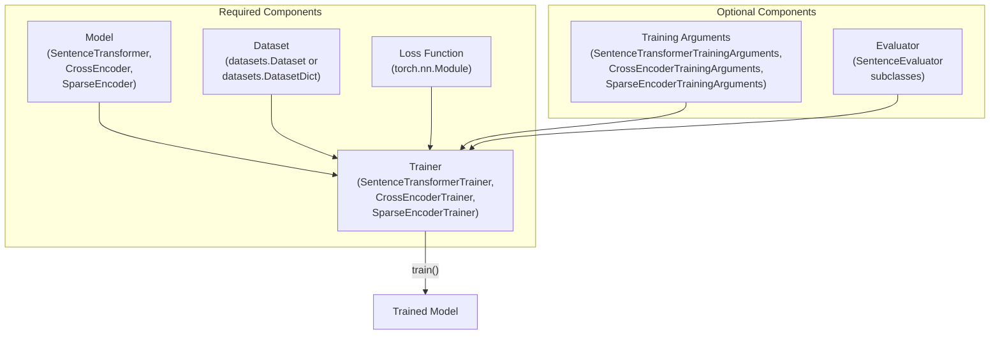
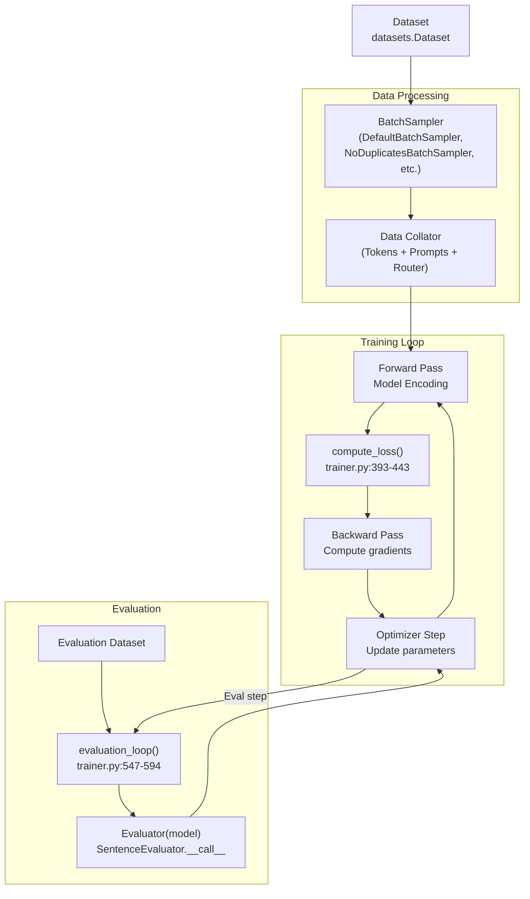
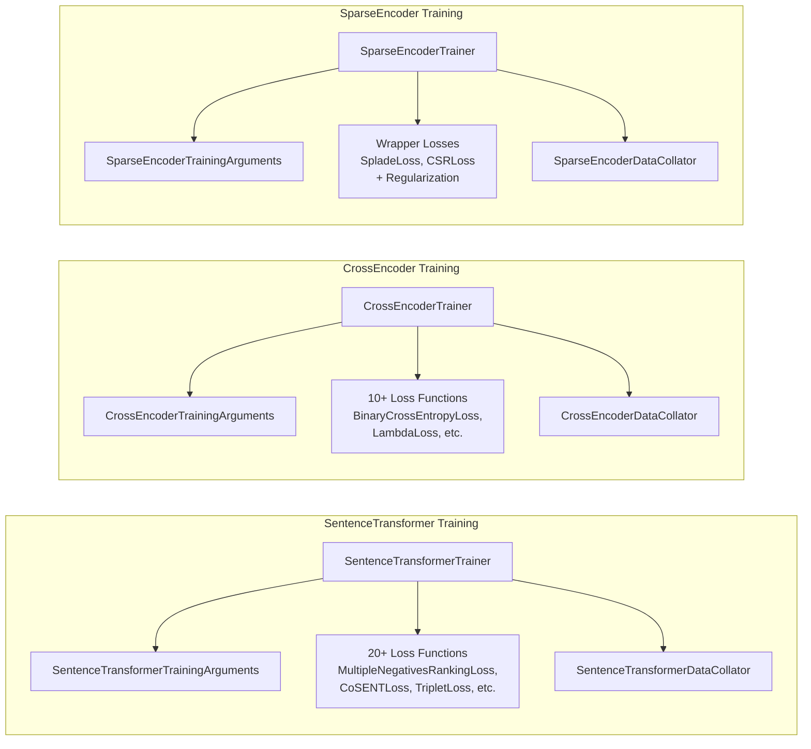
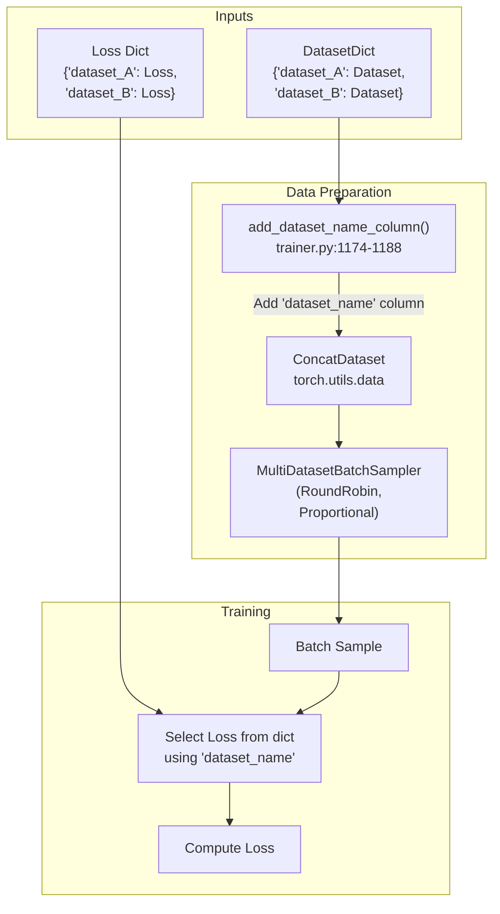

<!-- source: DeepWiki mcp.deepwiki.com · repo huggingface/sentence-transformers · page 5.1 Training Overview · fetched 2026-10-26 -->

# Training Overview

<details>
<summary>Relevant source files</summary>

The following files were used as context for generating this wiki page:

- [docs/cross_encoder/training_overview.md](docs/cross_encoder/training_overview.md)
- [docs/sentence_transformer/training_overview.md](docs/sentence_transformer/training_overview.md)
- [docs/sparse_encoder/training_overview.md](docs/sparse_encoder/training_overview.md)
- [examples/sentence_transformer/training/matryoshka/README.md](examples/sentence_transformer/training/matryoshka/README.md)
- [sentence_transformers/base/training_args.py](sentence_transformers/base/training_args.py)
- [sentence_transformers/cross_encoder/trainer.py](sentence_transformers/cross_encoder/trainer.py)
- [sentence_transformers/sentence_transformer/trainer.py](sentence_transformers/sentence_transformer/trainer.py)
- [sentence_transformers/sparse_encoder/trainer.py](sentence_transformers/sparse_encoder/trainer.py)

</details>


This page explains the six core components required to train sentence transformer models and how they interact within the training system. For detailed information about specific components, see [Dataset Preparation](#5.2), [Loss Functions](#5.3), [Training Configuration](#5.4), and [The Trainer System](#5.5).

## Six-Component Architecture

Training any sentence transformer model (SentenceTransformer, CrossEncoder, or SparseEncoder) requires assembling six components:



**Diagram: Six-Component Training Architecture**

The `Trainer` class orchestrates all components. It receives the model, dataset, loss function, and optional arguments/evaluator, then executes the training loop via the `train()` method.

---

## Component Details

### 1. Model

**Code Entities:**
- `SentenceTransformer` ([sentence_transformers/sentence_transformer/model.py:20-140]())
- `CrossEncoder` ([sentence_transformers/cross_encoder/model.py:18-110]())
- `SparseEncoder` ([sentence_transformers/sparse_encoder/model.py:15-110]())

The model must be instantiated before training.

- **SentenceTransformer:** Consists of a sequence of `Modules` such as `Transformer` and `Pooling` that encodes inputs into embeddings. You can load a pretrained model via:

  ```python
  from sentence_transformers import SentenceTransformer
  model = SentenceTransformer("sentence-transformers/all-MiniLM-L6-v2")
  ```

  Or build from modules:

  ```python
  from sentence_transformers import SentenceTransformer
  from sentence_transformers.sentence_transformer.modules import Transformer, Pooling

  transformer = Transformer("bert-base-uncased", model_kwargs={"torch_dtype": "float32"})
  pooling = Pooling(transformer.get_embedding_dimension(), pooling_mode="mean")
  model = SentenceTransformer(modules=[transformer, pooling])
  ```

- **CrossEncoder:** Wraps autoregressive or sequence classification Hugging Face transformers models, optionally with a classification or regression head for pairwise tasks. Usually instantiated with:

  ```python
  from sentence_transformers import CrossEncoder
  model = CrossEncoder("cross-encoder/ms-marco-MiniLM-L6-v2")
  ```

- **SparseEncoder:** Combines masked language modeling transformers with a specialized sparse pooling module (e.g., SPLADE) producing sparse token-level embeddings.

Models with `Router` modules need special mapping via `router_mapping` in training args to route dataset columns to submodules ("query" or "document") during training.

---

### 2. Dataset

**Code Entities:**
- `datasets.Dataset`, `datasets.DatasetDict`, `IterableDataset` ([datasets library API](https://huggingface.co/docs/datasets/))

The training dataset must be a `datasets.Dataset` for single datasets or a `DatasetDict` for multi-dataset training.

- **Format Requirements:**

  - Columns named `"label"`, `"labels"`, `"score"`, or `"scores"` are interpreted as targets (labels for the loss).
  - All other columns are treated as input texts or tokens.
  - Column order determines anchor, positive, negative relationships for some losses.
  - Reserved columns `"return_loss"` and `"dataset_name"` should not be used by datasets.
  
The trainer facilitates multi-dataset training by concatenating datasets internally and adding a `"dataset_name"` column for loss routing.

---

### 3. Loss Function

**Code Entities:** Various subclasses of `torch.nn.Module` in `sentence_transformers.sentence_transformer.losses`, `cross_encoder.losses`, and `sparse_encoder.losses`

Loss determines the training objective and interprets batch data.

- Can be a single loss instance, e.g.,

  ```python
  from sentence_transformers.sentence_transformer.losses import CoSENTLoss
  loss = CoSENTLoss(model=model)
  ```
  
- Can be a dictionary mapping dataset names to distinct losses (for multi-dataset training).

- Can be a callable returning a new loss instance given the model (useful in hyper-parameter search).

Default losses if not provided:
- `CoSENTLoss` (SentenceTransformer)
- `BinaryCrossEntropyLoss` (CrossEncoder)
- `SpladeLoss` and `SparseMultipleNegativesRankingLoss` composed for SparseEncoder

---

### 4. Training Arguments

**Code Entities:**
- `SentenceTransformerTrainingArguments` ([sentence_transformers/sentence_transformer/training_args.py:24-150]())
- `CrossEncoderTrainingArguments` ([sentence_transformers/cross_encoder/training_args.py:25-184]())
- `SparseEncoderTrainingArguments` ([sentence_transformers/sparse_encoder/training_args.py:25-180]())

These extend `transformers.TrainingArguments` with additional parameters specific to sentence transformer training, e.g.:

| Parameter              | Description                                                                                          |
|------------------------|--------------------------------------------------------------------------------------------------|
| `batch_sampler`        | Controls batch sampling strategies (e.g., `NO_DUPLICATES`, `GROUP_BY_LABEL`)                       |
| `multi_dataset_batch_sampler` | Controls multi-dataset sampling strategy (e.g., `ROUND_ROBIN`, `PROPORTIONAL`)                 |
| `prompts`              | Text or dict of text prompts prepended to dataset columns                                         |
| `router_mapping`       | Maps dataset columns to router routes (e.g., `"query"` or `"document"`) for asymmetric models    |
| `learning_rate_mapping`| Maps regex parameter names to learning rates for fine-grained tuning                              |

Usage example for router mapping:

```python
args = SentenceTransformerTrainingArguments(
    output_dir="output_dir",
    router_mapping={"query_text": "query", "doc_text": "document"}
)
```

---

### 5. Evaluator

**Code Entities:** `BaseEvaluator` ([sentence_transformers.base.evaluation.BaseEvaluator]()), various subclasses like `EmbeddingSimilarityEvaluator`, `InformationRetrievalEvaluator`, `NanoBEIREvaluator`

Evaluators measure task-relevant metrics during or after training.

- They run during training based on `eval_strategy` (`"steps"`, `"epoch"`, or `"no"`).
- Multiple evaluators can be combined with `SequentialEvaluator`.
- In distributed setups, evaluation runs only on the rank 0 device.
- After evaluation, metrics are logged and can be used to save the best checkpoint.

---

### 6. Trainer

**Code Entities:**
- `SentenceTransformerTrainer` ([sentence_transformers/sentence_transformer/trainer.py:35-135]())
- `CrossEncoderTrainer` ([sentence_transformers/cross_encoder/trainer.py:34-93]())
- `SparseEncoderTrainer` ([sentence_transformers/sparse_encoder/trainer.py:35-92]())

Each trainer extends `transformers.Trainer` and adapts it for each model type by:

- Applying the appropriate data collator (`SentenceTransformerDataCollator`, `CrossEncoderDataCollator`, or `SparseEncoderDataCollator`).
- Handling multi-dataset training by concatenating datasets with added `"dataset_name"` columns.
- Manages loss functions, routing to the correct loss if multiple defined.
- Supports callback integration for tracking (e.g., model card generation, logging).
- Overwrites the `compute_loss()` function to accept model outputs and batch data for correct loss invocation.
- Supports Router modules and loss dictionaries that return multiple components to track and log.

---

## Training Loop Data Flow



**Diagram: Training Loop Data Flow**

This flow describes:

1. **Dataset Sampling:** Controlled by batch samplers.
2. **Data Collation:** Batches are tokenized, prompts added, and routed according to config.
3. **Forward Pass:** The model generates features or predictions.
4. **Loss Computation:** Loss is calculated using batch data and model output.
5. **Backward Pass and Optimization:** Gradients are computed and applied.
6. **Evaluation:** Runs periodically based on `eval_strategy`.

---

## Model Type Variants and Their Training Systems



### SentenceTransformer Training

- Uses backbones like BERT, RoBERTa with pooling modules.
- Supports batch samplers including no-duplicates samplers.
- Supports complex losses (contrastive, triplet, regression, etc.).
- Supports Router modules for asymmetric encoding.
- Has specialized training arguments to control prompts, learning rates, and sampling.

### CrossEncoder Training

- Models wrap Transformer sequence-classification heads or causal LM backbones.
- Supports regression or multi-class outputs (e.g., reranking or pair classification).
- Losses suited for classification and ranking (binary cross-entropy, lambda loss).
- Data collator combines input pairs before tokenization for efficiency.

### SparseEncoder Training

- Combines MLM Transformers and SpladePooling for sparse representations.
- Requires wrapper losses which combine ranking and sparsity regularizers.
- Adds regularization weight scheduler callbacks automatically.
- Supports asymmetric models with Router module.

---

## Multi-Dataset Training

When training on multiple datasets, the `train_dataset` and `eval_dataset` arguments accept `DatasetDict` objects keyed by dataset names.



**Diagram: Multi-Dataset Training Data Flow**

The trainer handles:
- Adding a `"dataset_name"` column
- Concatenating datasets for unified sampling
- Using multi-dataset batch samplers
- Routing batches to appropriate losses by dataset name

---

## Router Module Integration

The `Router` module enables asymmetric architectures (e.g., different handling of queries vs documents).

- **Training Argument:** `router_mapping` specifies dataset column to router route mapping:

  ```python
  router_mapping = {
    "query_column": "query",
    "document_column": "document"
  }
  ```

- **Data Collation:** Uses router mapping to pass routing info (`task` keyword) during tokenization.

- **Loss Functions:** Expect features routed by the router, e.g., separate query/document embeddings.

- **Evaluators:** Support encoding queries and documents separately (`encode_query()`, `encode_document()`).

Router mapping must be consistent across all components in training and evaluation.

---

## Loss Component Tracking

Loss functions may return a dictionary of multiple loss components:

```python
{
    "main_loss": tensor(0.5),
    "regularization_loss": tensor(0.1),
    "flops_loss": tensor(0.05)
}
```

Trainer behavior for such outputs:

1. Sum all components to form the total loss for backpropagation.
2. Accumulate each component's scalar value for logging and analysis.
3. Report each component separately in progress bars and logs.

This behavior is essential for training SparseEncoder models with sparsity regularization losses.

---

## Model Card Generation

The trainer automatically integrates model card generation via the `SentenceTransformerModelCardCallback`:

- Added automatically or can be manually inserted in the callback list.
- Gathers training metadata, loss configurations, datasets, and evaluation results.
- Generates a readable `README.md` model card when `save_pretrained()` is called.
- Supports custom templates and metadata, including environmental info like carbon emissions if `codecarbon` is installed.

---

# Summary

| Component          | Role                                                                                     | Code Entities / Locations                              |
|--------------------|------------------------------------------------------------------------------------------|-------------------------------------------------------|
| **Model**          | Defines the architecture and forward pass                                               | `SentenceTransformer` ([.sentence_transformer/model.py])<br>`CrossEncoder` ([.cross_encoder/model.py])<br>`SparseEncoder` ([.sparse_encoder/model.py]) |
| **Dataset**        | Source of training data, single or multi-dataset                                         | `datasets.Dataset` and `DatasetDict` (external lib)   |
| **Loss**           | Training objective, computing loss from model output and batch data                      | Various loss classes in `sentence_transformers.losses` modules |
| **Training Args**  | Configuration parameters extending Transformers' arguments for sampling, routing, prompts | `SentenceTransformerTrainingArguments` ([base/training_args.py]) |
| **Evaluator**      | Compute metrics during and after training                                               | `BaseEvaluator` subclasses                             |
| **Trainer**        | Coordinates training loop, batching, loss computation, evaluation, and callbacks         | `SentenceTransformerTrainer` and siblings              |

---

This layered, modular system enables flexible, scalable training of diverse sentence transformer model architectures tailored for specific use cases, datasets, and objectives.

---

**Sources:**
- [docs/sentence_transformer/training_overview.md:1-155]()
- [sentence_transformers/sentence_transformer/trainer.py:36-135]()
- [sentence_transformers/cross_encoder/trainer.py:34-93]()
- [sentence_transformers/sparse_encoder/trainer.py:35-92]()
- [sentence_transformers/base/training_args.py:24-144]()
- [sentence_transformers/trainer.py:59-128]()
- [sentence_transformers/trainer.py:293-348]()
- [sentence_transformers/trainer.py:394-496]()
- [sentence_transformers/trainer.py:547-594]()
- [sentence_transformers/data_collator.py:35-119]()
- [sentence_transformers/models/Router.py:20-54]()

---

