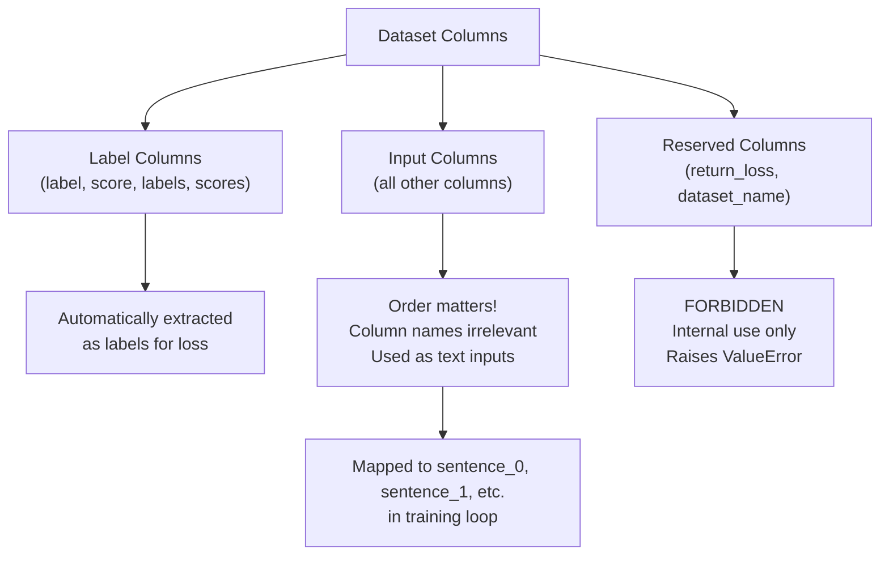
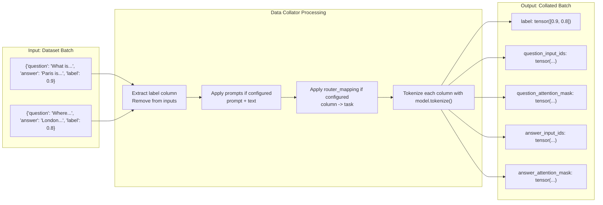
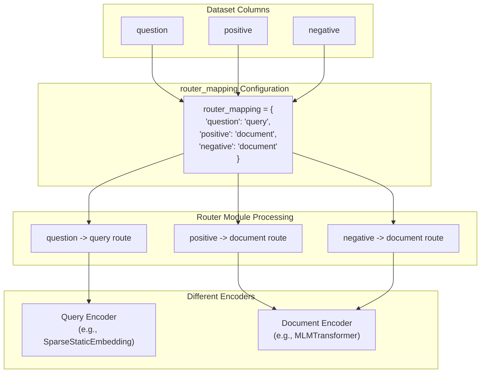
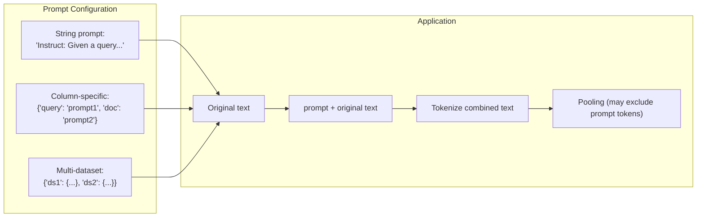
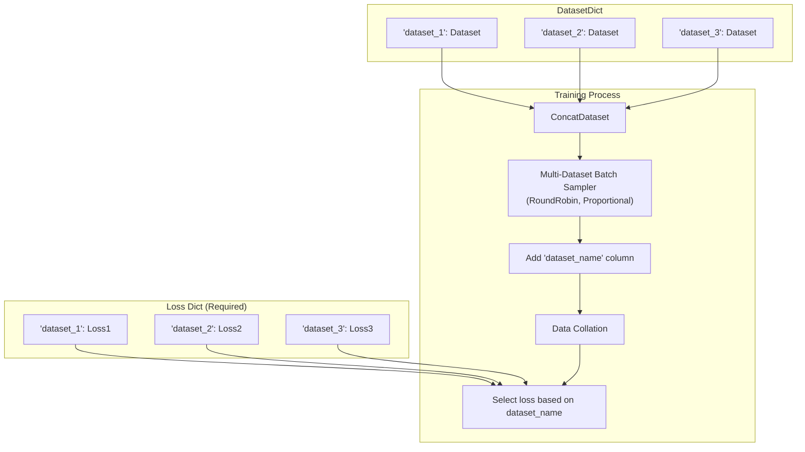
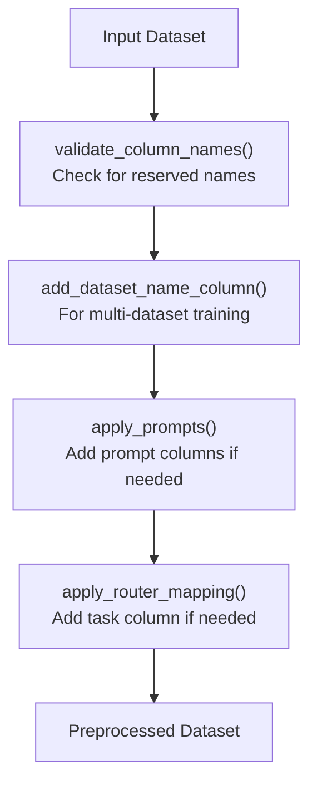

<!-- source: DeepWiki mcp.deepwiki.com · repo huggingface/sentence-transformers · page 5.2 Dataset Preparation · fetched 2026-10-26 -->

# Dataset Preparation

<details>
<summary>Relevant source files</summary>

The following files were used as context for generating this wiki page:

- [docs/cross_encoder/training_overview.md](docs/cross_encoder/training_overview.md)
- [docs/sentence_transformer/training_overview.md](docs/sentence_transformer/training_overview.md)
- [docs/sparse_encoder/training_overview.md](docs/sparse_encoder/training_overview.md)
- [examples/sentence_transformer/training/matryoshka/README.md](examples/sentence_transformer/training/matryoshka/README.md)
- [sentence_transformers/sentence_transformer/losses/cached_gist_embed.py](sentence_transformers/sentence_transformer/losses/cached_gist_embed.py)
- [sentence_transformers/sentence_transformer/losses/gist_embed.py](sentence_transformers/sentence_transformer/losses/gist_embed.py)
- [sentence_transformers/util/hard_negatives.py](sentence_transformers/util/hard_negatives.py)
- [skills/train-sentence-transformers/references/dataset_formats.md](skills/train-sentence-transformers/references/dataset_formats.md)
- [tests/sentence_transformer/losses/test_cached_gist_embed.py](tests/sentence_transformer/losses/test_cached_gist_embed.py)
- [tests/sentence_transformer/losses/test_gist_embed.py](tests/sentence_transformer/losses/test_gist_embed.py)
- [tests/util/test_hard_negatives.py](tests/util/test_hard_negatives.py)

</details>


## Overview

This page describes how to prepare datasets for training Sentence Transformer, Cross Encoder, and Sparse Encoder models. Dataset preparation involves loading data from various sources, ensuring the correct format and column structure, and configuring special settings like prompts and router mappings.

For information about the overall training workflow and how datasets fit into the training process, see [Training Overview](#5.1). For details on matching dataset formats to loss functions, see [Loss Functions](#5.3).

## Supported Dataset Types

The trainers (`SentenceTransformerTrainer`, `CrossEncoderTrainer`, `SparseEncoderTrainer`) accept datasets in the following formats:

| Type                  | Description                          | Use Case                          |
|-----------------------|------------------------------------|----------------------------------|
| `datasets.Dataset`     | Single dataset with named columns  | Standard training with one dataset|
| `datasets.DatasetDict` | Dict mapping names to datasets     | Multi-dataset training            |
| `datasets.IterableDataset` | Streaming dataset               | Training with very large datasets |
| `dict[str, Dataset]`  | Python dictionary of datasets      | Alternative to DatasetDict        |

All three trainer types share these dataset requirements. The trainer converts Python dicts into DatasetDict automatically.

---

## Loading Data from Different Sources

### From Hugging Face Hub

Load datasets directly with the `datasets` library:

```python
from datasets import load_dataset

train_dataset = load_dataset("sentence-transformers/all-nli", "pair-score", split="train")
eval_dataset = load_dataset("sentence-transformers/all-nli", "pair-score", split="dev")
```

Datasets with the `sentence-transformers` tag are designed for direct use:  
`https://huggingface.co/datasets?other=sentence-transformers`

### From Local Files

You may load CSV, JSON, Parquet, or Arrow files as datasets:

```python
dataset = load_dataset("csv", data_files="my_file.csv")
# or
dataset = load_dataset("json", data_files="my_file.json")
```

### From Custom Data with Preprocessing

You can build datasets manually by creating lists of texts and converting them:

```python
from datasets import Dataset

anchors = [...]
positives = [...]

dataset = Dataset.from_dict({
    "anchor": anchors,
    "positive": positives,
})
```

Keys become column names and the order of keys determines the input order.

---

## Dataset Format Requirements

Datasets must fit certain structural requirements for correct use with losses.



### Key Rules

- **Label Columns:** Columns named `"label"`, `"score"`, `"labels"`, or `"scores"` are detected automatically and treated as labels for training. Only one such column should exist.

- **Input Columns:** All other columns (excluding reserved names) are treated as textual inputs. The *order* of these columns matters to the model and loss; the *names* do not. For example, if columns are `["question", "answer", "label"]`, "question" is input 0 and "answer" input 1.

- **Reserved Columns:** The columns `"return_loss"` and `"dataset_name"` are reserved internally and must not be present in your input dataset; otherwise, a `ValueError` is raised.

- **Column Ordering:** If your dataset columns are not ordered correctly, use `dataset.select_columns()` to reorder them to match the loss expectations.

---

### Column Name Validation

The trainer validates the presence and correctness of column names during initialization, including both the training and evaluation datasets. If reserved names appear, the initialization fails immediately with recommendations.

Example error:

```python
# This will raise a ValueError due to the reserved column "return_loss"
invalid_dataset = dataset.rename_column("sentence1", "return_loss")
trainer = SentenceTransformerTrainer(model=model, train_dataset=invalid_dataset)
```

---

### IterableDataset and Features

If using `datasets.IterableDataset`, explicit `Features` must be provided with the expected column schema. Missing Features cause the trainer to raise a detailed error indicating the columns expected, inferred from the first sample.

```python
from datasets import Features, Value

features = Features({
    "text1": Value("string"),
    "text2": Value("string"),
    "label": Value("float32"),
})
iterable_dataset = IterableDataset(...).cast(features)
```

---

## Data Collation Process

The `SentenceTransformerDataCollator` converts batches of dataset rows into the tokenized format expected by models. The process is:



**Detailed Steps:**

1. **Label Extraction:** Detects label columns by names in `valid_label_columns` (default `["label", "score"]`) and extracts them into a `"label"` tensor.

2. **Prompt Application:** If a prompt or prompts dictionary is configured, prefixes the prompt text to the original text entries.

3. **Router Mapping:** For models with a `Router` module, applies a mapping from input column names to task types (e.g., "query" or "document") to control routing per input.

4. **Tokenization:** Uses the model's `tokenize()` method to tokenize each input column into tensors with keys like `{column_name}_input_ids`, `{column_name}_attention_mask`, etc.

The final collated batch contains tokenized features for each input column plus a label tensor if labels are found.

---

### Column Order Warning System

The data collator checks if the input dataset columns appear out of the expected order (e.g., negatives before anchors) by matching column name patterns common in training data. If detected, it issues a user warning suggesting the user reorder the columns to prevent subtle training bugs.

---

## Router Mapping for Asymmetric Models

Models that use the `Router` module require configuration of how dataset columns map to task routes.



### How to Configure

When your model contains a `Router` module, you must supply `router_mapping` in the `SentenceTransformerTrainingArguments`. For example:

```python
from sentence_transformers import SentenceTransformer, SentenceTransformerTrainingArguments
from sentence_transformers.models import Router

router = Router.for_query_document(
    query_modules=[...],      # modules handling queries
    document_modules=[...],   # modules handling documents
)
model = SentenceTransformer(modules=[router])

args = SentenceTransformerTrainingArguments(
    output_dir="output",
    router_mapping={
        "question": "query",
        "positive": "document",
        "negative": "document",
    },
)

trainer = SentenceTransformerTrainer(model=model, args=args, ...)
```

The trainer raises a `ValueError` if `router_mapping` is missing but the model requires it.

---

### Multi-Dataset Router Mappings

For multi-dataset training with different router mappings per dataset, configure:

```python
args = SentenceTransformerTrainingArguments(
    output_dir="output",
    router_mapping={
        "dataset_1": {
            "query": "query",
            "doc": "document",
        },
        "dataset_2": {
            "question": "query",
            "passage": "document",
        },
    }
)
```

The data collator automatically selects the appropriate mapping based on the `"dataset_name"` column.

---

## Prompts for Instruction-Tuned Models

You can augment the raw text inputs with instruction prompts before tokenization.



### Basic Prompt Examples

```python
# Single prompt applied to all columns
args = SentenceTransformerTrainingArguments(
    output_dir="output",
    prompts="Instruct: Given a question, retrieve relevant passages.\nQuery: "
)

# Per-column prompts
args = SentenceTransformerTrainingArguments(
    output_dir="output",
    prompts={
        "query": "Instruct: Given a question, retrieve relevant passages.\nQuery: ",
        "document": "Document: ",
    }
)
```

### Multi-Dataset Prompts

For multi-dataset training:

```python
args = SentenceTransformerTrainingArguments(
    output_dir="output",
    prompts={
        "nli_dataset": {
            "premise": "Premise: ",
            "hypothesis": "Hypothesis: ",
        },
        "qa_dataset": {
            "question": "Question: ",
            "answer": "Answer: ",
        },
    }
)
```

The trainer enforces that nested dictionaries for prompts are only allowed with `DatasetDict` datasets.

---

### Prompt Length Tracking

Pooling modules that remove prompt tokens during pooling require prompt length information.

The data collator tracks prompt lengths automatically if enabled:

```python
# Enabled automatically by trainer when needed
data_collator.include_prompt_lengths = True
```

This adds additional tensor entries `{column}_prompt_length` to the batch, used later to exclude prompt tokens.

---

## Multi-Dataset Training

Multi-dataset training requires combining datasets and losses correctly.



### Setup

1. Provide a `DatasetDict` of datasets keyed by dataset name.
2. Provide a dictionary of losses with matching keys.
3. The trainer injects a `"dataset_name"` column to track data origin for routing and loss selection.

---

### Validation and Safety

- If the loss dictionary lacks keys present in the dataset dict, a `ValueError` is raised.
- If the loss dictionary is provided but `train_dataset` is not a `DatasetDict`, a `ValueError` is raised.
  
Example:

```python
losses_dict = {
    "nli": losses.MultipleNegativesRankingLoss(model),
    # Missing "stsb" key, will raise ValueError
}

trainer = SentenceTransformerTrainer(
    model=model,
    train_dataset=train_datasets,  # DatasetDict with keys "nli", "stsb"
    loss=losses_dict,
)
```

---

### Multi-Dataset Batch Sampling

Control sampling of batches from multiple datasets using `multi_dataset_batch_sampler`:

| Sampler                    | Behavior                                  |
|----------------------------|-------------------------------------------|
| `RoundRobinBatchSampler`    | Alternates evenly between datasets       |
| `ProportionalBatchSampler`  | Samples proportionally to dataset size    |

Configure with:

```python
from sentence_transformers.training_args import MultiDatasetBatchSamplers

args = SentenceTransformerTrainingArguments(
    output_dir="output",
    multi_dataset_batch_sampler=MultiDatasetBatchSamplers.ROUND_ROBIN,
)
```

For more information, see batch sampling details in [Batch Sampling Strategies](#8.4).

---

## Dataset Preprocessing in Trainer

The trainer performs automatic dataset preprocessing:



This pipeline is triggered automatically during trainer initialization for both training and evaluation datasets.

---

### `"dataset_name"` Column

When using multi-dataset training, the trainer adds a `"dataset_name"` column to all dataset splits to tag samples with their dataset key. This column is used for loss selection and router mapping.

Before preprocessing:

```python
DatasetDict({
    "nli": Dataset({"sentence1": [...], "sentence2": [...]}),
    "stsb": Dataset({"sentence1": [...], "sentence2": [...]}),
})
```

After preprocessing:

```python
DatasetDict({
    "nli": Dataset({"sentence1": [...], "sentence2": [...], "dataset_name": "nli"}),
    "stsb": Dataset({"sentence1": [...], "sentence2": [...], "dataset_name": "stsb"}),
})
```

---

# Summary

Successful dataset preparation for training in the sentence-transformers codebase requires:

- Using supported dataset types with well-structured named columns
- Ensuring column names and order conform to loss expectations
- Providing explicit features for iterable datasets
- Optionally using prompts to prefix text for instruction-tuned models
- Configuring `router_mapping` for asymmetric models that route inputs to different subnetworks
- Correctly handling multi-dataset training setup with matching dataset and loss dicts
- Allowing the trainer to preprocess datasets to add dataset names, validate columns, and apply prompts/router mappings

By following these guidelines, you ensure smooth integration with the training components and correct batching, loss computation, and evaluation.

---

Sources:  
- [docs/sentence_transformer/training_overview.md:136-247]()  
- [docs/cross_encoder/training_overview.md:83-192]()  
- [sentence_transformers/trainer.py:129-234, 200-280, 297-326, 613-623, 687-722]()  
- [sentence_transformers/sparse_encoder/trainer.py:100-211, 188-206]()  
- [sentence_transformers/data_collator.py:1-172]()  
- [sentence_transformers/models/Router.py:42-54]()  
- [tests/models/test_router.py:414-451]()  
- [tests/util/test_hard_negatives.py:10-190]()  
- [skills/train-sentence-transformers/references/dataset_formats.md]()

---

