<!-- source: DeepWiki mcp.deepwiki.com · repo huggingface/sentence-transformers · page 5.3 Loss Functions · fetched 2026-10-26 -->

# Loss Functions

<details>
<summary>Relevant source files</summary>

The following files were used as context for generating this wiki page:

- [docs/cross_encoder/loss_overview.md](docs/cross_encoder/loss_overview.md)
- [docs/package_reference/cross_encoder/losses.md](docs/package_reference/cross_encoder/losses.md)
- [docs/package_reference/sparse_encoder/losses.md](docs/package_reference/sparse_encoder/losses.md)
- [docs/sentence_transformer/loss_overview.md](docs/sentence_transformer/loss_overview.md)
- [docs/sparse_encoder/loss_overview.md](docs/sparse_encoder/loss_overview.md)
- [examples/cross_encoder/training/ms_marco/README.md](examples/cross_encoder/training/ms_marco/README.md)
- [examples/cross_encoder/training/ms_marco/training_ms_marco_adrmse.py](examples/cross_encoder/training/ms_marco/training_ms_marco_adrmse.py)
- [sentence_transformers/cross_encoder/__init__.py](sentence_transformers/cross_encoder/__init__.py)
- [sentence_transformers/cross_encoder/evaluation/__init__.py](sentence_transformers/cross_encoder/evaluation/__init__.py)
- [sentence_transformers/cross_encoder/losses/__init__.py](sentence_transformers/cross_encoder/losses/__init__.py)
- [sentence_transformers/sentence_transformer/__init__.py](sentence_transformers/sentence_transformer/__init__.py)
- [sentence_transformers/sparse_encoder/__init__.py](sentence_transformers/sparse_encoder/__init__.py)
- [sentence_transformers/sparse_encoder/losses/__init__.py](sentence_transformers/sparse_encoder/losses/__init__.py)

</details>


Loss functions quantify how well a model performs on a batch of training data by producing a scalar loss value that guides the optimizer to update model weights. This page provides a high-level overview of the loss function architecture, selection criteria, and available implementations for all three core model types in the sentence-transformers library: SentenceTransformer (dense), CrossEncoder, and SparseEncoder.

For detailed selection guidance tailored to your dataset format and model type, please refer to the child pages and related resources:

- [Dense Model Loss Functions](#5.3.1) — Detailed reference for SentenceTransformer loss functions (contrastive, triplet, regression, cached variants)
- [Sparse Model Loss Functions](#5.3.2) — Detailed reference for SparseEncoder loss functions (SpladeLoss, CSRLoss, regularizers, architecture)
- CrossEncoder losses are documented in the [Cross Encoder Training Overview](docs/cross_encoder/training_overview.md) and [Cross Encoder Loss Overview](docs/cross_encoder/loss_overview.md)

For dataset preparation requirements compatible with these losses, see [Dataset Preparation](#5.2).

---

## Loss Function Architecture

All loss functions in the library inherit from PyTorch's `nn.Module` and follow a consistent architectural pattern. During training, tokenized input features and optional labels are passed to the loss function, which computes model embeddings, calculates similarities or distances, and returns a scalar loss or a dict of loss components for multi-part losses.

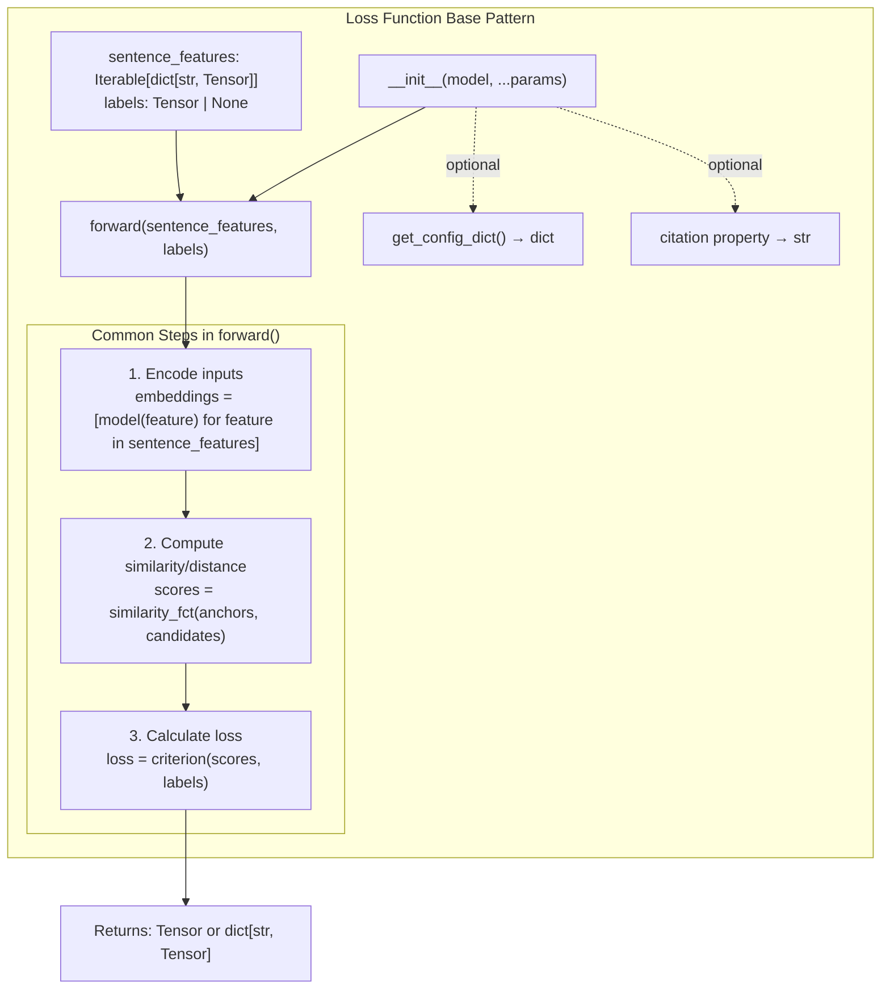

The `forward` method receives:
- `sentence_features`: A list of dictionaries representing tokenized batches, one per input column from the dataset excluding labels.
- `labels`: Optional tensor derived from dataset label columns such as "label", "labels", "score", or "scores".

Some losses return a single scalar tensor; others (e.g., multi-part losses like SpladeLoss) return a dict mapping loss component names to tensors for detailed logging and debugging.

Sources: [sentence_transformers/losses/MultipleNegativesRankingLoss.py:111-116](), [docs/sentence_transformer/loss_overview.md:55-70]()

---

## Loss Function Selection

The choice of loss function depends primarily on:

1. Your **dataset format** (number and type of input columns)
2. The **type of labels** available (none, binary, class, float similarity scores)
3. The **model architecture** you are training (SentenceTransformer, CrossEncoder, SparseEncoder)

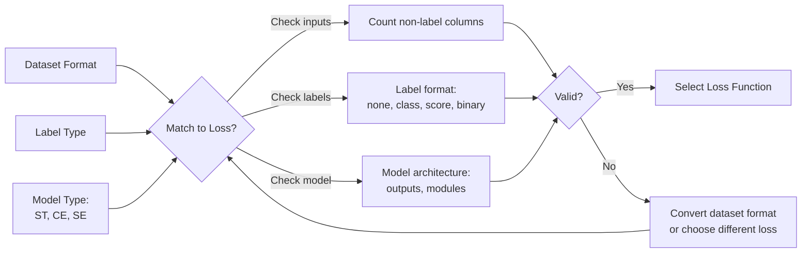

### Dataset Format Matching Rules

- **Non-label columns** are treated as *inputs* to the model. The count and order should match the expected inputs of the loss function.
- **Label columns** named `"label"`, `"labels"`, `"score"`, or `"scores"` serve as supervision signals.
- To reorder or select dataset columns, use `Dataset.select_columns()`.

| Dataset Columns Example          | Inputs Count | Label Type                  | Typical Compatible Loss Functions                         |
|---------------------------------|--------------|-----------------------------|-----------------------------------------------------------|
| `[anchor, positive]`             | 2            | none                        | `MultipleNegativesRankingLoss`, `MultipleNegativesSymmetricRankingLoss` |
| `[text1, text2, score]`          | 2            | float similarity (0 to 1)   | `CoSENTLoss`, `AnglELoss`, `CosineSimilarityLoss`          |
| `[anchor, positive, negative]`  | 3            | none                        | `MultipleNegativesRankingLoss`, `TripletLoss`, `GISTEmbedLoss` |
| `[sentence1, sentence2, label]` | 2            | categorical class           | `SoftmaxLoss` (SentenceTransformer), `CrossEntropyLoss` (CrossEncoder) |
| `[text1, text2, binary]`         | 2            | binary (0 or 1)             | `ContrastiveLoss`, `BinaryCrossEntropyLoss` (CrossEncoder) |

Sources: [docs/sentence_transformer/training_overview.md:231-247](), [docs/cross_encoder/training_overview.md:174-192]()

---

## Families of Loss Functions

Loss functions grouped by typical objectives and input requirements.

### Contrastive Learning Family

Contrastive losses learn embeddings such that positive pairs are closer than negatives, often leveraging in-batch negatives for better training signal.

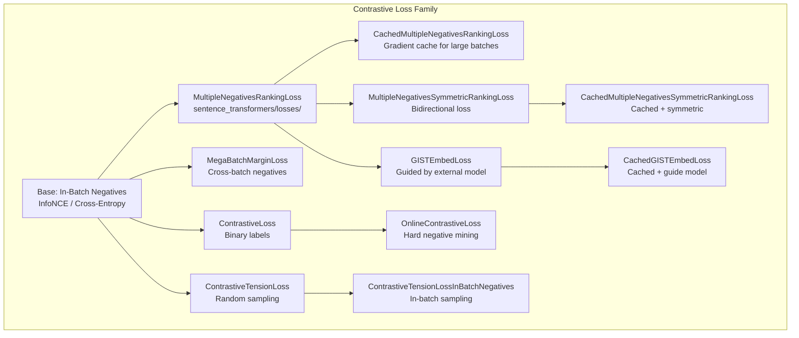

- **MultipleNegativesRankingLoss (MNRL)**: Most common loss for training sentence embeddings. Uses `(anchor, positive)` pairs and treats other positives in batch as negatives.
    - Supports optional explicit negatives.
    - Parameters include similarity function, temperature scaling, and device synchronization.
    - Recommended with batch sampling strategies that avoid duplicates for best performance.

- **CachedMultipleNegativesRankingLoss**: Uses gradient caching (GradCache algorithm) to enable very large effective batch sizes with constant memory.
    - Slightly slower (~2-2.4x) than MNRL but yields better performance.
    - Accepts a `mini_batch_size` parameter controlling memory use.
    - Cannot be used with static embeddings.

- **GISTEmbedLoss**: Applies a guide model to filter false negatives, improving training signal quality at cost of extra compute.
    - Useful to train stronger candidates without explicit hard negative mining.

Sources: [sentence_transformers/losses/MultipleNegativesRankingLoss.py](), [sentence_transformers/losses/CachedMultipleNegativesRankingLoss.py](), [sentence_transformers/losses/GISTEmbedLoss.py](), [sentence_transformers/losses/MultipleNegativesSymmetricRankingLoss.py]()

---

### Triplet Loss Family

Triplet losses focus on relative distances, enforcing `d(anchor,positive) + margin < d(anchor,negative)`.

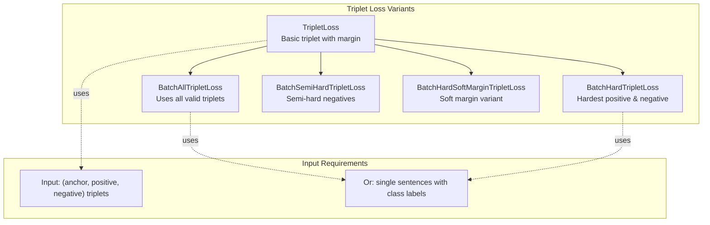

- Basic `TripletLoss` requires explicit triplet inputs.
- Batch variant triplet losses take single-sentence inputs with class labels and automatically form triplets inside batches.
- Variants differ in how they select the hardest or semi-hard negatives to focus the training signal.

Sources: [docs/sentence_transformer/loss_overview.md:14-15]()

---

### Regression Loss Family

Regression losses work with similarity scores (continuous values in [0,1]) to train the model to predict similarity accurately.

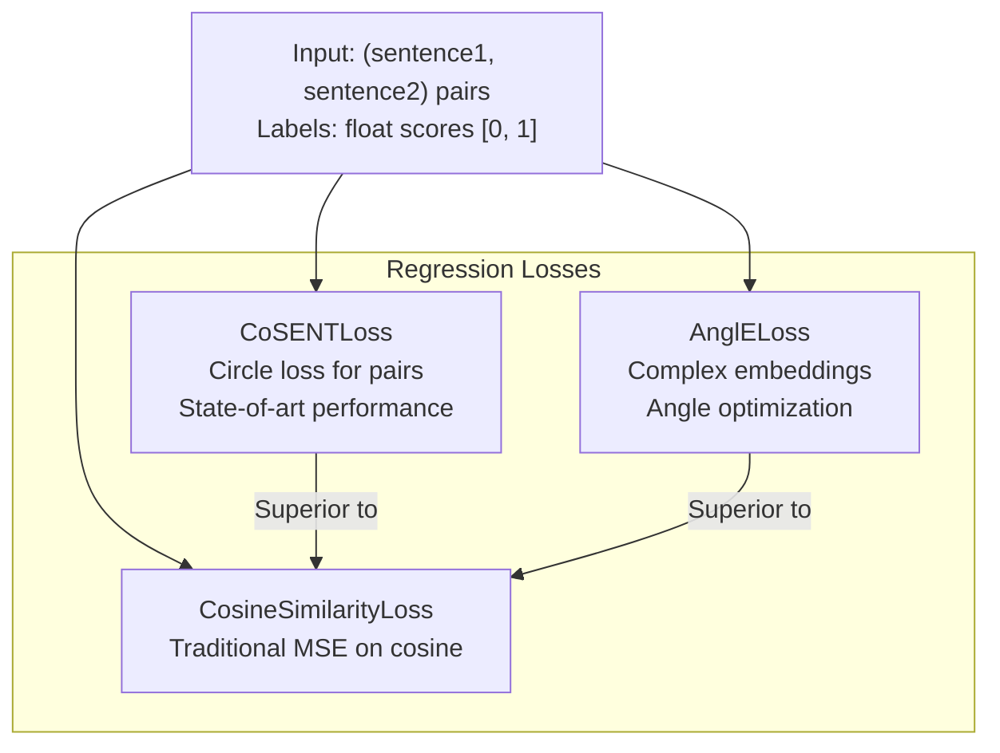

- `CoSENTLoss`: Recommended for regression-based training due to superior performance using circle loss.
- `AnglELoss`: Competitive and uses complex-valued embeddings to optimize angles.
- `CosineSimilarityLoss`: Classic MSE loss on cosine similarity, still used for simplicity.

Sources: [docs/sentence_transformer/loss_overview.md:22](), [docs/sentence_transformer/training_overview.md:239-243]()

---

### Distillation Loss Family

Distillation losses train a student model to mimic a teacher’s outputs, typically embeddings or similarity distributions.

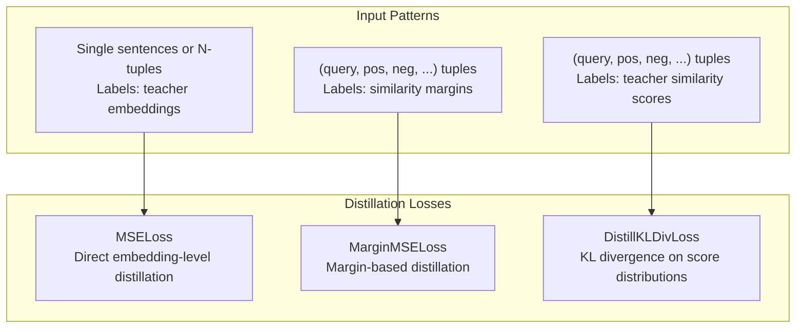

- `MSELoss`: Matches student embeddings directly to teacher embeddings.
- `MarginMSELoss`: Matches relative similarity margins, encouraging correct ordering.
- `DistillKLDivLoss`: Matches teacher similarity score distributions via KL divergence for richer supervision.

Sources: [docs/sentence_transformer/loss_overview.md:36-48]()

---

### Loss Modifiers

Loss modifiers wrap standard loss functions to produce models with special properties.

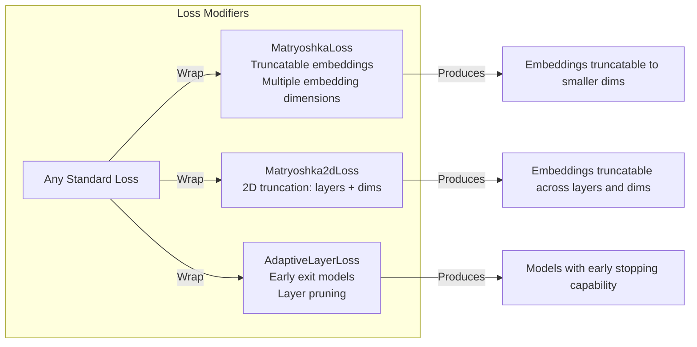

- `MatryoshkaLoss`: Enables trained models to output embeddings that can be truncated at different dimensions with minimal quality loss (useful for candidate retrieval speed trade-offs).
- `AdaptiveLayerLoss`: Enables models to cope with removal of transformer layers, facilitating adaptive inference latency.

Sources: [docs/sentence_transformer/loss_overview.md:26-35]()

---

## Sparse Encoder Loss Architecture

SparseEncoder losses require a special wrapper approach that combines a main loss with sparsity regularization.

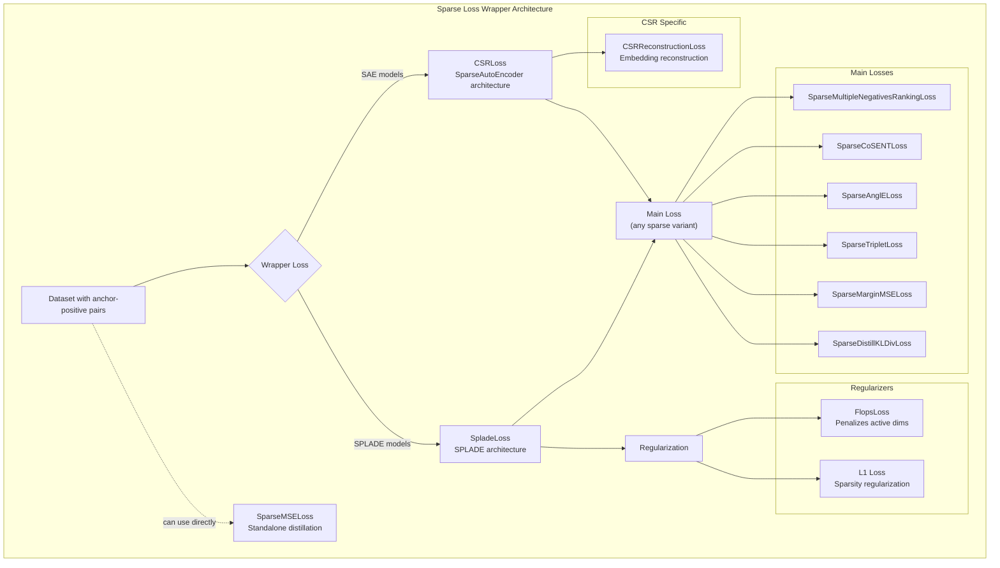

- `SpladeLoss`: Wraps main sparse loss and adds regularization (via `FlopsLoss` or custom regularizers) to enforce sparsity differently on queries and documents.
- `CSRLoss`: Required when using `SparseAutoEncoder` modules, adds reconstruction loss on top of contrastive main loss.
- `SparseMSELoss`: Standalone distillation loss used without wrappers to train sparse encoders by copying sparse teacher embeddings.

Sources: [docs/sparse_encoder/loss_overview.md:1-27](), [docs/sparse_encoder/loss_overview.md:43-70]()

---

## Cached Loss Variants with Gradient Caching

Certain loss functions (e.g., cached multiple negatives variants) use gradient caching (based on GradCache) to support much larger batch sizes without increasing GPU memory.

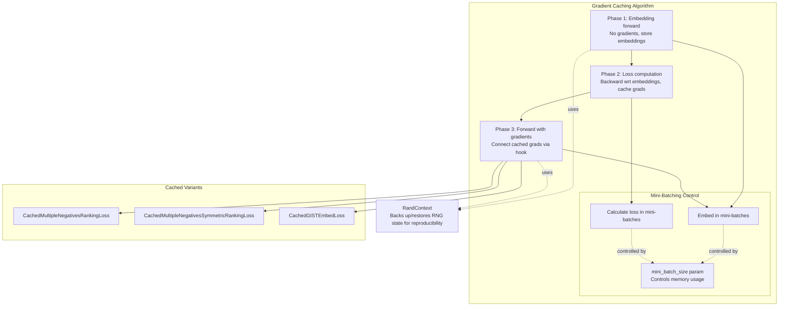

- The forward pass is split into two phases: 
  1. A no-gradient mini-batch forward producing embeddings
  2. A full loss computation with cached gradients w.r.t. embeddings
  3. A second forward pass with gradients connected via backward hook to cached gradients.

- This allows training with batch sizes up to thousands while keeping memory constant.

- The trade-off is training speed (~2-2.4x slower due to double forward passes) but with improved convergence and performance from very large batches.

Sources: [sentence_transformers/losses/CachedMultipleNegativesRankingLoss.py:42-67](), [sentence_transformers/losses/CachedMultipleNegativesRankingLoss.py:85-97](), [sentence_transformers/losses/CachedGISTEmbedLoss.py:42-66]()

---

## CrossEncoder Losses

CrossEncoder losses operate on input pairs jointly encoded to produce a single scalar or classification per pair.

Key distinctions from SentenceTransformer losses:

- Inputs are concatenated text pairs fed jointly into the model.
- Output is a single prediction per pair (score or class).
- Forward method signature differs, accepting nested lists of texts rather than tokenized features.

| Loss Function                  | Use Case                  | Inputs                        | Labels                      |
|-------------------------------|---------------------------|-------------------------------|-----------------------------|
| `BinaryCrossEntropyLoss`       | Binary classification, reranking | `(text1, text2)` pairs         | Binary (0/1) or float scores|
| `MultipleNegativesRankingLoss` | Reranking                 | `(anchor, positive, ...)`     | none                        |
| `CrossEntropyLoss`             | Multi-class classification| `(text1, text2)` pairs         | Class labels                |
| `LambdaLoss`, `RankNetLoss`    | Learning-to-rank          | `(query, [doc1, ..., docN])`  | Relevance scores            |
| `MSELoss`, `MarginMSELoss`     | Distillation              | Various                      | Teacher scores              |

For full discussion, examples, and API, see the [Cross Encoder Training Overview](docs/cross_encoder/training_overview.md) and detailed loss documentation.

Sources: [docs/cross_encoder/loss_overview.md:1-68](), [docs/cross_encoder/training_overview.md:287-318]()

---

## Creating Custom Loss Functions

Custom loss functions can be implemented for specialized needs but must conform to the standard interface and conventions:

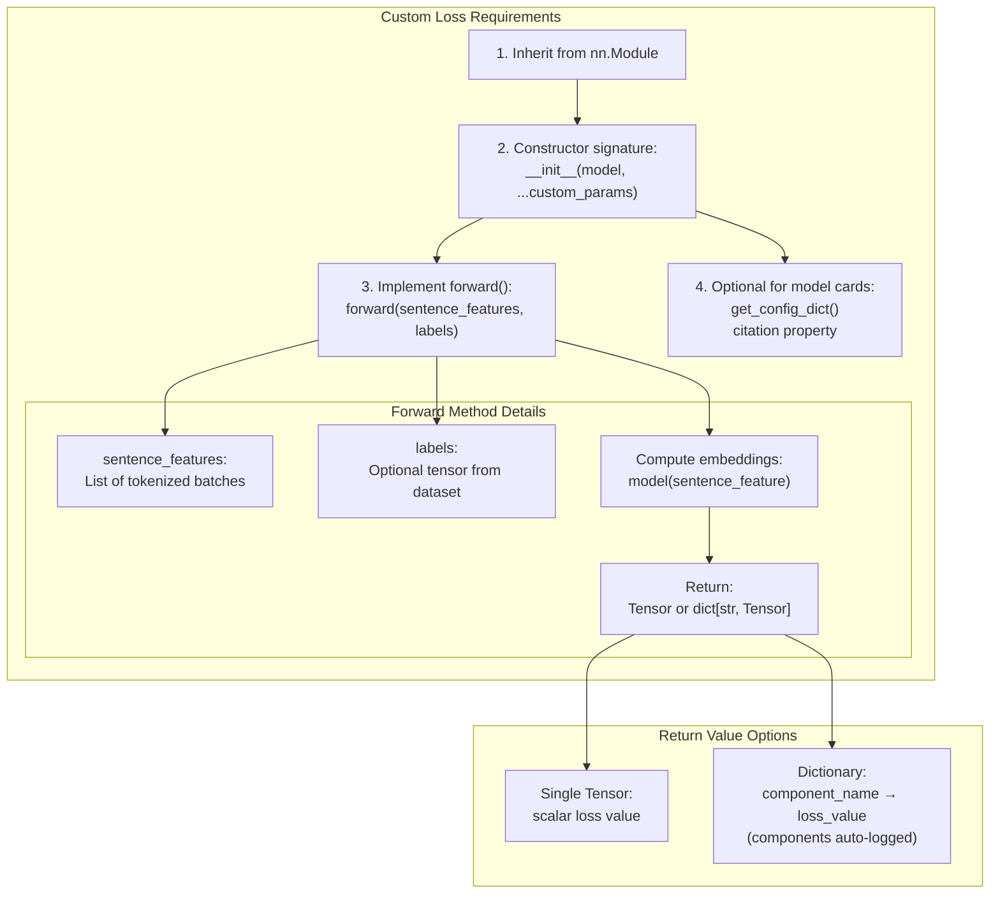

### Minimal Example Pattern

```python
from torch import nn, Tensor
from collections.abc import Iterable

class CustomLoss(nn.Module):
    def __init__(self, model: SentenceTransformer, custom_param: float = 1.0):
        super().__init__()
        self.model = model
        self.custom_param = custom_param
        self.criterion = nn.CrossEntropyLoss()
    
    def forward(self, sentence_features: Iterable[dict[str, Tensor]], labels: Tensor) -> Tensor:
        embeddings = [self.model(sf)["sentence_embedding"] for sf in sentence_features]
        # Custom loss calculation logic here
        loss = self.criterion(...)
        return loss
    
    def get_config_dict(self) -> dict[str, object]:
        return {"custom_param": self.custom_param}
    
    @property
    def citation(self) -> str:
        return "Publication details or URL"
```

- The forward method receives tokenized inputs and optional labels.
- It returns either a scalar loss or a dictionary of named loss components.
- `get_config_dict()` and `citation` properties enable downstream reproducibility and attribution.

### Notes on Input Parameters

- `sentence_features`: A list (length equals number of non-label input columns) of dictionaries containing tokenizer output tensors.
- `labels`: Optional tensor containing dataset labels (`None` if absent).

Sources: [docs/sentence_transformer/loss_overview.md:55-70](), [docs/cross_encoder/loss_overview.md:52-68](), [docs/sparse_encoder/loss_overview.md:71-86]()

---

## Summary Tables

### By Data Format and Model Type

| Data Format                  | Model Type       | Recommended Losses                             |
|-----------------------------|------------------|-----------------------------------------------|
| `(anchor, positive)` pairs   | SentenceTransformer | `MultipleNegativesRankingLoss`, `CachedMultipleNegativesRankingLoss` |
| `(anchor, positive)` pairs   | SparseEncoder    | `SpladeLoss(SparseMultipleNegativesRankingLoss)` |
| `(anchor, positive)` pairs   | CrossEncoder     | `MultipleNegativesRankingLoss`                  |
| `(text1, text2, float_score)`| SentenceTransformer | `CoSENTLoss`, `AnglELoss`                        |
| `(text1, text2, float_score)`| SparseEncoder    | `SpladeLoss(SparseCoSENTLoss)`                   |
| `(text1, text2, binary)`     | SentenceTransformer | `ContrastiveLoss`                                |
| `(text1, text2, binary)`     | CrossEncoder     | `BinaryCrossEntropyLoss`                          |
| `(anchor, positive, negative)`| SentenceTransformer | `MultipleNegativesRankingLoss`, `TripletLoss`, `GISTEmbedLoss` |
| `(anchor, positive, negative)`| SparseEncoder    | `SpladeLoss(SparseMultipleNegativesRankingLoss)` |
| Single sentences + class     | SentenceTransformer | `BatchHardTripletLoss`, `SoftmaxLoss`            |
| Sentence + teacher embeddings| ST / SE          | `MSELoss`, `SparseMSELoss`                        |

### By Use Case

| Use Case                | Recommended Losses                            | Notes                                   |
|-------------------------|----------------------------------------------|-----------------------------------------|
| Semantic search         | `MultipleNegativesRankingLoss`, `CachedMultipleNegativesRankingLoss` | Use cached variant for larger batches heps |
| Symmetric similarity tasks | `CoSENTLoss`, `AnglELoss`                    | Much better than classic cosine similarity loss |
| Sparse retrieval         | `SpladeLoss(SparseMultipleNegativesRankingLoss)` | Adds sparsity regularization             |
| Reranking                | `MultipleNegativesRankingLoss` (CE), `LambdaLoss` (CE) | CrossEncoder losses for pair scoring    |
| Distillation             | `MSELoss`, `MarginMSELoss`, `DistillKLDivLoss` | Teacher embedding supervision            |
| Hard negative mining     | `GISTEmbedLoss`, `CachedGISTEmbedLoss`       | Guide model filters false negatives     |
| Multi-dim embedding truncation | `MatryoshkaLoss` wrapper                      | Enables efficient dimensionality reduction |

Sources: [docs/sentence_transformer/loss_overview.md:49-54](), [docs/sparse_encoder/loss_overview.md:63-70](), [docs/cross_encoder/loss_overview.md:43-51]()

---

## Diagrams Bridging Natural Language Concepts to Code Entities

### Diagram 1: Dense Model Loss Functions & Core Components

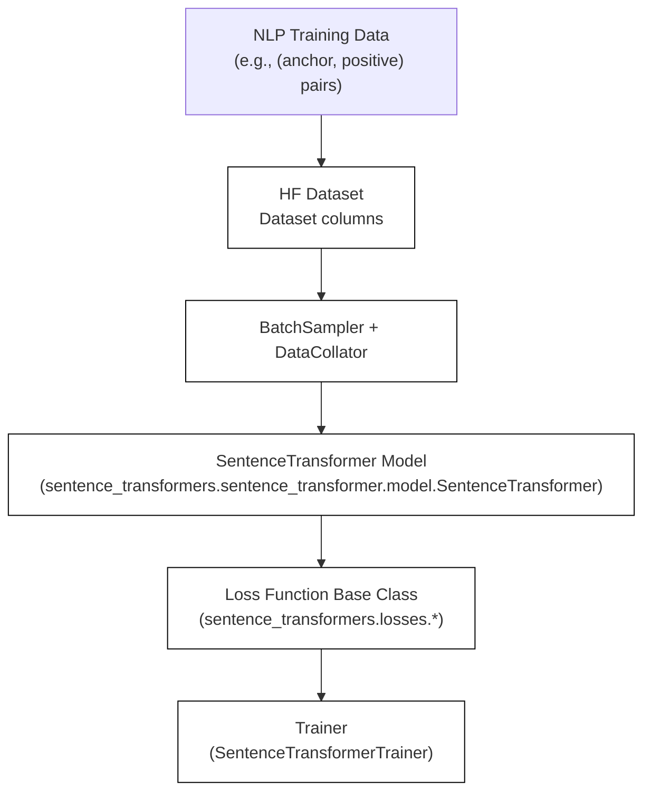

This diagram associates typical training data (e.g., `(anchor, positive)` pairs) passing through HF Datasets and batched by custom samplers/data collators, then submitted to `SentenceTransformer` model, wrapped by a loss function, and orchestrated by the `SentenceTransformerTrainer`.

### Diagram 2: SparseEncoder Loss Architecture and Wrappers

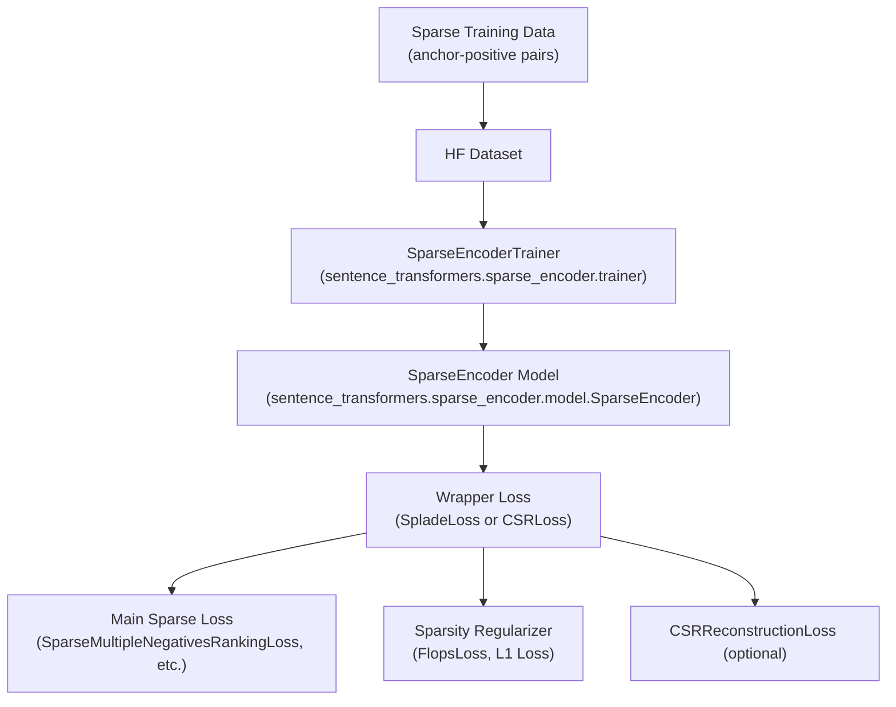

This diagram illustrates how SparseEncoder training data flows through specialized trainer and model, with loss functions wrapped by `SpladeLoss` or `CSRLoss` that incorporate both a main sparse loss and sparsity regularization terms.

---

End of overview. For the full implementation details, parameter descriptions, and examples, please consult the child pages:

- [Dense Model Loss Functions](#5.3.1)
- [Sparse Model Loss Functions](#5.3.2)

Sources:

- docs/sentence_transformer/loss_overview.md
- docs/sparse_encoder/loss_overview.md
- docs/cross_encoder/loss_overview.md
- sentence_transformers/losses/MultipleNegativesRankingLoss.py
- sentence_transformers/losses/CachedMultipleNegativesRankingLoss.py
- sentence_transformers/losses/GISTEmbedLoss.py
- sentence_transformers/sparse_encoder/losses/__init__.py
- sentence_transformers/cross_encoder/losses/__init__.py

---

