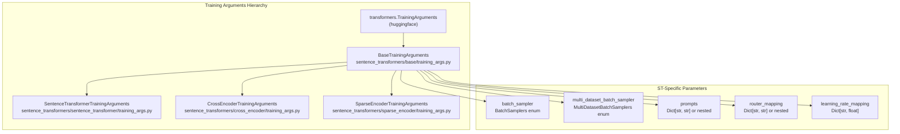
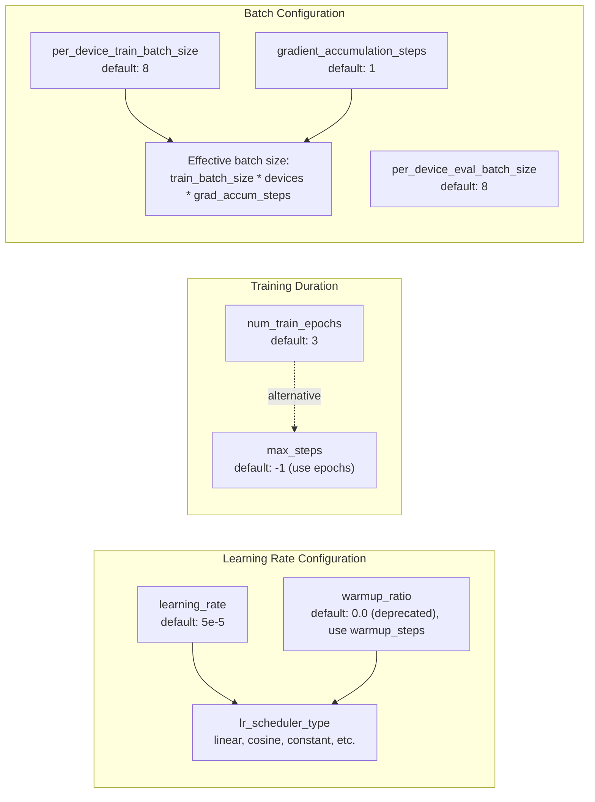
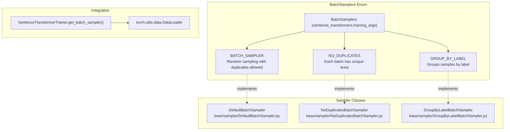
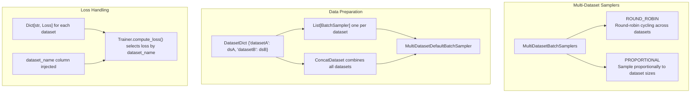
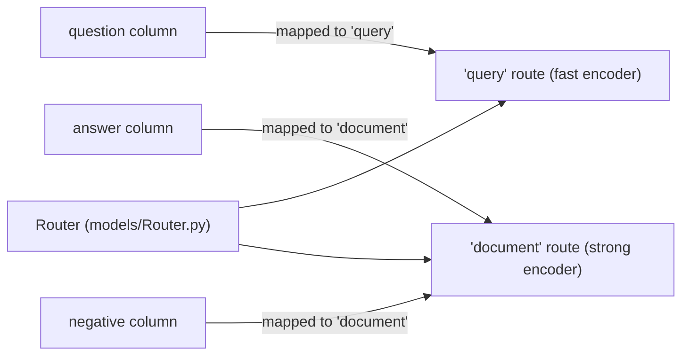
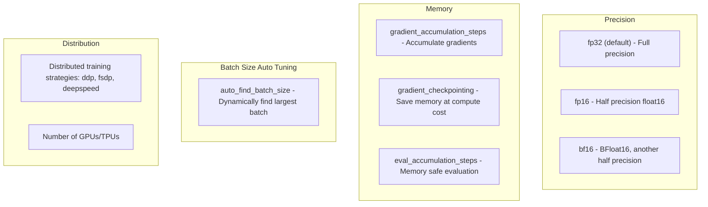
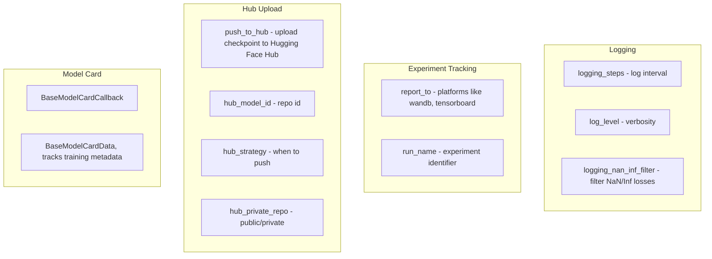
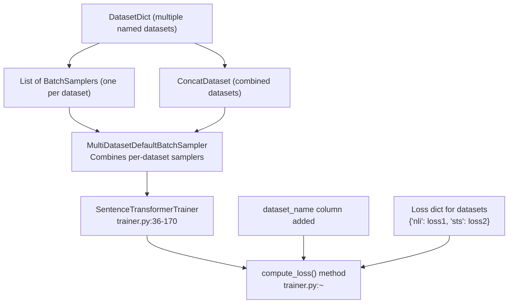

<!-- source: DeepWiki mcp.deepwiki.com · repo huggingface/sentence-transformers · page 5.4 Training Configuration · fetched 2026-10-26 -->

# Training Configuration

<details>
<summary>Relevant source files</summary>

The following files were used as context for generating this wiki page:

- [sentence_transformers/base/data_collator.py](sentence_transformers/base/data_collator.py)
- [sentence_transformers/base/peft_mixin.py](sentence_transformers/base/peft_mixin.py)
- [sentence_transformers/base/trainer.py](sentence_transformers/base/trainer.py)
- [sentence_transformers/base/training_args.py](sentence_transformers/base/training_args.py)
- [sentence_transformers/cross_encoder/trainer.py](sentence_transformers/cross_encoder/trainer.py)
- [sentence_transformers/cross_encoder/training_args.py](sentence_transformers/cross_encoder/training_args.py)
- [sentence_transformers/sentence_transformer/trainer.py](sentence_transformers/sentence_transformer/trainer.py)
- [sentence_transformers/sparse_encoder/data_collator.py](sentence_transformers/sparse_encoder/data_collator.py)
- [sentence_transformers/sparse_encoder/evaluation/__init__.py](sentence_transformers/sparse_encoder/evaluation/__init__.py)
- [sentence_transformers/sparse_encoder/trainer.py](sentence_transformers/sparse_encoder/trainer.py)
- [sentence_transformers/sparse_encoder/training_args.py](sentence_transformers/sparse_encoder/training_args.py)
- [sentence_transformers/util/similarity.py](sentence_transformers/util/similarity.py)
- [tests/sentence_transformer/test_trainer.py](tests/sentence_transformer/test_trainer.py)
- [tests/sparse_encoder/test_trainer.py](tests/sparse_encoder/test_trainer.py)

</details>


This page documents the configuration options for training Sentence Transformer models, including training arguments, hyperparameters, batch sampling strategies, evaluation strategies, and advanced options like prompts and router mappings. For a high-level overview of training components, see [Training Overview](#5.1). For details about the Trainer class, see [The Trainer System](#5.5).

---

## Training Arguments Class

Training configuration is primarily specified via the `BaseTrainingArguments` class hierarchy derived from Hugging Face's `transformers.TrainingArguments`. The library provides specialized subclasses for each model type:

- `SentenceTransformerTrainingArguments` for SentenceTransformer models
- `CrossEncoderTrainingArguments` for CrossEncoder models
- `SparseEncoderTrainingArguments` for SparseEncoder models

Each extends `BaseTrainingArguments` which itself extends Hugging Face's `TrainingArguments`, adding Sentence Transformers-specific options like batch samplers, prompts, router mappings, and parameter-wise learning rates.



**Initialization**

Example of constructing training arguments for SentenceTransformer training:

```python
from sentence_transformers.sentence_transformer.training_args import SentenceTransformerTrainingArguments
from sentence_transformers.training_args import BatchSamplers

args = SentenceTransformerTrainingArguments(
    output_dir="models/my-model",
    num_train_epochs=3,
    per_device_train_batch_size=16,
    learning_rate=2e-5,
    eval_strategy="steps",
    eval_steps=100,
    batch_sampler=BatchSamplers.NO_DUPLICATES,
)
```

Sources: [sentence_transformers/base/training_args.py:24-114](), [sentence_transformers/sentence_transformer/training_args.py:9-50](), [sentence_transformers/cross_encoder/training_args.py:8-44](), [sentence_transformers/sparse_encoder/training_args.py:8-50]()

---

## Core Hyperparameters

Most core hyperparameters mirror those in `transformers.TrainingArguments`, controlling optimization and training flow:



| Parameter | Default | Description | Typical Values |
|-----------|---------|-------------|----------------|
| `learning_rate` | `5e-5` | Base optimizer learning rate | `1e-6` to `5e-5` |
| `num_train_epochs` | `3` | Number of training epochs | `1` to `10` |
| `per_device_train_batch_size` | `8` | Batch size per GPU/CPU | `8` to `128` |
| `per_device_eval_batch_size` | `8` | Batch size for evaluation | `8` to `128` |
| `warmup_ratio`/`warmup_steps` | `0.0` / `0` | Learning rate warmup portion or steps | Typically `0.05` to `0.1` |
| `lr_scheduler_type` | `"linear"` | Scheduler type e.g. linear, cosine | See transformers docs |
| `gradient_accumulation_steps` | `1` | Steps to accumulate gradients | `1` to `16` |

Optimizers default to AdamW (`torch.optim.AdamW`) with optional alternatives like `adamw_hf`, `adafactor` controlled via the `optim` argument.

Sources: [sentence_transformers/base/trainer.py:700-712](), [sentence_transformers/base/training_args.py:24-114](), [docs/sentence_transformer/training_overview.md:294-318]()

---

## Batch Sampling Strategies

Batch samplers dictate how dataset samples are grouped into batches during training, impacting the effectiveness of losses that rely on in-batch negatives.

### Available Batch Samplers



### NoDuplicatesBatchSampler

- Ensures no duplicate sentences in the batch to maximize negatives diversity for contrastive losses.
- Implements by shuffling and rejecting duplicates within the batch.
- Useful for losses like `MultipleNegativesRankingLoss`.

### Custom Batch Samplers

You may also provide your own batch sampler or a callable that returns one. The default sampler (`DefaultBatchSampler`) is a wrapper around PyTorch samplers like `RandomSampler`.

```python
from sentence_transformers.base.sampler import DefaultBatchSampler

class MySampler(DefaultBatchSampler):
    def __init__(self, dataset, batch_size, drop_last, **kwargs):
        super().__init__(dataset, batch_size, drop_last, **kwargs)
        # Custom initialization
    
    def __iter__(self):
        # Custom batch building logic
        pass

args = SentenceTransformerTrainingArguments(
    output_dir="models/custom-sampler",
    batch_sampler=MySampler,
)
```

Sources: [sentence_transformers/base/trainer.py:604-690](), [sentence_transformers/base/training_args.py:15-19](), [tests/sentence_transformer/test_trainer.py:10-22]()

---

## Multi-Dataset Training Configuration

The library supports training on multiple datasets simultaneously with different losses and datasets combined via multi-dataset batch samplers.



### Behavior

- During training, the `dataset_name` field is automatically added to batches to identify which dataset each sample comes from.
- The trainer uses the dataset name to select the appropriate loss when `loss` is provided as a dictionary.
- The multi-dataset batch sampler mixes batches from multiple datasets according to the chosen strategy.
- Useful for training heterogeneous tasks like NLI and STS simultaneously.

### Example Setup

```python
from datasets import DatasetDict
from sentence_transformers.training_args import MultiDatasetBatchSamplers
from sentence_transformers import SentenceTransformerTrainingArguments

train_datasets = DatasetDict({
    "nli": nli_dataset,
    "sts": sts_dataset,
})

losses = {
    "nli": MultipleNegativesRankingLoss(model),
    "sts": CoSENTLoss(model),
}

args = SentenceTransformerTrainingArguments(
    output_dir="models/multi-dataset",
    multi_dataset_batch_sampler=MultiDatasetBatchSamplers.PROPORTIONAL,
    per_device_train_batch_size=16,
)
```

Sources: [sentence_transformers/base/trainer.py:690-718](), [sentence_transformers/training_args.py:93-97](), [tests/sentence_transformer/test_trainer.py:38-100]()

---

## Evaluation Strategies

Evaluation during training is controlled by parameters specifying when to evaluate, how often to save checkpoints, and selection criteria for the best model.

```mermaid
graph TB
    subgraph "Evaluation Timing"
        EvalStrategy["eval_strategy<br/>no, steps, epoch"]
        EvalSteps["eval_steps<br/>Number of steps between evals"]
        
        EvalStrategy --> EvalSteps
    end
    
    subgraph "Checkpoint Saving"
        SaveStrategy["save_strategy<br/>no, steps, epoch"]
        SaveSteps["save_steps<br/>Number of steps between saves"]
        SaveLimit["save_total_limit<br/>Max checkpoints to keep"]
        
        SaveStrategy --> SaveSteps
        SaveSteps --> SaveLimit
    end
    
    subgraph "Best Model Selection"
        LoadBest["load_best_model_at_end<br/>default: False"]
        MetricBest["metric_for_best_model<br/>Metric name (e.g., eval_pearson_cosine)"]
        GreaterBetter["greater_is_better<br/>Override metric maximizing/minizing"]
        
        LoadBest --> MetricBest
        MetricBest --> GreaterBetter
    end
    
    subgraph "Evaluation Components"
        EvalDataset["eval_dataset<br/>Calculates eval_loss"]
        Evaluator["evaluator<br/>Calculates detailed metrics"]
        
        EvalDataset -.both optional.-> Combine["Combined in evaluation_loop()"]
        Evaluator -.both optional.-> Combine
    end
```



| Parameter | Choices | Description |
|-----------|---------|-------------|
| `eval_strategy` | `"no" | "steps" | "epoch"` | Run evaluation |
| `eval_steps` | int | Frequency when `eval_strategy="steps"` |
| `save_strategy` | `"no" | "steps" | "epoch"` | When to save checkpoint |
| `save_steps` | int | Frequency when `save_strategy="steps"` |
| `save_total_limit` | int or `None` | Max checkpoints retained |
| `load_best_model_at_end` | bool | Load the best checkpoint at training end |
| `metric_for_best_model` | str | Metric to determine best checkpoint |
| `greater_is_better` | bool or None | Defines if metric is maximized |

### Evaluation Flow

- If `eval_dataset` is provided, the trainer computes the evaluation loss.
- If `evaluator` is provided (typically a `BaseEvaluator`), it computes richer metrics.
- If both are provided, their results are combined.
- Metrics are logged and optionally used to track the best model.

Sources: [sentence_transformers/base/trainer.py:530-611](), [docs/sentence_transformer/training_overview.md:320-337]()

---

## Advanced Training Options

### Prompts

The `prompts` parameter controls optional text prepended to dataset columns during preprocessing. This is especially helpful for instruction-tuned or prompt-based models.

Prompt formats:

1. Single string for all columns and datasets.
2. Mapping of column names to prompt strings.
3. Mapping of dataset names to prompt strings.
4. Nested dictionary mapping dataset names to column to prompt mapping.

Example of prompts for multi-dataset with multiple columns:

```python
prompts = {
    "nli": {
        "premise": "Premise: ",
        "hypothesis": "Hypothesis: ",
    },
    "sts": {
        "sentence1": "Sentence: ",
        "sentence2": "Sentence: ",
    },
}
```

The data collator automatically resolves and prepends these prompts before tokenization.

### Router Mapping

For routers used in asymmetric bi-encoders (e.g., Router module with query/document submodules), the `router_mapping` argument assigns dataset columns to router routes.

Example router mapping:

```python
router_mapping = {
    "question": "query",
    "answer": "document",
    "negative": "document",
}
```

This mapping ensures that during batching and preprocessing, columns are routed to the correct encoder submodule.



### Parameter Learning Rate Mapping

You can override the learning rate for specific model parts using `learning_rate_mapping`. This takes a dictionary where keys are regex patterns matching parameter names, and values are learning rates.

Example:

```python
learning_rate_mapping = {
    r"SparseStaticEmbedding\.*": 1e-3,
    r"0\..*": 1e-5,
}
```

This allows fine-grained control during fine-tuning, for example focusing learning on sparse embedding layers.

Sources: [sentence_transformers/base/training_args.py:24-114](), [sentence_transformers/base/data_collator.py:68-118](), [sentence_transformers/models/Router.py:40-69](), [sentence_transformers/sentence_transformer/trainer.py:200-214]()

---

## Hardware and Memory Optimization

Several training arguments support optimization for hardware, memory, and distributed training.



| Parameter | Default | Use Case |
|-----------|---------|----------|
| `fp16` | False | Half precision with supported GPUs for speedup |
| `bf16` | False | Alternative half precision on some hardware |
| `gradient_accumulation_steps` | 1 | Increase effective batch size with smaller batches |
| `gradient_checkpointing` | False | Save GPU memory with recomputation |
| `eval_accumulation_steps` | None | Reduce eval memory usage |
| `auto_find_batch_size` | False | Automatically adjust batch size to fit |

Example for memory-friendly training:

```python
args = SentenceTransformerTrainingArguments(
    output_dir="models/large",
    per_device_train_batch_size=4,
    gradient_accumulation_steps=8,
    gradient_checkpointing=True,
    fp16=True,
)
```

**Auto batch size finding:** Trainer iteratively tries batch sizes reducing on OOM errors until a maximum fitting size is found.

Sources: [sentence_transformers/base/trainer.py:700-718](), [docs/sentence_transformer/training_overview.md:304-311]()

---

## Logging and Experiment Tracking

Configure logging frequency, verbosity, and experiment tracking integration.



- Logging steps controls metric print frequency.
- The experiment tracking can leverage integrations to Weights & Biases (`wandb`), TensorBoard etc.
- Automatic model card callbacks collect metadata on training, loss, evaluation.
- Hub settings enable seamless model card and checkpoint uploads.

Example:

```python
args = SentenceTransformerTrainingArguments(
    output_dir="models/my-model",
    logging_steps=50,
    report_to=["wandb", "tensorboard"],
    run_name="experiment-1",
    push_to_hub=True,
    hub_model_id="user/model",
    hub_strategy="every_save",
    hub_private_repo=False,
)
```

Sources: [sentence_transformers/base/trainer.py:270-300](), [docs/sentence_transformer/training_overview.md:320-337]()

---

## Configuration Example: End-to-End Training Setup

A complete example combining all aspects:

```python
from datasets import load_dataset, DatasetDict
from sentence_transformers import (
    SentenceTransformer,
    SentenceTransformerTrainer,
    SentenceTransformerTrainingArguments,
    losses,
)
from sentence_transformers.training_args import BatchSamplers, MultiDatasetBatchSamplers
from sentence_transformers.evaluation import EmbeddingSimilarityEvaluator

# Load model
model = SentenceTransformer("microsoft/mpnet-base")

# Prepare datasets
train_dataset = DatasetDict({
    "nli": load_dataset("sentence-transformers/all-nli", "pair", split="train[:10000]"),
    "sts": load_dataset("sentence-transformers/stsb", split="train"),
})
eval_dataset = load_dataset("sentence-transformers/stsb", split="validation")

# Define losses for each dataset
loss = {
    "nli": losses.MultipleNegativesRankingLoss(model),
    "sts": losses.CoSENTLoss(model),
}

# Define evaluator
evaluator = EmbeddingSimilarityEvaluator(
    sentences1=eval_dataset["sentence1"],
    sentences2=eval_dataset["sentence2"],
    scores=eval_dataset["score"],
    name="sts-eval",
)

# Set training arguments
args = SentenceTransformerTrainingArguments(
    output_dir="models/complete",
    num_train_epochs=3,
    per_device_train_batch_size=32,
    per_device_eval_batch_size=32,
    learning_rate=2e-5,
    warmup_ratio=0.1,
    lr_scheduler_type="cosine",
    batch_sampler=BatchSamplers.NO_DUPLICATES,
    multi_dataset_batch_sampler=MultiDatasetBatchSamplers.PROPORTIONAL,
    eval_strategy="steps",
    eval_steps=100,
    save_strategy="steps",
    save_steps=100,
    save_total_limit=2,
    load_best_model_at_end=True,
    metric_for_best_model="eval_spearman_cosine",
    fp16=True,
    gradient_accumulation_steps=2,
    logging_steps=50,
    report_to=["wandb"],
    run_name="comprehensive-training-v1",
    push_to_hub=False,
)

# Initialize trainer
trainer = SentenceTransformerTrainer(
    model=model,
    args=args,
    train_dataset=train_dataset,
    eval_dataset=eval_dataset,
    loss=loss,
    evaluator=evaluator,
)

# Start training
trainer.train()
```

This setup offers:

- Multi-dataset training with dataset-specific losses
- Effective batch sampling strategies to maximize training quality
- Frequent detailed evaluation with best model checkpoint loading
- Hardware optimized training via FP16 and gradient accumulation
- Integrated experiment tracking for reproducibility

Sources: [sentence_transformers/sentence_transformer/trainer.py:130-320](), [docs/sentence_transformer/training_overview.md:490-564]()

---

# Summary

The training configuration in Sentence Transformers is mainly managed through extended Hugging Face training arguments, enabling flexible control over:

- **Core training hyperparameters** inherited from Hugging Face, dictating optimizer, training duration, batch sizes
- **Batch sampling strategies** customized for contrastive learning and multi-dataset settings
- **Evaluation scheduling and checkpointing** with metrics-driven best model selection
- **Advanced configuration** like prompts and router mappings for advanced asymmetric architectures
- **Hardware optimizations** including mixed precision, gradient checkpointing, and batch size tuning
- **Logging and experiment tracking** enriched with WandB and TensorBoard integrations and auto-generated model cards

The modular design facilitates easy switching between SentenceTransformer, CrossEncoder, and SparseEncoder training with tailored classes while sharing a common core API and capabilities.

---

# Diagrams Bridging Natural Language to Code Entities

### Overall Training Configuration Architecture

```mermaid
graph TD
    subgraph "Natural Language Concepts"
        NLTrainingArgs["Training Arguments (e.g. learning_rate, batch_sampler)"]
        NLBatchSampler["Batch Sampling Strategies (e.g. NoDuplicates)"]
        NLMultiDataset["Multi-Dataset Training Setup"]
        NLEval["Evaluation Config (eval_strategy, metrics)"]
        NLAdvanced["Advanced Options (prompts, router_mapping)"]
    end

    subgraph "Code Entities"
        BAT["BaseTrainingArguments<br/>sentence_transformers/base/training_args.py:25-124"]
        STArgs["SentenceTransformerTrainingArguments<br/>sentence_transformers/sentence_transformer/training_args.py:9-50"]
        BatchSamplersEnum["BatchSamplers Enum<br/>sentence_transformers/base/training_args.py:15-19"]
        MultiDatasetEnum["MultiDatasetBatchSamplers enum<br/>sentence_transformers/base/training_args.py:93-97"]
        DataCollator["BaseDataCollator<br/>sentence_transformers/base/data_collator.py:13-151"]
        RouterModule["Router Module<br/>sentence_transformers/base/modules/Router.py"]
        Trainer["SentenceTransformerTrainer<br/>sentence_transformers/sentence_transformer/trainer.py:36-170"]
        SamplerImpl["NoDuplicatesBatchSampler Impl<br/>sentence_transformers/base/sampler/NoDuplicatesBatchSampler.py"]
        EvalLoop["Evaluation Loop<br/>sentence_transformers/base/trainer.py:530-611"]
    end

    NLTrainingArgs --> BAT
    NLTrainingArgs --> STArgs
    NLBatchSampler --> BatchSamplersEnum
    NLBatchSampler --> SamplerImpl
    NLMultiDataset --> MultiDatasetEnum
    NLEval --> EvalLoop
    NLAdvanced --> DataCollator
    NLAdvanced --> RouterModule
    BAT --> Trainer
    STArgs --> Trainer
```



### Batch Sampling and Multi-Dataset Loss Selection



---

# References

- [sentence_transformers/base/training_args.py:24-114]()
- [sentence_transformers/sentence_transformer/training_args.py:9-50]()
- [sentence_transformers/cross_encoder/training_args.py:8-44]()
- [sentence_transformers/sparse_encoder/training_args.py:8-50]()
- [sentence_transformers/base/trainer.py:530-720]()
- [sentence_transformers/sentence_transformer/trainer.py:36-320]()
- [sentence_transformers/base/data_collator.py:13-151]()
- [sentence_transformers/base/sampler/NoDuplicatesBatchSampler.py](not shown explicitly)
- [sentence_transformers/models/Router.py](not shown explicitly)
- [docs/sentence_transformer/training_overview.md]()

This concludes the detailed technical documentation of the training configuration in the Sentence Transformers codebase.

---

