<!-- source: DeepWiki mcp.deepwiki.com · repo huggingface/sentence-transformers · page 5.5 The Trainer System · fetched 2026-10-26 -->

# The Trainer System

<details>
<summary>Relevant source files</summary>

The following files were used as context for generating this wiki page:

- [docs/package_reference/sparse_encoder/callbacks.md](docs/package_reference/sparse_encoder/callbacks.md)
- [sentence_transformers/base/data_collator.py](sentence_transformers/base/data_collator.py)
- [sentence_transformers/base/modules/module.py](sentence_transformers/base/modules/module.py)
- [sentence_transformers/base/peft_mixin.py](sentence_transformers/base/peft_mixin.py)
- [sentence_transformers/base/trainer.py](sentence_transformers/base/trainer.py)
- [sentence_transformers/base/training_args.py](sentence_transformers/base/training_args.py)
- [sentence_transformers/cross_encoder/trainer.py](sentence_transformers/cross_encoder/trainer.py)
- [sentence_transformers/sentence_transformer/trainer.py](sentence_transformers/sentence_transformer/trainer.py)
- [sentence_transformers/sparse_encoder/callbacks/__init__.py](sentence_transformers/sparse_encoder/callbacks/__init__.py)
- [sentence_transformers/sparse_encoder/callbacks/splade_callbacks.py](sentence_transformers/sparse_encoder/callbacks/splade_callbacks.py)
- [sentence_transformers/sparse_encoder/losses/csr.py](sentence_transformers/sparse_encoder/losses/csr.py)
- [sentence_transformers/sparse_encoder/modules/sparse_auto_encoder.py](sentence_transformers/sparse_encoder/modules/sparse_auto_encoder.py)
- [sentence_transformers/sparse_encoder/trainer.py](sentence_transformers/sparse_encoder/trainer.py)
- [sentence_transformers/util/file_io.py](sentence_transformers/util/file_io.py)
- [sentence_transformers/util/similarity.py](sentence_transformers/util/similarity.py)
- [tests/sentence_transformer/test_trainer.py](tests/sentence_transformer/test_trainer.py)
- [tests/sparse_encoder/test_trainer.py](tests/sparse_encoder/test_trainer.py)
- [tests/util/test_file_io.py](tests/util/test_file_io.py)

</details>


## Purpose and Scope

This document describes the Trainer system in Sentence Transformers, which orchestrates the training loop for embedding models. The Trainer system provides three specialized trainer classes that extend the Hugging Face `transformers.Trainer` with embedding-model-specific features like loss component tracking, Router module support, multi-dataset training, and automatic model card generation.

For information about preparing datasets for training, see [Dataset Preparation](#5.2). For configuring training parameters, see [Training Configuration](#5.4). For details about loss functions, see [Loss Functions](#5.3).

## Trainer Architecture

The Trainer system consists of three main classes that share a common architecture:

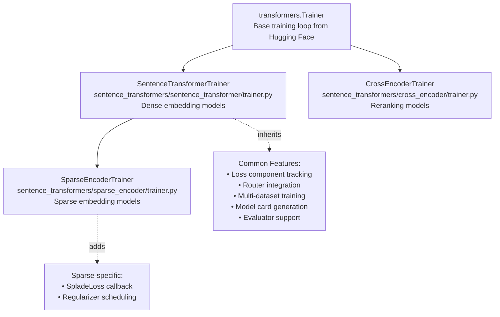

**Sources:** [sentence_transformers/sentence_transformer/trainer.py:36-109](), [sentence_transformers/sparse_encoder/trainer.py:34-94](), [sentence_transformers/cross_encoder/trainer.py:33-98]()

### Key Responsibilities

| Trainer Class               | Model Type           | Primary Use Case                           | Key File Path                                   |
|-----------------------------|----------------------|--------------------------------------------|------------------------------------------------|
| `SentenceTransformerTrainer` | `SentenceTransformer` | Dense embeddings for semantic search, clustering, similarity | `sentence_transformers/sentence_transformer/trainer.py` |
| `SparseEncoderTrainer`       | `SparseEncoder`       | Sparse embeddings for large-scale retrieval | `sentence_transformers/sparse_encoder/trainer.py`          |
| `CrossEncoderTrainer`        | `CrossEncoder`        | Reranking and pair classification          | `sentence_transformers/cross_encoder/trainer.py`           |

All three trainers extend `transformers.Trainer` and override specific methods to support embedding-model-specific requirements.

**Sources:** [sentence_transformers/sentence_transformer/trainer.py:36-109](), [sentence_transformers/sparse_encoder/trainer.py:34-94](), [sentence_transformers/cross_encoder/trainer.py:33-98]()

## Initialization and Configuration

### Trainer Initialization Flow

The initialization of a trainer involves several steps to set up the model, datasets, losses, evaluators, and callbacks, including validation and dataset preprocessing. This process is pivotal for enabling Router module support and multi-dataset training.

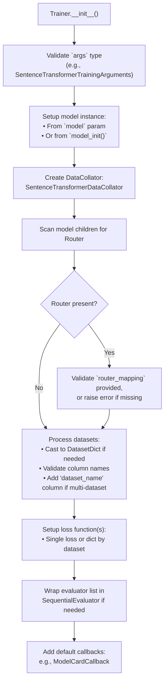

**Sources:** [sentence_transformers/sentence_transformer/trainer.py:120-340](), [sentence_transformers/sparse_encoder/trainer.py:270-315]()

### Required vs Optional Components

At minimum, initializing any trainer requires:

- **Model**: An instance of the respective model class (`SentenceTransformer`, `SparseEncoder`, or `CrossEncoder`), or a `model_init` function to create one.
- **Training dataset**: A `datasets.Dataset` or `DatasetDict` properly formatted for the loss.
- **Loss function**: Either a single loss object or a dictionary mapping dataset names to losses (defaults vary by trainer).

Optional but commonly used components include:

- **Training arguments**: Specialized training argument classes (e.g., `SentenceTransformerTrainingArguments`) configure hyperparameters.
- **Evaluation dataset**: Used for evaluation during training.
- **Evaluator**: An instance of `BaseEvaluator` or list of evaluators for problem-specific metrics.
- **Callbacks**: To customize training workflow and metrics logging.

**Sources:** [sentence_transformers/sentence_transformer/trainer.py:70-110](), [sentence_transformers/sparse_encoder/trainer.py:256-310]()

## The Training Loop

### Core Training Components and Data Flow

The Trainer system is built atop `transformers.Trainer`, with additional embedding-specific integrations like loss component tracking and Router-aware data collation.

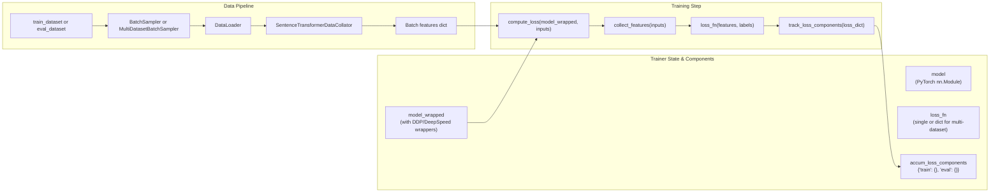

**Sources:** [sentence_transformers/sentence_transformer/trainer.py:380-530](), [sentence_transformers/sentence_transformer/trainer.py:540-594]()

### The compute_loss Method

This is the core method overridden from Hugging Face’s `Trainer`. During each training or evaluation batch:

- Extracts `dataset_name` if multi-dataset training is used.
- Converts the batch dictionary into a list of feature dictionaries and a labels tensor.
- Selects the correct loss function based on dataset.
- Replaces the inner model reference of the loss if the model is wrapped (e.g., by DDP).
- Calls the loss function with features and labels.
- If the loss returns a dictionary (e.g., `{ 'loss': ..., 'reg': ... }`) aggregates loss components:
  - Tracks components for logging and optionally logs averaged values.
  - Sums component values to produce the scalar loss for backward pass.

Sequence diagram of `compute_loss` flow:

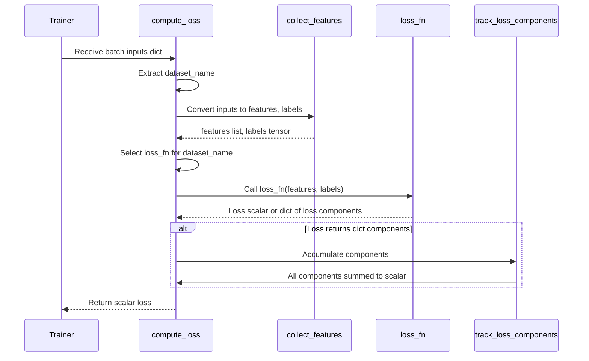

**Sources:** [sentence_transformers/sentence_transformer/trainer.py:393-443](), [sentence_transformers/sentence_transformer/trainer.py:498-531]()

### Collecting Features

The method `_collect_features` converts the batch dictionary into per-column feature dicts expected by the loss. It identifies feature columns via suffixes `_input_ids`, `_sentence_embedding`, or `_pixel_values`.

Input batch example:

```python
{
    'sentence_0_input_ids': tensor([...]),
    'sentence_0_attention_mask': tensor([...]),
    'sentence_1_input_ids': tensor([...]),
    'sentence_1_attention_mask': tensor([...]),
    'label': tensor([...]),
    'dataset_name': 'multi_nli'  # optional
}
```

Output:

```python
features = [
    {'input_ids': tensor([...]), 'attention_mask': tensor([...])},  # sentence_0
    {'input_ids': tensor([...]), 'attention_mask': tensor([...])}   # sentence_1
]
labels = tensor([...])
```

**Sources:** [sentence_transformers/sentence_transformer/trainer.py:498-531]()

### Loss Component Tracking

Some loss functions return a dictionary of components (e.g., main loss, regularization terms). The trainer accumulates these components separately over steps and logs their averages regularly.

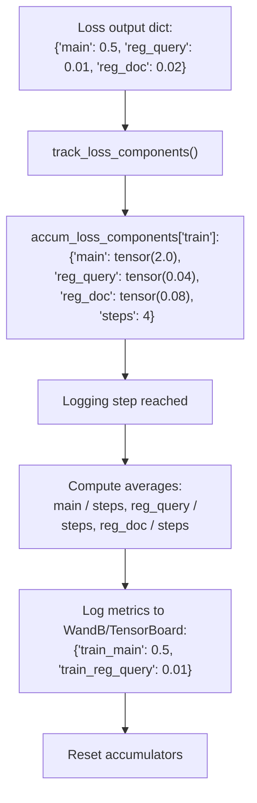

This enables fine-grained tracking of losses during training for better debugging and tuning.

**Sources:** [sentence_transformers/sentence_transformer/trainer.py:445-496]()

## Router Integration

The Router module enables models to route inputs differently based on text field semantics (e.g., asymmetric encoding of queries and documents). The trainer fully integrates Router support.

### How Router Integration Works

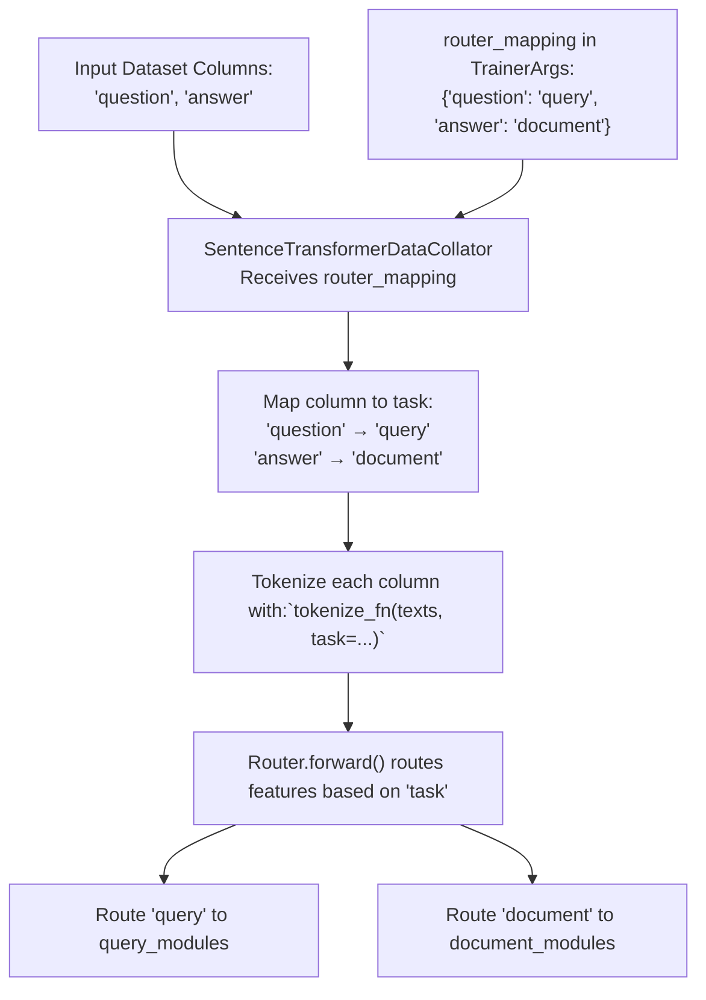

Each input column is assigned a routing task via `router_mapping`. The `DataCollator` tokenizes inputs with the appropriate task so the Router submodule routes inputs to correct encoders.

**Sources:** [sentence_transformers/sentence_transformer/trainer.py:200-214](), [sentence_transformers/base/data_collator.py:34-115](), [sentence_transformers/base/modules/module.py:200-250]()

### Validation of Router Arguments

During initialization, the trainer detects if the model contains a `Router` module and verifies that a proper `router_mapping` is provided:

```python
# Throws error if Router in model but no router_mapping argument
if has_router and not args.router_mapping:
    raise ValueError(
        "You are using a Router module in your model, but you did not provide "
        "a `router_mapping` in the training arguments. This means that the Router module "
        "will not be able to route the inputs to the correct submodules. Please provide "
        'a `router_mapping` that maps column names to routes, e.g.\n'
        '{"column_one": "query", "column_two": "document", "column_three": "document"}.'
    )
```

This helps avoid silent misrouting during training.

**Sources:** [sentence_transformers/sentence_transformer/trainer.py:208-214](), [sentence_transformers/sparse_encoder/trainer.py:180-186]()

### Router with Prompts

Prompts can be combined with Router settings for instruction tuning. The `router_mapping` and `prompts` arguments accept nested dicts keyed by dataset name and column:

```python
args = SentenceTransformerTrainingArguments(
    output_dir="output",
    router_mapping={
        "nli": {"premise": "document", "hypothesis": "document"},
        "qa": {"question": "query", "context": "document"},
    },
    prompts={
        "nli": {"premise": "Premise: ", "hypothesis": "Hypothesis: "},
        "qa": {"question": "Q: ", "context": "Context: "}
    }
)
```

The `DataCollator` uses these to prepend prompts before passing tokenized inputs with task info to Router.

**Sources:** [sentence_transformers/base/data_collator.py:35-88](), [sentence_transformers/base/modules/module.py:287-325]()

## Multi-Dataset Training

### Dataset and Loss Handling

Multi-dataset training allows running on several datasets simultaneously, each with its own loss, and sampling strategy.

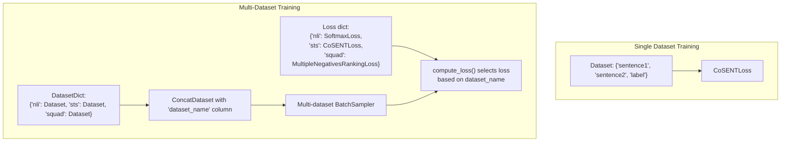

Each dataset in the `DatasetDict` has an assigned loss. During training, samples are labeled with `dataset_name`, allowing the trainer to select the correct loss function for each batch.

**Sources:** [sentence_transformers/sentence_transformer/trainer.py:230-340]()

### Multi-Dataset Configuration Validation

The trainer validates multi-dataset training setup:

- If `loss` is a dict (multi-loss), then both `train_dataset` and `eval_dataset` must be `DatasetDict`.
- The keys of the `loss` dict must correspond exactly to the dataset names.
- Automatically adds a `dataset_name` column to samples for loss routing.

Validation errors are raised if these conditions fail, preventing silent misconfiguration.

**Sources:** [sentence_transformers/sentence_transformer/trainer.py:297-312]()

### Dataset Preprocessing to Add dataset_name

When multi-dataset training is detected, the datasets are concatenated into a single dataset, with a new column recording the originating dataset:

```python
# Original DatasetDict datasets:
{
    "nli": Dataset(...),
    "sts": Dataset(...)
}

# After preprocessing:
ConcatDataset with columns:
[ ... original columns ..., "dataset_name" ]
"dataset_name" = "nli" or "sts" to mark source dataset for each sample
```

This column is critical to select the appropriate loss and routing in training.

**Sources:** [sentence_transformers/sentence_transformer/trainer.py:418-423]()

## Batch Sampling

### Single Dataset Batch Samplers

The trainer supports a pluggable batch sampling mechanism with several out-of-the-box batch samplers:

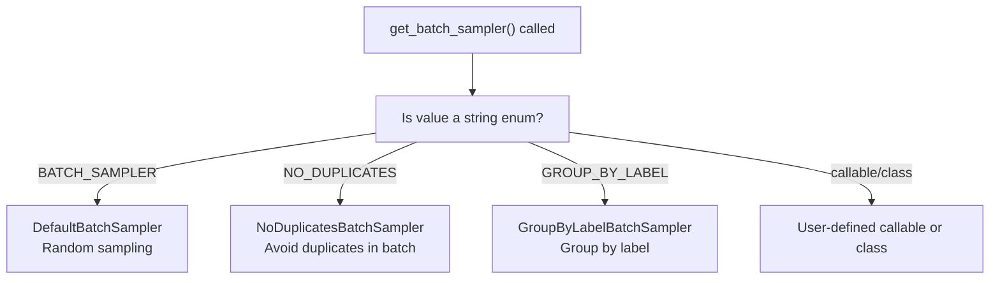

**Details on samplers:**

- `DefaultBatchSampler` (default) samples randomly from dataset.
- `NoDuplicatesBatchSampler` ensures no duplicate texts in the same batch, useful for in-batch negatives.
- `GroupByLabelBatchSampler` groups samples with the same label, suited for metric learning.
- Custom samplers can be passed as callable functions or subclasses.

**Sources:** [sentence_transformers/sentence_transformer/trainer.py:620-686]()

### Multi-Dataset Batch Samplers

For `DatasetDict` inputs, the trainer uses multi-dataset batch samplers which blend individual dataset samplers:

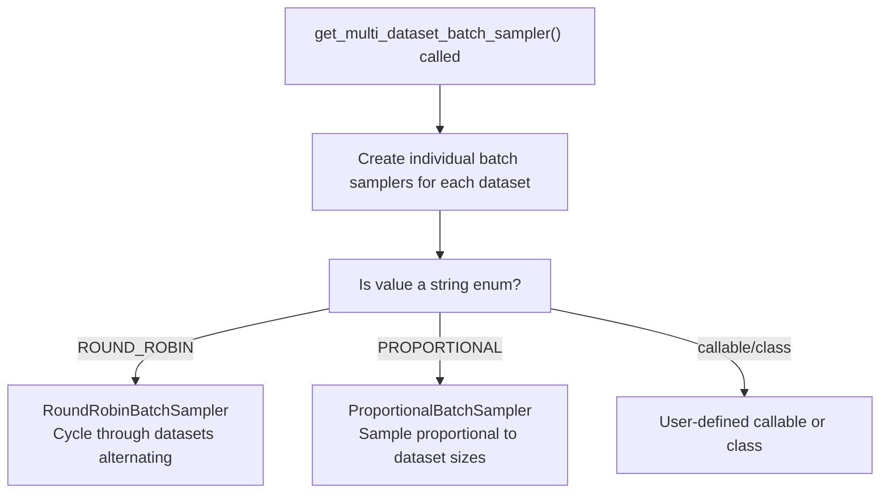

Common use cases choose between round-robin sampling (balanced across datasets) or proportional sampling (according to dataset size).

**Sources:** [sentence_transformers/sentence_transformer/trainer.py:687-724](), [sentence_transformers/base/training_args.py:15-20]()

### Example Configuration

```python
from sentence_transformers.training_args import BatchSamplers, MultiDatasetBatchSamplers

args = SentenceTransformerTrainingArguments(
    output_dir="output",
    batch_sampler=BatchSamplers.NO_DUPLICATES,  # for single dataset training
    multi_dataset_batch_sampler=MultiDatasetBatchSamplers.ROUND_ROBIN  # for DatasetDict training
)
```

**Sources:** [sentence_transformers/base/training_args.py:15-20]()

## Evaluator Integration

### Evaluation Workflow

The trainer supports evaluation through the `evaluation_loop` method, combining `eval_dataset` and optional `evaluator` objects:

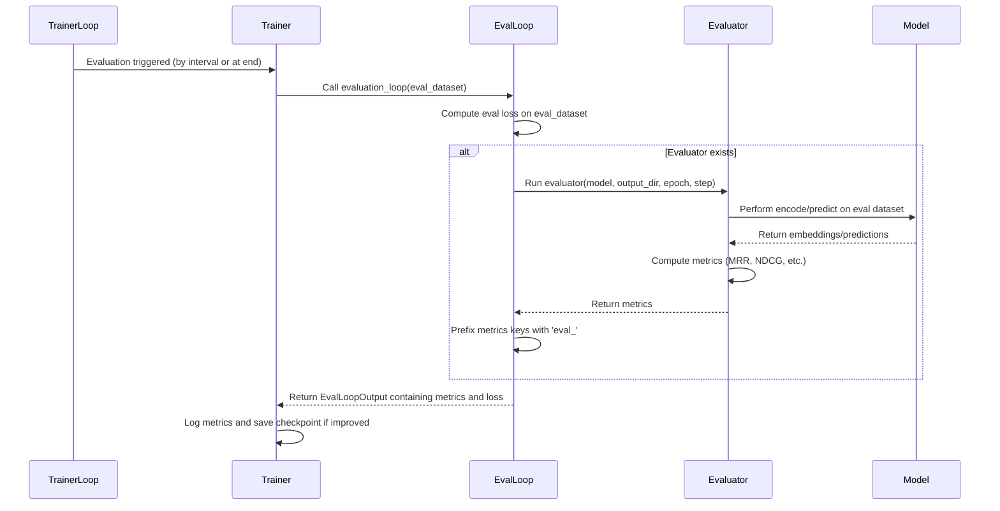

Only the first dataset in a multi-dataset eval is evaluated to reduce computational cost.

**Sources:** [sentence_transformers/sentence_transformer/trainer.py:547-594]()

### Evaluation Modes

| Mode                 | Configuration                        | Metrics returned           |
|----------------------|------------------------------------|---------------------------|
| No evaluation        | `eval_strategy="no"`                | None                      |
| Eval loss only       | `eval_dataset` given, no `evaluator` | `eval_loss` scalar        |
| Eval loss + metrics  | Both `eval_dataset` and `evaluator` | `eval_loss` + evaluator metrics |
| Metrics only         | `evaluator` provided, no `eval_dataset` | Evaluator metrics only   |

**Sources:** [sentence_transformers/sentence_transformer/trainer.py:259-264]()

### SequentialEvaluator Support

If multiple evaluators are provided as a list, they are automatically wrapped with a `SequentialEvaluator` that runs them serially, aggregating metrics.

```python
evaluators = [
    EmbeddingSimilarityEvaluator(...),
    TripletEvaluator(...),
    NanoBEIREvaluator(...),
]

trainer = SentenceTransformerTrainer(
    model=model,
    evaluator=evaluators,  # wrapped automatically to SequentialEvaluator
)
```

**Sources:** [sentence_transformers/sentence_transformer/trainer.py:314-317]()

## Callbacks and Model Cards

### Callback System Overview

The trainer inherits the standard Hugging Face `TrainerCallback` system and adds Sentence Transformers-specific callbacks.

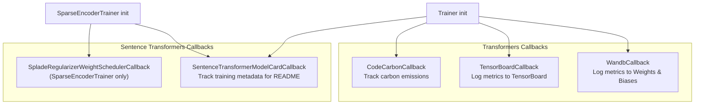

**Sources:** [sentence_transformers/sentence_transformer/trainer.py:64-73](), [sentence_transformers/sentence_transformer/trainer.py:329-347](), [sentence_transformers/sparse_encoder/trainer.py:341-373]()

### Model Card Generation Callback

`SentenceTransformerModelCardCallback` automatically tracks training metadata during the lifecycle:

- Stores parameters and metrics that differ from defaults.
- Tracks individual loss components and evaluator metrics.
- Records training time, hardware, dataset info.
- Includes carbon emission data if `codecarbon` installed.
- Generates a model card README upon training completion or saving.

Callback lifecycle interactions:

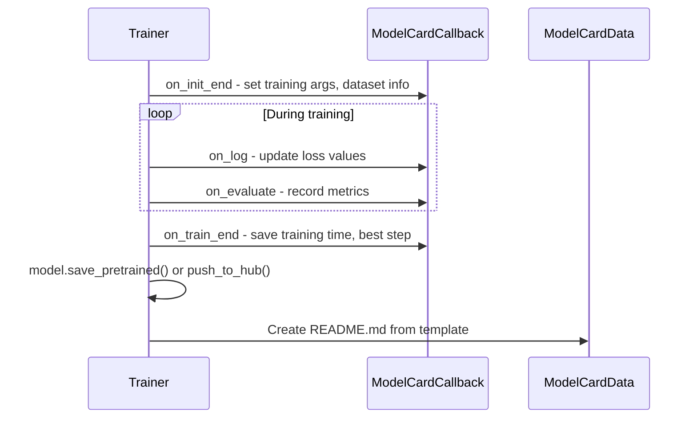

The model card integrates loss and evaluation metrics for transparency and documentation.

**Sources:** [sentence_transformers/sentence_transformer/trainer.py:329-347]()

### Automatic Project Naming for Logging Integrations

During initialization, if W&B or Trackio callbacks are detected, environment variables for project names are set automatically:

```python
os.environ.setdefault("WANDB_PROJECT", "sentence-transformers")
os.environ.setdefault("TRACKIO_PROJECT", "sentence-transformers")
```

This helps organize logs and metrics under consistent projects.

**Sources:** [sentence_transformers/sentence_transformer/trainer.py:280-291]()

## Data Collation

### Collation Workflow

The `SentenceTransformerDataCollator` prepares batches for the trainer with support for prompts and router tasks:

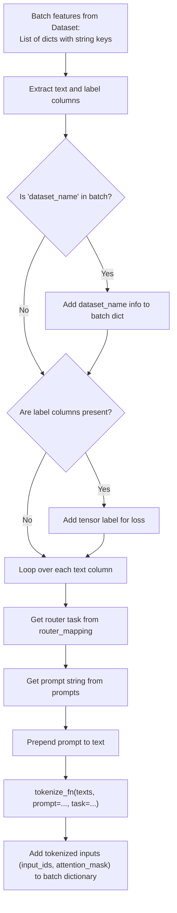

**Sources:** [sentence_transformers/base/data_collator.py:77-122]()

### Collator Configuration Options

The collator can be configured with:

- `tokenize_fn`: Tokenizer function of the model.
- `valid_label_columns`: Columns considered labels, defaulting to `["label","score"]`.
- `router_mapping`: Dict mapping column names (or dataset+column) to Router routes.
- `prompts`: Dict or string prompts per column or dataset.
- `include_prompt_lengths`: Whether to record prompt token lengths.
- `all_special_ids`: IDs of special tokens to exclude from prompt length.

Example usage:

```python
collator = SentenceTransformerDataCollator(
    tokenize_fn=model.tokenize,
    router_mapping={"question": "query", "answer": "document"},
    prompts={"question": "Query: ", "answer": "Document: "},
    include_prompt_lengths=True,
    all_special_ids=set(tokenizer.all_special_ids),
)
```

**Sources:** [sentence_transformers/base/data_collator.py:30-60](), [sentence_transformers/sentence_transformer/trainer.py:200-214]()

### Multi-Dataset Collator Support

When using `DatasetDict`, `router_mapping` and `prompts` may be nested dicts keyed by dataset and column, allowing fine-grained control.

```python
router_mapping = {
    "nli": {"premise": "document", "hypothesis": "document"},
    "qa": {"question": "query", "context": "document"},
}

prompts = {
    "nli": {"premise": "Premise: ", "hypothesis": "Hypothesis: "},
    "qa": {"question": "Q: ", "context": "Context: "}
}
```

The collator resolves the correct mapping based on `dataset_name` in each batch.

**Sources:** [sentence_transformers/base/data_collator.py:35-90]()

### Column Name Validation and Warning

The collator warns users if dataset columns appear in unusual orders that could cause loss mismatches, e.g., if `"negative"` comes before `"positive"`.

Expected orders and common patterns are checked, with warnings advising on how to reorder or rename columns.

**Sources:** [sentence_transformers/base/data_collator.py:114-152]()

## SparseEncoderTrainer Specifics

The `SparseEncoderTrainer` extends `SentenceTransformerTrainer` with features specific to sparse encoder models.

### SpladeLoss Callback Integration

When using the `SpladeLoss` loss function, the trainer automatically adds a `SpladeRegularizerWeightSchedulerCallback` to schedule the gradual increase of regularization weights over training:

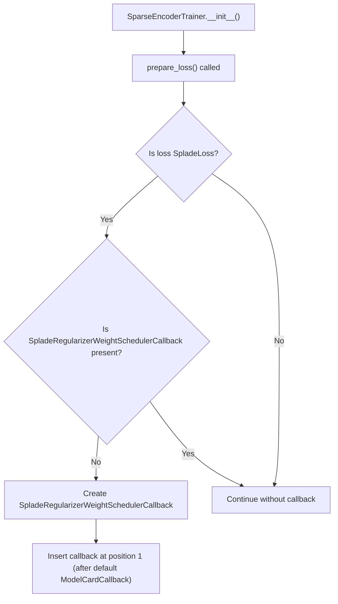

This callback linearly schedules the query and document regularizer weights from zero to their specified max values over the course of training warmup steps to improve training stability.

**Sources:** [sentence_transformers/sparse_encoder/trainer.py:340-375](), [sentence_transformers/sparse_encoder/callbacks/splade_callbacks.py:20-150]()

### Default Loss Function

Unlike `SentenceTransformerTrainer` which defaults to `CoSENTLoss`, the `SparseEncoderTrainer` defaults to `SpladeLoss` constructed as:

```python
SpladeLoss(
    model=model,
    loss=SparseMultipleNegativesRankingLoss(model=model),
    query_regularizer_weight=5e-5,
    document_regularizer_weight=3e-5,
)
```

**Sources:** [sentence_transformers/sparse_encoder/trainer.py:266-290]()

## Advanced Features

### Model Wrapping for Distributed Training

The trainer manages model wrapping used in distributed training (e.g., DDP, DeepSpeed).

During loss computation, the inner model used by the loss may be replaced temporarily with the wrapped model for correct forward passes.

```python
def compute_loss(self, model, inputs, ...):
    # model is self.model_wrapped (outermost wrapper)
    
    if (
        model == self.model_wrapped
        and hasattr(loss_fn, "model")
        and loss_fn.model != model
    ):
        loss_fn = self.override_model_in_loss(loss_fn, model)
```

The `override_model_in_loss` method recursively updates the loss's model reference and all child losses.

**Sources:** [sentence_transformers/sentence_transformer/trainer.py:374-385](), [sentence_transformers/sentence_transformer/trainer.py:427-432]()

### Optimizer Including Loss Parameters

If a loss function has learnable parameters (e.g., `SoftmaxLoss`), the trainer includes these parameters in the optimizer groups so they can be updated during training.

This is handled in `get_optimizer_cls_and_kwargs()` extending the standard `transformers.Trainer` behavior.

**Sources:** [sentence_transformers/sparse_encoder/trainer.py:400-420]()

### Best Model Loading Logic

If `load_best_model_at_end` is enabled, the trainer:

- Obtains best checkpoint path from `state.best_model_checkpoint`
- Extracts training step number from folder names via regex
- Updates model card info with best step
- Loads the checkpoint parameters into the model

This ensures consistent evaluation and saving of the best-performing model version.

**Sources:** [sentence_transformers/sentence_transformer/trainer.py:595-613]()

### IterableDataset Support and Validation

The trainer requires `IterableDataset` inputs to have Features defined so that column names can be inferred.

Invalid:

```python
datasets.IterableDataset.from_generator(lambda: ...)
```

Valid:

```python
from datasets import Features, Value

dataset = datasets.IterableDataset.from_generator(lambda: ...).cast(
    Features({"text": Value("string"), "label": Value("float32")})
)
```

This enables proper dataset column name access for batch collation and router mapping.

**Sources:** [sentence_transformers/sentence_transformer/trainer.py:215-231]()

## Summary

The Trainer system in Sentence Transformers is a comprehensive, flexible training loop built on Hugging Face Transformers. It provides:

- Extended training loops tailored for embedding models.
- Support for multiple model types: dense, sparse, and cross-encoders through dedicated trainer classes.
- Router module integration enabling task-based asymmetric encoding.
- Multi-dataset training with per-dataset loss and sampling strategies.
- Robust loss component tracking and logging.
- Integration with evaluators for rich metric evaluations.
- Automatic model card generation recording training metadata.
- Flexible batch samplers for advanced sampling needs.
- Support for distributed training with correct model wrapping.

This design enables diverse training scenarios from single dense embedding tasks to large multi-dataset sparse embedding training, while preserving ease of use and reproducibility.

**Sources:** [sentence_transformers/sentence_transformer/trainer.py](), [sentence_transformers/sparse_encoder/trainer.py](), [sentence_transformers/cross_encoder/trainer.py]()

---

