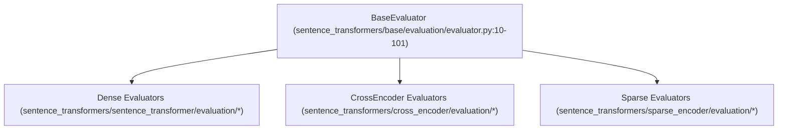
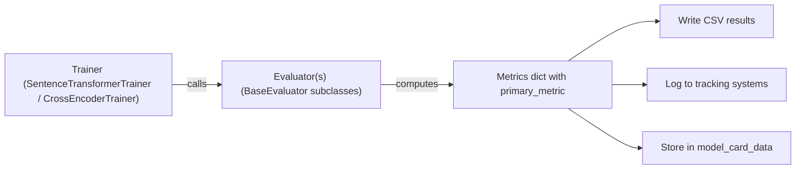
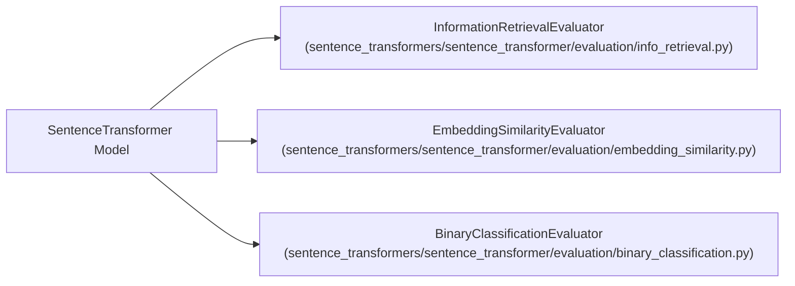
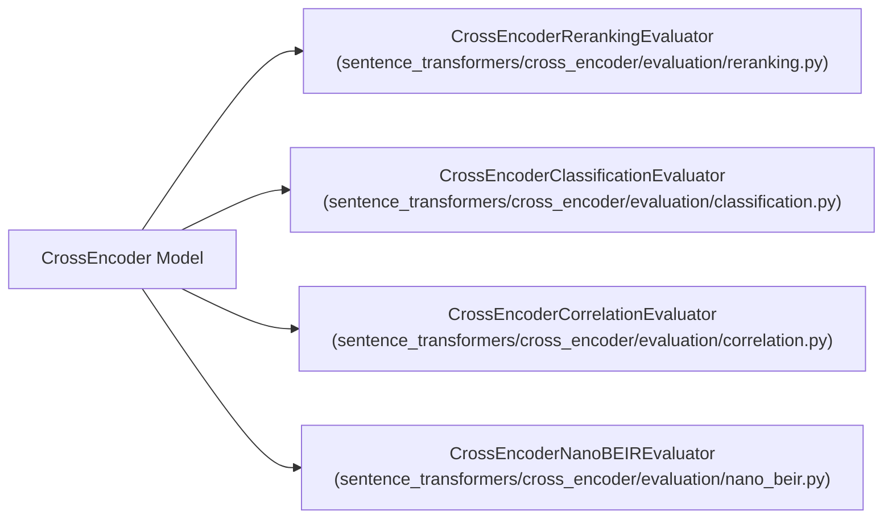
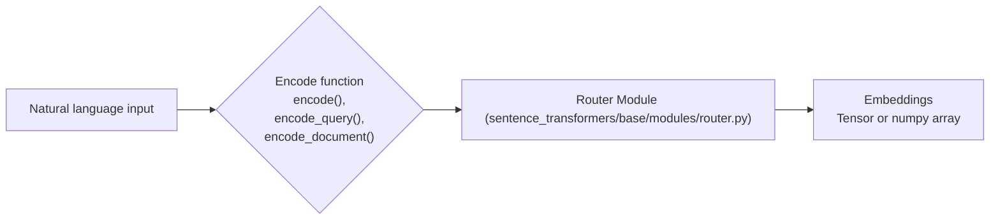

<!-- source: DeepWiki mcp.deepwiki.com · repo huggingface/sentence-transformers · page 6 Evaluation · fetched 2026-10-26 -->

# Evaluation

<details>
<summary>Relevant source files</summary>

The following files were used as context for generating this wiki page:

- [sentence_transformers/base/evaluation/evaluator.py](sentence_transformers/base/evaluation/evaluator.py)
- [sentence_transformers/base/evaluation/sequential.py](sentence_transformers/base/evaluation/sequential.py)
- [sentence_transformers/base/modules/router.py](sentence_transformers/base/modules/router.py)
- [sentence_transformers/cross_encoder/evaluation/classification.py](sentence_transformers/cross_encoder/evaluation/classification.py)
- [sentence_transformers/cross_encoder/evaluation/correlation.py](sentence_transformers/cross_encoder/evaluation/correlation.py)
- [sentence_transformers/cross_encoder/evaluation/nano_beir.py](sentence_transformers/cross_encoder/evaluation/nano_beir.py)
- [sentence_transformers/cross_encoder/evaluation/reranking.py](sentence_transformers/cross_encoder/evaluation/reranking.py)
- [sentence_transformers/sparse_encoder/losses/flops.py](sentence_transformers/sparse_encoder/losses/flops.py)
- [sentence_transformers/util/misc.py](sentence_transformers/util/misc.py)
- [tests/base/modules/test_router.py](tests/base/modules/test_router.py)
- [tests/util/test_misc.py](tests/util/test_misc.py)

</details>


## Purpose and Scope

The evaluation system in the Sentence Transformers library offers a unified and extensible framework for measuring model performance across various tasks, such as semantic search, classification, reranking, and sparsity analysis. Evaluators can be used both during training to monitor progress and after training for benchmarking or model comparison.

This page provides a high-level overview of the evaluation architecture, the types of evaluators available, and how these fit into the training and inference workflows. Deep technical details, concrete API references, and implementation specifics are covered in the linked child pages:

- **[Evaluation System Overview](#6.1)** — Describes the core `SentenceEvaluator` base class, its interface, and how it integrates with training or is used standalone.
- **[Dense Model Evaluators](#6.2)** — Comprehensive reference for evaluators tailored to dense embedding models (e.g., semantic similarity, information retrieval, classification, NanoBEIR benchmark).
- **[Sparse Model Evaluators](#6.3)** — Specialized evaluators for sparse models including sparsity statistics, FLOPS regularization metrics, and sparse-specific extensions.

---

## Evaluation System Architecture

Evaluation in the codebase is built around the abstract base class `BaseEvaluator` (alias `SentenceEvaluator` for backward compatibility). This class standardizes the evaluation interface:

- The main method is `__call__(model, output_path, epoch, steps)`, which runs the evaluation and returns metric results.
- The property `primary_metric` defines the key metric used for model selection and checkpointing.
- Optional CSV logging is supported with headers and file naming conventions.
- Metrics can be stored automatically in the model's metadata for later inclusion in model cards.

### Relationship of Evaluators and Code Entities



- All evaluators extend `BaseEvaluator` (`sentence_transformers/base/evaluation/evaluator.py`)
- Dense evaluators reside mostly under `sentence_transformers/sentence_transformer/evaluation`
- Cross-Encoder specific evaluators (e.g., classification, reranking) are under `sentence_transformers/cross_encoder/evaluation`
- Sparse evaluators (e.g., sparsity metrics, FLOPS) are under `sentence_transformers/sparse_encoder/evaluation`

**Sources:**  
- [sentence_transformers/base/evaluation/evaluator.py:1-101]()  
- [sentence_transformers/cross_encoder/evaluation/reranking.py:10-130]()  
- [sentence_transformers/cross_encoder/evaluation/classification.py:1-180]()  
- [sentence_transformers/cross_encoder/evaluation/nano_beir.py:20-180]()  

---

## Integration with Training and Use Cases

Evaluators can be used in two main contexts:

### During Training

When passed to trainers such as `SentenceTransformerTrainer` or `CrossEncoderTrainer`, evaluators are invoked automatically at configured intervals (`eval_steps`, `eval_strategy`). They compute evaluation metrics on validation datasets and return scores used for:

- Progress monitoring in logs (console, WandB, TensorBoard)
- Writing detailed results to CSV files
- Recording evaluation scores in `model_card_data` for documentation and Hub model cards
- Selecting and saving the best-performing checkpoint based on the `primary_metric`



### Standalone Usage

Evaluators can be used independently to evaluate models post-training or for experiments:

```python
from sentence_transformers import SentenceTransformer
from sentence_transformers.evaluation import InformationRetrievalEvaluator

model = SentenceTransformer("all-MiniLM-L6-v2")
evaluator = InformationRetrievalEvaluator(
    queries=queries,
    corpus=corpus,
    relevant_docs=relevant_docs,
    name="my_eval"
)

results = evaluator(model)
print(results[evaluator.primary_metric])
```

Standalone evaluation is useful for:

- Final validation/test evaluation after training completes
- Comparing multiple model checkpoints or architectures
- Rapid prototyping and benchmarking without retraining

**Sources:**  
- [sentence_transformers/base/evaluation/evaluator.py:10-101]()  
- [sentence_transformers/evaluation/InformationRetrievalEvaluator.py:50-120]()  
- [sentence_transformers/cross_encoder/evaluation/nano_beir.py:50-130]()  

---

## Evaluator Types and Main Metrics

The evaluation framework supports varied tasks and model types. Below is a high-level categorization of principal evaluators and the metrics they compute.

### Dense Model Evaluators (For SentenceTransformer)

| Evaluator                          | Required Input                                 | Primary Metrics                         | Use Cases                         |
|----------------------------------|------------------------------------------------|---------------------------------------|----------------------------------|
| `InformationRetrievalEvaluator`  | Queries, Corpus, Relevant doc lists             | MRR@k, NDCG@k, MAP@k, Recall@k        | Semantic search, retrieval       |
| `EmbeddingSimilarityEvaluator`   | Sentence pairs with continuous similarity scores| Pearson, Spearman correlation          | Semantic textual similarity (STS)|
| `BinaryClassificationEvaluator`  | Sentence pairs, binary labels                    | Accuracy, F1, Precision, Recall, AP   | Duplicate detection, binary tasks|
| `RerankingEvaluator`             | Query + positive/negative documents              | MAP, MRR@k, NDCG@k                    | Search reranking tasks           |
| `TripletEvaluator`               | Triplets of sentences                             | Accuracy based on embedding distance  | Triplet loss validation          |
| `ParaphraseMiningEvaluator`      | Sentences with paraphrase pairs                   | F1, Precision, Recall, Average Precision| Paraphrase mining              |
| `TranslationEvaluator`            | Parallel sentences across languages              | Accuracy src→trg and trg→src          | Cross-lingual embeddings         |
| `MSEEvaluator`                    | Source/target sets, teacher model scores         | Negative MSE                         | Knowledge distillation           |
| `NanoBEIREvaluator`               | Automated retrieval benchmark                     | Aggregated retrieval metrics          | Benchmarking on NanoBEIR datasets|

### Sparse Model Evaluators

Sparse evaluators extend dense metrics with sparsity and efficiency measures:

- Active feature counts, sparsity ratios
- FLOPS-based regularization measures
- Sparse-aware ranking and retrieval metrics

They include specialized classes like `SparseInformationRetrievalEvaluator`, `SparseNanoBEIREvaluator`, and `FlopsLoss` regularizer.

### Cross-Encoder Evaluators

Dedicated evaluators for CrossEncoder models, including:

- `CrossEncoderRerankingEvaluator` (reranking metrics like MAP, MRR, NDCG)
- `CrossEncoderClassificationEvaluator` (classification accuracy, F1, AP)
- `CrossEncoderCorrelationEvaluator` (Pearson and Spearman correlation)
- `CrossEncoderNanoBEIREvaluator` (benchmarking on NanoBEIR datasets)

---

## Bridging Natural Language Concepts to Code Entities in Evaluation

### Diagram 1: Evaluation Components for Dense Models and Their Code Entities



### Diagram 2: Cross-Encoder Evaluation Components and Code Entities



**Sources:**  
- [sentence_transformers/cross_encoder/evaluation/reranking.py:1-140]()  
- [sentence_transformers/cross_encoder/evaluation/classification.py:1-180]()  
- [sentence_transformers/cross_encoder/evaluation/correlation.py:1-150]()  
- [sentence_transformers/cross_encoder/evaluation/nano_beir.py:1-150]()  

---

## Common Evaluation System Features

### Encoding and Embedding Strategy

Most evaluators that compute metrics based on embeddings use a common strategy to obtain embeddings via the model’s encoding functions. For asymmetric or Router-based models, different encode functions may be selected:



- `encode_query()` and `encode_document()` are used for asymmetric models routed via the `Router` module
- `encode()` is the default encoding method for symmetric models
- Optional prompts can be provided for instruction-tuned and promptable models
- Embedding truncation supports Matryoshka dimension evaluation

**Sources:**  
- [sentence_transformers/evaluation/InformationRetrievalEvaluator.py:410-440]()  
- [sentence_transformers/base/modules/router.py:24-112]()  

---

### Metric Prefixing and Naming

Evaluators prepend their identifying names to metric keys to provide transparent tracking across multiple datasets or evaluators:

```python
def prefix_name_to_metrics(self, metrics: dict[str, float], name: str) -> dict[str, float]:
    # Adds `name_` prefix to all metric keys
    ...
```

Example metric keys include `msmarco_ndcg@10` or `sts-dev_spearman`. This consistent naming is important for integration with training logging and automated model card generation.

### CSV Results and Logging

Evaluators support outputs to CSV files for persistent metric tracking with columns for epochs, steps, and each computed metric. They also integrate with tensorboard and WandB logging if enabled in training arguments.

---

## Advanced Evaluation Features

- **SequentialEvaluator**: Combines multiple evaluators running them sequentially and aggregating the metrics (e.g., combining retrieval and classification metrics).
- **Similarity Functions**: Many evaluators support multiple similarity functions (cosine, dot, euclidean, manhattan) and select the best performing one.
- **Dimension Truncation**: For Matryoshka models, evaluators support evaluating embeddings truncated to specified dimensions.
- **Prompt Configuration**: For instruction-tuned models, prompts can be configured and are passed through the evaluation encoding calls.

---

## See Also

- [Evaluation System Overview](#6.1) — Core evaluator interface, standalone and training use  
- [Dense Model Evaluators](#6.2) — Reference for all dense evaluators such as IR, similarity, classification  
- [Sparse Model Evaluators](#6.3) — Sparse model evaluators with sparsity metrics and FLOPS calculations  
- [Training Models](#5) — Understanding how evaluation fits in the training pipeline  
- [The Trainer System](#5.5) — Deep dive into trainer-evaluator interaction and callbacks  

---

# Summary

The evaluation framework in Sentence Transformers is a cornerstone for both model development and benchmarking, offering a consistent interface across diverse tasks and model architectures. Through the `BaseEvaluator` abstraction, it supports rich metric computations, CSV logging, metric prefixing, training integration, and extensibility for both dense and sparse models as well as CrossEncoders.

For detailed usage, code examples, and API references, refer to the dedicated child pages outlining subsystem designs and available evaluator classes.

---

**Sources:**  
- sentence_transformers/base/evaluation/evaluator.py:1-101  
- sentence_transformers/cross_encoder/evaluation/reranking.py:1-140  
- sentence_transformers/cross_encoder/evaluation/classification.py:1-180  
- sentence_transformers/cross_encoder/evaluation/nano_beir.py:1-150  
- sentence_transformers/evaluation/InformationRetrievalEvaluator.py:40-580  
- sentence_transformers/evaluation/EmbeddingSimilarityEvaluator.py:20-250  
- sentence_transformers/evaluation/BinaryClassificationEvaluator.py:20-280  
- sentence_transformers/base/modules/router.py:20-150  
- sentence_transformers/base/evaluation/sequential.py:1-60  
- sentence_transformers/sparse_encoder/losses/flops.py:1-70

---

