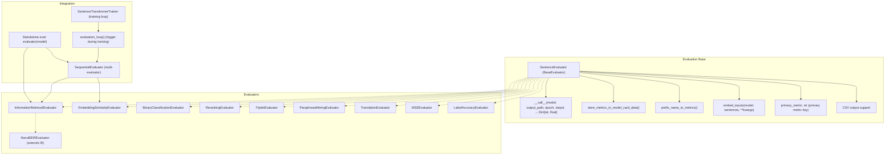
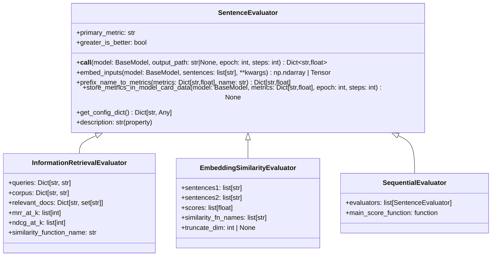
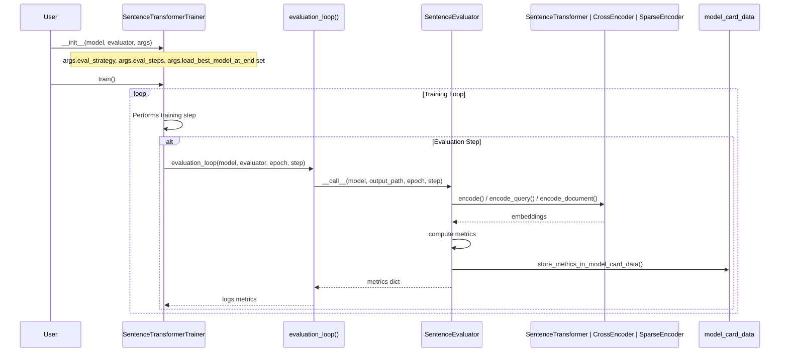
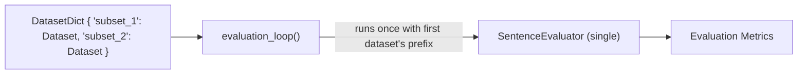
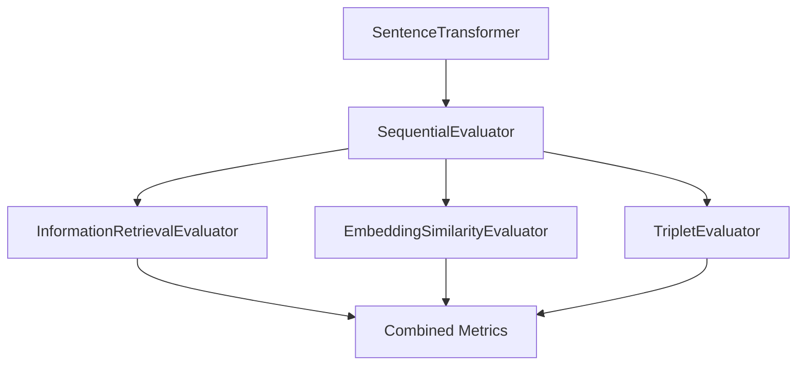
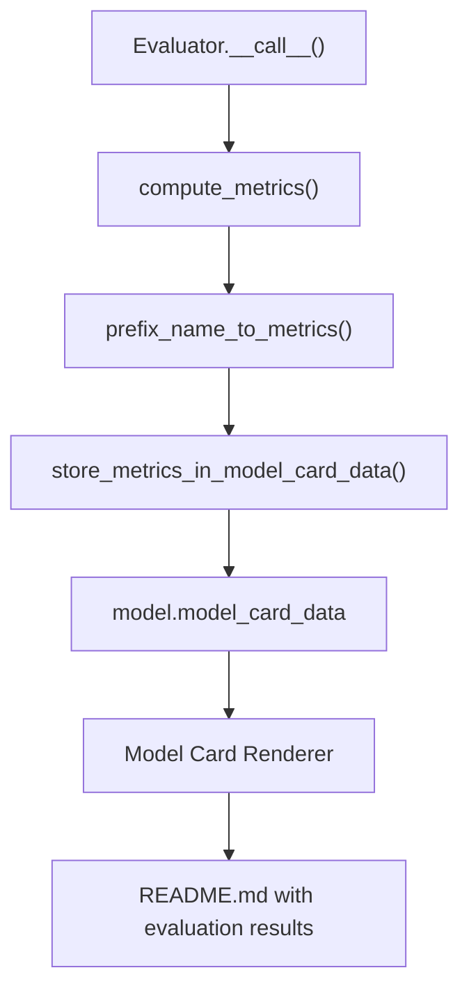

<!-- source: DeepWiki mcp.deepwiki.com · repo huggingface/sentence-transformers · page 6.1 Evaluation System Overview · fetched 2026-10-26 -->

# Evaluation System Overview

<details>
<summary>Relevant source files</summary>

The following files were used as context for generating this wiki page:

- [sentence_transformers/base/evaluation/evaluator.py](sentence_transformers/base/evaluation/evaluator.py)
- [sentence_transformers/base/evaluation/sequential.py](sentence_transformers/base/evaluation/sequential.py)
- [sentence_transformers/base/modules/router.py](sentence_transformers/base/modules/router.py)
- [sentence_transformers/sparse_encoder/losses/flops.py](sentence_transformers/sparse_encoder/losses/flops.py)
- [sentence_transformers/util/misc.py](sentence_transformers/util/misc.py)
- [tests/base/modules/test_router.py](tests/base/modules/test_router.py)
- [tests/cross_encoder/conftest.py](tests/cross_encoder/conftest.py)
- [tests/cross_encoder/test_model.py](tests/cross_encoder/test_model.py)
- [tests/cross_encoder/test_train_stsb.py](tests/cross_encoder/test_train_stsb.py)
- [tests/sentence_transformer/evaluation/test_information_retrieval_evaluator.py](tests/sentence_transformer/evaluation/test_information_retrieval_evaluator.py)
- [tests/sentence_transformer/test_pretrained_stsb.py](tests/sentence_transformer/test_pretrained_stsb.py)
- [tests/sentence_transformer/test_train_stsb.py](tests/sentence_transformer/test_train_stsb.py)
- [tests/sparse_encoder/test_train_stsb.py](tests/sparse_encoder/test_train_stsb.py)
- [tests/util/test_misc.py](tests/util/test_misc.py)

</details>


The evaluation system provides a comprehensive and flexible framework for measuring the performance of SentenceTransformer, CrossEncoder, and SparseEncoder models on diverse tasks. It supports seamless integration with the training loop (via `SentenceTransformerTrainer`) as well as standalone evaluation of pre-trained or fine-tuned models.

**Scope**:  
This page details the evaluation architecture centered on the base evaluator class `SentenceEvaluator` (the alias for `BaseEvaluator`), the data flow between models and evaluators, how evaluators integrate with training, and patterns for standalone usage. For concrete evaluators, see pages covering Dense Model and Sparse Model Evaluators. For training integration, see also the Trainer System overview.

---

## System Architecture

The core of the evaluation system is a class hierarchy where all evaluators inherit from the `SentenceEvaluator` base class. This provides a uniform interface to invoke evaluations and manage evaluation results. Multiple evaluators can be combined sequentially, and evaluators can operate with different metrics and data formats.

### Overview Diagram: Core Evaluation Architecture



---

## SentenceEvaluator Base Class

The base class for all evaluation classes is `SentenceEvaluator` (actually an alias for `BaseEvaluator` defined in `sentence_transformers/base/evaluation/evaluator.py`). It defines the core interface and some shared utilities.

### Core Interface and Attributes



### Explanation of Key Attributes and Methods

- **`primary_metric`**: Defines the main metric used for model selection and checkpoint loading (e.g., `"cosine_ndcg@10"`).
- **`greater_is_better`**: Boolean indicating if a higher metric value is better (important for checkpoint selection).
- **`__call__()`**: The primary evaluation method. Takes a model and returns metrics as a dictionary of metric names mapped to floats.
- **`embed_inputs()`**: Utility to encode a list of sentences with the model using the appropriate encoding function.
- **`prefix_name_to_metrics()`**: Prefix metric keys with evaluator name for disambiguation in multi-evaluator setups.
- **`store_metrics_in_model_card_data()`**: Integrates metrics with the model card for metadata storage.
- **`description`**: Human-readable name of the evaluator derived from the class name.

**Sources**: [sentence_transformers/base/evaluation/evaluator.py:10-102]()

---

## Integration with Training

The evaluation system integrates deeply with `SentenceTransformerTrainer` to enable automatic and periodic evaluation during model training.

### Training Evaluation Flow



### Notes on Integration

- The trainer calls evaluators at configured intervals (`eval_strategy="steps"` or `"epoch"`).
- Multiple evaluators can be passed; they are wrapped automatically in a `SequentialEvaluator`.
- Evaluation metrics are logged and used for early stopping or loading best checkpoint.
- The evaluator uses model encoding methods; for models with `Router`, it may call `encode_query()` and `encode_document()` separately.
- Evaluators can write CSV files with results if configured.

**Sources**: [sentence_transformers/trainer.py:533-594](), [sentence_transformers/trainer.py:314-317]()

### Multi-Dataset Considerations

When training using a `DatasetDict` with multiple datasets, evaluation is invoked only once per checkpoint. The prefixing of metrics corresponds to the first dataset's key during training.



---

## Standalone Evaluation

Evaluators are not just for training. They can be used directly on pre-trained or fine-tuned models for offline evaluation.

### Typical Usage Pattern

```python
from sentence_transformers import SentenceTransformer
from sentence_transformers.evaluation import InformationRetrievalEvaluator

model = SentenceTransformer('all-MiniLM-L6-v2')

evaluator = InformationRetrievalEvaluator(
    queries=queries,
    corpus=corpus,
    relevant_docs=relevant_docs,
    name="example-eval"
)

results = evaluator(model)  # Dictionary of metric names to values
```

### Sequential Evaluation

For evaluating multiple metrics simultaneously, the `SequentialEvaluator` combines sub-evaluators in one call.



---

## Evaluator Categories and Use Cases

| Category                 | Evaluators                             | Common Use Case                          |
|--------------------------|--------------------------------------|----------------------------------------|
| **Information Retrieval** | `InformationRetrievalEvaluator`, `NanoBEIREvaluator`  | Search and retrieval evaluation         |
| **Semantic Similarity**   | `EmbeddingSimilarityEvaluator`, `BinaryClassificationEvaluator` | Semantic textual similarity, classification  |
| **Ranking & Reranking**   | `RerankingEvaluator`, `TripletEvaluator` | Ranking tasks, metric learning          |
| **Paraphrase Detection**  | `ParaphraseMiningEvaluator`           | Paraphrase identification               |
| **Cross-lingual**         | `TranslationEvaluator`                 | Multilingual evaluation                  |
| **Knowledge Distillation**| `MSEEvaluator`, `MSEEvaluatorFromDataFrame` | Model compression, distillation         |
| **Classification**        | `LabelAccuracyEvaluator`               | Classification tasks                     |

**Sources**: [sentence_transformers/evaluation/InformationRetrievalEvaluator.py](), [sentence_transformers/evaluation/EmbeddingSimilarityEvaluator.py](), [sentence_transformers/evaluation/RerankingEvaluator.py]()

### Handling Asymmetric Models with Router

Evaluators support models with a Router module that handles different encoding for queries vs documents by calling `encode_query()` or `encode_document()` as appropriate.

```python
embeddings = evaluator.embed_inputs(
    model,
    sentences,
    encode_fn_name="query"  # or "document"
)
```

---

## Metrics and Output

### Metric Naming and Format

- Metrics returned are a dictionary with keys typically formatted as:

  ```
  {dataset_name}_{similarity_fn}_{metric_name}@{k}
  ```

  For example: `"mydataset_cosine_ndcg@10"`, `"stsb-dev_spearman_cosine"`, `"quora_cosine_accuracy"`

- The `primary_metric` attribute denotes which metric key is the main one for model selection.

### CSV Output Example

When enabled (`write_csv=True`), evaluation results are stored as CSV files with columns:

```
epoch,steps,{metric1},{metric2},...
-1,-1,0.856,0.923,...
0,100,0.862,0.928,...
```

---

## Model Card Integration

Evaluators automatically update model cards with evaluation metrics, enabling documentation of model performance in the Hugging Face Hub.



---

## Common Usage Patterns

### Pattern 1: Training with Evaluation

Use an evaluator during training for periodic validation and checkpointing.

```python
from sentence_transformers import SentenceTransformer, SentenceTransformerTrainer
from sentence_transformers.training_args import SentenceTransformerTrainingArguments
from sentence_transformers.evaluation import InformationRetrievalEvaluator

model = SentenceTransformer('model_name')
evaluator = InformationRetrievalEvaluator(
    queries=queries,
    corpus=corpus,
    relevant_docs=relevant_docs,
    name="validation"
)

args = SentenceTransformerTrainingArguments(
    output_dir="output",
    eval_strategy="steps",
    eval_steps=100,
    load_best_model_at_end=True
)

trainer = SentenceTransformerTrainer(
    model=model,
    train_dataset=train_dataset,
    evaluator=evaluator,
    args=args
)

trainer.train()
```

### Pattern 2: Multi-Evaluator Sequential Evaluation

Wrap multiple evaluators for comprehensive evaluation.

```python
from sentence_transformers.evaluation import InformationRetrievalEvaluator, EmbeddingSimilarityEvaluator, TripletEvaluator

evaluators = [
    InformationRetrievalEvaluator(..., name="ir"),
    EmbeddingSimilarityEvaluator(..., name="sts"),
    TripletEvaluator(..., name="triplet")
]

trainer = SentenceTransformerTrainer(
    model=model,
    train_dataset=train_dataset,
    evaluator=evaluators,  # automatically wrapped in SequentialEvaluator
    args=args
)
```

### Pattern 3: Custom Encoding in Evaluator

Override `embed_inputs()` for custom embedding strategy.

```python
class CustomEvaluator(InformationRetrievalEvaluator):
    def embed_inputs(self, model, sentences, encode_fn_name=None, **kwargs):
        if encode_fn_name == "query":
            return model.encode_query(sentences, **kwargs)
        return model.encode(sentences, **kwargs)
```

### Pattern 4: Truncation for Matryoshka Representations

Evaluators support truncation of embeddings for dimension-wise evaluation.

```python
evaluator = EmbeddingSimilarityEvaluator(
    sentences1=sentences1,
    sentences2=sentences2,
    scores=scores,
    truncate_dim=256,  # Evaluate on embeddings truncated to 256 dims
)
results = evaluator(model)
```

---

## Summary

- The evaluation system centralizes evaluation logic in the `SentenceEvaluator` base class.
- Evaluators are easily integrated with the training loop and support standalone usage.
- They provide standardized metric outputs with configurable primary metrics.
- The system supports complex evaluation workflows via `SequentialEvaluator`.
- Metrics are logged, saved as CSV, and integrated into model cards for reproducibility.
- Evaluation gracefully supports asymmetric models via Router-based encoding.
- Users should pick appropriate evaluators for their task category and configure their training and evaluation strategies accordingly.

---

**Sources**:  
- [sentence_transformers/base/evaluation/evaluator.py:1-102]()  
- [sentence_transformers/evaluation/InformationRetrievalEvaluator.py:20-130]()  
- [sentence_transformers/trainer.py:533-594]()  
- [sentence_transformers/evaluation/sequential.py:1-65]()  
- [tests/sentence_transformer/evaluation/test_information_retrieval_evaluator.py:1-142]()

---

