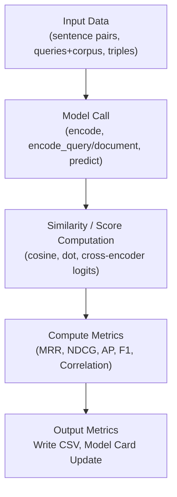
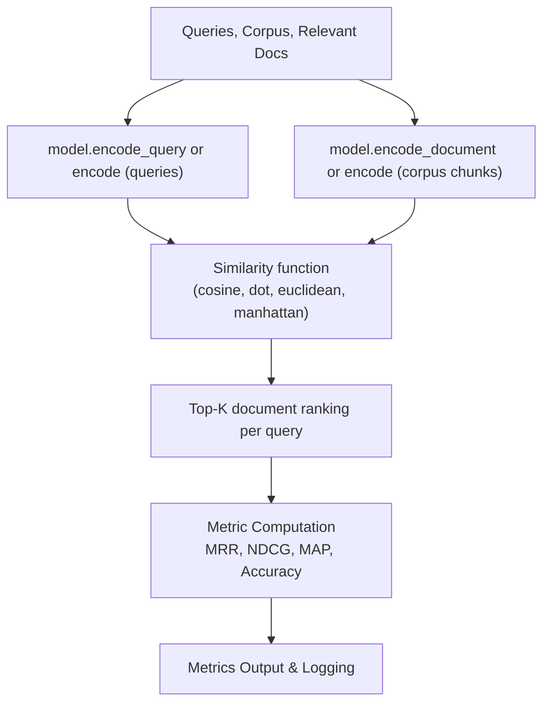
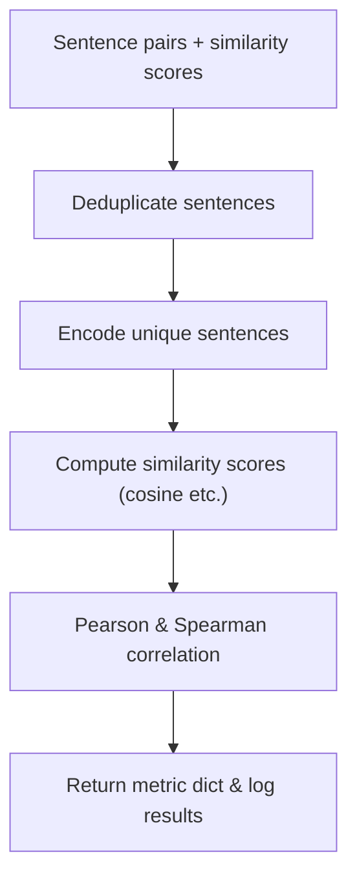
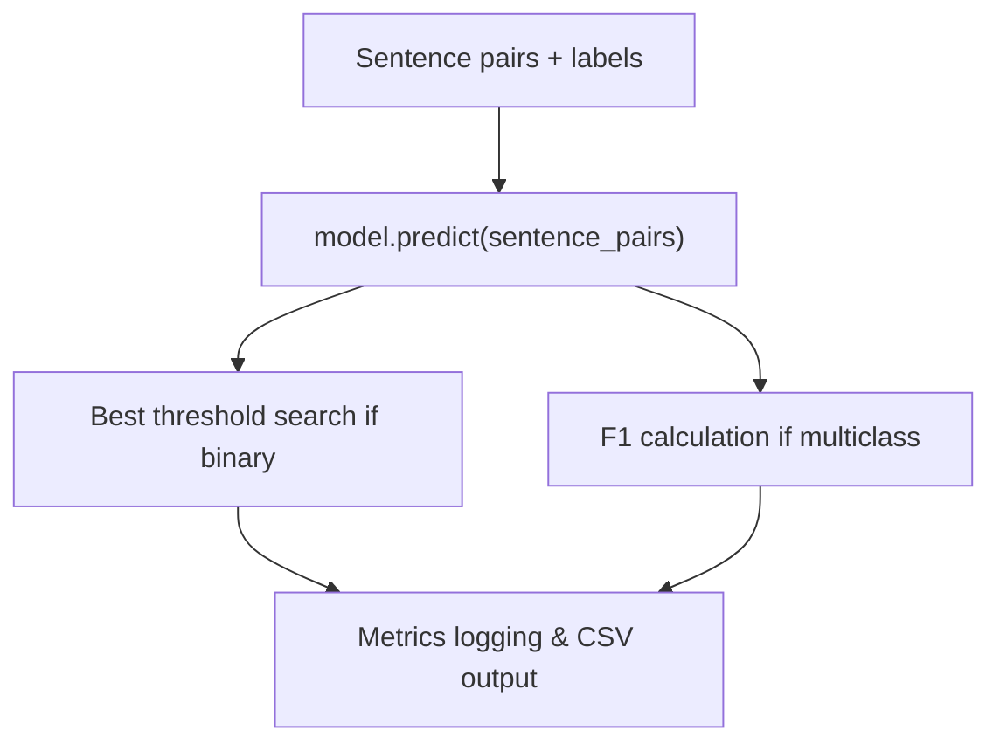
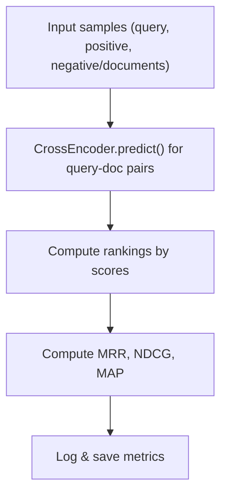
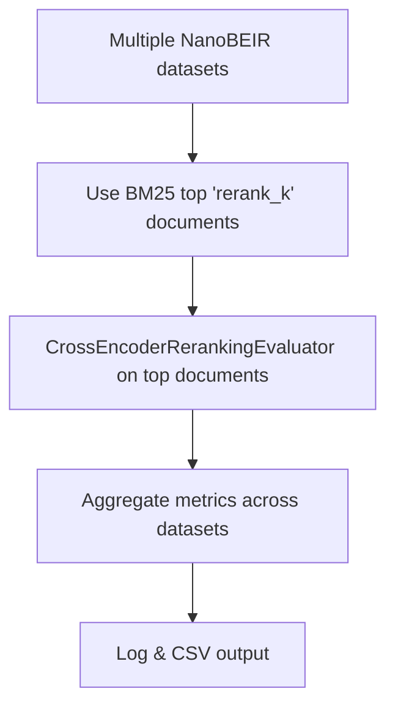

<!-- source: DeepWiki mcp.deepwiki.com · repo huggingface/sentence-transformers · page 6.2 Dense Model Evaluators · fetched 2026-10-26 -->

# Dense Model Evaluators

<details>
<summary>Relevant source files</summary>

The following files were used as context for generating this wiki page:

- [docs/sentence_transformer/usage/mteb_evaluation.md](docs/sentence_transformer/usage/mteb_evaluation.md)
- [sentence_transformers/cross_encoder/evaluation/classification.py](sentence_transformers/cross_encoder/evaluation/classification.py)
- [sentence_transformers/cross_encoder/evaluation/correlation.py](sentence_transformers/cross_encoder/evaluation/correlation.py)
- [sentence_transformers/cross_encoder/evaluation/nano_beir.py](sentence_transformers/cross_encoder/evaluation/nano_beir.py)
- [sentence_transformers/cross_encoder/evaluation/reranking.py](sentence_transformers/cross_encoder/evaluation/reranking.py)
- [tests/cross_encoder/evaluation/__init__.py](tests/cross_encoder/evaluation/__init__.py)
- [tests/cross_encoder/evaluation/test_reranking.py](tests/cross_encoder/evaluation/test_reranking.py)
- [tests/sentence_transformer/evaluation/__init__.py](tests/sentence_transformer/evaluation/__init__.py)
- [tests/sentence_transformer/evaluation/test_binary_classification_evaluator.py](tests/sentence_transformer/evaluation/test_binary_classification_evaluator.py)
- [tests/sentence_transformer/evaluation/test_label_accuracy_evaluator.py](tests/sentence_transformer/evaluation/test_label_accuracy_evaluator.py)
- [tests/sentence_transformer/evaluation/test_nanobeir_evaluator.py](tests/sentence_transformer/evaluation/test_nanobeir_evaluator.py)
- [tests/sentence_transformer/evaluation/test_paraphrase_mining_evaluator.py](tests/sentence_transformer/evaluation/test_paraphrase_mining_evaluator.py)
- [tests/sentence_transformer/evaluation/test_triplet_evaluator.py](tests/sentence_transformer/evaluation/test_triplet_evaluator.py)

</details>


## Purpose and Scope

This page provides a comprehensive reference for evaluators designed to assess the performance of dense embedding models (`SentenceTransformer` and related cross-encoder models). These evaluators compute metrics for tasks including information retrieval, semantic similarity, classification, reranking, and benchmark collections like NanoBEIR.

Dense evaluators are specialized for models producing dense, fixed-size embeddings or cross-encoder scores, and can be integrated during training or used standalone. For sparse model evaluators, see [Sparse Model Evaluators](#6.3). For the evaluation system overview, see [Evaluation System Overview](#6.1).

---

## Evaluator Architecture and Data Flow

Dense evaluators typically inherit from `BaseEvaluator` or its specialized subclasses and follow a common evaluation pattern:

1. **Input Processing:** Receives input data structured per task (sentence pairs, queries + docs, triples, etc.).
2. **Embedding / Prediction:** Uses model API (`encode()`, `encode_query()`, `encode_document()`, or `predict()` for cross-encoders) to obtain embeddings or predictions.
3. **Similarity / Score Calculation:** Computes pairwise similarities or ranks with chosen similarity functions or model predictions.
4. **Metric Computation:** Computes task-specific metrics (e.g., MRR, NDCG, F1, correlation).
5. **Output and Logging:** Returns metrics dictionary, writes CSV and updates model card.



---

## Core Dense Evaluator Classes and Task Associations

Below is an association between high-level evaluator tasks (natural language evaluation contexts) and the core code classes implementing them.

```mermaid
graph TD
    subgraph "NaturalLanguageTasks"
        IR["Information Retrieval"]
        Similarity["Semantic Similarity"]
        Classification["Classification"]
        Reranking["Reranking"]
        NanoBEIR["NanoBEIR Benchmark"]
    end

    subgraph "CodeEntities"
        IREval["InformationRetrievalEvaluator<br/>sentence_transformers.evaluation.InformationRetrievalEvaluator"]
        EmbSimEval["EmbeddingSimilarityEvaluator<br/>sentence_transformers.evaluation.EmbeddingSimilarityEvaluator"]
        BinClassEval["BinaryClassificationEvaluator<br/>sentence_transformers.cross_encoder.evaluation.classification.CrossEncoderClassificationEvaluator"]
        CorrEval["CrossEncoderCorrelationEvaluator<br/>sentence_transformers.cross_encoder.evaluation.correlation.CrossEncoderCorrelationEvaluator"]
        RerankEval["CrossEncoderRerankingEvaluator<br/>sentence_transformers.cross_encoder.evaluation.reranking.CrossEncoderRerankingEvaluator"]
        NanoBEIREval["CrossEncoderNanoBEIREvaluator<br/>sentence_transformers.cross_encoder.evaluation.nano_beir.CrossEncoderNanoBEIREvaluator"]
    end

    IR --> IREval
    Similarity --> EmbSimEval
    Similarity --> CorrEval
    Classification --> BinClassEval
    Reranking --> RerankEval
    NanoBEIR --> NanoBEIREval
```



---

# Detailed Evaluator References

---

## InformationRetrievalEvaluator

**Purpose:** Evaluates SentenceTransformer-style dense bi-encoder models on large retrieval tasks measuring ranking performance of queries retrieving relevant documents from a corpus.

**Key metrics:**
- Mean Reciprocal Rank (MRR@k)
- Normalized Discounted Cumulative Gain (NDCG@k)
- Mean Average Precision (MAP@k)
- Accuracy@k, Precision@k, Recall@k

**Data flow and implementation:**

- Inputs: `queries` (qid → text), `corpus` (docid → text), `relevant_docs` (qid → set of relevant docids)
- Encodes queries and corpus, optionally chunking corpus for memory efficiency.
- Computes similarity matrix using specified similarity function (e.g., cosine).
- Ranks documents per query and evaluates metrics from ground truth relevance.
- Supports asymmetric prompts for query/document via `query_prompt` and `corpus_prompt`.
- Outputs metrics logged, CSV written, and model card data updated.



**Constructor key parameters:**

- `queries`, `corpus`, `relevant_docs`
- `corpus_chunk_size`: Batched corpus encoding chunk size (default: 50000)
- `score_functions`: Dict specifying similarity metrics (default: model's similarity)
- Metrics `@k` parameters like `map_at_k`, `mrr_at_k`, `ndcg_at_k`
- `batch_size`, `show_progress_bar`, `truncate_dim` for embedding control
- Prompt parameters to support asymmetric encoding

**Example usage:**

```python
ir_evaluator = InformationRetrievalEvaluator(
    queries=queries_dict,
    corpus=corpus_dict,
    relevant_docs=relevant_docs_dict,
    name="BeIR-touche2020",
)
results = ir_evaluator(model)
print(results)
```

**Sources:** [sentence_transformers/evaluation/InformationRetrievalEvaluator.py:1-569]()

---

## EmbeddingSimilarityEvaluator

**Purpose:** Evaluates semantic similarity of SentenceTransformer models via correlation with human-annotated similarity scores on benchmark datasets.

**Metrics computed:**
- Pearson correlation coefficient
- Spearman rank correlation coefficient

For multiple similarity functions: cosine, euclidean, manhattan, dot product.

**Data flow:**

- Input: paired sentences and gold similarity scores.
- Deduplicates sentences for efficiency before encoding.
- Computes pairwise similarity between embedded sentence pairs.
- Calculates correlations of predicted similarity with gold labels.



**Constructor highlights:**

- `sentences1`, `sentences2`, `scores`
- `main_similarity` to select primary metric
- Optionally control batch size, precision, truncation dimension.

**Usage:**

```python
evaluator = EmbeddingSimilarityEvaluator.from_input_examples(test_samples, name="sts-dev")
scores = model.evaluate(evaluator)
print(scores)
```

**Sources:** [sentence_transformers/evaluation/EmbeddingSimilarityEvaluator.py:1-273]()

---

## CrossEncoderClassificationEvaluator

**Purpose:** Evaluates CrossEncoder models for classification tasks based on labeled sentence pairs.

**Metrics:**
- For binary classification (single label output): accuracy, F1, precision, recall, average precision (AP).
- For multi-class (multi-output): macro, micro, weighted F1.

**Implementation outline:**

- Input: list of sentence pairs + gold labels.
- Calls cross-encoder's `predict()` to get logits or scores.
- For binary: finds best accuracy and F1 thresholds over predictions.
- For multi-class: predicts label argmax and computes F1 scores.
- Writes results and logs metrics.



**Constructor:

- `sentence_pairs`, `labels`
- `batch_size`, `show_progress_bar`, `write_csv`

**Example:**

```python
evaluator = CrossEncoderClassificationEvaluator(sentence_pairs, labels, name="dataset-dev")
results = evaluator(model)
print(results)
```

**Sources:** [sentence_transformers/cross_encoder/evaluation/classification.py:1-170]()

---

## CrossEncoderCorrelationEvaluator

**Purpose:** Measures Pearson and Spearman correlations between model predicted scores and continuous gold scores on sentence pairs.

**Data flow:**

- Inputs: sentence pairs + continuous scores.
- Predicts scores with CrossEncoder.
- Computes correlations.

**Example use:**

```python
evaluator = CrossEncoderCorrelationEvaluator(sentence_pairs, scores, name="sts-dev")
results = evaluator(model)
print(results)
```

**Sources:** [sentence_transformers/cross_encoder/evaluation/correlation.py:1-143]()

---

## CrossEncoderRerankingEvaluator

**Purpose:** Evaluates CrossEncoder models on reranking tasks, where a query and candidate documents (positives and negatives) are given.

**Metrics:** Mean Reciprocal Rank (MRR@k), NDCG@k, Mean Average Precision (MAP).

**Key features:**

- Accepts samples with keys: `query`, `positive`, and either `negative` or `documents`.
- Supports reranking either all documents or partial sets.
- Can consider whether positives are always reranked or only if present in the candidate docs.
- Uses CrossEncoder's `predict()` on query-document pairs to compute reranking scores.

**Encoding modes:**

- Batched encoding (default): encodes all queries and docs in batch.
- Individual per-sample encoding: memory efficient but slower.



**Constructor parameters:**

- `samples`: List of dict with query and positive/negative documents.
- `at_k`: cutoff for evaluation.
- `always_rerank_positives`
- `batch_size`, `show_progress_bar`, `write_csv`, etc.

**Example:**

```python
evaluator = CrossEncoderRerankingEvaluator(samples, at_k=10, name="ms-marco-dev")
results = evaluator(model)
print(results)
```

**Sources:** [sentence_transformers/cross_encoder/evaluation/reranking.py:1-200]()

---

## CrossEncoderNanoBEIREvaluator

**Purpose:** Provides fast evaluation of CrossEncoder models on a curated subset of BEIR IR datasets called NanoBEIR for quick retrieval performance assessment.

**Key aspects:**

- Evaluates on multiple datasets with BM25 initial ranking for reranking top documents.
- Supports reranking only `rerank_k` top documents from BM25.
- Reports metrics same as reranking evaluator (MRR, NDCG, MAP) per dataset and average.
- Allows configuration of dataset subsets, rerank cutoff, batch size, etc.



**Constructor highlights:**

- `dataset_names`: List of dataset shortnames.
- `dataset_id`: HF dataset that contains corpus, queries, qrels, bm25 rankings.
- `rerank_k`: Number of documents to rerank.
- Various batch and evaluation controls.

**Use case:** Rapid prototyping and evaluation on standard IR benchmarks without full BEIR cost.

**Example:**

```python
evaluator = CrossEncoderNanoBEIREvaluator(["msmarco", "nfcorpus", "nq"])
results = evaluator(model)
print(results)
```

**Sources:** [sentence_transformers/cross_encoder/evaluation/nano_beir.py:1-150]()

---

# Summary Table of Dense Model Evaluators

| Evaluator Class                           | Task                  | Model Type         | Input Data Format                                                     | Key Metrics                          | Source File and Lines                        |
|------------------------------------------|-----------------------|--------------------|----------------------------------------------------------------------|------------------------------------|----------------------------------------------|
| `InformationRetrievalEvaluator`          | Dense Bi-Encoder IR   | SentenceTransformer | Queries dict, Corpus dict, Relevant docs dict                        | MRR@k, NDCG@k, MAP@k, Recall, Precision | evaluation/InformationRetrievalEvaluator.py |
| `EmbeddingSimilarityEvaluator`           | STS & Similarity      | SentenceTransformer | Sentence pairs + similarity scores                                  | Pearson, Spearman correlations     | evaluation/EmbeddingSimilarityEvaluator.py   |
| `CrossEncoderClassificationEvaluator`   | Classification        | CrossEncoder       | Sentence pairs + class labels                                        | Accuracy, F1, AP, Precision, Recall| cross_encoder/evaluation/classification.py   |
| `CrossEncoderCorrelationEvaluator`       | Regression/STS        | CrossEncoder       | Sentence pairs + continuous scores                                  | Pearson, Spearman correlations     | cross_encoder/evaluation/correlation.py      |
| `CrossEncoderRerankingEvaluator`          | Reranking             | CrossEncoder       | Query + positives + negatives/documents                             | MRR@k, NDCG@k, MAP                 | cross_encoder/evaluation/reranking.py         |
| `CrossEncoderNanoBEIREvaluator`           | IR Benchmark (NanoBEIR)| CrossEncoder      | Supported NanoBEIR datasets with BM25 rankings                     | MRR@k, NDCG@k, MAP, aggregated     | cross_encoder/evaluation/nano_beir.py         |

---

# Integration with Training and Standalone Evaluation

Dense evaluators implement callables compatible with the training system. They can be passed to the `SentenceTransformerTrainer` or equivalent cross-encoder trainers and called per evaluation cycle, producing metrics and saving results automatically.

Example standalone usage pattern:

```python
from sentence_transformers import SentenceTransformer
from sentence_transformers.evaluation import InformationRetrievalEvaluator

model = SentenceTransformer("all-MiniLM-L6-v2")
evaluator = InformationRetrievalEvaluator(queries, corpus, relevant_docs, name="dev")
results = evaluator(model)
print(results)
```

---

# Additional Notes

- Many evaluators accept a `truncate_dim` parameter enabling dimension truncation of embeddings during evaluation (useful for studying lower-dimensional representations).
- Several evaluators support asymmetric encoding with different query/document prompts or separate encode methods.
- Evaluators write CSV files logging results per evaluation run if `write_csv=True`.
- Primary metrics are identified by each evaluator and used for model card data and best model selection during training.

---

# References and Sources

- [sentence_transformers/cross_encoder/evaluation/reranking.py:1-200]()
- [sentence_transformers/cross_encoder/evaluation/nano_beir.py:1-150]()
- [sentence_transformers/cross_encoder/evaluation/classification.py:1-170]()
- [sentence_transformers/cross_encoder/evaluation/correlation.py:1-143]()
- [sentence_transformers/evaluation/InformationRetrievalEvaluator.py:1-569]()
- [sentence_transformers/evaluation/EmbeddingSimilarityEvaluator.py:1-273]()

---

End of page.

---

