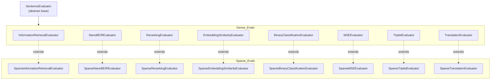
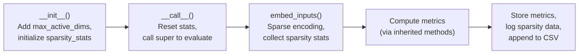
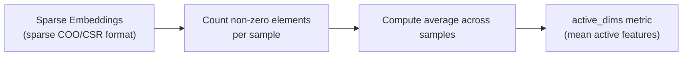
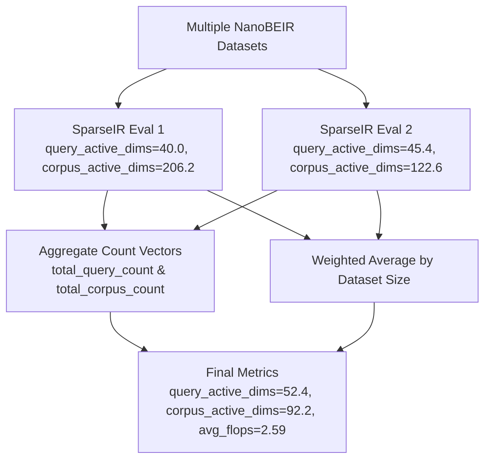
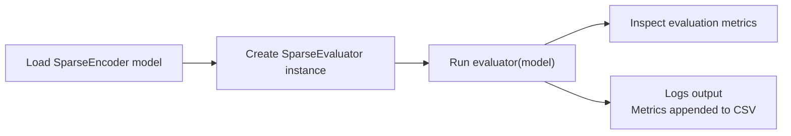
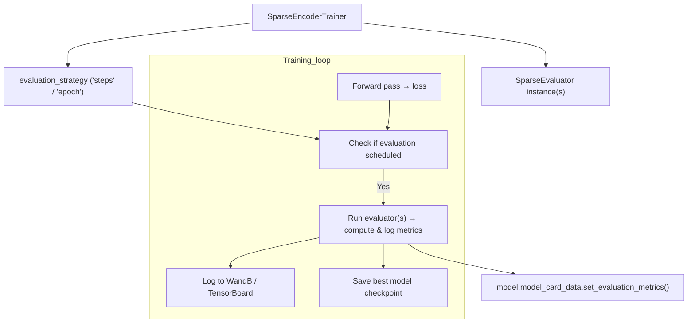
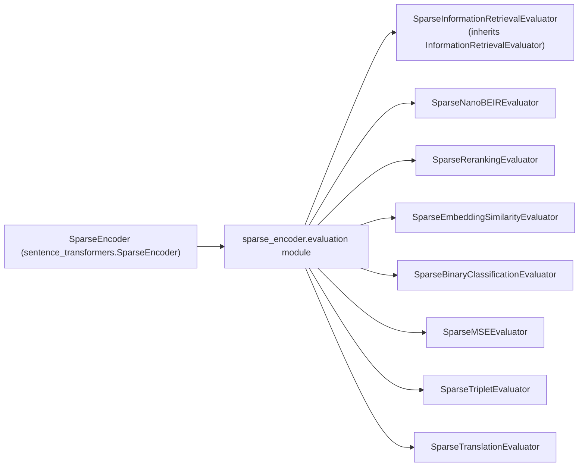
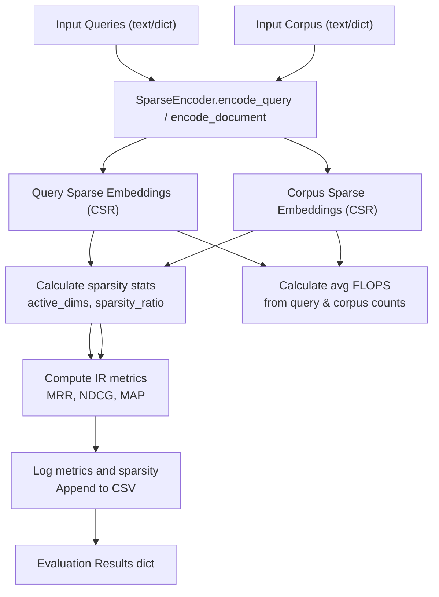

<!-- source: DeepWiki mcp.deepwiki.com · repo huggingface/sentence-transformers · page 6.3 Sparse Model Evaluators · fetched 2026-10-26 -->

# Sparse Model Evaluators

<details>
<summary>Relevant source files</summary>

The following files were used as context for generating this wiki page:

- [docs/package_reference/sparse_encoder/evaluation.md](docs/package_reference/sparse_encoder/evaluation.md)
- [examples/sentence_transformer/training/clip/training_clip_flickr8k_mlflow.py](examples/sentence_transformer/training/clip/training_clip_flickr8k_mlflow.py)
- [examples/sparse_encoder/applications/README.md](examples/sparse_encoder/applications/README.md)
- [examples/sparse_encoder/applications/retrieve_rerank/README.md](examples/sparse_encoder/applications/retrieve_rerank/README.md)
- [examples/sparse_encoder/applications/retrieve_rerank/hybrid_search.py](examples/sparse_encoder/applications/retrieve_rerank/hybrid_search.py)
- [examples/sparse_encoder/applications/retrieve_rerank/retrieve_rerank_simple_wikipedia.ipynb](examples/sparse_encoder/applications/retrieve_rerank/retrieve_rerank_simple_wikipedia.ipynb)
- [examples/sparse_encoder/evaluation/README.md](examples/sparse_encoder/evaluation/README.md)
- [examples/sparse_encoder/evaluation/sparse_classification_evaluator.py](examples/sparse_encoder/evaluation/sparse_classification_evaluator.py)
- [examples/sparse_encoder/evaluation/sparse_mse_evaluator.py](examples/sparse_encoder/evaluation/sparse_mse_evaluator.py)
- [examples/sparse_encoder/evaluation/sparse_nanobeir_advanced_evaluator.py](examples/sparse_encoder/evaluation/sparse_nanobeir_advanced_evaluator.py)
- [examples/sparse_encoder/evaluation/sparse_nanobeir_evaluator.py](examples/sparse_encoder/evaluation/sparse_nanobeir_evaluator.py)
- [examples/sparse_encoder/evaluation/sparse_reranking_evaluator.py](examples/sparse_encoder/evaluation/sparse_reranking_evaluator.py)
- [examples/sparse_encoder/evaluation/sparse_retrieval_evaluator.py](examples/sparse_encoder/evaluation/sparse_retrieval_evaluator.py)
- [examples/sparse_encoder/evaluation/sparse_similarity_evaluator.py](examples/sparse_encoder/evaluation/sparse_similarity_evaluator.py)
- [examples/sparse_encoder/evaluation/sparse_translation_evaluator.py](examples/sparse_encoder/evaluation/sparse_translation_evaluator.py)
- [examples/sparse_encoder/evaluation/sparse_triplet_evaluator.py](examples/sparse_encoder/evaluation/sparse_triplet_evaluator.py)

</details>


This page documents the evaluation system for **sparse encoder models** in the sentence-transformers library. Sparse model evaluators extend the capabilities of dense evaluators (covered in [Dense Model Evaluators](#6.2)) by introducing sparsity-specific metrics and computational efficiency measures designed to work with the `SparseEncoder` model class (see [SparseEncoder Architecture](#3.3)). These evaluators track metrics such as active embedding dimensions, sparsity ratios, and approximate floating point operations (FLOPS).

For general evaluation concepts and base classes, see [Evaluation System Overview](#6.1). For sparse model training and loss refer to [Sparse Model Loss Functions](#5.3.2).

---

## Architecture and Inheritance

Sparse evaluators follow a consistent design pattern by extending the corresponding dense evaluator classes while adding sparsity-specific functionality and metrics.

### Evaluator Class Hierarchy



This hierarchy showcases that each sparse evaluator inherits from its corresponding dense sibling, retaining core evaluation capabilities but overriding key methods to handle sparse tensor inputs and include sparsity statistics.

**Sources:** [sentence_transformers/sparse_encoder/evaluation](#all) (multiple files)

---

## Common Features Across Sparse Evaluators

Sparse evaluators incorporate unique features that diverge from dense evaluators by design:

| Feature                     | Dense Evaluators                       | Sparse Evaluators                                           |
|-----------------------------|--------------------------------------|------------------------------------------------------------|
| **Embedding Format**         | Dense tensors (NumPy arrays or Torch tensors) | Sparse tensors (e.g., CSR format)                           |
| **Encoding Parameters**      | `convert_to_numpy=True` or `convert_to_tensor=True` | `convert_to_sparse_tensor=True`, `save_to_cpu=True`         |
| **Additional Metrics**       | Standard IR and similarity metrics only | + active_dims, sparsity_ratio, average FLOPS               |
| **Dimension Limiting Param** | `truncate_dim`                       | `max_active_dims` (controls sparsity level)                |
| **Model Class**              | `SentenceTransformer`                | `SparseEncoder`                                            |

### Implementation Pattern

Sparse evaluators commonly override three main lifecycle methods: `__init__()`, `embed_inputs()`, and `__call__()` to incorporate sparsity tracking and enhanced metric logging.



This flow ensures that each evaluation cycle collects sparse embeddings, computes standard metrics and sparsity statistics, logs meaningful data, and persists it in CSV and model cards.

**Sources:**  
- `SparseInformationRetrievalEvaluator.__call__`, `embed_inputs` [SparseInformationRetrievalEvaluator:134-309]()  
- `SparseEmbeddingSimilarityEvaluator` [SparseEmbeddingSimilarityEvaluator:85-169]()  

---

## Sparsity Metrics

Sparse evaluators compute and report three primary sparsity-oriented metrics critical for understanding model efficiency and behavior.

### Active Dimensions (active_dims)

Measures the average number of non-zero elements per sample in sparse embeddings.



The count reflects the dimensional complexity the model uses to represent inputs. Lower active dimensions indicate higher sparsity and typically faster retrieval.

Obtained from `model.sparsity(embeddings)["active_dims"]`.

### Sparsity Ratio (sparsity_ratio)

Represents the fraction of zero (inactive) embedding dimensions:

```
sparsity_ratio = 1 - (active_dims / model.vocab_size)
```

For example, a sparsity ratio of 0.998 means 99.8% of embedding features are zero.

### Average FLOPS (avg_flops)

Estimates computational cost for dot-product similarity in retrieval by counting FLOPS:

```
avg_flops = dot(avg_query_count_vector, avg_corpus_count_vector)
```

This uses average counts of active features in query and corpus embeddings (sparse count vectors). Because FLOPS can only be approximated when both query and corpus embeddings are available, it's calculated only in retrieval evaluators.

---

## Individual Sparse Evaluators

### SparseInformationRetrievalEvaluator

Extends the dense `InformationRetrievalEvaluator` to add sparse-specific metrics tracked separately for queries and corpus.

- Accepts standard IR parameters plus `max_active_dims` (to limit active feature counts).
- Collects sparsity statistics for both query and corpus embeddings.
- Computes average FLOPS as a proxy for evaluation cost.

**Example usage:**

```python
from sentence_transformers import SparseEncoder
from sentence_transformers.sparse_encoder.evaluation import SparseInformationRetrievalEvaluator

model = SparseEncoder("naver/splade-cocondenser-ensembledistil")

evaluator = SparseInformationRetrievalEvaluator(
    queries=queries_dict,
    corpus=corpus_dict,
    relevant_docs=relevant_docs_dict,
    max_active_dims=256,  # Optional limit for active dims
    name="test-dataset"
)

results = evaluator(model)
# results include MRR@k, NDCG@k, MAP@k, plus sparsity metrics
```

**Implementation:**

- Overrides `embed_inputs()` to encode queries and corpus separately with sparsity statistics collection.
- Tracks weighted averages of active dimensions and sparsity ratios.
- Estimates average FLOPS from count vectors.

**Sources:** `SparseInformationRetrievalEvaluator` [SparseInformationRetrievalEvaluator.py:134-309]()

---

### SparseNanoBEIREvaluator

Evaluates across multiple NanoBEIR datasets aggregating both performance and sparsity statistics.

- Inherits from `NanoBEIREvaluator` but specifies `information_retrieval_class = SparseInformationRetrievalEvaluator`.
- When running per dataset, collects individual sparsity and count vector stats.
- Aggregates weighted averages across datasets by query count.
- Computes a final averaged FLOPS across all datasets.

**Aggregation flow:**



**Sources:** `SparseNanoBEIREvaluator` [SparseNanoBEIREvaluator.py:27-295]()

---

### SparseRerankingEvaluator

Specialized evaluator for reranking with sparse models.

- Uses `samples` format (queries with positive and negative candidates).
- Tracks separate sparsity statistics for queries and concatenated positive+negative documents.
- Returns traditional reranking metrics (MAP, MRR@k, NDCG@k) alongside sparsity info.
- Supports `use_batched_encoding` for performance.

**Implementation notes:**

- Maintains sparse tensors as lists (`convert_to_tensor=False`) to preserve slicing ability.
- Computes active_dims and sparsity_ratio for queries and documents separately.

**Sources:** `SparseRerankingEvaluator` [SparseRerankingEvaluator.py:21-212]()

---

### SparseEmbeddingSimilarityEvaluator

Evaluates the correlation of similarity scores (e.g., Pearson, Spearman) on paired sentences with sparsity reporting.

- Supports multiple similarity functions including cosine, dot, euclidean, manhattan.
- Calculates average sparsity across all embeddings in both sentence sets.
- Reports active_dims and sparsity_ratio of combined embeddings.

**Sources:** `SparseEmbeddingSimilarityEvaluator` [SparseEmbeddingSimilarityEvaluator.py:22-169]()

---

### SparseBinaryClassificationEvaluator

Measures classification metrics (accuracy, F1, precision, recall, AP, MCC) for binary classification tasks using sparse embeddings and similarity functions.

- Deduplicates sentences before encoding for efficiency.
- Supports multiple similarity functions.
- Tracks sparsity stats aggregated over all unique embeddings.

**Sources:** `SparseBinaryClassificationEvaluator` [SparseBinaryClassificationEvaluator.py:21-194]()

---

### SparseMSEEvaluator

Used for evaluating mean squared error (MSE) between a teacher and student sparse model, common in knowledge distillation.

- Warning: Does **not** use sparse tensors internally for MSE computation due to memory issues.
- Encodes with sparse options disabled (`convert_to_sparse_tensor=False`).
- Still computes sparsity statistics for reporting.
- Useful when distilling from a sparse teacher model.

```python
logger.warning(
    "The SparseMSEEvaluator is not handling the mse compute with sparse tensors yet. Memory issues may occur."
)
```

**Sources:** `SparseMSEEvaluator` [SparseMSEEvaluator.py:20-171]()

---

### SparseTripletEvaluator

Evaluates accuracy on triplet datasets (anchor, positive, negative) including sparse statistics for each component separately.

- Tracks active_dims and sparsity_ratio for anchors, positives, negatives individually.
- Uses prefix detection based on evaluation order (`anchor->positive->negative`) to assign embeddings.
- Measures accuracy if `sim(anchor, positive) > sim(anchor, negative) + margin`.

**Sources:** `SparseTripletEvaluator` [SparseTripletEvaluator.py:23-192]()

---

### SparseTranslationEvaluator

Measures translation matching accuracy on parallel corpora for two different languages.

- Tracks combined sparsity statistics across source and target languages.
- Reports bidirectional accuracy (`src2trg`, `trg2src`).
- Works with sparse tensors (`convert_to_tensor=False`).

**Sources:** `SparseTranslationEvaluator` [SparseTranslationEvaluator.py:23-159]()

---

## Usage Patterns

### Basic Sparse Evaluation Flow



### Example: Information Retrieval and Similarity Evaluation Combined

```python
from sentence_transformers import SparseEncoder
from sentence_transformers.sparse_encoder.evaluation import (
    SparseInformationRetrievalEvaluator,
    SparseEmbeddingSimilarityEvaluator
)

model = SparseEncoder("naver/splade-cocondenser-ensembledistil")

# Initialize evaluators
ir_evaluator = SparseInformationRetrievalEvaluator(
    queries=queries_dict,
    corpus=corpus_dict,
    relevant_docs=relevant_docs_dict,
    max_active_dims=256,
    name="nfcorpus"
)

sim_evaluator = SparseEmbeddingSimilarityEvaluator(
    sentences1=sts_dataset["sentence1"],
    sentences2=sts_dataset["sentence2"],
    scores=sts_dataset["score"],
    name="stsb"
)

ir_results = ir_evaluator(model)
sim_results = sim_evaluator(model)

print(f"NDCG@10: {ir_results['nfcorpus_dot_ndcg@10']:.4f}")
print(f"Query Sparsity: {ir_results['nfcorpus_query_active_dims']:.1f}")
print(f"Corpus Sparsity: {ir_results['nfcorpus_corpus_active_dims']:.1f}")
print(f"FLOPS: {ir_results['nfcorpus_avg_flops']:.2f}")
```

**Sources:** `examples/sparse_encoder/evaluation/sparse_similarity_evaluator.py:1-35`()

---

## CSV Output Format

Sparse evaluators extend CSV logs with extra sparsity metrics. Examples of added columns include:

| Evaluator Type                         | Additional CSV Columns                                                     |
|--------------------------------------|---------------------------------------------------------------------------|
| SparseInformationRetrievalEvaluator  | `query_active_dims`, `query_sparsity_ratio`, `corpus_active_dims`, `corpus_sparsity_ratio`, `avg_flops` |
| SparseNanoBEIREvaluator               | Same as above (aggregated across datasets)                               |
| SparseRerankingEvaluator              | `query_active_dims`, `query_sparsity_ratio`, `corpus_active_dims`, `corpus_sparsity_ratio` |
| SparseEmbeddingSimilarityEvaluator   | `active_dims`, `sparsity_ratio`                                           |
| SparseBinaryClassificationEvaluator  | `active_dims`, `sparsity_ratio`                                           |
| SparseMSEEvaluator                   | `active_dims`, `sparsity_ratio`                                           |
| SparseTripletEvaluator                | `anchor_active_dims`, `anchor_sparsity_ratio`, `positive_active_dims`, `positive_sparsity_ratio`, `negative_active_dims`, `negative_sparsity_ratio` |
| SparseTranslationEvaluator            | `active_dims`, `sparsity_ratio`                                           |

CSV appending is implemented with helper functions that add new columns to existing evaluation CSVs to integrate seamlessly with dense evaluator metrics.

---

## Integration with Training

Sparse evaluators integrate fully with the training pipeline via the `SparseEncoderTrainer`.



Example snippet:

```python
from sentence_transformers import SparseEncoder
from sentence_transformers.sparse_encoder import SparseEncoderTrainer
from sentence_transformers.sparse_encoder.evaluation import SparseInformationRetrievalEvaluator

model = SparseEncoder("distilbert-base-uncased")

evaluator = SparseInformationRetrievalEvaluator(
    queries=dev_queries,
    corpus=dev_corpus,
    relevant_docs=dev_qrels,
    name="dev"
)

trainer = SparseEncoderTrainer(
    model=model,
    train_dataset=train_dataset,
    evaluator=evaluator,
    eval_strategy="steps",
    eval_steps=1000,
    save_strategy="steps",
    metric_for_best_model="dev_dot_ndcg@10",
)
trainer.train()
```

**Sources:**  
- `SparseInformationRetrievalEvaluator` [SparseInformationRetrievalEvaluator.py:284-309]()  
- `SparseRerankingEvaluator` [SparseRerankingEvaluator.py:200-210]()  

---

## Model Card Integration

Sparse evaluators store evaluation results in the model card through:

```python
model.model_card_data.set_evaluation_metrics(metrics_dict, config_dict, epoch, step)
```

This enables automatic documentation of evaluation metrics, sparsity statistics, and configuration parameters in the model card, which is subsequently published to the Hugging Face Hub when pushing the model.

Stored evaluation info includes:

- All standard IR, similarity, classification metrics.
- Sparsity metrics: active dimensions, sparsity ratios, average FLOPS.
- Evaluator config values such as `max_active_dims`, dataset names.
- Epoch and step metadata.

This integration ensures comprehensive, reproducible evaluation logging as part of model documentation.

---

# Appendix: Example Mermaid Diagram Linking Natural Language Concepts to Code Entities

### Diagram: Sparse Evaluation System Overview



### Diagram: SparseInformationRetrievalEvaluator Data Flow



---

# Summary

Sparse Model Evaluators provide a rich, consistent evaluation framework specialized for sparse sentence transformers, integrating sparsity measures deeply into the evaluation lifecycle. Metrics like active dimensions, sparsity ratios, and FLOPS augment traditional IR, similarity, and classification metrics enabling users and researchers to understand both model accuracy and efficiency.

Use sparse evaluators to assess and optimize sparse encoder models such as SPLADE variants efficiently in retrieval, ranking, translation, and classification tasks.

---

**Sources:**  
- examples/sparse_encoder/evaluation/* (all files)  
- examples/sparse_encoder/evaluation/sparse_similarity_evaluator.py:1-35  
- examples/sparse_encoder/evaluation/sparse_retrieval_evaluator.py:1-74  
- examples/sparse_encoder/evaluation/sparse_nanobeir_evaluator.py:1-99  
- examples/sparse_encoder/evaluation/sparse_reranking_evaluator.py:1-212  
- examples/sparse_encoder/evaluation/sparse_embedding_similarity_evaluator.py:22-169  
- examples/sparse_encoder/evaluation/sparse_binary_classification_evaluator.py:21-194  
- examples/sparse_encoder/evaluation/sparse_mse_evaluator.py:20-171  
- examples/sparse_encoder/evaluation/sparse_triplet_evaluator.py:23-192  
- examples/sparse_encoder/evaluation/sparse_translation_evaluator.py:23-159  
- examples/sparse_encoder/applications/retrieve_rerank/hybrid_search.py:1-300 (overview references)

---

