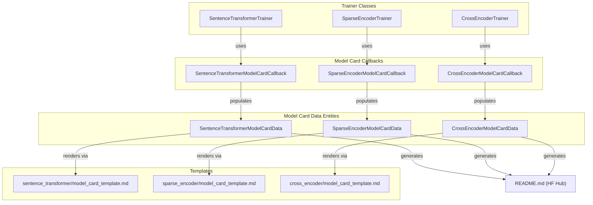
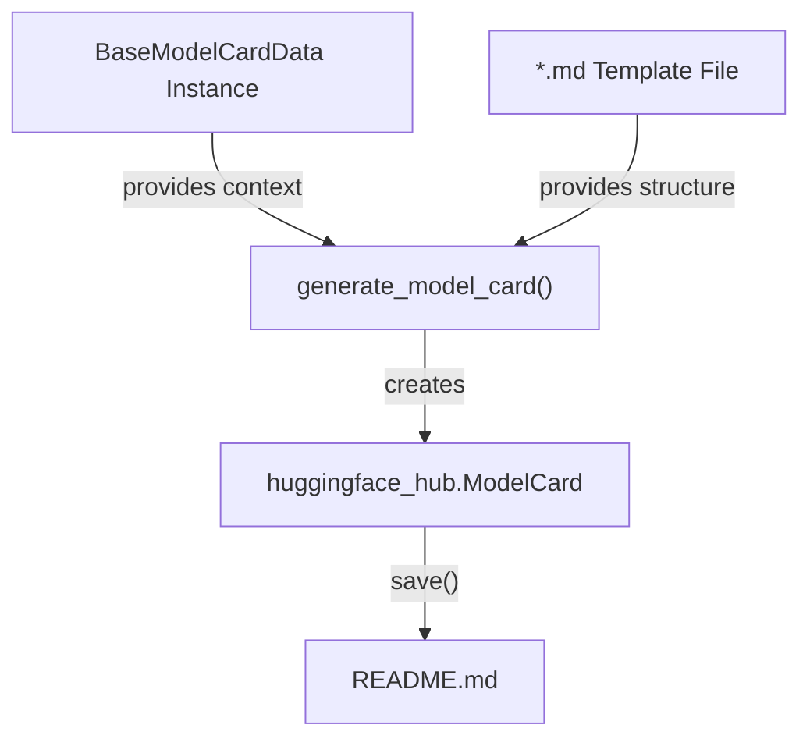

<!-- source: DeepWiki mcp.deepwiki.com · repo huggingface/sentence-transformers · page 7 Model Cards and Documentation · fetched 2026-10-26 -->

# Model Cards and Documentation

Relevant source files

The following files were used as context for generating this wiki page:

- [sentence_transformers/base/model_card.py](sentence_transformers/base/model_card.py)
- [sentence_transformers/base/model_card_template.md](sentence_transformers/base/model_card_template.md)
- [sentence_transformers/cross_encoder/model_card.py](sentence_transformers/cross_encoder/model_card.py)
- [sentence_transformers/cross_encoder/model_card_template.md](sentence_transformers/cross_encoder/model_card_template.md)
- [sentence_transformers/sentence_transformer/model_card.py](sentence_transformers/sentence_transformer/model_card.py)
- [sentence_transformers/sentence_transformer/model_card_template.md](sentence_transformers/sentence_transformer/model_card_template.md)
- [sentence_transformers/sparse_encoder/model_card.py](sentence_transformers/sparse_encoder/model_card.py)
- [sentence_transformers/sparse_encoder/model_card_template.md](sentence_transformers/sparse_encoder/model_card_template.md)
- [tests/base/modules/transformer/conftest.py](tests/base/modules/transformer/conftest.py)
- [tests/base/test_model_card.py](tests/base/test_model_card.py)
- [tests/cross_encoder/test_model_card.py](tests/cross_encoder/test_model_card.py)
- [tests/sentence_transformer/test_model_card.py](tests/sentence_transformer/test_model_card.py)
- [tests/sparse_encoder/test_model_card.py](tests/sparse_encoder/test_model_card.py)

This page explains the automatic model card and documentation system in the `sentence-transformers` library. It covers how model metadata, training details, evaluation results, and usage examples are collected and rendered into standardized model cards, and how these are integrated with the Hugging Face Hub. This system ensures that every model trained or shared with the library is accompanied by a reproducible, transparent, and informative model card.

**Scope:**  
- How model cards are generated and updated during training and saving.
- What metadata is collected and how it is structured.
- The template system for rendering model cards for different model types.
- Integration with the Hugging Face Hub and environmental impact tracking.
- How to customize or extend model card generation.

For details on the implementation of these classes, see [Model Card System](#7.1).  
For information about sharing models on the Hub, see [Sharing Models on the Hub](#7.2).  
For details on the model architectures themselves, see [Model Architecture](#3).  
For training and evaluation, see [Training Models](#5) and [Evaluation](#6).

---

## Purpose of Model Cards

Model cards provide a standardized, machine-readable, and human-readable summary of a model's:
- Architecture and configuration.
- Training and evaluation datasets.
- Loss functions and hyperparameters.
- Evaluation metrics and logs.
- Usage examples and code snippets.
- Environmental impact (if tracked).
- Citations and references.

This documentation is critical for reproducibility, transparency, and responsible sharing of models.

**Sources:**  
[sentence_transformers/base/model_card.py:265-354]()  
[sentence_transformers/sparse_encoder/model_card.py:25-66]()  
[sentence_transformers/cross_encoder/model_card.py:38-77]()  
[sentence_transformers/sentence_transformer/model_card.py:22-63]()  

---

## System Overview

The model card system is tightly integrated with the training and saving workflow. It automatically collects metadata during training and evaluation via `TrainerCallback` implementations, and renders a model card when the model is saved or pushed to the Hub.

### Diagram: Model Card System Integration

**Sources:**  
[sentence_transformers/base/model_card.py:100-113]()  
[sentence_transformers/sparse_encoder/model_card.py:20-21]()  
[sentence_transformers/cross_encoder/model_card.py:33-34]()  
[sentence_transformers/sentence_transformer/model_card.py:17-18]()  

---

## Model Card Data Collection

### Data Structures

Each model type has a dedicated dataclass inheriting from `BaseModelCardData` ([sentence_transformers/base/model_card.py:265-354]()) for storing model card data:
- `SentenceTransformerModelCardData` ([sentence_transformers/sentence_transformer/model_card.py:22-63]())
- `SparseEncoderModelCardData` ([sentence_transformers/sparse_encoder/model_card.py:25-66]())
- `CrossEncoderModelCardData` ([sentence_transformers/cross_encoder/model_card.py:38-77]())

These dataclasses store:
- **User Metadata:** `language`, `license`, `model_name`, `model_id`.
- **Dataset Info:** `train_datasets` and `eval_datasets` lists containing names and Hub IDs.
- **Inference Info:** `task_name`, `tags`, and automatically generated `usage_examples`.
- **Metrics:** `eval_metrics` collected during training or standalone evaluation.

### Automatic Metadata Tracking

The `BaseModelCardCallback` ([sentence_transformers/base/model_card.py:100-113]()) and its variants hook into training events to collect:
- **Dataset Metadata:** Inferred from dataset cache files during `on_init_end` ([sentence_transformers/base/model_card.py:124-133]()).
- **Loss Functions:** Extracted and formatted during `on_init_end` ([sentence_transformers/base/model_card.py:134-136]()).
- **Hyperparameters:** Captured during `on_train_begin`, distinguishing between all and non-default parameters ([sentence_transformers/base/model_card.py:142-184]()).
- **Logs:** Training and evaluation logs tracked at each step ([sentence_transformers/base/model_card.py:186-215]()).

**Sources:**  
[sentence_transformers/base/model_card.py:100-215]()  
[sentence_transformers/sparse_encoder/model_card.py:81-82]()  
[sentence_transformers/cross_encoder/model_card.py:89-90]()  

---

## Model Card Template Rendering

Each model type uses a Jinja2-based Markdown template to render the model card. The template is filled with the collected metadata and written as `README.md` when the model is saved.

### Template Features

- **Header:** YAML metadata for the Hugging Face Hub ([sentence_transformers/sparse_encoder/model_card_template.md:1-5]()).
- **Model Details:** Architecture, base model, sequence length, and similarity function ([sentence_transformers/sentence_transformer/model_card_template.md:11-26]()).
- **Full Model Architecture:** A string representation of the model's modular components ([sentence_transformers/cross_encoder/model_card_template.md:64-68]()).
- **Usage Snippets:** Automatically generated code for `SentenceTransformer.encode`, `CrossEncoder.predict`, or `SparseEncoder.encode` ([sentence_transformers/sparse_encoder/model_card_template.md:72-80]()).
- **Evaluation Tables:** Markdown tables generated from `eval_metrics` ([sentence_transformers/base/model_card.py:29]()).

### Diagram: Model Card Template Rendering

**Sources:**  
[sentence_transformers/base/model_card.py:20-24]()  
[sentence_transformers/sentence_transformer/model_card_template.md:1-154]()  
[sentence_transformers/sparse_encoder/model_card_template.md:1-154]()  
[sentence_transformers/cross_encoder/model_card_template.md:1-154]()  

---

## Environmental Impact Tracking

If the `CodeCarbonCallback` ([sentence_transformers/base/model_card.py:28]()) is present in the trainer, the model card system automatically captures carbon emission data.
- The `BaseModelCardCallback.on_init_end` method searches for a `CodeCarbonCallback` and registers it to the `model_card_data` ([sentence_transformers/base/model_card.py:116-121]()).
- This data is then rendered into the model card to provide transparency regarding the environmental cost of training.

**Sources:**  
[sentence_transformers/base/model_card.py:28]()  
[sentence_transformers/base/model_card.py:116-121]()  

---

## Customizing and Extending Model Cards

Users can customize the documentation by:
- Passing a custom `model_card_data` object to the model constructor ([sentence_transformers/sentence_transformer/model_card.py:53-62]()).
- Overriding default tags or task names in the `ModelCardData` dataclass ([sentence_transformers/sparse_encoder/model_card.py:72-79]()).
- Manually calling `generate_model_card` with specific parameters during a custom saving workflow.

**Sources:**  
[sentence_transformers/base/model_card.py:265-354]()  
[sentence_transformers/sparse_encoder/model_card.py:92-117]()  

---

## Summary

The model card and documentation system ensures that every model is accompanied by a detailed summary of its configuration, training, and evaluation. This is achieved through a robust callback system and flexible Jinja2 templates.

For more details on the specific data collected, see [Model Card System](#7.1).  
To learn how to push these cards to the Hub, see [Sharing Models on the Hub](#7.2).

**Sources:**  
[sentence_transformers/base/model_card.py]()  
[sentence_transformers/sentence_transformer/model_card.py]()  
[sentence_transformers/sparse_encoder/model_card.py]()  
[sentence_transformers/cross_encoder/model_card.py]()

---

