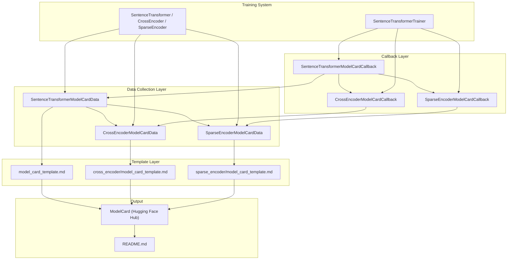
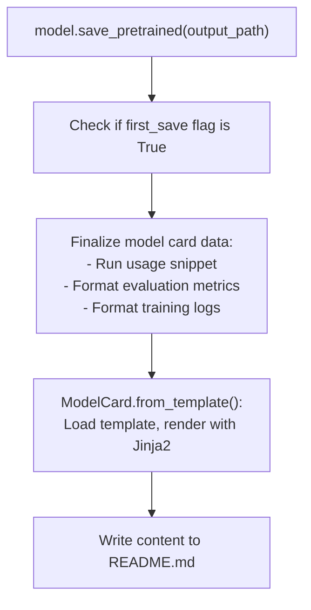

<!-- source: DeepWiki mcp.deepwiki.com · repo huggingface/sentence-transformers · page 7.1 Model Card System · fetched 2026-10-26 -->

# Model Card System

<details>
<summary>Relevant source files</summary>

The following files were used as context for generating this wiki page:

- [sentence_transformers/base/model_card.py](sentence_transformers/base/model_card.py)
- [sentence_transformers/base/model_card_template.md](sentence_transformers/base/model_card_template.md)
- [sentence_transformers/cross_encoder/model_card.py](sentence_transformers/cross_encoder/model_card.py)
- [sentence_transformers/cross_encoder/model_card_template.md](sentence_transformers/cross_encoder/model_card_template.md)
- [sentence_transformers/sentence_transformer/model_card.py](sentence_transformers/sentence_transformer/model_card.py)
- [sentence_transformers/sentence_transformer/model_card_template.md](sentence_transformers/sentence_transformer/model_card_template.md)
- [sentence_transformers/sparse_encoder/model_card.py](sentence_transformers/sparse_encoder/model_card.py)
- [sentence_transformers/sparse_encoder/model_card_template.md](sentence_transformers/sparse_encoder/model_card_template.md)
- [tests/base/modules/transformer/conftest.py](tests/base/modules/transformer/conftest.py)
- [tests/base/test_model_card.py](tests/base/test_model_card.py)
- [tests/cross_encoder/test_model_card.py](tests/cross_encoder/test_model_card.py)
- [tests/sentence_transformer/test_model_card.py](tests/sentence_transformer/test_model_card.py)
- [tests/sparse_encoder/test_model_card.py](tests/sparse_encoder/test_model_card.py)

</details>


The Model Card System automatically generates comprehensive documentation for trained models, tracking all aspects of the training process including datasets, hyperparameters, evaluation metrics, and environmental impact. This system ensures reproducibility and transparency by capturing metadata throughout training and generating standardized model cards that can be shared on the Hugging Face Hub.

For information about sharing models to the Hub, see [Sharing Models on the Hub](#7.2).

## System Architecture

The Model Card System consists of three main subsystems:

1.  **Data Collection**: `ModelCardData` dataclasses that store metadata.
2.  **Callback Integration**: `ModelCardCallback` classes that collect data during training.
3.  **Template Rendering**: Jinja2 templates that generate the final markdown.

### Architecture Overview
The following diagram illustrates the data flow from training entities to the final rendered model card.


**Sources:** [sentence_transformers/sentence_transformer/model_card.py:22-82](), [sentence_transformers/cross_encoder/model_card.py:38-98](), [sentence_transformers/sparse_encoder/model_card.py:25-90](), [sentence_transformers/base/model_card.py:100-141]()

## ModelCardData Class Hierarchy

The system uses a hierarchical dataclass structure where `BaseModelCardData` serves as the foundation, with specialized versions for SentenceTransformer, CrossEncoder, and SparseEncoder models.

### SentenceTransformerModelCardData
The base dataclass stores all metadata for dense sentence transformer models.

| Field | Type | Purpose |
| :--- | :--- | :--- |
| `language` | `str \| list[str]` | Model language(s) |
| `license` | `str` | Model license |
| `model_name` | `str` | Pretty display name |
| `model_id` | `str` | Hub model ID |
| `train_datasets` | `list[dict[str, str]]` | Training dataset metadata |
| `eval_datasets` | `list[dict[str, str]]` | Evaluation dataset metadata |
| `task_name` | `str` | Human-readable task description |
| `tags` | `list[str]` | Model tags for Hub search |

**Sources:** [sentence_transformers/sentence_transformer/model_card.py:22-63]()

### CrossEncoderModelCardData
Extends the base with CrossEncoder-specific logic for ranking and classification.

- **`task_name`**: Defaults to `"text reranking and semantic search"` if `num_labels == 1`, else `"text pair classification"` [sentence_transformers/cross_encoder/model_card.py:158-160]().
- **`pipeline_tag`**: Automatically set to `"text-ranking"` or `"text-classification"` [sentence_transformers/cross_encoder/model_card.py:161-162]().
- **`usage_examples`**: Stores query-answer pairs rather than single sentences [sentence_transformers/cross_encoder/model_card.py:152]().

### SparseEncoderModelCardData
Extends the base for sparse retrieval models (SPLADE, CSR).

- **`model_type`**: Automatically inferred from architecture modules like `SpladePooling` or `SparseAutoEncoder` [sentence_transformers/sparse_encoder/model_card.py:100-116]().
- **`max_active_dims`**: Captured for models using Constrained Sparse Representations (CSR) [sentence_transformers/sparse_encoder/model_card.py:132]().

**Sources:** [sentence_transformers/sparse_encoder/model_card.py:25-135]()

## ModelCardCallback Classes

The callback system integrates with the `transformers.Trainer` to collect metadata during training.

### Callback Lifecycle and Hooks

```mermaid
graph LR
    Init["on_init_end"]
    TrainBegin["on_train_begin"]
    Log["on_log"]
    Eval["on_evaluate"]
    
    Init --> TrainBegin
    TrainBegin --> Log
    Log --> Eval
    Eval --> Log
    
    Init -.-> "Extract datasets,<br/>Set losses,<br/>Generate widget"
    TrainBegin -.-> "Collect<br/>hyperparameters"
    Log -.-> "Record<br/>training loss"
    Eval -.-> "Record<br/>validation loss"
```

#### Hook: `on_init_end`
Executed after Trainer initialization. It performs:
1.  **Dataset Metadata Extraction**: Inferred from trainer's train and eval datasets [sentence_transformers/base/model_card.py:124-132]().
2.  **Loss Registration**: Identifies the loss functions used for training [sentence_transformers/base/model_card.py:134-136]().
3.  **Widget Examples**: Extracts samples from datasets to populate the Hub's interactive widget [sentence_transformers/base/model_card.py:139-140]().

#### Hook: `on_train_begin`
Captures training hyperparameters while ignoring infrastructure-related keys like `output_dir` or `hub_token` [sentence_transformers/base/model_card.py:150-183](). It also records the start time for duration tracking [sentence_transformers/base/model_card.py:184]().

#### Hook: `on_evaluate`
Extracts validation metrics (keys starting with `eval_` and ending with `_loss`) and tracks total evaluation duration [sentence_transformers/base/model_card.py:195-203]().

**Sources:** [sentence_transformers/base/model_card.py:100-203]()

## Metadata Collection Logic

### Dataset Statistics
The system computes detailed statistics for training and evaluation datasets by analyzing samples. For string columns, it calculates min, mean, and max lengths in tokens [sentence_transformers/base/model_card.py:72-91]().

### Widget Generation
`set_widget_examples` selects representative samples from the provided datasets. For `SentenceTransformer`, it creates `source_sentence` and `sentences` pairs [sentence_transformers/sentence_transformer/model_card.py:119-124](). For `CrossEncoder`, it identifies text pairs suitable for ranking [sentence_transformers/cross_encoder/model_card.py:119-152]().

### Loss and Citation Tracking
The system recursively extracts nested losses using `get_losses` [sentence_transformers/base/model_card.py:245-263](). It then maps these losses to BibTeX citations stored in the loss classes to ensure proper academic attribution in the model card [sentence_transformers/base/model_card.py:424-454]().

**Sources:** [sentence_transformers/base/model_card.py:245-263](), [sentence_transformers/base/model_card.py:424-454](), [sentence_transformers/sentence_transformer/model_card.py:119-124]()

## Template System

The system uses Jinja2 templates located in the respective model directories.

### Model Card Template Structure
The templates follow the Hugging Face Model Card specification, including:
-   **YAML Front Matter**: Metadata for Hub indexing (tags, language, license) [sentence_transformers/sentence_transformer/model_card_template.md:1-5]().
-   **Model Description**: High-level summary of the model and training data [sentence_transformers/sentence_transformer/model_card_template.md:7-9]().
-   **Full Model Architecture**: A text representation of the model's layers [sentence_transformers/sentence_transformer/model_card_template.md:64-68]().
-   **Evaluation**: Markdown tables for evaluation metrics [sentence_transformers/sentence_transformer/model_card_template.md:104-126]().
-   **Training Details**: Dataset statistics, loss functions with parameters, and hyperparameters [sentence_transformers/sentence_transformer/model_card_template.md:139-170]().

**Sources:** [sentence_transformers/sentence_transformer/model_card_template.md:1-170](), [sentence_transformers/cross_encoder/model_card_template.md:1-160](), [sentence_transformers/sparse_encoder/model_card_template.md:1-160]()

## Generation and Output

Model cards are generated during the `save_pretrained` call of the model classes.



### Usage Snippets
The system generates a runnable Python snippet for the model card. It even executes a small inference pass to provide example similarity scores or rankings directly in the documentation [sentence_transformers/sentence_transformer/model_card.py:113-127]().

**Sources:** [sentence_transformers/base/model_card.py:857-1200](), [sentence_transformers/sentence_transformer/model_card.py:113-127]()

---

