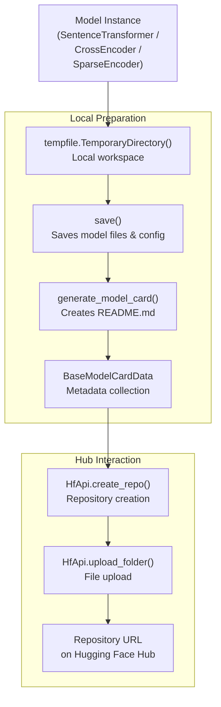
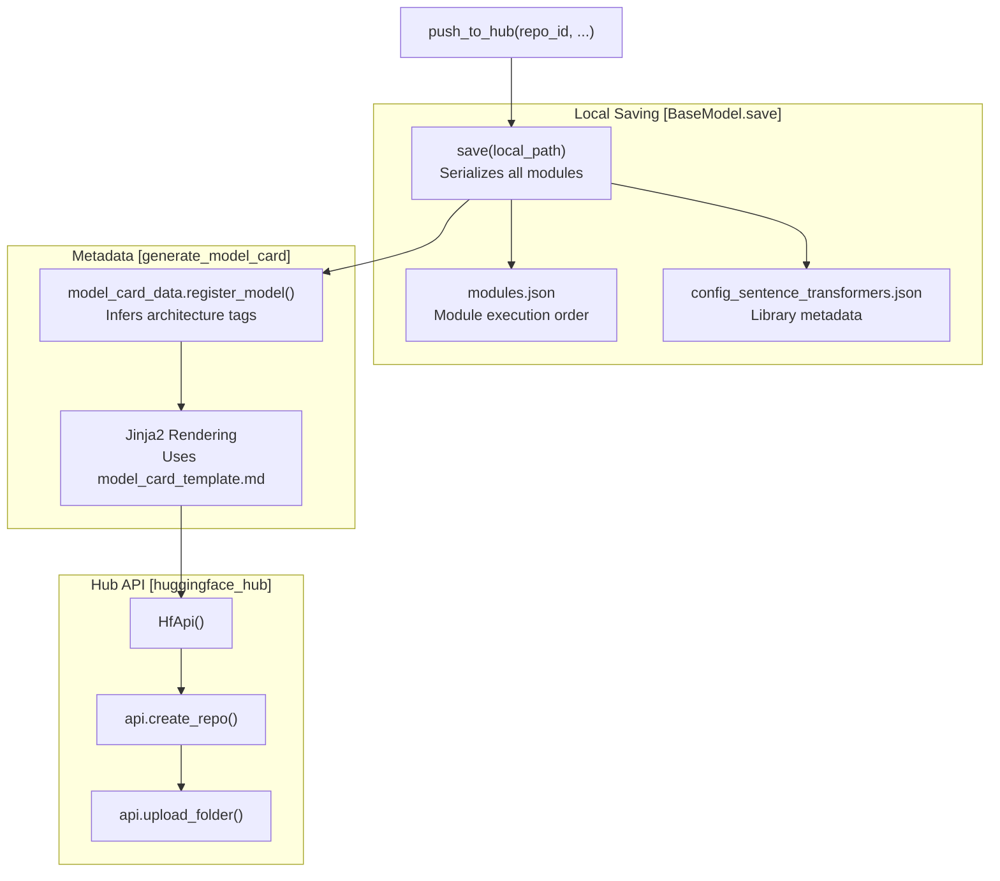
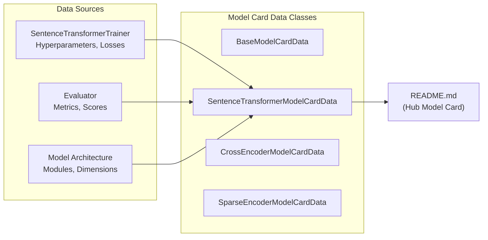
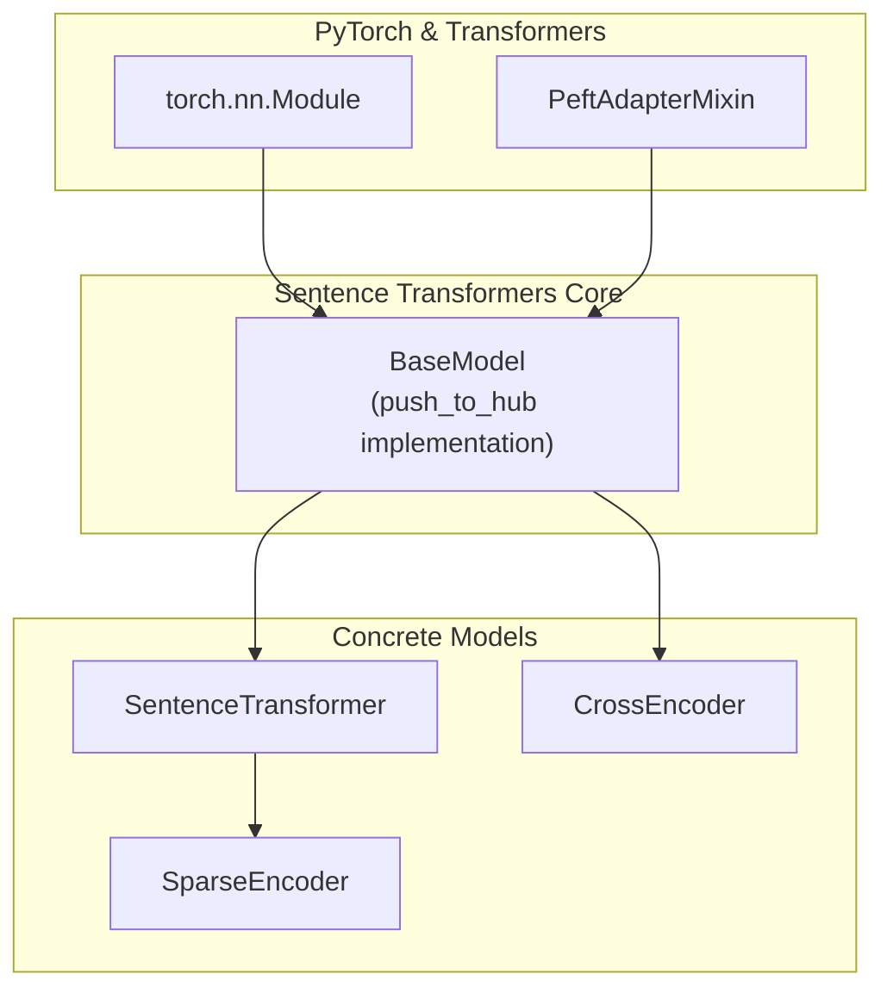

<!-- source: DeepWiki mcp.deepwiki.com · repo huggingface/sentence-transformers · page 7.2 Sharing Models on the Hub · fetched 2026-10-26 -->

# Sharing Models on the Hub

<details>
<summary>Relevant source files</summary>

The following files were used as context for generating this wiki page:

- [sentence_transformers/base/model.py](sentence_transformers/base/model.py)
- [sentence_transformers/base/model_card.py](sentence_transformers/base/model_card.py)
- [sentence_transformers/base/modules/transformer.py](sentence_transformers/base/modules/transformer.py)
- [sentence_transformers/cross_encoder/model.py](sentence_transformers/cross_encoder/model.py)
- [sentence_transformers/cross_encoder/model_card.py](sentence_transformers/cross_encoder/model_card.py)
- [sentence_transformers/sentence_transformer/model.py](sentence_transformers/sentence_transformer/model.py)
- [sentence_transformers/sentence_transformer/model_card.py](sentence_transformers/sentence_transformer/model_card.py)
- [sentence_transformers/sparse_encoder/model.py](sentence_transformers/sparse_encoder/model.py)
- [sentence_transformers/sparse_encoder/model_card.py](sentence_transformers/sparse_encoder/model_card.py)
- [tests/base/modules/transformer/conftest.py](tests/base/modules/transformer/conftest.py)
- [tests/base/test_model.py](tests/base/test_model.py)
- [tests/base/test_model_card.py](tests/base/test_model_card.py)
- [tests/cross_encoder/test_model_card.py](tests/cross_encoder/test_model_card.py)
- [tests/sentence_transformer/test_model_card.py](tests/sentence_transformer/test_model_card.py)
- [tests/sparse_encoder/test_model_card.py](tests/sparse_encoder/test_model_card.py)

</details>


This page describes how to share trained models on the Hugging Face Hub using the `push_to_hub` method. For information about model card generation and metadata collection, see [Model Card System](#7.1).

## Purpose and Scope

This document covers the process of uploading `SentenceTransformer`, `CrossEncoder`, and `SparseEncoder` models to the Hugging Face Hub. It explains the `push_to_hub` method, automatic model card generation, repository management, and best practices for model sharing. This applies to models trained using the library or custom models created from scratch.

## Overview

The model sharing workflow involves three main steps: saving the model locally with an automatically generated model card, creating a Hub repository, and uploading the model files. All three model types inherit from `BaseModel` and implement this workflow through a unified `push_to_hub` interface.

### Push to Hub Workflow



**Sources:** [sentence_transformers/base/model.py:611-638](), [sentence_transformers/base/model.py:658-693]()

## The push_to_hub Method

### Method Signature and Parameters

The `BaseModel` class defines the `push_to_hub` method which is inherited by all model types.

| Parameter | Type | Description |
|-----------|------|-------------|
| `repo_id` | `str` | Repository identifier in format `"username/model-name"` |
| `token` | `str \| bool \| None` | Hugging Face authentication token |
| `private` | `bool \| None` | Whether to create a private repository |
| `commit_message` | `str` | Commit message for the upload |
| `local_model_path` | `str \| None` | Local path to save before pushing (uses temp dir if None) |
| `exist_ok` | `bool` | Whether to overwrite existing repository |
| `replace_model_card` | `bool` | Whether to replace existing model card |
| `train_datasets` | `list[str] \| None` | Training dataset names/IDs for model card |
| `revision` | `str \| None` | Branch name for upload |
| `safe_serialization` | `bool` | Use safetensors format (recommended) |

**Sources:** [sentence_transformers/base/model.py:611-638]()

### Implementation Details

The implementation handles path resolution, local saving, and Hub API interaction sequentially.



**Sources:** [sentence_transformers/base/model.py:658-693](), [sentence_transformers/base/model.py:535-601]()

The `push_to_hub` method is decorated with `@save_to_hub_args_decorator` which handles backward compatibility for deprecated argument names like `repo_name` and `organization`.

**Sources:** [sentence_transformers/util/misc.py:554-632]() (referenced via import in `base/model.py`)

### Model-Specific Behavior

While all models use the same `push_to_hub` logic from `BaseModel`, the content of the repository varies based on the architecture:

**SentenceTransformer:**
- Saves a sequence of modules (Transformer, Pooling, Dense, etc.) into numbered subdirectories.
- Includes `config_sentence_transformers.json` with the library version and model type.
- **Sources:** [sentence_transformers/sentence_transformer/model.py:41-110]()

**CrossEncoder:**
- Typically saves as a single `Transformer` module combined with a classification head.
- Includes `config.json` with `num_labels` and label mappings.
- **Sources:** [sentence_transformers/cross_encoder/model.py:35-108]()

**SparseEncoder:**
- Saves specialized modules like `SpladePooling` or `SparseAutoEncoder`.
- Metadata includes `max_active_dims` for sparsity control.
- **Sources:** [sentence_transformers/sparse_encoder/model.py:35-107]()

## Model Card Generation Integration

### Automatic Metadata Collection

The `BaseModel` holds a `model_card_data` attribute (an instance of `BaseModelCardData` or its subclasses) which is populated during training and evaluation.



**Sources:** [sentence_transformers/base/model_card.py:265-455](), [sentence_transformers/sentence_transformer/model_card.py:25-50]()

### Model Card Templates

Each model type defines its own `template_path` to a Markdown file containing Jinja2 placeholders.

| Model Type | Data Class | Template Path |
|------------|------------|--------------|
| SentenceTransformer | `SentenceTransformerModelCardData` | `sentence_transformers/sentence_transformer/model_card_template.md` |
| CrossEncoder | `CrossEncoderModelCardData` | `sentence_transformers/cross_encoder/model_card_template.md` |
| SparseEncoder | `SparseEncoderModelCardData` | `sentence_transformers/sparse_encoder/model_card_template.md` |

**Sources:** [sentence_transformers/cross_encoder/model_card.py:95](), [sentence_transformers/sparse_encoder/model_card.py:86]()

## Repository Management

### Creating Repositories

The `push_to_hub` method uses `HfApi.create_repo` with `exist_ok=True` by default, allowing users to update existing models or create new ones seamlessly.

**Sources:** [sentence_transformers/base/model.py:682-683]()

### Branch and Revision Management

Users can specify a `revision` to push to a specific branch. If the branch does not exist, the library attempts to create it before uploading.

**Sources:** [sentence_transformers/base/model.py:685-687]()

## Examples

### SentenceTransformer Model

```python
from sentence_transformers import SentenceTransformer

model = SentenceTransformer("all-MiniLM-L6-v2")
# After training...
model.push_to_hub("username/my-awesome-model")
```

### CrossEncoder Model

```python
from sentence_transformers import CrossEncoder

model = CrossEncoder("cross-encoder/ms-marco-MiniLM-L6-v2")
model.push_to_hub("username/my-reranker", safe_serialization=True)
```

## Best Practices

### Repository Naming
- Use clear, descriptive names including the base model and task (e.g., `modernbert-base-stsb`).
- Use lowercase and hyphens.

### Model Card Metadata
- Ensure `train_datasets` and `eval_datasets` are provided to `push_to_hub` or the `ModelCardData` object to ensure proper indexing on the Hub.
- **Sources:** [sentence_transformers/base/model_card.py:300-340]()

### Safe Serialization
- Set `safe_serialization=True` (default) to save models in `.safetensors` format, which is faster to load and safer than Python pickles.
- **Sources:** [sentence_transformers/base/model.py:636]()

### Local Testing Before Upload
- Call `model.save(path)` and verify that the model can be reloaded using `SentenceTransformer(path)` before pushing to the Hub.
- **Sources:** [sentence_transformers/base/model.py:535-601]()

## Implementation Architecture

### Class Hierarchy for push_to_hub



**Sources:** [sentence_transformers/base/model.py:50-80](), [sentence_transformers/sentence_transformer/model.py:41](), [sentence_transformers/cross_encoder/model.py:35](), [sentence_transformers/sparse_encoder/model.py:35]()

### File Upload Process

The `BaseModel.push_to_hub` method performs the following:
1. Resolves the `repo_id`.
2. Creates a temporary directory if no `local_model_path` is provided.
3. Calls `self.save(path)` to write all module weights and configs.
4. Calls `generate_model_card(self)` to produce `README.md`.
5. Uses `huggingface_hub.HfApi` to create the repo and upload the entire folder contents.

**Sources:** [sentence_transformers/base/model.py:658-693]()

---

