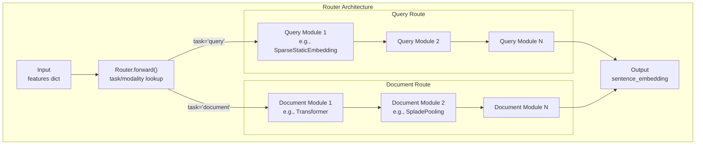
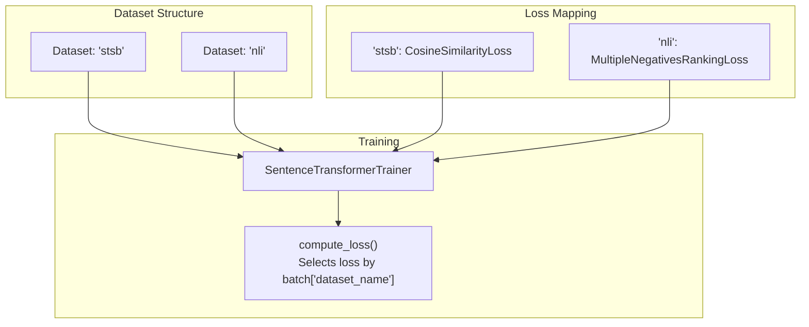

<!-- source: DeepWiki mcp.deepwiki.com · repo huggingface/sentence-transformers · page 8 Advanced Topics · fetched 2026-10-26 -->

# Advanced Topics

<details>
<summary>Relevant source files</summary>

The following files were used as context for generating this wiki page:

- [sentence_transformers/backend/load.py](sentence_transformers/backend/load.py)
- [sentence_transformers/backend/optimize.py](sentence_transformers/backend/optimize.py)
- [sentence_transformers/backend/quantize.py](sentence_transformers/backend/quantize.py)
- [sentence_transformers/base/evaluation/evaluator.py](sentence_transformers/base/evaluation/evaluator.py)
- [sentence_transformers/base/evaluation/sequential.py](sentence_transformers/base/evaluation/sequential.py)
- [sentence_transformers/base/modules/router.py](sentence_transformers/base/modules/router.py)
- [sentence_transformers/sparse_encoder/losses/flops.py](sentence_transformers/sparse_encoder/losses/flops.py)
- [sentence_transformers/util/misc.py](sentence_transformers/util/misc.py)
- [tests/base/modules/test_router.py](tests/base/modules/test_router.py)
- [tests/cross_encoder/test_backends.py](tests/cross_encoder/test_backends.py)
- [tests/sentence_transformer/test_backends.py](tests/sentence_transformer/test_backends.py)
- [tests/sparse_encoder/test_backends.py](tests/sparse_encoder/test_backends.py)
- [tests/util/test_misc.py](tests/util/test_misc.py)

</details>


This page covers advanced features and optimization techniques for Sentence Transformers that go beyond basic model usage and training. Topics include asymmetric model architectures with the Router module, training on multiple datasets simultaneously, backend optimization for faster inference (ONNX/OpenVINO), sophisticated batch sampling strategies, and prompt engineering for instruction-tuned models.

For basic model usage, see [Quick Start Guide](#2.2). For standard training workflows, see [Training Models](#5). For evaluation metrics, see [Evaluation](#6).

---

## Router Module for Asymmetric Models

The `Router` module enables asymmetric architectures that apply different encoding pipelines based on task type or modality. This is particularly useful for Information Retrieval where queries and documents benefit from different encoders (e.g., static embeddings for queries and full transformers for documents).

### Architecture Overview

The Router maintains separate module chains for different routes and selects which chain to execute based on the `task` or `modality` parameters.



**Sources:** [sentence_transformers/base/modules/router.py:24-65](), [sentence_transformers/base/modules/router.py:127-151]()

### Creating Router Models

The `Router` class provides two initialization patterns:

1. **Generic routing**: Pass a dictionary mapping route names to module lists [sentence_transformers/base/modules/router.py:29-35]().
2. **Query-document routing**: Use the `Router.for_query_document()` class method [sentence_transformers/base/modules/router.py:75-78]().

```python
from sentence_transformers import SentenceTransformer
from sentence_transformers.base.modules import Router, Normalize

# Example from router.py documentation
document_embedder = SentenceTransformer("mixedbread-ai/mxbai-embed-large-v1")
query_embedder = SentenceTransformer("sentence-transformers/static-retrieval-mrl-en-v1")

router = Router.for_query_document(
    query_modules=list(query_embedder.children()),
    document_modules=list(document_embedder.children()),
)
model = SentenceTransformer(modules=[router, Normalize()])
```

**Sources:** [sentence_transformers/base/modules/router.py:69-84](), [tests/base/modules/test_router.py:122-151]()

### Inference and Route Priority

The Router uses a priority system to find the correct route [sentence_transformers/base/modules/router.py:51-59]():
1. Exact match: `(task, modality)`
2. Task with any modality: `(task, None)`
3. Any task with modality: `(None, modality)`
4. Catch-all: `(None, None)`
5. Direct lookup in `sub_modules` by name.

For details, see [Router Module for Asymmetric Models](#8.1).

---

## Multi-Dataset Training

Multi-dataset training allows training a single model on multiple datasets simultaneously, optionally with different loss functions per dataset.

### Dataset Organization and Loss Mapping

The `SentenceTransformerTrainer` handles the mapping between datasets and losses. If a dictionary is provided for the `loss` argument, the keys must correspond to dataset names [sentence_transformers/base/evaluation/evaluator.py:10-101]().



For details, see [Multi-Dataset Training](#8.2).

---

## Backend Optimization

Sentence Transformers supports PyTorch (default), ONNX, and OpenVINO backends for optimized inference and deployment.

### Backend Support Matrix

| Backend | Library Required | Features |
|---------|------------------|----------|
| **torch** | `torch` | Default, supports training and all model types. |
| **onnx** | `optimum`, `onnxruntime` | Dynamic quantization, optimized for CPU/GPU [sentence_transformers/backend/optimize.py:19-26](). |
| **openvino** | `optimum`, `openvino` | Static quantization, Intel CPU/NPU optimization [sentence_transformers/backend/quantize.py:107-118](). |

### Quantization and Optimization

The library provides dedicated functions for exporting optimized models:
- `export_dynamic_quantized_onnx_model`: int8 dynamic quantization for ONNX [sentence_transformers/backend/quantize.py:24-31]().
- `export_static_quantized_openvino_model`: int8 static quantization using a calibration dataset for OpenVINO [sentence_transformers/backend/quantize.py:107-118]().
- `export_optimized_onnx_model`: Graph optimizations (O1-O4) [sentence_transformers/backend/optimize.py:19-26]().

For details, see [Backend Optimization](#8.3).

---

## Batch Sampling Strategies

Batch samplers control how training examples are grouped. This is critical for losses like `MultipleNegativesRankingLoss` where in-batch negatives are used.

### Sampler Types
- **Default**: Random sampling.
- **No Duplicates**: Ensures no duplicate texts within a single batch [sentence_transformers/sampler/NoDuplicatesBatchSampler.py]().
- **Group By Label**: Groups examples with the same label into the same batch [sentence_transformers/sampler/GroupByLabelBatchSampler.py]().
- **Multi-Dataset**: Supports `ROUND_ROBIN` or `PROPORTIONAL` sampling across different datasets.

For details, see [Batch Sampling Strategies](#8.4).

---

## Prompt Engineering

Prompts provide context for instruction-tuned models. They can be configured globally on the model or per-task.

### Configuration
- `model.prompts`: A dictionary of available prompts [sentence_transformers/SentenceTransformer.py]().
- `model.default_prompt_name`: The prompt used when none is specified.
- `encode(..., prompt_name="...")`: Explicitly select a prompt during inference.

For details, see [Prompt Engineering](#8.5).

---

## AI Agent Skill (train-sentence-transformers)

The `train-sentence-transformers` skill is a tool designed for AI coding agents to automate the training of Sentence Transformer models. It provides a standardized protocol for dataset preparation, training script generation, and model verification.

### Key Components
- **SKILL.md**: The router file defining how the agent should handle training requests.
- **Production Templates**: Standardized script templates for various training tasks (Retrieval, Classification, etc.).
- **Smoke-Test Protocol**: A verification step to ensure the trained model performs as expected before final delivery.

For details, see [AI Agent Skill (train-sentence-transformers)](#8.6).

---

**Sources:**
- [sentence_transformers/base/modules/router.py:1-344]()
- [sentence_transformers/backend/quantize.py:24-150]()
- [sentence_transformers/backend/optimize.py:19-103]()
- [sentence_transformers/backend/load.py:14-175]()
- [tests/base/modules/test_router.py:1-200]()
- [sentence_transformers/base/evaluation/evaluator.py:10-101]()
- [sentence_transformers/sparse_encoder/losses/flops.py:11-40]()

---

