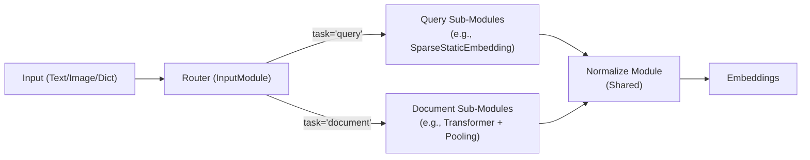
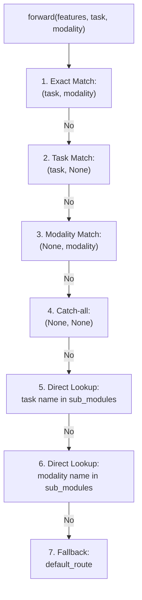
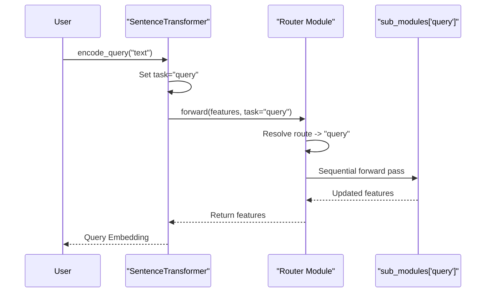

<!-- source: DeepWiki mcp.deepwiki.com · repo huggingface/sentence-transformers · page 8.1 Router Module for Asymmetric Models · fetched 2026-10-26 -->

# Router Module for Asymmetric Models

<details>
<summary>Relevant source files</summary>

The following files were used as context for generating this wiki page:

- [sentence_transformers/base/evaluation/evaluator.py](sentence_transformers/base/evaluation/evaluator.py)
- [sentence_transformers/base/evaluation/sequential.py](sentence_transformers/base/evaluation/sequential.py)
- [sentence_transformers/base/model.py](sentence_transformers/base/model.py)
- [sentence_transformers/base/modules/router.py](sentence_transformers/base/modules/router.py)
- [sentence_transformers/base/modules/transformer.py](sentence_transformers/base/modules/transformer.py)
- [sentence_transformers/cross_encoder/model.py](sentence_transformers/cross_encoder/model.py)
- [sentence_transformers/sentence_transformer/model.py](sentence_transformers/sentence_transformer/model.py)
- [sentence_transformers/sparse_encoder/losses/flops.py](sentence_transformers/sparse_encoder/losses/flops.py)
- [sentence_transformers/sparse_encoder/model.py](sentence_transformers/sparse_encoder/model.py)
- [sentence_transformers/util/misc.py](sentence_transformers/util/misc.py)
- [tests/base/modules/test_router.py](tests/base/modules/test_router.py)
- [tests/base/test_model.py](tests/base/test_model.py)
- [tests/util/test_misc.py](tests/util/test_misc.py)

</details>


## Purpose and Scope

The `Router` module enables the creation of **asymmetric** SentenceTransformer models that apply different encoder architectures based on the input type. Most commonly, this allows using separate encoding paths for queries versus documents in information retrieval tasks. For example, queries can use lightweight static embeddings while documents use full transformer models, or vice versa.

This page covers the `Router` module architecture, implementation details of task-based routing, and how it integrates with `encode_query` and `encode_document`.

**Sources:** [sentence_transformers/base/modules/router.py:29-64](), [sentence_transformers/base/modules/router.py:75-113]()

---

## Architecture Overview

The `Router` module acts as a dispatching layer that routes inputs through different sub-module chains based on a `task` or `modality` parameter. It typically sits at the beginning of a `SentenceTransformer` or `SparseEncoder` model's module sequence.

### Router Position in Model Architecture



**Router Module Position in SentenceTransformer Model**

The `Router` contains a `sub_modules` attribute of type `nn.ModuleDict` where keys are route names and values are `nn.Sequential` chains of modules.

**Sources:** [sentence_transformers/base/modules/router.py:24-27](), [sentence_transformers/base/modules/router.py:124-151]()

---

## Router Module Components

### Core Attributes

| Attribute | Type | Description |
|-----------|------|-------------|
| `sub_modules` | `nn.ModuleDict` | Maps route names to `nn.Sequential` module chains. |
| `default_route` | `str \| None` | The fallback route used when no task/modality is specified. |
| `route_mappings` | `dict` | Maps specific `(task, modality)` tuples to route names. |
| `forward_kwargs` | `set` | Includes `{"task", "modality"}` for parameter passing. |

**Sources:** [sentence_transformers/base/modules/router.py:25-35](), [sentence_transformers/base/modules/router.py:129-140]()

### Route Resolution Logic

The `Router` resolves which path to take using a hierarchical priority system:



**Task and Modality Resolution Hierarchy**

**Sources:** [sentence_transformers/base/modules/router.py:51-59](), [sentence_transformers/base/modules/router.py:218-283]()

---

## Creating Router-Based Models

### Using the `for_query_document` Helper

The `Router.for_query_document()` class method provides a standard way to create asymmetric models with `"query"` and `"document"` routes.

```python
from sentence_transformers import SentenceTransformer
from sentence_transformers.base.modules import Router, Normalize

# Load base models
doc_model = SentenceTransformer("mixedbread-ai/mxbai-embed-large-v1")
query_model = SentenceTransformer("sentence-transformers/static-retrieval-mrl-en-v1")

# Create Router with separate paths
router = Router.for_query_document(
    query_modules=list(query_model.children()),
    document_modules=list(doc_model.children()),
)

# Build final model
model = SentenceTransformer(modules=[router, Normalize()])
```

**Sources:** [sentence_transformers/base/modules/router.py:72-81](), [sentence_transformers/base/modules/router.py:188-216]()

### Router with SparseEncoder

The `Router` is a core component for "inference-free" query encoding in sparse retrieval, where queries use static lookups and documents use full transformers.

```python
from sentence_transformers.sparse_encoder import SparseEncoder
from sentence_transformers.base.modules import Router, Transformer
from sentence_transformers.sparse_encoder.modules import SparseStaticEmbedding, SpladePooling

doc_encoder = Transformer("opensearch-project/opensearch-neural-sparse-encoding-doc-v3-distill")
router = Router.for_query_document(
    query_modules=[SparseStaticEmbedding.from_json("...", tokenizer=doc_encoder.tokenizer)],
    document_modules=[doc_encoder, SpladePooling(pooling_strategy="max")]
)

model = SparseEncoder(modules=[router])
```

**Sources:** [sentence_transformers/base/modules/router.py:97-113](), [sentence_transformers/sparse_encoder/model.py:23-26]()

---

## Using Router Models for Inference

### Specialized Encoding Methods

The `SentenceTransformer` and `SparseEncoder` classes provide shorthand methods that automatically inject the correct `task` parameter into the routing logic.

| Method | Task Value | Use Case |
|--------|------------|----------|
| `encode_query()` | `"query"` | Encoding search queries for retrieval. |
| `encode_document()` | `"document"` | Encoding the corpus for indexing. |
| `encode()` | `None` | General encoding (uses `default_route`). |

**Sources:** [sentence_transformers/base/modules/router.py:46-47](), [sentence_transformers/sentence_transformer/model.py:41-43]()

### Task Parameter Flow



**Execution Flow for encode_query**

**Sources:** [sentence_transformers/base/modules/router.py:218-240](), [sentence_transformers/base/model.py:50-65]()

---

## Training Router Models

When training models containing a `Router`, the `SentenceTransformerTrainer` requires a `router_mapping` to know which dataset columns correspond to which routes.

### Router Mapping Configuration

```python
args = SentenceTransformerTrainingArguments(
    output_dir="output",
    router_mapping={
        "query_column": "query",
        "doc_column": "document"
    }
)
```

The `SentenceTransformerDataCollator` uses this mapping during tokenization to attach the `task` metadata to the batch features, which the `Router` then consumes during the forward pass.

**Sources:** [sentence_transformers/base/modules/router.py:34-35](), [sentence_transformers/base/model.py:76-79]()

---

## Model Properties and Internals

### Saving and Loading

Router models save their configuration to `router_config.json` and store sub-modules in indexed subdirectories (e.g., `query_0_Transformer`, `document_0_Transformer`).

**Sources:** [sentence_transformers/base/modules/router.py:27](), [sentence_transformers/base/modules/router.py:313-355]()

### Property Delegation

The `Router` delegates several properties to its sub-modules:
- **`max_seq_length`**: Returns the maximum `max_seq_length` across all routes. Setting it updates all sub-modules.
- **`get_sentence_embedding_dimension()`**: Returns the dimension from the first route that defines it.

**Sources:** [sentence_transformers/base/modules/router.py:247-252](), [tests/base/modules/test_router.py:89-120]()

**Page Sources:**
- [sentence_transformers/base/modules/router.py:1-355]()
- [sentence_transformers/base/model.py:50-100]()
- [sentence_transformers/sentence_transformer/model.py:41-113]()
- [sentence_transformers/sparse_encoder/model.py:35-107]()
- [tests/base/modules/test_router.py:1-200]()

---

