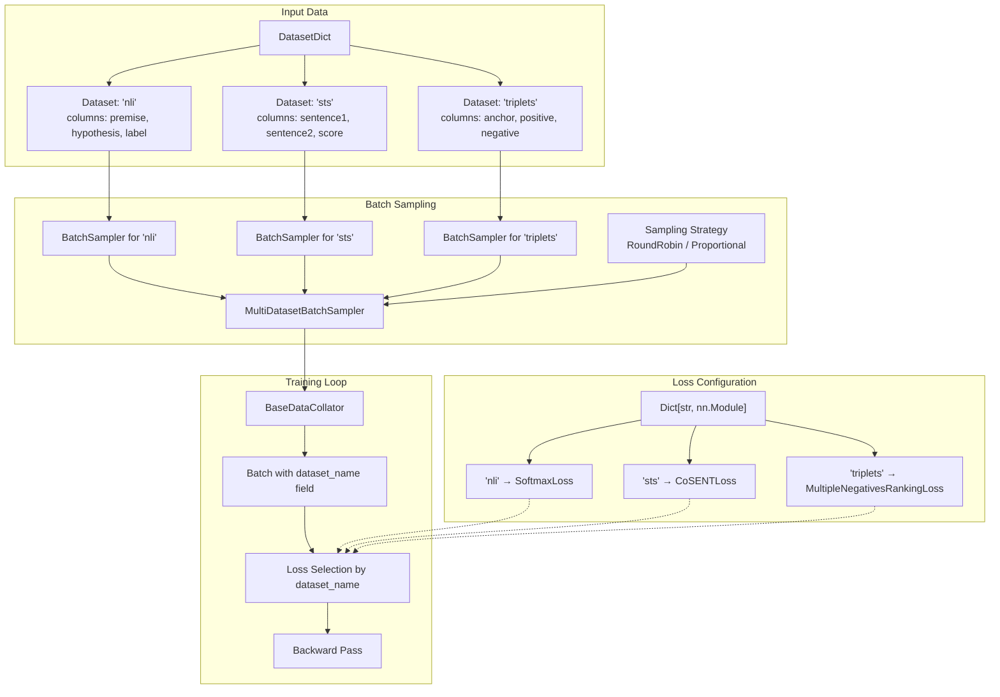
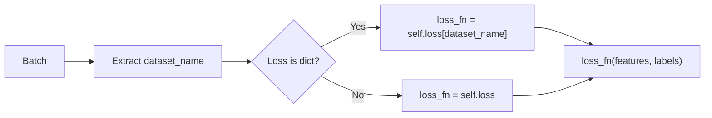
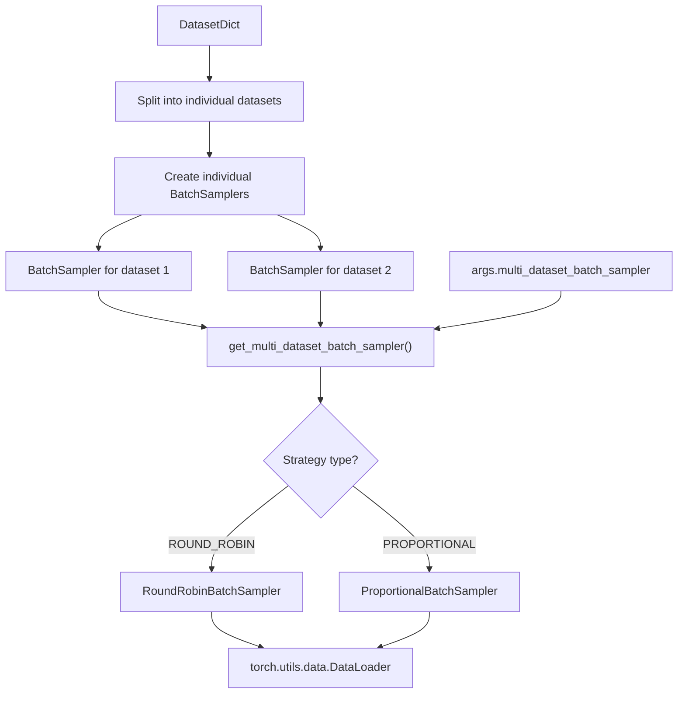
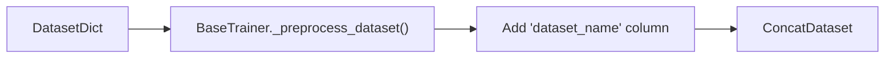

<!-- source: DeepWiki mcp.deepwiki.com · repo huggingface/sentence-transformers · page 8.2 Multi-Dataset Training · fetched 2026-10-26 -->

# Multi-Dataset Training

<details>
<summary>Relevant source files</summary>

The following files were used as context for generating this wiki page:

- [sentence_transformers/base/data_collator.py](sentence_transformers/base/data_collator.py)
- [sentence_transformers/base/peft_mixin.py](sentence_transformers/base/peft_mixin.py)
- [sentence_transformers/base/trainer.py](sentence_transformers/base/trainer.py)
- [sentence_transformers/base/training_args.py](sentence_transformers/base/training_args.py)
- [sentence_transformers/cross_encoder/trainer.py](sentence_transformers/cross_encoder/trainer.py)
- [sentence_transformers/sentence_transformer/trainer.py](sentence_transformers/sentence_transformer/trainer.py)
- [sentence_transformers/sparse_encoder/trainer.py](sentence_transformers/sparse_encoder/trainer.py)
- [sentence_transformers/util/similarity.py](sentence_transformers/util/similarity.py)
- [tests/sentence_transformer/test_trainer.py](tests/sentence_transformer/test_trainer.py)
- [tests/sparse_encoder/test_trainer.py](tests/sparse_encoder/test_trainer.py)

</details>


## Purpose and Scope

Multi-dataset training allows you to train a single model on multiple datasets simultaneously, each potentially with its own loss function and sampling strategy. This is useful when you want to:

- Train on heterogeneous data from different sources or domains.
- Apply different loss functions to different dataset types (e.g., classification vs. retrieval).
- Control the sampling ratio of datasets during training.
- Use different batch sampling strategies per dataset.

This page covers multi-dataset training for `SentenceTransformer`, `CrossEncoder`, and `SparseEncoder` models using their respective trainers, all of which inherit from the common `BaseTrainer` [sentence_transformers/base/trainer.py:76-130]().

**Sources**: [sentence_transformers/sentence_transformer/trainer.py:36-100](), [sentence_transformers/cross_encoder/trainer.py:34-99](), [sentence_transformers/sparse_encoder/trainer.py:35-98]()

---

## Core Architecture

The multi-dataset training system uses a `DatasetDict` structure where each key represents a dataset name, and the value is the corresponding `Dataset`. The trainer automatically tracks which dataset each batch comes from and routes it to the appropriate loss function.



**Title**: Multi-Dataset Training Architecture

**Sources**: [sentence_transformers/base/trainer.py:245-310](), [sentence_transformers/base/trainer.py:418-423](), [sentence_transformers/base/trainer.py:687-722]()

---

## Dataset Setup

### Using DatasetDict

Multi-dataset training requires organizing your datasets in a `DatasetDict`, where each key is a unique dataset name and each value is a `Dataset` instance.

```python
from datasets import Dataset, DatasetDict

# Create individual datasets
nli_dataset = Dataset.from_dict({
    "premise": [...],
    "hypothesis": [...],
    "label": [...]
})

sts_dataset = Dataset.from_dict({
    "sentence1": [...],
    "sentence2": [...],
    "score": [...]
})

# Combine into DatasetDict
train_dataset = DatasetDict({
    "nli": nli_dataset,
    "sts": sts_dataset,
})
```

The trainer automatically adds a `dataset_name` column to track which dataset each sample originates from during the internal `_preprocess_dataset` call [sentence_transformers/base/trainer.py:756-813]().

**Sources**: [sentence_transformers/base/trainer.py:231-234](), [sentence_transformers/base/data_collator.py:86-89]()

### Reserved Column Names

The following column names are reserved and cannot be used in your datasets:
- `dataset_name`: Used internally to track dataset origin.
- `return_loss`: Used internally by the trainer.

Attempting to use these column names will raise a `ValueError` [tests/sentence_transformer/test_trainer.py:107-131]().

**Sources**: [sentence_transformers/base/trainer.py:613-623]()

---

## Loss Configuration

### Single Loss for All Datasets

If all datasets use the same loss function, you can provide a single loss instance. The same loss function will be applied to all datasets in the `DatasetDict` [sentence_transformers/base/trainer.py:312]().

**Sources**: [sentence_transformers/base/trainer.py:293-295]()

### Different Losses per Dataset

For more control, provide a dictionary mapping dataset names to loss functions:

```python
from sentence_transformers.losses import SoftmaxLoss, CoSENTLoss, MultipleNegativesRankingLoss

loss = {
    "nli": SoftmaxLoss(model=model, num_labels=3),
    "sts": CoSENTLoss(model),
    "triplets": MultipleNegativesRankingLoss(model),
}

trainer = SentenceTransformerTrainer(
    model=model,
    train_dataset=train_dataset,
    loss=loss,
)
```

**Requirements**:
1. If `loss` is a dict, `train_dataset` must be a `DatasetDict` [tests/sentence_transformer/test_trainer.py:47-50]().
2. If `eval_dataset` is provided with a dict `loss`, it must also be a `DatasetDict` [tests/sentence_transformer/test_trainer.py:74-82]().
3. All keys in the dataset dictionaries must have corresponding keys in the loss dictionary [tests/sentence_transformer/test_trainer.py:60-65]().

**Sources**: [sentence_transformers/base/trainer.py:297-310]()

### Loss Selection During Training

During the forward pass, the `BaseTrainer` extracts the `dataset_name` from the batch and selects the appropriate loss function:



**Title**: Loss Selection Flow in BaseTrainer.compute_loss

**Sources**: [sentence_transformers/base/trainer.py:418-423]()

---

## Batch Sampling Strategies

The trainer uses specialized batch samplers to control how samples from different datasets are combined. The `multi_dataset_batch_sampler` argument in `BaseTrainingArguments` (inherited by `SentenceTransformerTrainingArguments`, etc.) controls this [sentence_transformers/base/training_args.py:93-97]().

### Available Strategies

| Strategy | Enum Value | Description |
|----------|-----------|-------------|
| Round Robin | `MultiDatasetBatchSamplers.ROUND_ROBIN` | Alternates between datasets in order [sentence_transformers/base/sampler.py:270-323](). |
| Proportional | `MultiDatasetBatchSamplers.PROPORTIONAL` | Samples proportionally to dataset size [sentence_transformers/base/sampler.py:326-388](). |

**Sources**: [sentence_transformers/base/training_args.py:17-19]()

### Batch Sampler Creation Flow

The `BaseTrainer` constructs the data loader by combining individual dataset samplers:



**Title**: Multi-Dataset Batch Sampler Creation in BaseTrainer.get_train_dataloader

**Sources**: [sentence_transformers/base/trainer.py:687-722]()

---

## Router Integration

When using the `Router` module for asymmetric models, you must provide a `router_mapping` to specify which columns map to which routes [sentence_transformers/base/training_args.py:98-105]().

### Per-Dataset Router Mappings

For multi-dataset training with different column names per dataset, use a nested dictionary. The `BaseDataCollator` resolves this mapping using the `dataset_name` in the batch:

```python
args = SentenceTransformerTrainingArguments(
    output_dir="output",
    router_mapping={
        "nli": {"premise": "query", "hypothesis": "document"},
        "qa": {"question": "query", "answer": "document"}
    }
)
```

**Sources**: [sentence_transformers/base/data_collator.py:34-45](), [sentence_transformers/base/data_collator.py:100-101]()

---

## Evaluation with Multiple Datasets

When providing an `eval_dataset` as a `DatasetDict`, the trainer evaluates on each dataset separately and logs metrics with prefixes [sentence_transformers/base/trainer.py:533-545]().

### Metric Naming

Metrics are logged with the dataset name as a prefix (e.g., `eval_nli_loss`). If an `evaluator` is also provided, it runs alongside the first dataset in the `DatasetDict` [sentence_transformers/base/trainer.py:547-594]().

---

## Implementation Details

### Dataset Name Column Injection

The `BaseTrainer` injects the dataset name during preprocessing to ensure that samples can be identified during batching and loss computation:



**Title**: Dataset Preprocessing Flow

**Sources**: [sentence_transformers/base/trainer.py:756-813]()

### Data Collator Role

The `BaseDataCollator` is responsible for extracting the `dataset_name`, resolving prompts, and applying the correct router task for each column in the batch [sentence_transformers/base/data_collator.py:77-112]().

**Sources**: [sentence_transformers/base/data_collator.py:14-25]()

---

