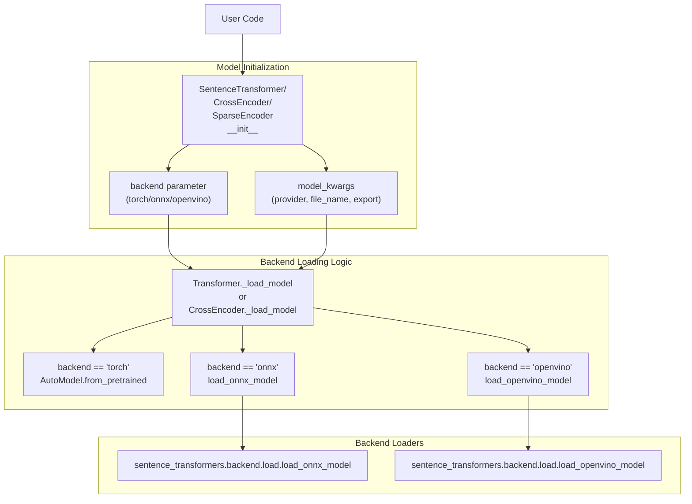
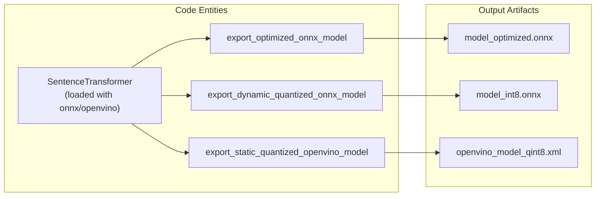

<!-- source: DeepWiki mcp.deepwiki.com · repo huggingface/sentence-transformers · page 8.3 Backend Optimization · fetched 2026-10-26 -->

# Backend Optimization

<details>
<summary>Relevant source files</summary>

The following files were used as context for generating this wiki page:

- [docs/cross_encoder/usage/efficiency.rst](docs/cross_encoder/usage/efficiency.rst)
- [docs/img/benchmark_fa2_unpadding.png](docs/img/benchmark_fa2_unpadding.png)
- [docs/sentence_transformer/usage/efficiency.rst](docs/sentence_transformer/usage/efficiency.rst)
- [docs/sparse_encoder/usage/efficiency.rst](docs/sparse_encoder/usage/efficiency.rst)
- [sentence_transformers/backend/load.py](sentence_transformers/backend/load.py)
- [sentence_transformers/backend/optimize.py](sentence_transformers/backend/optimize.py)
- [sentence_transformers/backend/quantize.py](sentence_transformers/backend/quantize.py)
- [sentence_transformers/backend/utils.py](sentence_transformers/backend/utils.py)
- [tests/cross_encoder/test_backends.py](tests/cross_encoder/test_backends.py)
- [tests/sentence_transformer/test_backends.py](tests/sentence_transformer/test_backends.py)
- [tests/sparse_encoder/test_backends.py](tests/sparse_encoder/test_backends.py)

</details>


## Purpose and Scope

This page covers inference optimization for Sentence Transformers models using alternative backends beyond the default PyTorch implementation. The library supports three backends: **torch** (default), **onnx**, and **openvino**, which provide significant speedups for production inference workloads.

Backend optimization applies to all three model types:
- **SentenceTransformer** (dense embeddings) [[sentence_transformers/SentenceTransformer.py:135-137]]()
- **CrossEncoder** (reranking) [[sentence_transformers/cross_encoder/CrossEncoder.py:113-115]]()
- **SparseEncoder** (sparse embeddings) [[sentence_transformers/sparse_encoder/SparseEncoder.py:101-103]]()

This page focuses on backend selection, hardware-specific acceleration (like Flash Attention), and model export/quantization for optimized inference engines.

## Supported Backends

The library supports three inference backends, each with different performance characteristics:

| Backend | Description | Best For | Installation |
|---------|-------------|----------|--------------|
| `torch` | Default PyTorch implementation | Development, GPU training | Default |
| `onnx` | ONNX Runtime with optimization | CPU/GPU inference, cross-platform | `pip install "sentence-transformers[onnx]"` |
| `openvino` | Intel OpenVINO optimization | Intel Hardware (CPU/iGPU/NPU) | `pip install "sentence-transformers[openvino]"` |

**Sources:** [[docs/sentence_transformer/usage/efficiency.rst:8-34]](), [[sentence_transformers/backend/load.py:49-54]](), [[sentence_transformers/backend/load.py:126-130]]()

## PyTorch Backend Optimizations

The default PyTorch backend supports several techniques to speed up inference on GPUs.

### Precision (fp16 & bf16)
Using reduced precision formats like `float16` or `bfloat16` can significantly speed up GPU inference with minimal accuracy loss. This can be set via `model_kwargs` or by calling conversion methods on the model [[docs/sentence_transformer/usage/efficiency.rst:53-80]]().

```python
model = SentenceTransformer("all-MiniLM-L6-v2", model_kwargs={"torch_dtype": "float16"})
# or
model.half()
```

### Flash Attention and Input Unpadding
Sentence Transformers supports **Flash Attention 2** for efficient attention computation. When enabled, the library automatically performs **input unpadding** (flattening) for text-only inputs, concatenating them into a single sequence to eliminate padding overhead [[docs/sentence_transformer/usage/efficiency.rst:81-103]]().

This behavior is controlled by the `unpad_inputs` attribute on the `Transformer` module [[docs/sentence_transformer/usage/efficiency.rst:108-116]]():
- `model[0].unpad_inputs = True`: Explicitly request unpadding.
- `model[0].unpad_inputs = None`: Auto-detect based on Flash Attention availability (default).

**Sources:** [[docs/sentence_transformer/usage/efficiency.rst:81-132]](), [[sentence_transformers/models/Transformer.py:112-115]]()

## Backend Selection Architecture



**Sources:** [[sentence_transformers/SentenceTransformer.py:186-202]](), [[sentence_transformers/models/Transformer.py:164-215]](), [[sentence_transformers/cross_encoder/CrossEncoder.py:229-258]](), [[sentence_transformers/backend/load.py:14-175]]()

## Loading and Exporting Optimized Models

### ONNX Backend
ONNX can be used by setting `backend="onnx"`. If the model repository does not contain an ONNX file, the library uses `optimum` to export it automatically [[sentence_transformers/backend/load.py:65-75]]().

**Key `model_kwargs` for ONNX:**
- `provider`: Specifies the ONNX Runtime execution provider (e.g., `CUDAExecutionProvider`). Defaults to the highest priority available [[sentence_transformers/backend/load.py:56-58]]().
- `file_name`: Name of the ONNX file to load (useful for quantized models) [[sentence_transformers/backend/utils.py:83-85]]().
- `export`: Boolean to force or skip export [[sentence_transformers/backend/utils.py:78-80]]().

### OpenVINO Backend
OpenVINO is optimized for Intel hardware. It supports an `ov_config` parameter which can be a dictionary or a path to a JSON file [[sentence_transformers/backend/load.py:148-156]]().

**Sources:** [[sentence_transformers/backend/load.py:92-175]](), [[docs/sentence_transformer/usage/efficiency.rst:137-145]]()

## Model Optimization and Quantization

The library provides specialized functions to optimize and quantize models after they have been exported to a backend.



### Optimization Levels (ONNX)
The `export_optimized_onnx_model` function supports levels O1 to O4 [[sentence_transformers/backend/optimize.py:19-38]]():
- **O1**: Basic general optimizations.
- **O2**: Extended optimizations + Transformer fusions.
- **O3**: O2 + GELU approximation.
- **O4**: O3 + Mixed precision (FP16, GPU-only).

### Quantization
1.  **Dynamic Quantization (ONNX)**: `export_dynamic_quantized_onnx_model` applies INT8 quantization without a calibration dataset [[sentence_transformers/backend/quantize.py:24-37]]().
2.  **Static Quantization (OpenVINO)**: `export_static_quantized_openvino_model` uses Post-Training Static Quantization (PTQ) with a calibration dataset [[sentence_transformers/backend/quantize.py:107-124]]().

**Sources:** [[sentence_transformers/backend/optimize.py:19-103]](), [[sentence_transformers/backend/quantize.py:24-104]](), [[sentence_transformers/backend/quantize.py:107-150]]()

## Implementation Details: The Utility Wrapper

The `save_or_push_to_hub_model` utility in `sentence_transformers.backend.utils` handles the logic for saving exported/optimized models locally or pushing them to the Hugging Face Hub. It ensures that backend-specific files are stored in correct subfolders (e.g., `/onnx/` or `/openvino/`) [[sentence_transformers/backend/utils.py:155-175]]().

When a model is exported during load, the library issues a warning via `backend_warn_to_save` recommending the user save the model to avoid re-exporting in the future [[sentence_transformers/backend/utils.py:138-152]]().

**Sources:** [[sentence_transformers/backend/utils.py:1-175]](), [[sentence_transformers/backend/load.py:82-87]]()

## Backend Performance Comparison

| Technique | Backend | Hardware | Speedup |
|-----------|---------|----------|---------|
| Flash Attention 2 | Torch | GPU (NVIDIA) | Significant (up to 2x+) |
| Unpadding | Torch | GPU (NVIDIA) | High (varies with length variance) |
| Dynamic Quantization | ONNX | CPU | Moderate (~2x size reduction) |
| Static Quantization | OpenVINO | Intel CPU | High (4x+ throughput) |

**Sources:** [[docs/sentence_transformer/usage/efficiency.rst:117-126]](), [[sentence_transformers/backend/quantize.py:35-37]](), [[sentence_transformers/backend/quantize.py:122-124]]()

---

