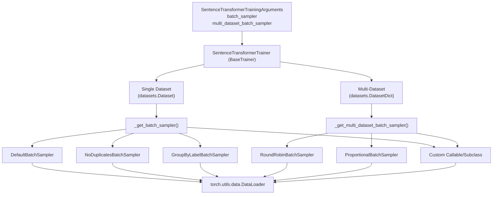

<!-- source: DeepWiki mcp.deepwiki.com · repo huggingface/sentence-transformers · page 8.4 Batch Sampling Strategies · fetched 2026-10-26 -->

# Batch Sampling Strategies

Relevant source files

The following files were used as context for generating this wiki page:

- [sentence_transformers/base/data_collator.py](sentence_transformers/base/data_collator.py)
- [sentence_transformers/base/peft_mixin.py](sentence_transformers/base/peft_mixin.py)
- [sentence_transformers/base/sampler.py](sentence_transformers/base/sampler.py)
- [sentence_transformers/base/trainer.py](sentence_transformers/base/trainer.py)
- [sentence_transformers/util/similarity.py](sentence_transformers/util/similarity.py)
- [tests/base/samplers/test_no_duplicates_batch_sampler.py](tests/base/samplers/test_no_duplicates_batch_sampler.py)
- [tests/sentence_transformer/test_trainer.py](tests/sentence_transformer/test_trainer.py)
- [tests/sparse_encoder/test_trainer.py](tests/sparse_encoder/test_trainer.py)

Batch sampling strategies control how training samples are grouped into batches during model training. Different sampling strategies can significantly impact training efficiency and model performance, particularly when using losses that benefit from specific batch compositions (e.g., losses with in-batch negatives) or when training on multiple datasets simultaneously.

This page covers the configuration and behavior of batch samplers for single-dataset and multi-dataset training.

## System Architecture

The batch sampling system operates during the `DataLoader` creation stage within the `BaseTrainer`. The trainer selects and initializes the appropriate batch sampler based on the `SentenceTransformerTrainingArguments`.

**Batch Sampler Selection Flow**

Sources: [sentence_transformers/base/trainer.py:51-58](), [sentence_transformers/base/trainer.py:724-817](), [sentence_transformers/base/sampler.py:33-106]()

## Single-Dataset Batch Samplers

Single-dataset batch samplers are used when training with a single `datasets.Dataset`. They are configured via the `batch_sampler` argument in `SentenceTransformerTrainingArguments`.

### BatchSamplers.BATCH_SAMPLER (Default)

The default batch sampler uses `DefaultBatchSampler`, which wraps a `RandomSampler` to shuffle samples randomly across epochs.

**Behavior:**
- Randomly shuffles the dataset at each epoch using a `torch.Generator` [sentence_transformers/base/trainer.py:794-796]().
- Groups consecutive samples into batches.
- No special constraints on batch composition.

**When to use:** General-purpose training when batch composition doesn't matter.

Sources: [sentence_transformers/base/sampler.py:40-41](), [sentence_transformers/base/sampler.py:102](), [sentence_transformers/base/trainer.py:794-796]()

### BatchSamplers.NO_DUPLICATES

`NoDuplicatesBatchSampler` ensures that each batch contains no duplicate samples. This is critical for losses using in-batch negatives where duplicates act as "easy" negatives that can degrade performance or cause division-by-zero errors in some loss implementations.

**Behavior:**
- Prevents the same sample from appearing multiple times in a batch [sentence_transformers/base/sampler.py:42-43]().
- **Hashed Variant:** `NO_DUPLICATES_HASHED` precomputes hashes (requires `xxhash`) for faster duplicate checks at a small memory cost [sentence_transformers/base/sampler.py:44-46]().
- Identifies duplicates by comparing all columns except `dataset_name` [sentence_transformers/base/sampler.py:30]().

**When to use:** Losses with in-batch negatives, such as `MultipleNegativesRankingLoss`, `CachedMultipleNegativesRankingLoss`, and `GISTEmbedLoss` [sentence_transformers/base/sampler.py:48-56]().

Sources: [sentence_transformers/base/sampler.py:42-56](), [sentence_transformers/base/sampler.py:103-104](), [tests/base/samplers/test_no_duplicates_batch_sampler.py:65-101]()

### BatchSamplers.GROUP_BY_LABEL

`GroupByLabelBatchSampler` constructs batches by drawing at least 2 samples from each of at least 2 distinct labels. This guarantees every batch contains multiple classes, which is required for in-batch triplet mining.

**Behavior:**
- Identifies label columns (e.g., "label", "score") [sentence_transformers/base/sampler.py:58-59]().
- Ensures the batch composition supports mining hard positives and negatives [sentence_transformers/base/sampler.py:59]().

**When to use:** Triplet mining losses like `BatchHardTripletLoss` or `BatchSemiHardTripletLoss` [sentence_transformers/base/sampler.py:60-65]().

Sources: [sentence_transformers/base/sampler.py:57-65](), [sentence_transformers/base/sampler.py:105]()

## Multi-Dataset Batch Samplers

When training with a `DatasetDict`, the trainer uses a multi-dataset sampler to determine the order of batches sampled from different datasets.

### MultiDatasetBatchSamplers.ROUND_ROBIN

`RoundRobinBatchSampler` cycles through each dataset in the `ConcatDataset` equally.

**Behavior:**
- Samples one batch from Dataset A, then one from Dataset B, etc. [sentence_transformers/base/sampler.py:115-118]().
- Training continues until one dataset is exhausted.
- Prevents large datasets from dominating the gradient updates.

Sources: [sentence_transformers/base/sampler.py:115-118](), [sentence_transformers/base/sampler.py:108-130]()

### MultiDatasetBatchSamplers.PROPORTIONAL (Default)

`ProportionalBatchSampler` samples from each dataset in proportion to its total number of samples.

**Behavior:**
- Larger datasets are sampled more frequently [sentence_transformers/base/sampler.py:119-121]().
- Ensures all samples from all datasets are used during training.
- Probability of a batch coming from dataset $i$ is $\frac{|D_i|}{\sum |D_j|}$.

Sources: [sentence_transformers/base/sampler.py:119-122](), [tests/base/samplers/test_no_duplicates_batch_sampler.py:169-171]()

## Implementation Details

The `BaseTrainer` handles the logic for selecting these samplers in `_get_batch_sampler` and `_get_multi_dataset_batch_sampler`.

**Code Entity Mapping**

| Feature | Code Entity | File |
| :--- | :--- | :--- |
| **Sampler Registry** | `BatchSamplers` (Enum) | [sentence_transformers/base/sampler.py:33]() |
| **Multi-Sampler Registry** | `MultiDatasetBatchSamplers` (Enum) | [sentence_transformers/base/sampler.py:108]() |
| **Base Sampler Logic** | `DefaultBatchSampler` | [sentence_transformers/base/sampler.py:52]() |
| **Sampler Selection** | `BaseTrainer._get_batch_sampler` | [sentence_transformers/base/trainer.py:724]() |
| **Multi-Sampler Selection** | `BaseTrainer._get_multi_dataset_batch_sampler` | [sentence_transformers/base/trainer.py:801]() |

### Data Collator Interaction

The batch sampler provides a list of indices to the `DataLoader`, which fetches the raw rows. These rows are then passed to the `BaseDataCollator`. The collator is responsible for:
1. Resolving prompts per-dataset or per-column [sentence_transformers/base/data_collator.py:47-67]().
2. Resolving `Router` task mappings [sentence_transformers/base/data_collator.py:34-45]().
3. Applying the `preprocess_fn` (usually `model.tokenize`) [sentence_transformers/base/data_collator.py:108]().

Sources: [sentence_transformers/base/data_collator.py:14-112]()

## Decision Matrix for Samplers

| Training Setup | Recommended Sampler | Reasoning |
| :--- | :--- | :--- |
| **MNR Loss** | `NO_DUPLICATES` | Prevents easy negatives/collisions in contrastive learning. |
| **Triplet Loss** | `GROUP_BY_LABEL` | Ensures batches have samples with shared labels for mining. |
| **Multi-Task (Balanced)** | `ROUND_ROBIN` | Prevents high-resource tasks from overwhelming low-resource ones. |
| **Multi-Task (Natural)** | `PROPORTIONAL` | Samples datasets according to their actual distribution. |

Sources: [sentence_transformers/base/sampler.py:33-130]()

---

