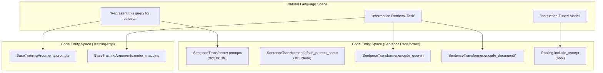
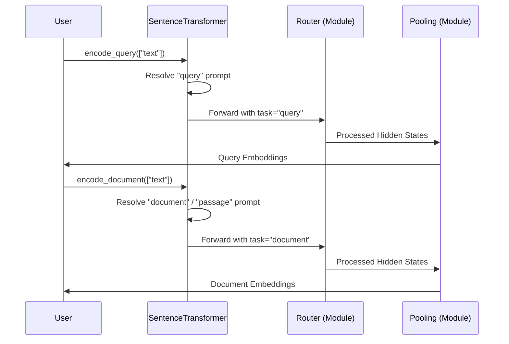

<!-- source: DeepWiki mcp.deepwiki.com · repo huggingface/sentence-transformers · page 8.5 Prompt Engineering · fetched 2026-10-26 -->

# Prompt Engineering

<details>
<summary>Relevant source files</summary>

The following files were used as context for generating this wiki page:

- [docs/cross_encoder/pretrained_models.md](docs/cross_encoder/pretrained_models.md)
- [docs/cross_encoder/usage/custom_models.rst](docs/cross_encoder/usage/custom_models.rst)
- [docs/cross_encoder/usage/usage.rst](docs/cross_encoder/usage/usage.rst)
- [docs/quickstart.rst](docs/quickstart.rst)
- [docs/sentence_transformer/dataset_overview.md](docs/sentence_transformer/dataset_overview.md)
- [docs/sentence_transformer/pretrained_models.md](docs/sentence_transformer/pretrained_models.md)
- [docs/sentence_transformer/usage/usage.rst](docs/sentence_transformer/usage/usage.rst)
- [examples/sentence_transformer/training/multimodal/README.md](examples/sentence_transformer/training/multimodal/README.md)
- [examples/sentence_transformer/training/multimodal/training_visual_document_retrieval.py](examples/sentence_transformer/training/multimodal/training_visual_document_retrieval.py)
- [sentence_transformers/base/training_args.py](sentence_transformers/base/training_args.py)
- [sentence_transformers/cross_encoder/trainer.py](sentence_transformers/cross_encoder/trainer.py)
- [sentence_transformers/sentence_transformer/trainer.py](sentence_transformers/sentence_transformer/trainer.py)
- [sentence_transformers/sparse_encoder/trainer.py](sentence_transformers/sparse_encoder/trainer.py)

</details>


This page describes how to use prompts with Sentence Transformers models to improve embedding quality for specific tasks. Prompts are text prefixes that are prepended to input sentences before encoding, providing task-specific context to instruction-tuned models.

**Scope**: This page covers the prompt system for `SentenceTransformer` and `SparseEncoder` models. For information about training models with prompts, see [Training Overview](#5.1). For Router-based asymmetric encoding, see [Router Module for Asymmetric Models](#8.1).

## Overview

Prompts enable instruction-tuned models to produce task-appropriate embeddings by prepending descriptive text to inputs. The library supports:

- **Named prompts**: Pre-configured prompt templates stored in the model.
- **Direct prompts**: Ad-hoc prompt strings specified at encoding time.
- **Specialized methods**: `encode_query()` and `encode_document()` with automatic prompt selection.
- **Default prompts**: Automatically applied prompts for all encoding operations.

### Natural Language to Code Entity Mapping

The following diagram illustrates how high-level prompt concepts map to specific code entities within the `SentenceTransformer` and `SparseEncoder` classes.



**Sources**: [sentence_transformers/sentence_transformer/model.py:73-78](), [sentence_transformers/base/training_args.py:34-45](), [sentence_transformers/models/Pooling.py:38-40]()

## Basic Prompt Usage

### Direct Prompt Application

Use the `prompt` parameter in `encode()` to prepend text to all inputs:

```python
from sentence_transformers import SentenceTransformer

model = SentenceTransformer("all-mpnet-base-v2")

# With prompt - prepends "query: " to the text
embeddings = model.encode(
    ["What is the capital of France?"],
    prompt="query: "
)
```

The prompt is automatically prepended to each sentence before tokenization. The resulting input becomes `"query: What is the capital of France?"`.

### Named Prompts

Models can store pre-configured prompts in a dictionary. Use `prompt_name` to reference them:

```python
model = SentenceTransformer("all-mpnet-base-v2")

# Configure named prompts
model.prompts = {
    "query": "Represent this query for retrieval: ",
    "document": "Represent this document for retrieval: "
}

# Use named prompt
query_embeddings = model.encode(
    ["What is machine learning?"],
    prompt_name="query"
)
```

**Priority**: If both `prompt` and `prompt_name` are specified, `prompt` takes precedence and `prompt_name` is ignored (with a warning).

**Sources**: [sentence_transformers/sentence_transformer/model.py:698-715](), [sentence_transformers/base/training_args.py:82-89]()

## Model Configuration

### Setting Prompts at Initialization

Configure prompts when loading a model:

```python
model = SentenceTransformer(
    "all-mpnet-base-v2",
    prompts={
        "query": "query: ",
        "document": "document: "
    },
    default_prompt_name="query"
)
```

### Default Prompt Behavior

When `default_prompt_name` is set, the specified prompt is automatically applied to all `encode()` calls unless overridden.

**Warning**: Using default prompts affects all encoding operations, including those in training and evaluation. Set `default_prompt_name=None` (the default) for models without instruction tuning.

**Sources**: [sentence_transformers/sentence_transformer/model.py:167-192](), [sentence_transformers/sentence_transformer/model.py:370-386]()

### Persistence

Prompts and default prompt names are saved in `config_sentence_transformers.json` and automatically loaded.

| Configuration File | Stored Keys |
|-------------------|-------------|
| `config_sentence_transformers.json` | `prompts`, `default_prompt_name` |

## Specialized Encoding Methods

### encode_query() and encode_document()

These convenience methods provide automatic prompt selection for information retrieval tasks.



**encode_query() behavior**:
- Uses the model's `"query"` prompt (if available) and sets `task="query"` [docs/sentence_transformer/usage/usage.rst:110-113]().

**encode_document() behavior**:
- Uses the first available prompt from `"document"`, `"passage"`, or `"corpus"`, and sets `task="document"` [docs/sentence_transformer/usage/usage.rst:110-113]().

| Method | Automatic Prompt | Task Parameter | Use Case |
|--------|-----------------|----------------|----------|
| `encode()` | None | Not set | General-purpose encoding |
| `encode_query()` | `"query"` if available | `"query"` | Encoding search queries |
| `encode_document()` | `"document"`, `"passage"`, or `"corpus"` | `"document"` | Encoding corpus passages |

**Sources**: [sentence_transformers/sentence_transformer/model.py:446-573](), [sentence_transformers/sentence_transformer/model.py:575-681](), [docs/sentence_transformer/usage/usage.rst:110-115]()

## INSTRUCTOR Models

INSTRUCTOR models (e.g., `hkunlp/instructor-large`) are trained with task-specific instructions and require special handling.

### Native Support

Three models have native support with automatic `include_prompt=False` configuration:
- `hkunlp/instructor-base`
- `hkunlp/instructor-large`
- `hkunlp/instructor-xl`

```python
from sentence_transformers import SentenceTransformer

model = SentenceTransformer("hkunlp/instructor-large")

# Prompts are instructions, not part of the pooled content
embeddings = model.encode(
    ["Fermion Bags in the Massive Gross-Neveu Model"],
    prompt="Represent the Science sentence for clustering: "
)
```

**Sources**: [sentence_transformers/sentence_transformer/model.py:388-403](), [docs/sentence_transformer/pretrained_models.md:161-212]()

## Prompt Pooling Behavior

### include_prompt Parameter

The `include_prompt` parameter in `Pooling` controls whether prompt tokens participate in pooling operations.

| Setting | Behavior | Use Case |
|---------|----------|----------|
| `include_prompt=True` (default) | Prompt tokens included in pooling | Standard models where prompts provide context |
| `include_prompt=False` | Prompt tokens excluded from pooling | INSTRUCTOR models where prompts are instructions |

### Implementation

The library tracks prompt length and applies it during pooling. If `include_prompt` is `False`, the `attention_mask` is modified to zero out the prompt tokens before the pooling operation [sentence_transformers/models/Pooling.py:142-152]().

**Sources**: [sentence_transformers/models/Pooling.py:100](), [sentence_transformers/models/Pooling.py:142-152]()

## Sparse Encoder Prompts

`SparseEncoder` extends prompt functionality with additional defaults for document encoding, specifically used in training and inference via `SparseEncoderTrainer`.

```python
from sentence_transformers.sparse_encoder.model import SparseEncoder

model = SparseEncoder("naver/splade-cocondenser-ensembledistil")
model.prompts = {
    "query": "query: ",
    "document": "doc: "
}
```

The `SparseEncoderTrainer` supports `prompts` via its training arguments to ensure that training data is correctly prefixed [sentence_transformers/sparse_encoder/trainer.py:25-25]().

**Sources**: [sentence_transformers/sparse_encoder/model.py:181-293](), [sentence_transformers/sparse_encoder/trainer.py:35-71]()

## Best Practices

### When to Use Prompts

| Scenario | Recommendation |
|----------|---------------|
| General-purpose models (e.g., `all-MiniLM-L6-v2`) | No prompts needed |
| Instruction-tuned models (e.g., INSTRUCTOR, Qwen3-VL) | Always use task-specific prompts |
| Asymmetric tasks (query vs document) | Use `encode_query()` and `encode_document()` |
| Multimodal models | Check `model.modalities` and use prompts if the model is instruction-tuned [docs/sentence_transformer/usage/usage.rst:48-60]() |

### Multimodal Considerations

For multimodal models like `Qwen/Qwen3-VL-Embedding-2B`, prompts can be applied to text queries while encoding image documents. The `encode_query` and `encode_document` methods handle this transition seamlessly [docs/sentence_transformer/usage/usage.rst:110-138]().

**Sources**: [docs/sentence_transformer/usage/usage.rst:110-138](), [examples/sentence_transformer/training/multimodal/README.md:9-12]()

---

