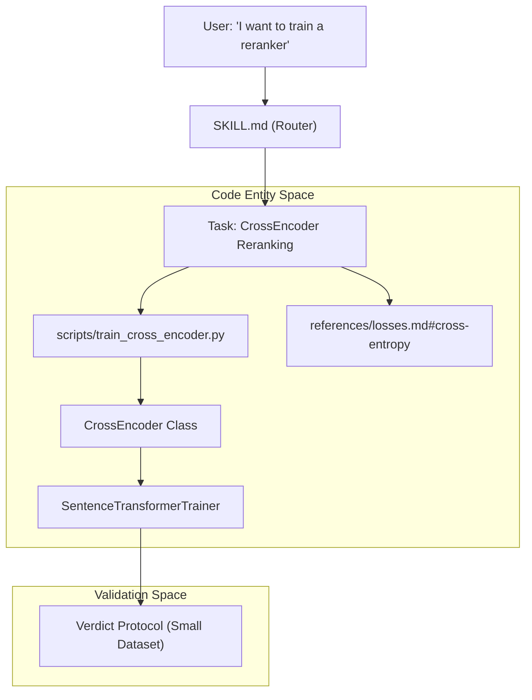
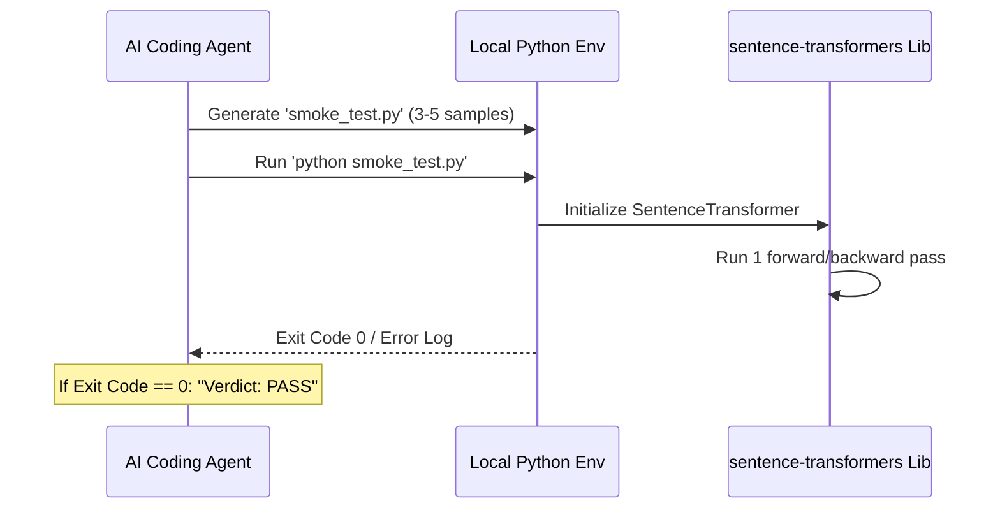

<!-- source: DeepWiki mcp.deepwiki.com · repo huggingface/sentence-transformers · page 8.6 AI Agent Skill (train-sentence-transformers) · fetched 2026-10-26 -->

# AI Agent Skill (train-sentence-transformers)

<details>
<summary>Relevant source files</summary>

The following files were used as context for generating this wiki page:

- [.github/workflows/min-versions.yml](.github/workflows/min-versions.yml)
- [.github/workflows/quality.yml](.github/workflows/quality.yml)
- [.github/workflows/sync-skills.yml](.github/workflows/sync-skills.yml)
- [.github/workflows/tests.yml](.github/workflows/tests.yml)
- [docs/cross_encoder/training_overview.md](docs/cross_encoder/training_overview.md)
- [docs/sentence_transformer/training_overview.md](docs/sentence_transformer/training_overview.md)
- [docs/sparse_encoder/training_overview.md](docs/sparse_encoder/training_overview.md)
- [examples/sentence_transformer/training/matryoshka/README.md](examples/sentence_transformer/training/matryoshka/README.md)
- [sentence_transformers/sentence_transformer/losses/cached_gist_embed.py](sentence_transformers/sentence_transformer/losses/cached_gist_embed.py)
- [sentence_transformers/sentence_transformer/losses/gist_embed.py](sentence_transformers/sentence_transformer/losses/gist_embed.py)
- [sentence_transformers/util/hard_negatives.py](sentence_transformers/util/hard_negatives.py)
- [skills/train-sentence-transformers/references/dataset_formats.md](skills/train-sentence-transformers/references/dataset_formats.md)
- [tests/__init__.py](tests/__init__.py)
- [tests/sentence_transformer/losses/test_cached_gist_embed.py](tests/sentence_transformer/losses/test_cached_gist_embed.py)
- [tests/sentence_transformer/losses/test_gist_embed.py](tests/sentence_transformer/losses/test_gist_embed.py)
- [tests/util/test_hard_negatives.py](tests/util/test_hard_negatives.py)
- [tests/util/test_similarity.py](tests/util/test_similarity.py)

</details>


The `train-sentence-transformers` skill is a specialized toolset designed for AI coding agents (such as Claude Code, Cursor, or Gemini CLI) to automate the fine-tuning and deployment of Sentence Transformer models. It provides a structured interface, reference templates, and a "router" system to guide agents through complex training workflows for Bi-Encoders, Cross-Encoders, and Sparse (SPLADE) Encoders.

## Overview and Purpose

Training high-quality embedding models requires precise coordination between datasets, loss functions, and hardware configurations. The agent skill abstracts these complexities into a standardized "skill" folder that agents can consume to:
1.  **Select the correct architecture** (SentenceTransformer vs. CrossEncoder vs. SparseEncoder) based on the user's task [docs/sentence_transformer/training_overview.md:16-27]().
2.  **Generate production-ready scripts** using pre-defined templates.
3.  **Validate implementations** via a strict smoke-test protocol before the user runs full training.

## Installation and Setup

The skill is managed via the `hf` CLI and is hosted in the `huggingface/skills` marketplace.

```bash
# Add the skill to your local environment
hf skills add train-sentence-transformers [--claude] [--global]
```

### Deployment Workflow
The skill is synchronized from the main `sentence-transformers` repository to the marketplace via GitHub Actions.

- **Sync Trigger**: Automated on new version tags (e.g., `v3.4.0`) [ .github/workflows/sync-skills.yml:18-21]().
- **Sync Mechanism**: Wholesale directory copy of `skills/train-sentence-transformers/` to the `huggingface/skills` repository [ .github/workflows/sync-skills.yml:64-69]().

## Architecture: The SKILL.md Router

The skill operates through a central `SKILL.md` file (the "router"). This file serves as the entry point for the AI agent, mapping Natural Language requirements to specific Code Entity paths.

### Natural Language to Code Mapping

The following diagram illustrates how the Agent Skill bridges user requests to the underlying library components:

**Diagram: Agent Skill Routing Logic**

*Sources: [docs/cross_encoder/training_overview.md:4-14](), [docs/sentence_transformer/training_overview.md:31-60]()*

## Reference Files and Templates

The skill includes a `references/` directory that provides the agent with the "ground truth" for the current version of the library.

| File | Purpose | Key Symbols Referenced |
| :--- | :--- | :--- |
| `dataset_formats.md` | Maps data structures to loss functions. | `InputExample`, `Dataset` |
| `losses.md` | Detailed API for loss selection. | `MultipleNegativesRankingLoss`, `GISTEmbedLoss` |
| `scripts/` | Templates for common training tasks. | `SentenceTransformerTrainer`, `TrainingArguments` |

### Production Script Templates
Agents are instructed to use the templates in `skills/train-sentence-transformers/scripts/`. These templates include:
- **Bi-Encoder Training**: Using `SentenceTransformer` with `MultipleNegativesRankingLoss`.
- **Reranker Training**: Using `CrossEncoder` for sequence classification [docs/cross_encoder/training_overview.md:60-71]().
- **SPLADE Training**: Using `SparseEncoder` with `SpladePooling` [docs/sparse_encoder/training_overview.md:72-84]().

## The Verdict / Smoke-Test Protocol

To ensure reliability, the skill enforces a "Verdict" protocol. Before finalizing a training script, the agent must execute a smoke test.

### Data Flow for Smoke-Testing

**Diagram: Smoke-Test Execution Flow**

*Sources: [.github/workflows/tests.yml:93-95](), [sentence_transformers/sentence_transformer/losses/cached_gist_embed.py:64-86]()*

### Validation Steps
1.  **Small Data**: Use a subset of 5-10 samples to verify the `DataCollator` and `Loss` compatibility.
2.  **Loss Check**: Verify the loss decreases after a single step.
3.  **GIST/Cache Compatibility**: If using `CachedGISTEmbedLoss`, verify that the `guide` model and `model` share compatible tokenizers [sentence_transformers/sentence_transformer/losses/gist_embed.py:107-117]().

## Advanced Agent Capabilities

The skill allows agents to implement advanced training features automatically:
- **Hard Negative Mining**: Agents can call `util.mine_hard_negatives` to improve triplet quality [sentence_transformers/util/hard_negatives.py:25-55]().
- **Gradient Caching**: For large batch sizes, agents are guided to use `CachedMultipleNegativesRankingLoss` [sentence_transformers/sentence_transformer/losses/cached_gist_embed.py:106-115]().
- **Matryoshka Embeddings**: Templates provide configurations for `MatryoshkaLoss` to enable scalable vector dimensions.

---
**Sources:**
- [.github/workflows/sync-skills.yml:1-26]()
- [docs/sentence_transformer/training_overview.md:3-14]()
- [docs/cross_encoder/training_overview.md:3-14]()
- [docs/sparse_encoder/training_overview.md:3-14]()
- [sentence_transformers/util/hard_negatives.py:25-55]()
- [sentence_transformers/sentence_transformer/losses/gist_embed.py:107-117]()

---

