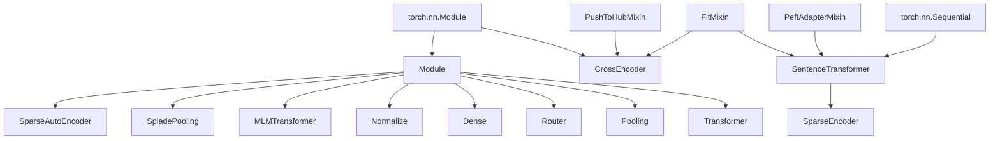
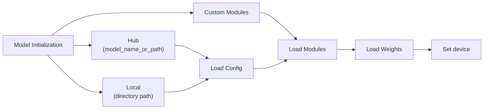
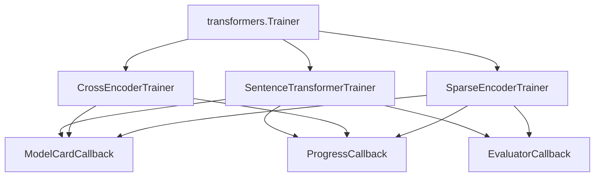
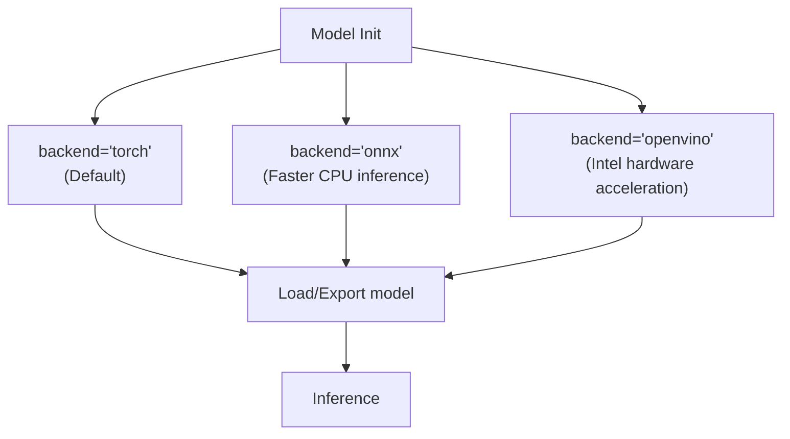
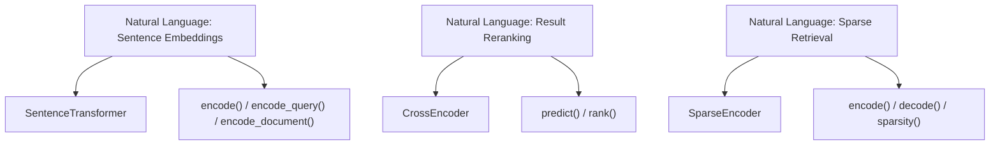
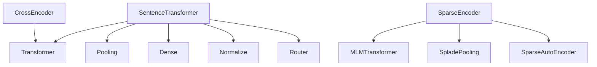

<!-- source: DeepWiki mcp.deepwiki.com · repo huggingface/sentence-transformers · page 9 API Reference · fetched 2026-10-26 -->

# API Reference

Relevant source files

The following files were used as context for generating this wiki page:

- [.gitignore](.gitignore)
- [.pre-commit-config.yaml](.pre-commit-config.yaml)
- [Makefile](Makefile)
- [pyproject.toml](pyproject.toml)
- [sentence_transformers/__init__.py](sentence_transformers/__init__.py)
- [sentence_transformers/base/modules/__init__.py](sentence_transformers/base/modules/__init__.py)
- [sentence_transformers/base/modules/dense.py](sentence_transformers/base/modules/dense.py)
- [sentence_transformers/sentence_transformer/evaluation/__init__.py](sentence_transformers/sentence_transformer/evaluation/__init__.py)
- [sentence_transformers/sentence_transformer/losses/global_orthogonal_regularization.py](sentence_transformers/sentence_transformer/losses/global_orthogonal_regularization.py)
- [sentence_transformers/sentence_transformer/modules/__init__.py](sentence_transformers/sentence_transformer/modules/__init__.py)
- [sentence_transformers/sentence_transformer/readers/__init__.py](sentence_transformers/sentence_transformer/readers/__init__.py)
- [sentence_transformers/util/deprecated_import.py](sentence_transformers/util/deprecated_import.py)
- [tests/util/test_deprecated_import.py](tests/util/test_deprecated_import.py)

This section provides a comprehensive reference for all public classes, methods, and functions in the Sentence Transformers library. It serves as a high-level overview of the complete API grouped by main components, linking to detailed child pages for in-depth documentation.

For practical usage examples, training guides, or architectural explanations, refer to the respective sections: [Getting Started](#2), [Training Models](#5), and [Model Architecture](#3).

---

## Overview of API Components

The API is organized around three core model types, each supported by dedicated training, evaluation, and modular components:

```mermaid
graph TB
    subgraph "Core Models"
        ST["SentenceTransformer<br/>(Dense Embeddings)"]
        CE["CrossEncoder<br/>(Reranking)"]
        SE["SparseEncoder<br/>(Sparse Embeddings)"]
    end
    
    subgraph "Training Infrastructure"
        STTrainer["SentenceTransformerTrainer"]
        CETrainer["CrossEncoderTrainer"]
        SETrainer["SparseEncoderTrainer"]
        
        STArgs["SentenceTransformerTrainingArguments"]
        CEArgs["CrossEncoderTrainingArguments"]
        SEArgs["SparseEncoderTrainingArguments"]
    end
    
    subgraph "Model Components"
        Transformer["Transformer"]
        Pooling["Pooling"]
        Router["Router"]
        Dense["Dense"]
        Normalize["Normalize"]
    end
    
    subgraph "Loss Functions"
        STLosses["20+ SentenceTransformer Losses"]
        CELosses["10+ CrossEncoder Losses"]
        SELosses["10+ SparseEncoder Losses"]
    end
    
    subgraph "Evaluators"
        STEval["Dense Evaluators<br/>IR, Similarity, etc."]
        CEEval["CrossEncoder Evaluators<br/>Reranking, etc."]
        SEEval["Sparse Evaluators<br/>SparseIR, etc."]
    end
    
    ST --> STTrainer
    CE --> CETrainer
    SE --> SETrainer
    
    STTrainer --> STArgs
    CETrainer --> CEArgs
    SETrainer --> SEArgs
    
    ST --> Transformer
    ST --> Pooling
    ST --> Router
    ST --> Dense
    ST --> Normalize
    
    STTrainer --> STLosses
    CETrainer --> CELosses
    SETrainer --> SELosses
    
    STTrainer --> STEval
    CETrainer --> CEEval
    SETrainer --> SEEval
```

This architecture allows flexible model building, training, evaluation, and deployment workflows.  
**Sources:** [sentence_transformers/__init__.py:1-73]()

---

## API Organization by Model Type

There are three primary model types, each with corresponding classes, methods, and training infrastructure:

| Model Type             | Primary Class        | Use Case                                  | Key Methods                                    | Trainer Class                |
|------------------------|---------------------|-------------------------------------------|------------------------------------------------|-----------------------------|
| Dense Embeddings       | `SentenceTransformer` | Semantic search, clustering, similarity  | `encode()`, `encode_query()`, `encode_document()`, `similarity()` | `SentenceTransformerTrainer` |
| Reranking (Cross-encoder) | `CrossEncoder`       | Reranking results, pair classification    | `predict()`, `rank()`                           | `CrossEncoderTrainer`         |
| Sparse Embeddings      | `SparseEncoder`       | Efficient retrieval, interpretable search | `encode()`, `decode()`, `sparsity()`, `intersection()` | `SparseEncoderTrainer`         |

**Sources:** [sentence_transformers/sentence_transformer/model.py:50-150](), [sentence_transformers/cross_encoder/CrossEncoder.py:40-120](), [sentence_transformers/sparse_encoder/SparseEncoder.py:25-130]()

---

## Class Inheritance and Hierarchy

The major classes and their inheritance relationships form the following structure:

This helps understand component reuse and extension across the codebase.  
**Sources:** [sentence_transformers/SentenceTransformer.py:61](), [sentence_transformers/cross_encoder/CrossEncoder.py:48](), [sentence_transformers/sparse_encoder/SparseEncoder.py:27](), [sentence_transformers/base/modules/transformer.py:1-50](), [sentence_transformers/base/modules/pooling.py:1-50]()

---

## Common API Patterns

### Model Initialization and Loading

All three model types share a standard loading procedure from:

- Hugging Face Hub (by model name or path)
- Local directory
- Custom modular components list

This entails loading configuration, modules, weights, and moving the model to the specified device:

This pattern is implemented for:

- `SentenceTransformer.__init__` [sentence_transformers/sentence_transformer/model.py:167-187]()
- `CrossEncoder.__init__` [sentence_transformers/cross_encoder/CrossEncoder.py:119-136]()
- `SparseEncoder.__init__` [sentence_transformers/sparse_encoder/SparseEncoder.py:133-152]()

---

### Encoding Interface

Key encoding methods differ slightly by model type but follow similar semantic roles:

| Method              | Models                                      | Function                               | Key Parameters                           |
|---------------------|---------------------------------------------|--------------------------------------|----------------------------------------|
| `encode()`          | `SentenceTransformer`, `SparseEncoder`     | Encode single or batch of texts       | `sentences`, `batch_size`, `show_progress_bar`, `convert_to_tensor` |
| `encode_query()`    | `SentenceTransformer`, `SparseEncoder`     | Encode queries with optional prompt  | `prompt_name="query"`, `task="query"`  |
| `encode_document()` | `SentenceTransformer`, `SparseEncoder`     | Encode documents with prompt          | `prompt_name="document"`, `task="document"` |
| `predict()`         | `CrossEncoder`                              | Predict scores for sentence pairs    | `sentences`, `activation_function`, `apply_softmax` |
| `rank()`            | `CrossEncoder`                              | Rank documents according to query    | `query`, `documents`, `top_k`, `return_documents` |

These methods provide the main interface for embedding generation and reranking use cases.  
**Sources:** [sentence_transformers/sentence_transformer/model.py:683-1132](), [sentence_transformers/sparse_encoder/SparseEncoder.py:412-498](), [sentence_transformers/cross_encoder/CrossEncoder.py:392-486]()

---

### Training API

Training classes extend `transformers.Trainer` to add model-specific features, callbacks, and evaluation:

Typical training workflow:
1. Initialize model object
2. Prepare training dataset
3. Select appropriate loss function
4. Configure training arguments
5. Instantiate trainer
6. Call `train()` method

This design supports flexible training on single or multi-dataset scenarios with custom batch samplers and evaluation hooks.  
**Sources:** [sentence_transformers/sentence_transformer/trainer.py](), [sentence_transformers/cross_encoder/CrossEncoderTrainer.py](), [sentence_transformers/sparse_encoder/SparseEncoderTrainer.py]()

---

## Configuration and Metadata Classes

### Training Arguments

Each model has dedicated training argument classes which extend from `transformers.TrainingArguments`:

| Class                                  | Base Class                  | Key Extensions                         |
|--------------------------------------|-----------------------------|--------------------------------------|
| `SentenceTransformerTrainingArguments` | `TrainingArguments`        | Batch samplers, prompts, multi-dataset support |
| `CrossEncoderTrainingArguments`       | `TrainingArguments`        | Standard transformer training args    |
| `SparseEncoderTrainingArguments`      | `SentenceTransformerTrainingArguments` | Inherits dense training arguments     |

They encapsulate commonly used flags and hyperparameters for model training.  
**Sources:** [sentence_transformers/sentence_transformer/training_args.py](), [sentence_transformers/cross_encoder/CrossEncoderTrainingArguments.py](), [sentence_transformers/sparse_encoder/SparseEncoderTrainingArguments.py]()

---

### Model Card Data Classes

Model metadata for automatic card generation is tracked via dedicated classes per model type:

| Class                          | Purpose                        | Key Attributes                          |
|--------------------------------|--------------------------------|---------------------------------------|
| `SentenceTransformerModelCardData` | Dense model metadata           | Languages, license, datasets, performance metrics |
| `CrossEncoderModelCardData`     | Reranker model metadata        | Includes classification and ranking details |
| `SparseEncoderModelCardData`    | Sparse model metadata           | Sparsity stats and retriever information |

These classes help generate rich model documentation for sharing and reproducibility.  
**Sources:** [sentence_transformers/sentence_transformer/model_card.py](), [sentence_transformers/cross_encoder/model_card.py](), [sentence_transformers/sparse_encoder/model_card.py]()

---

## Backend and Export Support

Models support multiple inference backends to optimize runtime performance and hardware utilization:

Utility functions are provided for exporting models to ONNX and OpenVINO formats with optional quantization.  
Common export functions include:

- `export_optimized_onnx_model()`
- `export_dynamic_quantized_onnx_model()`
- `export_static_quantized_openvino_model()`

**Sources:** [sentence_transformers/__init__.py:10-14](), [sentence_transformers/SentenceTransformer.py:400-420](), [sentence_transformers/cross_encoder/CrossEncoder.py:255-270]()

---

## Main API Sections and Child Pages

The API reference is structured into the following detailed subsections, each documented in their own pages:

### [Core Model Classes](#9.1)

Covers the foundational model classes providing embedding and reranking functionalities:

- `SentenceTransformer` (dense embeddings)
- `CrossEncoder` (reranking and pair scoring)
- `SparseEncoder` (sparse embeddings)

Includes methods for model initialization, encoding, predicting, similarity computations, saving and loading.

### [Training Components](#9.2)

Documents training infrastructure including:

- Trainers: `SentenceTransformerTrainer`, `CrossEncoderTrainer`, `SparseEncoderTrainer`
- Training configuration arguments
- Extensive library of loss functions tailored for different models
- Data collators for preprocessing batches
- Batch sampling strategies supporting multi-dataset and duplicate prevention

### [Evaluation Components](#9.3)

Describes evaluation classes and utilities for model benchmarking and validation:

- Base evaluator `SentenceEvaluator`
- Dense model evaluators: similarity, information retrieval, classification, and BEIR-style benchmarks (NanoBEIR)
- Sparse model evaluators focusing on sparsity and efficiency metrics
- CrossEncoder evaluators for reranking and classification scenarios
- Evaluation combiners such as `SequentialEvaluator`

### [Model Modules](#9.4)

API reference for modular building blocks of models, enabling flexible architecture design:

- Core modules: `Transformer`, `Pooling`, `Dense`, `Normalize`
- Router modules supporting asymmetric encoding architectures
- Sparse-specific modules: `MLMTransformer`, `SpladePooling`, `SparseAutoEncoder`
- Additional modules including CNNs, LSTMs, LayerNorm, WeightedLayerPooling, and CLIP integration

### [Utility Functions](#9.5)

Covers miscellaneous utility functions used across the codebase:

- Similarity functions: `SimilarityFunction`, `cos_sim`, `dot_score`, `euclidean_sim`, `manhattan_sim`
- Quantization helpers: `quantize_embeddings()`
- Hard negative mining utilities: `mine_hard_negatives()`
- Backend export tools for ONNX and OpenVINO
- Helper functions such as `batch_to_device()`, `truncate_embeddings()`, and `fullname()`

---

## Bridging Natural Language Concepts to Code Entities

This diagram maps common natural language system concepts to their corresponding API classes and methods, helping new users quickly locate relevant code:

---

Another diagram linking core modules to top-level models:

---

# Summary

This high-level API reference outlines the main classes, methods, and patterns across Sentence Transformers. For detailed class and method-level API documentation, please consult the linked child pages:

| Link                                  | Description                              |
|-------------------------------------|-----------------------------------------|
| [Core Model Classes](#9.1)       | SentenceTransformer, CrossEncoder, SparseEncoder API |
| [Training Components](#9.2)      | Trainers, TrainingArguments, Losses, DataCollators, Samplers |
| [Evaluation Components](#9.3)    | Evaluators and evaluation utilities    |
| [Model Modules](#9.4)             | Building blocks: Transformer, Pooling, Dense, etc. |
| [Utility Functions](#9.5)         | Similarity, quantization, mining, backend exports |

This modular structure supports extensibility and deep customization of embedding, reranking, and sparse retrieval tasks.

---

**Sources:**  
- [sentence_transformers/__init__.py:1-73]()  
- [sentence_transformers/sentence_transformer/model.py:40-150, 160-380, 680-1140]()  
- [sentence_transformers/cross_encoder/CrossEncoder.py:30-135, 250-270, 390-490]()  
- [sentence_transformers/sparse_encoder/SparseEncoder.py:25-130, 130-180, 410-500]()  
- [sentence_transformers/sentence_transformer/trainer.py]()  
- [sentence_transformers/cross_encoder/CrossEncoderTrainer.py]()  
- [sentence_transformers/sparse_encoder/SparseEncoderTrainer.py]()  
- [sentence_transformers/sentence_transformer/training_args.py]()  
- [sentence_transformers/cross_encoder/CrossEncoderTrainingArguments.py]()  
- [sentence_transformers/sparse_encoder/SparseEncoderTrainingArguments.py]()  
- [sentence_transformers/sentence_transformer/model_card.py]()  
- [sentence_transformers/cross_encoder/model_card.py]()  
- [sentence_transformers/sparse_encoder/model_card.py]()  
- [sentence_transformers/base/modules/dense.py]()  
- [sentence_transformers/base/modules/__init__.py]()  
- [sentence_transformers/sentence_transformer/modules/__init__.py]()  
- [sentence_transformers/util/__init__.py]()

---

