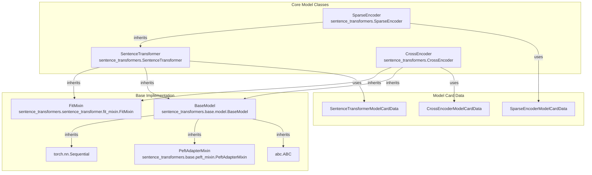
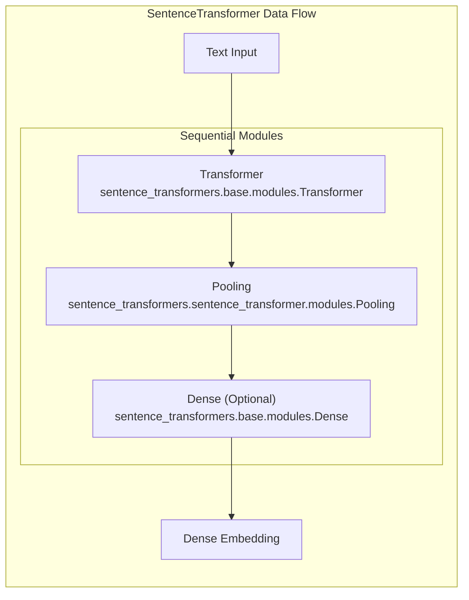
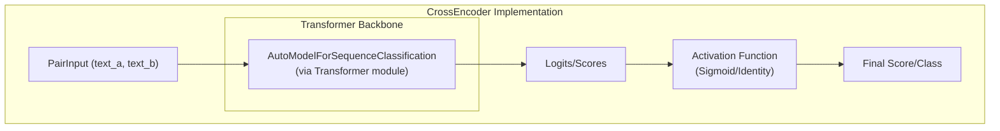

<!-- source: DeepWiki mcp.deepwiki.com · repo huggingface/sentence-transformers · page 9.1 Core Model Classes · fetched 2026-10-26 -->

# Core Model Classes

Relevant source files

The following files were used as context for generating this wiki page:

- [.gitignore](.gitignore)
- [.pre-commit-config.yaml](.pre-commit-config.yaml)
- [Makefile](Makefile)
- [pyproject.toml](pyproject.toml)
- [sentence_transformers/__init__.py](sentence_transformers/__init__.py)
- [sentence_transformers/base/model.py](sentence_transformers/base/model.py)
- [sentence_transformers/base/modules/transformer.py](sentence_transformers/base/modules/transformer.py)
- [sentence_transformers/cross_encoder/model.py](sentence_transformers/cross_encoder/model.py)
- [sentence_transformers/sentence_transformer/model.py](sentence_transformers/sentence_transformer/model.py)
- [sentence_transformers/sparse_encoder/model.py](sentence_transformers/sparse_encoder/model.py)
- [tests/base/test_model.py](tests/base/test_model.py)

This page provides API reference documentation for the three core model classes in the sentence-transformers library: `SentenceTransformer`, `CrossEncoder`, and `SparseEncoder`. These classes represent different architectural approaches to embedding and scoring text.

For information about training these models, see [Training Overview](#5.1). For details about the internal module components, see [Model Modules](#9.4).

## Overview and Relationships

The sentence-transformers library provides three distinct model architectures, each optimized for different use cases. All three inherit from a common `BaseModel` which provides shared functionality for loading, saving, and device management.

### System Hierarchy and Code Entities

The following diagram bridges the conceptual model types to their implementation classes and base inheritance structure.

**Sources:** [sentence_transformers/base/model.py:50-80](), [sentence_transformers/sentence_transformer/model.py:41-41](), [sentence_transformers/cross_encoder/model.py:35-35](), [sentence_transformers/sparse_encoder/model.py:35-35]()

### Comparison of Core Model Classes

| Feature | SentenceTransformer | CrossEncoder | SparseEncoder |
|---------|-------------------|--------------|---------------|
| **Primary Use Case** | Dense embeddings for semantic similarity | Pairwise scoring and reranking | Sparse embeddings for efficient retrieval |
| **Base Class** | `BaseModel`, `FitMixin` | `BaseModel`, `FitMixin` | `SentenceTransformer` |
| **Architecture** | Modular pipeline (Transformer→Pooling→...) | Sequence classification / Regression | Extends ST with sparse pooling/heads |
| **Input** | Single text or list of texts | Text pairs `(text1, text2)` | Single text or list of texts |
| **Output** | Dense vectors (e.g., 768 dimensions) | Similarity scores or class probabilities | Sparse vectors (vocabulary-sized) |
| **Encoding Method** | `encode()`, `encode_query()`, `encode_document()` | `predict()`, `rank()` | `encode()`, `encode_query()`, `encode_document()` |
| **Similarity Computation** | Cosine/dot product between embeddings | Joint encoding (internal attention) | Dot product between sparse embeddings |
| **File Location** | `sentence_transformers/sentence_transformer/model.py` | `sentence_transformers/cross_encoder/model.py` | `sentence_transformers/sparse_encoder/model.py` |

**Sources:** [sentence_transformers/__init__.py:1-76](), [sentence_transformers/base/model.py:50-65]()

## SentenceTransformer

The `SentenceTransformer` class maps sentences and paragraphs to fixed-sized dense vector embeddings. It is implemented as a sequential pipeline of modules.

### Initialization and Data Flow

The `SentenceTransformer` initializes by loading modules defined in a `modules.json` file or by creating a default Transformer + Pooling architecture.

**Sources:** [sentence_transformers/sentence_transformer/model.py:41-115](), [sentence_transformers/base/model.py:81-140]()

#### Key Parameters

| Parameter | Type | Description |
|-----------|------|-------------|
| `model_name_or_path` | `str` | Path to local model or Hugging Face Hub model name |
| `modules` | `list[nn.Module]` | Custom modules to create a model from scratch |
| `device` | `str` | Device for computation (`"cuda"`, `"cpu"`, `"mps"`, `"npu"`) |
| `prompts` | `dict[str, str]` | Dictionary of prompts (e.g., `{"query": "query: "}`) |
| `backend` | `str` | Inference backend: `"torch"`, `"onnx"`, or `"openvino"` |

**Sources:** [sentence_transformers/sentence_transformer/model.py:45-115](), [sentence_transformers/base/model.py:98-140]()

### Key Encoding Methods

The class provides several methods for generating embeddings, supporting both symmetric and asymmetric (query/document) tasks.

#### encode()
The primary method for generating dense embeddings. It handles batching, tokenization, and optional quantization.

**Signature:** [sentence_transformers/sentence_transformer/model.py:683-1028]()
- `precision`: Supports `"float32"`, `"int8"`, `"uint8"`, `"binary"`, `"ubinary"`.
- `normalize_embeddings`: If `True`, L2-normalizes the output vectors.

#### encode_query() and encode_document()
Specialized methods for asymmetric retrieval. These methods automatically apply the `"query"` or `"document"` prompt if available and set the `task` for `Router` modules.

**Sources:** [sentence_transformers/sentence_transformer/model.py:446-681]()

## CrossEncoder

The `CrossEncoder` class performs pairwise scoring by jointly encoding text pairs through a sequence classification model.

### Architecture

Unlike the bi-encoder approach of `SentenceTransformer`, the `CrossEncoder` processes both sentences simultaneously, allowing for full self-attention between the pair.

**Sources:** [sentence_transformers/cross_encoder/model.py:35-118](), [sentence_transformers/base/modules/transformer.py:147-152]()

### Key Methods

#### predict()
Computes scores for a list of sentence pairs.
- **Input:** `list[tuple[str, str]]`
- **Output:** `np.ndarray` of scores or class probabilities.

**Sources:** [sentence_transformers/cross_encoder/model.py:392-486]()

#### rank()
Ranks a list of documents relative to a query.
- **Input:** `query: str`, `documents: list[str]`
- **Returns:** Sorted list of dictionaries containing `corpus_id` and `score`.

**Sources:** [sentence_transformers/cross_encoder/model.py:488-554]()

## SparseEncoder

The `SparseEncoder` class is designed for generating sparse embeddings (e.g., SPLADE). It inherits from `SentenceTransformer` but modifies the output to produce sparse tensors.

### Architecture Components

`SparseEncoder` typically uses a `MLMTransformer` (Masked LM) backbone combined with specialized pooling.

| Module | Code Entity | Role |
|--------|-------------|------|
| **Backbone** | `MLMTransformer` | Transformer with a language modeling head |
| **Pooling** | `SpladePooling` | Log-sum-exp pooling to identify important tokens |
| **Projection** | `SparseAutoEncoder` | Optional k-sparse projection for CSR output |

**Sources:** [sentence_transformers/sparse_encoder/model.py:21-33](), [sentence_transformers/sparse_encoder/modules/__init__.py]()

### Sparse Encoding Behavior

The `encode()` method in `SparseEncoder` is optimized to return sparse representations.

- `convert_to_sparse_tensor`: If `True`, returns a PyTorch sparse CSR or COO tensor.
- `max_active_dims`: Limits the number of non-zero dimensions (sparsity control).

**Sources:** [sentence_transformers/sparse_encoder/model.py:412-600]()

## Common Base Functionality

All core models inherit from `BaseModel` (defined in `sentence_transformers/base/model.py`), which provides:

1.  **Module Management**: Models are `nn.Sequential` containers. You can access individual steps via indexing (e.g., `model[0]` is usually the `Transformer`).
2.  **Saving/Loading**: Unified `save_pretrained()` and `from_pretrained()` (via `__init__`) logic that handles both local paths and the Hugging Face Hub.
3.  **Prompt System**: Integrated support for prepending instruction prompts to inputs based on task names.
4.  **Backend Switching**: Logic to export and load models using ONNX or OpenVINO for optimized inference.

**Sources:** [sentence_transformers/base/model.py:50-140](), [sentence_transformers/base/model.py:382-440]()

---

